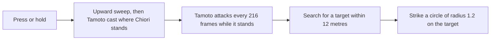

# Chiori

Chiori's kit is its record and one behaviour module, `createChioriKitBehaviour`, on avatar 10000094 (`{data-root}/genshin-dump-backup-6.6/ExcelBinOutput/AvatarExcelConfigData.json`, named Chiori in `{data-root}/genshin-dump-backup-6.6/TextMap/TextMap_MediumEN.json`): four strikes with the third of two hits, a charged attack of two thrusts, a collision and two plunges, Fluttering Hasode's upward sweep with its Tamoto doll and its hold, and Hiyoku: Twin Blades (`{data-root}/cache/genshin-wiki/Category_Chiori_Talents.json`). Her multipliers are read from proud skill groups 9431, 9432 and 9439 (the game's `ProudSkillExcelConfigData`, `{data-root}/genshin-dump-backup-6.6/ExcelBinOutput/ProudSkillExcelConfigData.json`), and at level 1 they match gcsim's tables in `{data-root}/cache/gcsim-v2.47.2/internal/characters/chiori/zz_chiori.dm.go` (the strikes at lines 43-165, the Tamoto and sweep values at 222-276 and the burst at 294 and 312) to the game's decimals; the higher levels were not compared on this page. Her damage that scales with Defense is each hit's additive base damage, read from its striker as it is priced, as Zhongli's Max HP share is (`packages/genshin-world/src/services/kit/characters/chioriKit.ts`).

## How it works

## Decisions

- **Tamoto is a summon cast where Chiori stands.** For the press, its five attacks land at 60, 276, 492, 708 and 924 frames: the cast at 19 frames (`{data-root}/cache/gcsim-v2.47.2/internal/characters/chiori/skill.go` line 16), plus its first attack's 36 frames of start delay and 5 of attack delay, then every 216 frames while it stands (`{data-root}/cache/gcsim-v2.47.2/internal/characters/chiori/skill.go` lines 24-26: the doll's start delay of 0.6 seconds, its attack interval of 3.6 seconds, its attack delay of 5). Each strikes a circle of radius 1.2 on the target it finds within 12 metres (`{data-root}/cache/gcsim-v2.47.2/internal/characters/chiori/skill.go` lines 29 and 214-220, `{data-root}/cache/gcsim-v2.47.2/internal/characters/chiori/chiori.go` line 51 for the 12), priced as the search's radius plus the circle's, so the reach is 13.2 metres from the body. gcsim places the doll 1.2 metres to Chiori's side (`{data-root}/cache/gcsim-v2.47.2/internal/characters/chiori/skill.go` lines 27-28), which is not built, so its reach is priced from her body.
- **The press and the hold differ by their sweep and their doll's cast.** The press's upward sweep lands at 21 frames and casts Tamoto at 19, lasting until 1039 frames; the hold's sweep lands at 37 frames and casts Tamoto at 34, lasting until 1054 frames (`{data-root}/cache/gcsim-v2.47.2/internal/characters/chiori/skill.go` line 15, the hitmarks 21 and 37, and line 16, the cooldown starts 19 and 34, "same as doll spawn"). The sweep is a box from her body 3.5 metres ahead and 5.5 wide, priced as the circle to its far corner, as the [kits README](../README.md)'s boxes-are-circles rule gives (`{data-root}/cache/gcsim-v2.47.2/internal/characters/chiori/skill.go` line 132, a 5.5 by 3.5 box on Chiori, whose rectangle rises from its spawn edge by its height, `{data-root}/cache/gcsim-v2.47.2/pkg/core/info/rectangle.go` lines 18 and 31-37).
- **Upward Sweep and Tamoto price their Defense share as additive base damage.** The sweep is its ATK share plus 1.866 of her Defense, and Tamoto 0.8208 of ATK plus 1.026 of Defense per attack, each added as flat damage to the base damage (`{data-root}/genshin-dump-backup-6.6/ExcelBinOutput/ProudSkillExcelConfigData.json`: group 9432 at level 1 holds 0.8208 and 1.026 at parameters 0 and 1, and 1.866 at 5, matching gcsim's `{data-root}/cache/gcsim-v2.47.2/internal/characters/chiori/zz_chiori.dm.go` lines 222, 240 and 276).
- **The press's cooldown is the table's 16 seconds, and the burst's is 13.5 seconds on 50 energy.** The press's 16 seconds are group 9432's parameter 6 (`{data-root}/genshin-dump-backup-6.6/ExcelBinOutput/ProudSkillExcelConfigData.json`) and gcsim's `{data-root}/cache/gcsim-v2.47.2/internal/characters/chiori/skill.go` line 33 (16 seconds), and the burst's 13.5 seconds and 50 energy are group 9439's parameters 2 and 3 (the same file, `{data-root}/cache/gcsim-v2.47.2/internal/characters/chiori/burst.go` line 63 gives the 13.5). Her burst strikes at 92 frames (`{data-root}/cache/gcsim-v2.47.2/internal/characters/chiori/burst.go` line 15) as a circle of radius 12 round her (`{data-root}/cache/gcsim-v2.47.2/internal/characters/chiori/burst.go` line 57), 200 poise (`{data-root}/cache/gcsim-v2.47.2/internal/characters/chiori/burst.go` line 37), its ATK share and 3.204 of Defense (group 9439's parameter 1, `{data-root}/cache/gcsim-v2.47.2/internal/characters/chiori/zz_chiori.dm.go` line 312).
- **Tamoto stands for the table's 17 seconds, where gcsim gives 17.5.** The game's proud skill table reads Tamoto Duration as 17 in group 9432's parameter 2 (`{data-root}/genshin-dump-backup-6.6/ExcelBinOutput/ProudSkillExcelConfigData.json`, level 1), and gcsim's `{data-root}/cache/gcsim-v2.47.2/internal/characters/chiori/skill.go` line 22 gives 17.5 seconds, so the table settles it. The record holds the duration as `parameters.tamotoSeconds`, read from the table, rather than as a frame key: a frame holds a plain number, and a table value is a reference read in seconds. The kit adds each cast's spawn to it, so the ends land at 1039 and 1054 frames.
- **Chiori's high plunge lands with the low plunge's 41 frames at 150 poise.** gcsim has no high plunge of its own (`{data-root}/cache/gcsim-v2.47.2/internal/characters/chiori/plunge.go` holds the low plunge alone, its hitmark 41 at line 17), so the record takes the wiki's 150 poise (`{data-root}/cache/genshin-wiki/Category_Chiori_Talents.json`, `poise10`); the frames stay provisional until a recording shows them.
- **Her strikes, charged attack and plunging collision deal the wiki's poise.** gcsim gives them none, so the record takes the wiki's poise from Weaving Blade's advanced properties (`{data-root}/cache/genshin-wiki/Category_Chiori_Talents.json`): 51.7 for the first strike, 49 for the second, 31.3 for each of the third strike's two hits, 78.6 for the fourth, 60 for each charged thrust, and 25 for the collision. gcsim's Chiori package sets none of them (no poise on the strikes or the charge).

## Not built

- **Her ascension passives are not built.** They add to her Tamoto and to her sweep and burst, and the kit framework has no hook for them yet, so they are left out rather than approximated.
- **Her constellations are not built.** Their effects, including the Kinu her burst calls and the constructs her Geo passives depend on, have no hook in the kit framework yet, so none is approximated.
- **Hold's threshold is provisional.** The half second a press must be held is the framework's default, as no source gives Chiori's, and it is on the roadmap's Manual verification list.

## Key files

| File                                                                            | Role                                                                                                                                      |
| :------------------------------------------------------------------------------ | :---------------------------------------------------------------------------------------------------------------------------------------- |
| `packages/genshin-world/src/services/kit/characters/chioriKit.ts`               | `createChioriKitBehaviour`, Chiori's kit with her strikes, charged attack, plunges, Fluttering Hasode with Tamoto and Hiyoku: Twin Blades |
| `scripts/src/services/genshinAssets/kits/tables/CharacterIdSlotHitLabelsMap.ts` | Chiori's Tamoto Duration label, read in seconds as `parameters.tamotoSeconds`                                                             |

## Sources

- The install's proud skill table, `ProudSkillExcelConfigData` (`{data-root}/genshin-parity/text/ExcelBinOutput`), group 9432: Tamoto's duration, 17 seconds, read from the game's own data, and groups 9431 and 9439 for the other values checked above.
- The line numbers above are gcsim v2.47.2's files in `{data-root}/cache/gcsim-v2.47.2/internal/characters/chiori` (`{data-root}/cache/gcsim-v2.47.2/pkg/core/info/rectangle.go` in the same tree).
- [gcsim](https://github.com/genshinsim/gcsim/tree/v2.47.2/internal/characters/chiori), MIT: the kit's hitmarks, animations, reach, Tamoto's ticker and its 12 metre search, the upward sweep's box, the burst's circle, and the proud group indices behind each multiplier.
- [Weaving Blade](https://genshin-impact.fandom.com/wiki/Weaving_Blade), Genshin Impact Wiki: the poise for her strikes, charged attack, plunging collision and high plunge.
