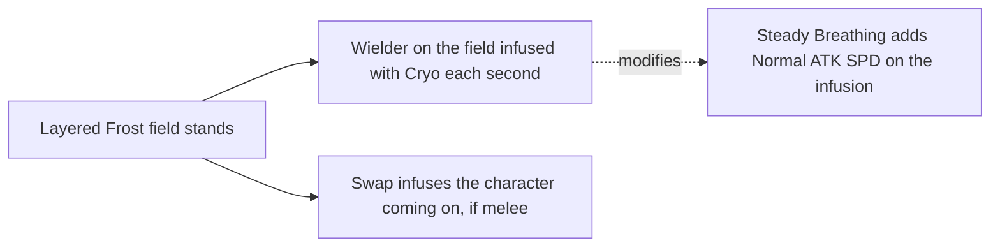

# Chongyun

Chongyun's kit is its record and one behaviour module, `createChongyunKitBehaviour`, avatar 10000036: four strikes, a charged attack of two slashes with its stamina a second, a collision and two plunges, Spirit Blade: Chonghua's Layered Frost with its field, and Spirit Blade: Cloud-Parting Star's three blades. His multipliers are read from proud skill groups 3631, 3632 and 3639 (the game's `ProudSkillExcelConfigData`, `{data-root}/genshin-parity/text/ExcelBinOutput/ProudSkillExcelConfigData.json`, rows 3632 and 3639 at level 1), and at level 1 they match the wiki's Chongyun talent values to two decimal places (the skill's 172.04% and the burst's 142.4% in `{data-root}/cache/genshin-wiki/Category_Chongyun_Talents.json`, against groups 3632 and 3639 at 1.7204 and 1.424) and gcsim's tables in `{data-root}/cache/gcsim-v2.47.2/internal/characters/chongyun/zz_chongyun.dm.go` (lines 38, 89, 162 and 198); the higher levels were not compared on this page. The skill's cooldown is 15 seconds and the burst's 12 seconds with 40 energy, as the wiki gives them (`energycost=40`, `cd=12s`, `cd=15s`, in `{data-root}/cache/genshin-wiki/Category_Chongyun_Talents.json`) and gcsim sets the burst's cooldown at `{data-root}/cache/gcsim-v2.47.2/internal/characters/chongyun/burst.go` line 64 (720 frames). The field is a circle of radius 8 centred 1.5 metres ahead of him (`{data-root}/cache/gcsim-v2.47.2/internal/characters/chongyun/skill.go` line 60), which infuses a sword, claymore or polearm wielder on the field with Cryo each second while it stands in the field (`{data-root}/cache/gcsim-v2.47.2/internal/characters/chongyun/skill.go` lines 77 to 87), and whoever a swap brings on while it stands, as the kits README's Shared effects give an infusion; a press ends the field standing. Steady Breathing's Normal ATK SPD from Ascension 1 rides the infusion (its 1st Ascension Passive, `{data-root}/cache/genshin-wiki/Category_Chongyun_Talents.json`), Rimechaser Blade strikes as the field ends from Ascension 4 (its 4th Ascension Passive, in the same file), and Ice Unleashed's blades (`{data-root}/cache/gcsim-v2.47.2/internal/characters/chongyun/attack.go` line 68), Atmospheric Revolution's cooldown cut (`{data-root}/cache/gcsim-v2.47.2/internal/characters/chongyun/skill.go` line 131), Frozen Skies' energy and Rally of Four Blades' fourth blade and DMG Bonus (`{data-root}/cache/gcsim-v2.47.2/internal/characters/chongyun/burst.go` line 54) come from one, two, four and six constellations. The charged attack is provisional, and the particles are not built.

## How it works

## Decisions

- **Layered Frost infuses only a sword, claymore or polearm wielder**, as gcsim and the wiki give it (`{data-root}/cache/gcsim-v2.47.2/internal/characters/chongyun/skill.go` lines 146-152, the weapon class switch on Claymore, Spear and Sword, and `{data-root}/cache/genshin-wiki/Category_Chongyun_Talents.json`, the Layered Frost text "Sword, Claymore and Polearm-wielding characters' weapons will be infused with Cryo") and Fantastic Voyage's infusion does (`{data-root}/genshin-parity/text/TextMap/TextMap_MediumEN.json`, key `596614575`, which infuses Sword, Claymore and Polearm-wielding characters inside its radius), and Steady Breathing's 8% Normal ATK SPD rides the infusion for its seconds, as gcsim adds them together (`{data-root}/cache/gcsim-v2.47.2/internal/characters/chongyun/skill.go` lines 161-164, and the wiki's Steady Breathing text, "increased by 8%"). A swap infuses the character coming on wherever it stands, as gcsim's swap hook does (`{data-root}/cache/gcsim-v2.47.2/internal/characters/chongyun/skill.go` lines 114-124).
- **A press ends the frost field standing** (`{data-root}/cache/gcsim-v2.47.2/internal/characters/chongyun/skill.go` lines 55 and 56, which end the field on a press while it stands), so its Rimechaser Blade strikes then. The blade lands 655 frames after the press, gcsim's (`{data-root}/cache/gcsim-v2.47.2/internal/characters/chongyun/skill.go` line 91, which queues the blade at 655 frames), at the enemy the targeting scores highest within the field round its centre, or at the centre (`{data-root}/cache/gcsim-v2.47.2/internal/characters/chongyun/asc.go` lines 40-50, radius 3.5 either way), priced by Chongyun as he stands at the field's end where gcsim holds him as he pressed.
- **Atmospheric Revolution is the field's cooldown multiplier**, read where the skill or burst is cast, as the English text map reads (`{data-root}/genshin-parity/text/TextMap/TextMap_MediumEN.json`, key `1537894911`: "Elemental Skills and Elemental Bursts cast within the Frost Field created by Spirit Blade: Chonghua's Layered Frost have their CD time decreased by 15%."). gcsim instead cuts the skill, burst and special-skill cooldowns by 15% for the wielder while infused, the modifier lasting the infusion and gated only by constellation 2 (`{data-root}/cache/gcsim-v2.47.2/internal/characters/chongyun/skill.go` lines 129 to 138, the constellation check in the infusion and the minus 0.15 cooldown modifier).
- **Frozen Skies gives 1 energy** for any of Chongyun's hits on an enemy with Cryo on it while he is on the field, once every 2 seconds (`{data-root}/genshin-parity/text/TextMap/TextMap_MediumEN.json`, key `461481359`: "Chongyun regenerates 1 Energy every time he hits an opponent affected by Cryo. This effect can only occur once every 2s."). gcsim gives 2 (`{data-root}/cache/gcsim-v2.47.2/internal/characters/chongyun/cons.go` lines 32-36, 2 energy behind a 2-second internal cooldown). The wiki cache's Chongyun page carries no constellation 4 text (its talent notes stop at constellation 6 without it), so the 1 is read from the English text map instead; gcsim's 2 is the difference (see Open).

## Provisional constants and open items

- **Chongyun's charged attack is provisional and open.** gcsim's Chongyun package has no charged attack to read (its `{data-root}/cache/gcsim-v2.47.2/internal/characters/chongyun/attack.go` holds the four strikes only), so the spinning slash at half a second, the final slash at a second and the attack's end at 1.2 seconds are the kit's own estimates, and the record's radii (3.3 and 3.5), its poise (60 and 120) and its stamina per second (group 3631's index 6, 40) are unsourced.
- **Ice Unleashed's blades reach what the fourth strike reaches, and the fourth Cloud-Parting Star blade the other blades' 5 metres**, both provisional. gcsim's Ice Unleashed blades are radius-1 circles on the primary target (`{data-root}/cache/gcsim-v2.47.2/internal/characters/chongyun/attack.go` lines 73-92), and its Cloud-Parting Star blades are radius-3.5 circles (`{data-root}/cache/gcsim-v2.47.2/internal/characters/chongyun/burst.go` lines 46 and 57), so the record's 2.69-metre and 5-metre reaches are `DiffersFromSource` against gcsim and wait on a recording.
- **Ice Unleashed's blades deal no kind of attack.** The game's English text gives them 50% of Chongyun's ATK as Cryo DMG (`{data-root}/genshin-parity/text/TextMap/TextMap_MediumEN.json`, key `3874733319`) and names no kind, as gcsim tags them none (`{data-root}/cache/gcsim-v2.47.2/internal/characters/chongyun/attack.go` line 72), so no attack tag is set on them.

## Key files

| File                                                                | Role                                                                                                                  |
| :------------------------------------------------------------------ | :-------------------------------------------------------------------------------------------------------------------- |
| `packages/genshin-world/src/services/kit/characters/chongyunKit.ts` | `createChongyunKitBehaviour`, Chongyun's kit with the frost field's infusion, Rimechaser Blade and his constellations |

## Sources

- [Steady Breathing](https://genshin-impact.fandom.com/wiki/Steady_Breathing), [Rimechaser Blade](https://genshin-impact.fandom.com/wiki/Rimechaser_Blade), [Ice Unleashed](https://genshin-impact.fandom.com/wiki/Ice_Unleashed), [Atmospheric Revolution](https://genshin-impact.fandom.com/wiki/Atmospheric_Revolution), [Frozen Skies](https://genshin-impact.fandom.com/wiki/Frozen_Skies) and [Rally of Four Blades](https://genshin-impact.fandom.com/wiki/Rally_of_Four_Blades), Genshin Impact Wiki: Chongyun's passives' and constellations' text, gauges and poise.
- [gcsim v2.47.2](https://github.com/genshinsim/gcsim/tree/v2.47.2/internal/characters/chongyun), MIT: the infusion's wielders and Steady Breathing beside it, the swap's infusion, Rimechaser Blade's frame, area and target, Ice Unleashed's blades and the fourth Cloud-Parting Star blade.

## Open

- [ ] **Which energy the game gives from Frozen Skies** — the English text gives 1 (see Decisions), and gcsim's `{data-root}/cache/gcsim-v2.47.2/internal/characters/chongyun/cons.go:32-36` gives 2 behind a 2-second cooldown.
- [ ] **The wiki's note keeps Atmospheric Revolution's cut while the infusion would hold** — no source yet: the note's text, which `{data-root}/cache/genshin-wiki/Category_Chongyun_Talents.json` names as constellation 2 without giving.
