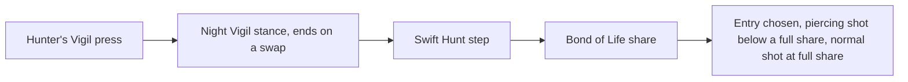

# Clorinde

Clorinde's kit is its record and one behaviour module, `createClorindeKitBehaviour`, on avatar 10000098 (`~/Esposter.noindex/genshin-dump-backup-6.6/ExcelBinOutput/AvatarExcelConfigData.json`): five normal attacks (`~/Esposter/cache/gcsim-v2.47.2/internal/characters/clorinde/attack.go` lines 16 to 20), the fourth of three boxes and the fifth of one circle, a charged attack, a collision and two plunges (the wiki's Plunging Attack Collision, Low Plunge and High Plunge, `~/Esposter/cache/genshin-wiki/Category_Clorinde_Talents.json`), and Last Lightfall's five strikes (`~/Esposter/cache/gcsim-v2.47.2/internal/characters/clorinde/burst.go` line 15). Her multipliers are read from proud skill groups 9831, 9832 and 9839 (the game's `ProudSkillExcelConfigData`, `~/Esposter.noindex/genshin-dump-backup-6.6/ExcelBinOutput/ProudSkillExcelConfigData.json`), matching gcsim's level-1 values (`~/Esposter/cache/gcsim-v2.47.2/internal/characters/clorinde/zz_clorinde.dm.go` lines 49, 263, 281, 317 and 371) to three decimal places. The burst's cooldown (group 9839's index 2, 15 seconds, `~/Esposter/cache/gcsim-v2.47.2/internal/characters/clorinde/burst.go` line 19) and cost (index 3, 60), and the charged attack's 20 stamina (group 9831's index 11), come from them (`~/Esposter.noindex/genshin-dump-backup-6.6/ExcelBinOutput/ProudSkillExcelConfigData.json`). Hunter's Vigil's press plays its 33-frame animation (`~/Esposter/cache/gcsim-v2.47.2/internal/characters/clorinde/skill.go` line 31) and starts its 16-second cooldown (`~/Esposter/cache/gcsim-v2.47.2/internal/characters/clorinde/skill.go` lines 27 and 56), with no hit of its own.

## How it works

## Decisions

- **Each strike is priced at its gcsim reach.** The first three strikes are circles of radius 1.7, 1.9 and 2.1 centred 1.1 to 1.3 metres ahead, priced as the offset plus the radius, as Zhongli's are (`~/Esposter/cache/gcsim-v2.47.2/internal/characters/clorinde/attack.go` lines 20-21, its hitbox and offset tables). The fourth strike is three boxes 2 metres wide, 1.3 metres ahead, and the fifth a circle of radius 2.5 at 1.4 metres (the same lines). Each strike takes the wiki's poise, 56.6, 54, 35.8, 24.234 and 94.2 from the first to the fifth (`~/Esposter/cache/genshin-wiki/Category_Clorinde_Talents.json`, Advanced Properties), as gcsim gives no poise for a normal attack (the clorinde package has no poise field, `~/Esposter/cache/gcsim-v2.47.2/internal/characters/clorinde/`).
- **The charged attack is a circle of radius 4.1 round her** (`~/Esposter/cache/gcsim-v2.47.2/internal/characters/clorinde/charge.go` line 15 and lines 42 to 44). gcsim strikes it at 38 frames of a 68-frame animation as a Physical hit (`~/Esposter/cache/gcsim-v2.47.2/internal/characters/clorinde/charge.go` lines 14-15, 19 and 42-44, its Physical element at line 34), with 20 stamina (`~/Esposter.noindex/genshin-dump-backup-6.6/ExcelBinOutput/ProudSkillExcelConfigData.json`, group 9831 index 11). Its poise is the wiki's 120 (`~/Esposter/cache/genshin-wiki/Category_Clorinde_Talents.json`), which gcsim does not give.
- **Last Lightfall keeps gcsim's five frames.** Its boxes land at 97, 103, 109, 115 and 121 frames (`~/Esposter/cache/gcsim-v2.47.2/internal/characters/clorinde/burst.go` line 15, its hitmark list), each a gauge of 1U (`~/Esposter/cache/genshin-wiki/Category_Clorinde_Talents.json`) under the Elemental Burst internal cooldown (`~/Esposter/cache/gcsim-v2.47.2/internal/characters/clorinde/burst.go` line 39), inside its 128-frame animation (`~/Esposter/cache/gcsim-v2.47.2/internal/characters/clorinde/burst.go` line 23).
- **The press has no hit.** gcsim's press only starts Night Vigil (`~/Esposter/cache/gcsim-v2.47.2/internal/characters/clorinde/skill.go` lines 54 and 56), so the kit's press plays its animation and starts its cooldown, and enters Night Vigil, built in the kit's behaviour below.
- **Her plunges are provisional.** Clorinde has no plunge in gcsim (the clorinde package holds no plunge file), so hers share the plunge reach (`packages/genshin-world/src/services/kit/characters/clorindeKit.ts`), deal the wiki's poise of 150 high and 100 low (`~/Esposter/cache/genshin-wiki/Category_Clorinde_Talents.json`), and land as their action starts; the roadmap's Manual verification list has the question.
- **Night Vigil is the press's stance, built as a behaviour** (`packages/genshin-world/src/services/kit/characters/clorindeKit.ts`). Hunter's Vigil's press enters Night Vigil for its duration (`~/Esposter/cache/gcsim-v2.47.2/internal/characters/clorinde/skill.go` line 54), ending on a swap (the wiki says she exits it when she leaves the field, `~/Esposter/cache/genshin-wiki/Category_Clorinde_Talents.json`). Each Swift Hunt step casts its own entry of the list her Bond of Life share picks, the piercing shot below a full share and the normal shot at one (`~/Esposter/cache/gcsim-v2.47.2/internal/characters/clorinde/attack.go` lines 136 to 142), the entry at the step's index, where her body stands. The piercing shot gains its Bond of Life gain as it strikes. Impale the Night casts its full variant at a full share, its no-share variant at zero within gcsim's `0.0000001` tolerance and its low variant between, from `~/Esposter/cache/gcsim-v2.47.2/internal/characters/clorinde/skill.go`'s HP debt ratio (`~/Esposter/cache/gcsim-v2.47.2/internal/characters/clorinde/skill.go` lines 70 to 78, with the tolerance at line 25). Each summon lands where her body stands rather than where gcsim's lunge carries her, which the kit does not model.
- **Night Vigil's frames and piercing box are cited where gcsim states them.** The Swift Hunt steps' frames are `Gcsim`-sourced in the overlay, cited at `~/Esposter/cache/gcsim-v2.47.2/internal/characters/clorinde/attack.go` lines 58, 62 and 66: gcsim reads them as attack-speed-adjusted frames at `~/Esposter/cache/gcsim-v2.47.2/internal/characters/clorinde/attack.go` line 163, and the reader does not resolve a wrapped call, so each value is the one gcsim's cancel-slice initialiser gives that element on its own line (18, 17 and 20). Their count of three, and each shot's three hits, are `Unsourced` lengths: gcsim queues one attack for a step, so no queue call counts them, and gcsim's hitmark list at `~/Esposter/cache/gcsim-v2.47.2/internal/characters/clorinde/attack.go` line 26 holds three entries. Impale the Night's low and no-share lunges are single hits, read with `readHit`, and its full lunge is a list of three. Impale the Night's 43 is the literal at `~/Esposter/cache/gcsim-v2.47.2/internal/characters/clorinde/skill.go` line 39 that gcsim's dash-frames table reads, so it stays cited in the overlay. The piercing shot's box overstates its reach: a 2 m wide, 14 m long box (`~/Esposter/cache/gcsim-v2.47.2/internal/characters/clorinde/attack.go` line 138) is priced as a radius-14 circle, which covers ground the box never does.
- **Impale the Night's three hits are seeded in the kit's overlay.** Each lunge is a named hit joined to gcsim's Bond of Life variable for no, low and full Bond of Life, so the record carries them once it is published. Two of their values are seeded rather than read, since the builder reads a queue call's hitbox only where it is written inline, not through a variable, and a loop's one queued call does not fill the full lunge's three-hit list.

## Not built

- **Impale the Night's low and full variants clear her Bond of Life and heal her by it.** gcsim's `~/Esposter/cache/gcsim-v2.47.2/internal/characters/clorinde/skill.go` calls its heal function at line 170 (low) and line 132 (full, queued six frames after the press, line 24). That function at line 182 takes her HP debt times the multiplier and heals her by it, with her Healing Bonus applied. The multipliers are 1.04 and 1.1 in [gcsim's Clorinde data file](https://github.com/genshinsim/gcsim/blob/v2.47.2/internal/characters/clorinde/zz_clorinde.dm.go) lines 34 and 35. The reader does not read those constants: the builder reads them as table parameters 5 and 7 of skill group 9832 (`Impale the Night Healing`, Tables), and both table values match gcsim's at level 1 (group 9832 holds 1.04 and 1.1 there, rechecked here) and are stated at level 10 by the design, not rechecked here. The build heals her through `changeKitMemberHealth`, so her Bond takes the heal before her HP does, as gcsim's core heal does. Approximations: the build heals at the press rather than six frames on, and the no-share variant has no heal.
- **Her Bond of Life gain and Last Lightfall's scaling are not built.** Her Bond of Life rises as she attacks and falls as she heals, and Last Lightfall's damage and her Bond of Life gain scale with it. The Bond of Life hook and the wearer's HP share are both built, so the attack and heal changes that set her Bond of Life are what is left, and until they land her burst deals its base damage only.
- **Her Surging Blade waits on a conditional follow-up hit.** Her skill's arkhe is a follow-up hit gcsim fires under a 10-second cooldown (`~/Esposter/cache/gcsim-v2.47.2/internal/characters/clorinde/zz_clorinde.dm.go` line 37, a cooldown of 10, and `~/Esposter/cache/gcsim-v2.47.2/internal/characters/clorinde/attack.go` line 187) on a condition of its own, a 4.5-metre circle on the primary target at 42 frames (`~/Esposter/cache/gcsim-v2.47.2/internal/characters/clorinde/attack.go` lines 33 and 186), and a conditional follow-up under a cooldown has no hook yet.
- **Her passives and constellations are not built.** The Nightvigil Shade and the Glimbright Shade that Night Vigil summons, and the constellations that work through Bond of Life wait on the same hooks. Constellation 6's crit buff after Hunter's Vigil is built on the skill's start (`~/Esposter/cache/gcsim-v2.47.2/internal/characters/clorinde/cons.go` lines 105-134: CRIT Rate 0.1 at line 121 and CRIT DMG 0.7 at line 131, for 12 seconds after the press as its comment at line 105 says, and its internal cooldown at `~/Esposter/cache/gcsim-v2.47.2/internal/characters/clorinde/cons.go` line 19). The constellations that raise talent levels are the [talents](../../talents/design.md) page's.

## Key files

| File                                                                | Role                                                                                |
| :------------------------------------------------------------------ | :---------------------------------------------------------------------------------- |
| `packages/genshin-world/src/services/kit/characters/clorindeKit.ts` | `createClorindeKitBehaviour`, Clorinde's strikes, charged attack and Last Lightfall |

## Sources

- [gcsim](https://github.com/genshinsim/gcsim/tree/v2.47.2/internal/characters/clorinde), MIT: every strike's hitmarks, frames and areas, the circle and hitmark of the charged attack, Last Lightfall's five boxes and their hitmarks, the press's cooldown and state, and the passives and constellations listed as not built. The line numbers above are its files at v2.47.2 (`~/Esposter/cache/gcsim-v2.47.2/internal/characters/clorinde/`).
- The wiki's Clorinde talent page (`~/Esposter/cache/genshin-wiki/Category_Clorinde_Talents.json`): the poise of each strike, the charged attack, the plunges and the Swift Hunt and Impale the Night hits.
- The game's `ProudSkillExcelConfigData` (`~/Esposter.noindex/genshin-parity/text/ExcelBinOutput`), which holds proud skill groups 9831, 9832 and 9839.
- `~/Esposter/cache/gcsim-v2.47.2/internal/characters/clorinde/attack.go` line 20: grounds the requirement Normal attack chain.
- `~/Esposter/cache/gcsim-v2.47.2/internal/characters/clorinde/charge.go` lines 15 and 42 to 44: grounds the requirement Charged attack.
- `~/Esposter/cache/genshin-wiki/Category_Clorinde_Talents.json`, Attribute Scaling's `stamina=20`: grounds the requirement Charged attack.
- `~/Esposter/cache/gcsim-v2.47.2/internal/characters/clorinde/burst.go` lines 15 and 23: grounds the requirement Last Lightfall strikes.
- `~/Esposter/cache/gcsim-v2.47.2/internal/characters/clorinde/skill.go` line 31: grounds the requirement Hunter's Vigil press, for its 33-frame animation.
- `~/Esposter/cache/gcsim-v2.47.2/internal/characters/clorinde/skill.go` line 27: grounds the requirement Hunter's Vigil press, for its 16-second cooldown.
- `~/Esposter/cache/genshin-wiki/Category_Clorinde_Talents.json`, Advanced Properties: normal attacks 24.234 to 94.2, Low Plunge 100, High Plunge 150: grounds the requirement Poise from normal attacks and plunges.
- `~/Esposter/cache/gcsim-v2.47.2/internal/characters/clorinde/cons.go` lines 19, 121 and 131: grounds the requirement Sixth constellation raises her crit after Hunter's Vigil.

## Open

- [ ] **Each summon lands where her body stands, not where the lunge carries her** — no source yet: a source for the lunge's displacement, which gcsim's skill code (`~/Esposter/cache/gcsim-v2.47.2/internal/characters/clorinde/skill.go` lines 85 to 101) does not give.
