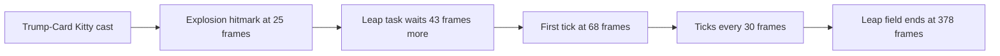

# Collei

Collei's kit is its record and one behaviour module, `createColleiKitBehaviour`, avatar 10000067 (`~/Esposter.noindex/genshin-dump-backup-6.6/ExcelBinOutput/AvatarExcelConfigData.json`): four strikes (`~/Esposter/cache/gcsim-v2.47.2/internal/characters/collei/attack.go` line 16), a fully charged shot, a collision and two plunges (`~/Esposter/cache/genshin-wiki/Category_Collei_Talents.json`), Floral Brush's two hits (`~/Esposter/cache/gcsim-v2.47.2/internal/characters/collei/skill.go` line 19), and Trump-Card Kitty's explosion with its leap field (`~/Esposter/cache/gcsim-v2.47.2/internal/characters/collei/burst.go` lines 28 to 47 and 88 to 91). Her multipliers are read from proud skill groups 6731, 6732 and 6739 (the game's `ProudSkillExcelConfigData`, `~/Esposter.noindex/genshin-dump-backup-6.6/ExcelBinOutput/ProudSkillExcelConfigData.json`), and at level 1 group 6731 holds gcsim's strike values (0.43602, 0.42656, 0.54094, 0.68026 at indices 0 to 3, and its fully-charged shot's 1.24 at index 5, as `~/Esposter/cache/gcsim-v2.47.2/internal/characters/collei/zz_collei.dm.go` gives them to the same decimals at lines 38, 55, 72, 89 and 126, and the dump gives them at `~/Esposter.noindex/genshin-dump-backup-6.6/ExcelBinOutput/ProudSkillExcelConfigData.json`) and group 6739 holds Trump-Card Kitty's 6-second duration at index 2, its 15-second cooldown at index 3 and its 60 energy at index 4 (`~/Esposter.noindex/genshin-dump-backup-6.6/ExcelBinOutput/ProudSkillExcelConfigData.json`). Floral Brush's cooldown and Trump-Card Kitty's cooldown and energy cost come from the same groups (`packages/genshin-world/src/services/kit/characters/colleiKit.ts`). Constellation 4's Elemental Mastery for the other members is built on Trump-Card Kitty's burst start (`packages/genshin-world/src/services/kit/characters/colleiKit.ts`, `~/Esposter/cache/gcsim-v2.47.2/internal/characters/collei/burst.go` lines 58 and 59, with 60 Elemental Mastery on each other member for 720 frames at `~/Esposter/cache/gcsim-v2.47.2/internal/characters/collei/cons.go` lines 61 to 69).

Not yet built: Sprout (Ascension 1) and the Cuilein-Anbar Zone's extension (Ascension 4) both react to a reaction another party member triggers, which no passive can read yet. Constellation 2's Sprout extension and Constellation 6's Forest of Falling Arrows wait on a passive's hook.

## How it works

## Decisions

- **Trump-Card Kitty's leap runs 378 frames from its explosion, as gcsim gives it** (`~/Esposter/cache/gcsim-v2.47.2/internal/characters/collei/burst.go` line 50). The table's duration reads 6 seconds (group 6739's index 2, `~/Esposter.noindex/genshin-dump-backup-6.6/ExcelBinOutput/ProudSkillExcelConfigData.json`), and gcsim's 6.3 is shipped until a recording settles it. The field has no edge, as a schedule that runs wherever the body stands, and each of its ticks lands the leap's circle of radius 4 (`~/Esposter/cache/gcsim-v2.47.2/internal/characters/collei/burst.go` line 91) round the spot the kitty was cast at, at 68 frames and every 30 after it (`~/Esposter/cache/gcsim-v2.47.2/internal/characters/collei/burst.go` lines 16-17: the leap's hitmark and its tick period).
- **The leap's first tick reads 68 frames as the explosion's 25 and the leap's 43 added together.** gcsim starts the leap in a task at the explosion's hitmark of 25 (`~/Esposter/cache/gcsim-v2.47.2/internal/characters/collei/burst.go:56`), and that task starts the ticks in a task at the leap's hitmark less the explosion's, 43 (`~/Esposter/cache/gcsim-v2.47.2/internal/characters/collei/burst.go:54`), so the tick's queued attack at `~/Esposter/cache/gcsim-v2.47.2/internal/characters/collei/burst.go` lines 88-91 reads 68, and the record's `frames.leapFirstTick` is 68 (`packages/genshin-world/src/data/kits/collei.json`, `~/Esposter/cache/gcsim-v2.47.2/internal/characters/collei/burst.go` line 16). The reader (`scripts/src/services/genshinAssets/kits/gcsim/readCallSiteDelays.ts`) summed the delays of the tasks that run a method's call, the outer task's 25 with the inner task's 43.
- **The leap's ticks are priced by the kitty's combatant with the team's buffs as each tick lands** (`packages/genshin-world/src/services/kit/characters/colleiKit.ts`). A summon is priced as its hits land, as Xiangling's Pyronado is. gcsim snapshots the explosion's attack for each tick, so a tick there reads the stats of the cast; that snapshot is not built.
- **Collei's arrows, her charged shot, Floral Brush and Trump-Card Kitty take the wiki's poise: 14.88 to 23.73 an arrow, 20 for the charged shot, 40 a Floral Brush hit, 30 for the explosion and 10 for the leap.** gcsim gives them no poise, so the record takes each from the wiki's Advanced Properties (`~/Esposter/cache/genshin-wiki/Category_Collei_Talents.json`: the normal attacks 15.21, 14.88, 18.87 and 23.73, the fully-charged shot 20, Skill DMG 40, Explosion DMG 30 and Leap DMG 10).
- **Constellation 1 reads whether Collei is on the field from the deployed team.** gcsim (MIT) gives her 20% Energy Recharge while she is not the active character (`~/Esposter/cache/gcsim-v2.47.2/internal/characters/collei/cons.go` lines 17 and 20-24, which return the mod only when the active character is another character), so the passive reads her own entry's `isOnField` in the deployed team it is given (`packages/genshin-world/src/services/kit/characters/colleiKit.ts`), and gives none when she is not in that team.

## Key files

| File                                                              | Role                                                                                                        |
| :---------------------------------------------------------------- | :---------------------------------------------------------------------------------------------------------- |
| `packages/genshin-world/src/services/kit/characters/colleiKit.ts` | `createColleiKitBehaviour`, Collei's kit with Floral Brush, Trump-Card Kitty's explosion and its leap field |

## Sources

- [gcsim v2.47.2](https://github.com/genshinsim/gcsim/tree/v2.47.2/internal/characters/collei), MIT: Collei's strikes' hitmarks and cancels, the fully charged shot's frames, Floral Brush's hitmarks, and Trump-Card Kitty's explosion, leap ticks and status.
- Requirement "No poise from arrows, Floral Brush and Trump-Card Kitty": "as the wiki gives it".
- Scenario "An arrow deals no poise": "as the wiki gives it".
- Requirement "Leap length": "until a recording settles it against the table's six-second duration".
