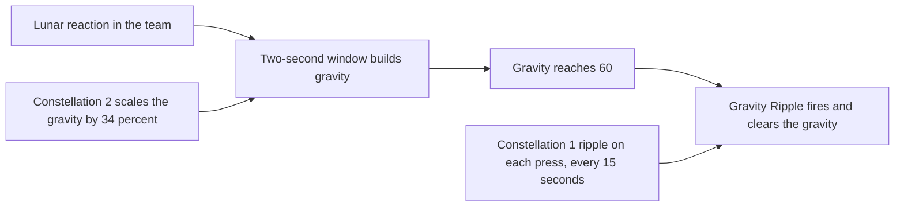

# Columbina

Columbina's kit is its record and one behaviour module, `createColumbinaKitBehaviour`, avatar 10000125: three strikes, a charged attack, a collision and two plunges, her skill's press with the DoT field it sets going and the gravity that field builds, the Gravity Ripple that gravity fires with Constellations 1 and 2, and the burst's hit. Her multipliers are read from proud skill groups 12531, 12532 and 12539 (the game's `ProudSkillExcelConfigData` holds all three, `{data-root}/genshin-dump-backup-6.6/ExcelBinOutput/ProudSkillExcelConfigData.json`), and the skill's duration is among them; at level 1 group 12539 holds the burst's cooldown of 15 seconds at index 3 and its energy cost of 60 at index 4 (`{data-root}/cache/genshin-wiki/Category_Columbina_Talents.json`), and the duration's index is not checked against gcsim here. Her strikes, plunges and skill's press are Hydro at gauge one, her burst's hit is Hydro at gauge two, the collision deals gauge zero, and her charged attack is Hydro at gauge one, or Moondew Cleanse, Dendro at gauge zero, while Dew stands (`{data-root}/cache/genshin-wiki/Category_Columbina_Talents.json`).

Her skill and burst deal their multiplier on her max HP, as gcsim's max HP damage gives them (`{data-root}/cache/gcsim-v2.47.2/internal/characters/columbina/skill.go` lines 259 and 314, and `{data-root}/cache/gcsim-v2.47.2/internal/characters/columbina/burst.go` line 45), so their talent multiplier is zero and the share of max HP is each hit's flat damage. A press while the DoT runs restarts its duration rather than stacking a second field, as gcsim restarts its status and keeps its ticks (`{data-root}/cache/gcsim-v2.47.2/internal/characters/columbina/skill.go` lines 269 to 273).

gcsim sources: her attack, charge, skill and burst files, with the table data in gcsim's Columbina data file.

## How it works

## Decisions

- **Gravity Interference's gravity builds from the team's Lunar reactions, and a Gravity Ripple fires at 60.** Each Lunar reaction in the team opens a two-second window (`{data-root}/cache/gcsim-v2.47.2/internal/characters/columbina/skill.go` lines 65 and 84, the two-second status) in which the gravity builds 10 a second for the reaction's type (`{data-root}/cache/genshin-wiki/Category_Columbina_Talents.json`, Lunacy's Lure), scaled by Constellation 2's 34% (`{data-root}/cache/gcsim-v2.47.2/internal/characters/columbina/cons.go` line 102). At 60 (`{data-root}/cache/gcsim-v2.47.2/internal/characters/columbina/skill.go` line 29, the gravity's maximum) a ripple fires and clears the gravity (`{data-root}/cache/gcsim-v2.47.2/internal/characters/columbina/skill.go` lines 120 to 122), on the type with the most; with none built, the reaction is the one the team's elements favour, Electro, Dendro or Geo in that order on a tie (`{data-root}/cache/gcsim-v2.47.2/internal/characters/columbina/skill.go` lines 170 to 179). A press while the skill stands keeps the gravity, and one with none standing starts from none (`{data-root}/cache/gcsim-v2.47.2/internal/characters/columbina/skill.go` lines 264 to 266). Constellation 1's ripple fires on each press, once every 15 seconds (`{data-root}/cache/gcsim-v2.47.2/internal/characters/columbina/cons.go` line 60, a 15-second cooldown). gcsim (`{data-root}/cache/gcsim-v2.47.2/internal/characters/columbina/skill.go`, `{data-root}/cache/gcsim-v2.47.2/internal/characters/columbina/cons.go`) gives each of these.
- **The skill's DoT reaches 4 metres, or 6 metres while the team is at Ascendant Gleam.** gcsim reaches 6 metres from Moonsign level 2 (`{data-root}/cache/gcsim-v2.47.2/internal/characters/columbina/skill.go` lines 318 to 320: a radius of 4.0, then 6 at Moonsign level 2 or above), which the party's Moonsign level reads. She counts toward that level through her Benediction (`{data-root}/cache/genshin-wiki/Category_Columbina_Talents.json`), as gcsim counts her, so a team of her and one other Moonsign character reads Ascendant Gleam where gcsim does.
- **Her strikes, charged attack, burst, collision and plunges take the wiki's poise: 8.8, 6.9 and 11 for the strikes, 100 for the charged attack and the burst's hit, 5 for the collision, and 100 high and 50 low for the plunges.** The wiki's Advanced Properties give the strikes (8.8, 6.9, 11) and the charged attack (100) in `{data-root}/cache/genshin-wiki/Category_Columbina_Talents.json`; the burst's 100 is the table's second Skill DMG row, which is Moonlit Melancholy's own Skill DMG and gives 100 (`{data-root}/cache/genshin-wiki/Category_Columbina_Talents.json`). gcsim gives none for the strikes and plunges (the columbina package has no poise field for them), so each takes its wiki row (`{data-root}/cache/genshin-wiki/Category_Columbina_Talents.json`).
- **The first strike's two-frame windup is not built.** gcsim adds it to a first strike that follows a strike or a charged attack. The kit keeps no record of the state the previous action left, so each strike lands on its gcsim hitmark without it.
- **The charged attack's stamina is the catalyst's 50, and Moondew Cleanse spends none of it.** gcsim's default for a catalyst's charged attack is 50 (cited on the [character controller](../../character-controller/design.md) page), and her table reads the same (`{data-root}/cache/genshin-wiki/Category_Columbina_Talents.json`). While the party holds Dew her charged attack is Moondew Cleanse, which the wiki's Normal Attack text says "will not consume Stamina" (`{data-root}/cache/genshin-wiki/Category_Columbina_Talents.json`), and gcsim's stamina action (`{data-root}/cache/gcsim-v2.47.2/internal/characters/columbina/columbina.go` lines 66 to 70) makes it free. Both sources agree, so the wiki does not overrule gcsim here. The cut is `getChargedAttackStaminaMultiplier`, which reads the same check that picks the variant, so the two cannot disagree.
- **The plunges borrow gcsim's Bennett plunge reach.** gcsim has no plunge file for Columbina (its package holds `jump.go` but no `plunge.go`), so the reach is the kit constants' borrowed one, and the 0.4 seconds are the wiki's standard, not measured.
- **Her Moonsign Benediction turns her team's reactions Lunar, and adds Base DMG from her max HP.** Electro-Charged, Bloom and Hydro-Crystallize become Lunar-Charged, Lunar-Bloom and Lunar-Crystallize, the three types the record holds, through the engine's conversion (`{data-root}/cache/genshin-wiki/Category_Columbina_Talents.json`, Moonlight, Lent Unto You). Her Base DMG bonus is 0.2% for every 1,000 of her max HP, up to 7%, as gcsim's `{data-root}/cache/gcsim-v2.47.2/internal/characters/columbina/asc.go` gives it (lines 31 and 46, 0.2 percent per 1,000 max HP, capped at 7 percent), and the benediction's text (`{data-root}/genshin-parity/text/TextMap/TextMap_MediumEN.json`, TextMap 79900803) agrees. The curve is `columbinaBenediction.ts`, and the party sums it into the Lunar reaction damage the engine prices.
- **Ascension 1's Lunacy gains a stack on each Gravity Ripple, not on each Gravity Interference tick, and its CRIT Rate is the stacks' share.** gcsim (`{data-root}/cache/gcsim-v2.47.2/internal/characters/columbina/asc.go` lines 74 to 77: 5% CRIT Rate per stack from its stack count, held for 10 seconds) gives 5% CRIT Rate per stack, up to three (`{data-root}/cache/genshin-wiki/Category_Columbina_Talents.json`), and calls it from its gravity tick alone (`{data-root}/cache/gcsim-v2.47.2/internal/characters/columbina/skill.go` line 236), so the DoT's ticks gain none. Each gain restarts every stack's 10 seconds together. The kit's holds carry the stacks, and `getStrikeCriticalRateBonus` reads them for her own strikes.
- **Her Moonridge Dew is a second pool beside the party's Verdant Dew, and a Lunar-Bloom skill's Dew takes both.** At Ascension 4 a Lunar-Bloom in her burst's window gives one Moonridge Dew, at most one each three frames and three each eighteen seconds from the first, as gcsim's `{data-root}/cache/gcsim-v2.47.2/internal/characters/columbina/asc.go` does (lines 120 to 145). The party's Dew spends Verdant first and then Moonridge, as gcsim's Dew consumption does (`verdantdew.go` lines 61 to 77, a file the [combat](../../combat/design.md) page also cites), so Lauma's hold spends both. gcsim's sixty-second loss of Moonridge Dew (`{data-root}/cache/gcsim-v2.47.2/internal/characters/columbina/asc.go` line 147) is not built, so a gained Dew stays until a hold spends it.
- **Constellation 6's strike CRIT is a window and a buff per Lunar reaction.** gcsim's burst holds the team's 1.2-second window (`{data-root}/cache/gcsim-v2.47.2/internal/characters/columbina/burst.go` line 29), and a Lunar reaction in it sets an 8-second buff on every party member for the elements that reaction covers: Lunar-Charged on Electro and Hydro, Lunar-Bloom on Dendro and Hydro, Lunar-Crystallize on Geo and Hydro. Each buff a striker holds adds 0.8 CRIT DMG to its strikes of those elements. A reaction of a kind refreshes its buff rather than stacking, while different kinds add (`{data-root}/cache/gcsim-v2.47.2/internal/characters/columbina/cons.go` lines 203 and 230 for the 0.8 CRIT DMG, lines 246 to 248, 270 to 272 and 295 to 297 for the elements, and lines 244, 268 and 293 for the eight-second buffs). The window is a status on Columbina set by her burst, and the buffs are statuses on each party member, read by `getPartyStrikeBonus` for her team and by `getStrikeCriticalDamageBonus` for her own strikes.

## Not built

- **The burst's Lunar damage bonus waits on the Lunar reaction hook.** The burst opens the 1.2-second window that Constellation 6 reads, but the bonus the window gives each character's Lunar reaction damage is not applied, as no kit reads a Lunar reaction's damage yet. The burst's field is not built either.
- **The Gravity Ripple's hit is not built.** The record holds none of the ripple's multipliers or hitmarks, so a ripple runs its Lunacy and constellation effects without damage. Gravity built from direct Lunar damage is not built either, as no kit reads a Lunar damage yet.
- **Constellation 4 waits on the Gravity Ripple's hits, and Ascension 4's extra hits on the Lunar reactions hook.** Constellation 4 needs the ripple's hits, its energy for each and its flat DMG. Ascension 4's extra hits on Lunar-Charged and Lunar-Crystallize need that hook, as its Moonridge Dew on Lunar-Bloom is built. Constellation 6's strike CRIT is built, but its CRIT on the Lunar reaction's own damage waits on the reaction's element, which `KitReaction` does not carry.

## Key files

| File                                                                         | Role                                                                                                                                                                              |
| :--------------------------------------------------------------------------- | :-------------------------------------------------------------------------------------------------------------------------------------------------------------------------------- |
| `packages/genshin-world/src/services/kit/characters/columbinaKit.ts`         | `createColumbinaKitBehaviour`, Columbina's three strikes, charged attack, plunges, skill press with its DoT field, burst hit and window, Constellation 6's buffs, and Benediction |
| `packages/genshin-world/src/services/kit/characters/columbinaBenediction.ts` | The Benediction's Base DMG bonus: 0.2% for every 1,000 max HP, up to 7%                                                                                                           |

## Sources

- [Columbina](https://genshin-impact.fandom.com/wiki/Columbina), Genshin Impact Wiki: the Normal Attack talent's text, which says her charged attacks are Moondew Cleanse, which does not consume Stamina.
- [gcsim](https://github.com/genshinsim/gcsim/tree/v2.47.2/internal/characters/columbina), MIT: her strikes' hitmarks and cancels, the charged attack's hit and animation, the skill's press and DoT and their timing, the burst's hit and animation, and her table data file.
- `{data-root}/cache/genshin-wiki/Category_Columbina_Talents.json`: grounds the requirement Basic attacks deal Hydro, and Moondew Cleanse deals Dendro.
- `{data-root}/cache/genshin-wiki/Category_Columbina_Talents.json`: grounds the requirement Poise from strikes, the charged attack and plunges.
- `{data-root}/cache/gcsim-v2.47.2/internal/characters/columbina/charge.go` line 101, which sets the DEF ignored at 100 percent: grounds the requirement Moondew Cleanse's hits ignore all of each enemy's DEF.
- `{data-root}/cache/gcsim-v2.47.2/internal/characters/columbina/skill.go` lines 318 to 320, the DoT's radius of 4.0 and then 6 at Moonsign level 2 or above, as gcsim reaches them from Moonsign level 2: grounds the requirement Damage-over-time reach.

## Open
