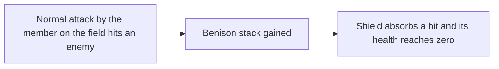

# Dahlia

Dahlia's kit is its record and one behaviour module, `createDahliaKitBehaviour`, avatar 10000115 (`{data-root}/genshin-parity/text/ExcelBinOutput/AvatarExcelConfigData.json`): her four strikes, a charged attack, Immersive Ordinance as her skill with its tap and hold, Radiant Psalter as her burst with its shield, and a low, high and collision plunge (`{data-root}/cache/genshin-wiki/Category_Dahlia_Talents.json`). Her multipliers are read from proud skill groups 11531, 11532 and 11539 (`{data-root}/genshin-parity/text/ExcelBinOutput/ProudSkillExcelConfigData.json`), the burst's shield, Favonian Favor's seconds and its multiplier among them: at level 1 group 11539 holds Favonian Favor's 12 seconds at index 3, the burst's 60 energy at index 4 and its 15-second cooldown at index 5 (gcsim's `{data-root}/cache/gcsim-v2.47.2/internal/characters/dahlia/burst.go:67` sets the 15 seconds, and `{data-root}/cache/gcsim-v2.47.2/internal/characters/dahlia/burst.go:74` the 12), and group 11531 holds the charged attack's 20 stamina at index 7. The charged attack costs 20 stamina, the skill cools for 9 seconds (`{data-root}/cache/gcsim-v2.47.2/internal/characters/dahlia/skill.go:70`, and the wiki's Immersive Ordinance CD of 9s in `{data-root}/cache/genshin-wiki/Category_Dahlia_Talents.json`), and the burst takes 60 energy and a 15-second cooldown (the wiki's Radiant Psalter energy cost of 60 and CD of 15s in `{data-root}/cache/genshin-wiki/Category_Dahlia_Talents.json`).

## Not yet built

The team's attack-speed attribute, `NormalAttackSpeed`, is buffed by Jean's kit, but her kit does not buff it yet, so what depends on it waits on that buff. The Benison stacks need no hook of their own.

- **Benison stacks are a status of hers, and the shield's regeneration waits on two delays.** Her normal attacks gain her stacks during Favonian Favor, four hits to a stack (the wiki's Radiant Psalter text, `{data-root}/cache/genshin-wiki/Category_Dahlia_Talents.json`), with a 3-frame cooldown after each counted hit (gcsim's stack cooldown, `{data-root}/cache/gcsim-v2.47.2/internal/characters/dahlia/burst.go:130`, as the wiki is silent on it), and Constellation 1 returns energy for each. Radiant Psalter's shield is built here, but it is not made again once it breaks: that waits on the 26-frame and 31-frame delays gcsim's `{data-root}/cache/gcsim-v2.47.2/internal/characters/dahlia/burst.go` gives (`{data-root}/cache/gcsim-v2.47.2/internal/characters/dahlia/burst.go:22` for the 26, a broken shield's regeneration, and `{data-root}/cache/gcsim-v2.47.2/internal/characters/dahlia/burst.go:21` for the 31, a new shield after a Benison stack), which the records do not carry. gcsim keeps the stacks on Dahlia alone, gained and spent inside her own package with no event for any other character (`{data-root}/cache/gcsim-v2.47.2/internal/characters/dahlia/dahlia.go:15`, `{data-root}/cache/gcsim-v2.47.2/internal/characters/dahlia/burst.go:134`, `{data-root}/cache/gcsim-v2.47.2/internal/characters/dahlia/shield.go:58`), so they are a status of hers with `stacks`, as Navia's Crystal Shrapnel is: an `EnemyHit` of a normal attack by the member on the field gains them, a `ReactionTriggered` with Frozen gains Ascension 1's two, and a `ShieldAbsorbed` that leaves her shield's `health` at 0 spends one to cast it again.
- **The Favonian Favor attack speed waits on her kit's attack-speed buff.** The active party member gets an attack-speed bonus from her burst's Favonian Favor, through the team's `NormalAttackSpeed` attribute, which her kit does not set yet. Her charged attack takes none.
- **Her skill's Hydro particles wait on the particle hook.** Immersive Ordinance gives three Hydro particles on an internal cooldown, so its energy goes ungenerated, as the index says of every particle.
- **Her Ascension passives and Constellations 2 and 6 are not built.** Constellation 1's 2.5 Energy a stack gained is built with `gainPartyMemberEnergy` (`{data-root}/cache/gcsim-v2.47.2/internal/characters/dahlia/cons.go:21`). Ascension 1 gives two stacks on Frozen, which waits on the Frozen gain, and Constellation 2's 25% is a `ShieldStrength` buff on the member on the field, applying while a shield of hers stands (`{data-root}/cache/gcsim-v2.47.2/internal/characters/dahlia/cons.go` lines 37 to 39, its `hasShield` check), so it waits on the shield's absorption reading the member's buffs. Ascension 4 and Constellation 6 read the attack-speed bonus, so they wait on that buff. Constellation 4 lengthens Favonian Favor by three seconds on the shield the burst places (`{data-root}/cache/gcsim-v2.47.2/internal/characters/dahlia/cons.go:51`).

## How it works

## Decisions

- **The shield is a task's.** gcsim places Radiant Psalter's shield 31 frames in (`{data-root}/cache/gcsim-v2.47.2/internal/characters/dahlia/burst.go:20`, the shield's initial delay, and the task at `{data-root}/cache/gcsim-v2.47.2/internal/characters/dahlia/burst.go:88`), so the burst sets a task that runs then; the shield reads her Max HP as it runs, as the table's share of Max HP plus a flat HP (`{data-root}/cache/gcsim-v2.47.2/internal/characters/dahlia/shield.go:55`). It lasts the 12 seconds Favonian Favor holds, from its placement (`{data-root}/cache/gcsim-v2.47.2/internal/characters/dahlia/burst.go:74`, 12 seconds plus the Constellation 4 bonus).
- **The hold's threshold is provisional.** gcsim takes Immersive Ordinance's hold as its own variant but gives no threshold for it, so the kit takes the framework's default half second (`UNMEASURED_HOLD_SECONDS`), as the kits README's Framework decisions give it. The roadmap's manual verification has the question.
- **The plunges are borrowed.** Dahlia has no gcsim plunge file (the dahlia package holds none, and the wiki's collision, low and high poise rows are 25, 100 and 150, `{data-root}/cache/genshin-wiki/Category_Dahlia_Talents.json`, Advanced Properties), so her three plunges borrow Mizuki's timings, as [how a kit is read](../README.md#how-a-kit-is-read) gives, and the wiki's poise above is what they take. The roadmap's manual verification has the question.
- **Normal attacks and the charged attack take the wiki's poise.** gcsim gives her normal attacks and charged attack none (`{data-root}/cache/gcsim-v2.47.2/internal/characters/dahlia/`, where no file names a poise), so the kit takes the wiki's rows (`{data-root}/cache/genshin-wiki/Category_Dahlia_Talents.json`, Advanced Properties): 45.6 for the first strike, 42 for the second, 27.6 for each hit of the third and 68.7 for the fourth, and 60 for each of the charged attack's two hits.

## Key files

| File                                                              | Role                                                                                                                         |
| :---------------------------------------------------------------- | :--------------------------------------------------------------------------------------------------------------------------- |
| `packages/genshin-world/src/services/kit/characters/dahliaKit.ts` | `createDahliaKitBehaviour`, Dahlia's four strikes, charged attack, Immersive Ordinance, Radiant Psalter's shield and plunges |

## Sources

- [gcsim](https://github.com/genshinsim/gcsim/tree/v2.47.2/internal/characters/dahlia), MIT, at v2.47.2: hitmarks, cancels and reaches for the strikes and the charged attack, the skill's tap and hold, the burst and its shield, and the Benison and attack-speed states the hooks wait on.
- [Hosted game data](../../hosted-game-data/design.md): the proud skill groups 11531, 11532 and 11539 and the skill-kit record.
