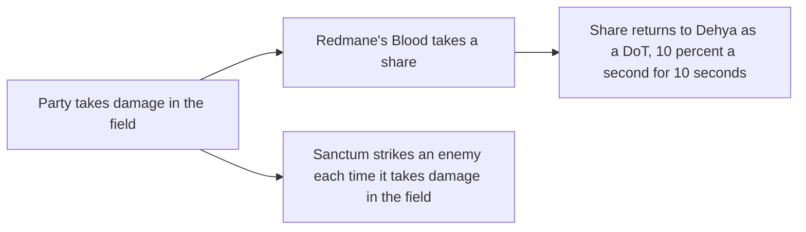

# Dehya

Dehya's kit is its record and one behaviour module, `createDehyaKitBehaviour`, on avatar 10000079 (`packages/genshin-world/src/services/kit/characters/dehyaKit.ts`): four strikes, a charged attack, a collision and two plunges, and Molten Inferno's initial Pyro circle of radius 5, which lands at 20 frames (gcsim `{data-root}/cache/gcsim-v2.47.2/internal/characters/dehya/skill.go:20` and `:91`). Her multipliers are read from proud skill groups 7931, 7932 and 7939, the groups of skills 10791, 10792 and 10795 in the dump's `{data-root}/genshin-dump-backup-6.6/ExcelBinOutput/AvatarSkillExcelConfigData.json`; the skill's cooldown and the burst's cooldown and energy cost are read from the same groups, and the dump's rows give 20 seconds for skill 10792 and 18 seconds and 70 energy for burst 10795 (gcsim's `{data-root}/cache/gcsim-v2.47.2/internal/characters/dehya/dehya.go:36` gives the same 70). Her strikes are blunt, as gcsim gives them (`{data-root}/cache/gcsim-v2.47.2/internal/characters/dehya/attack.go:45`), and her plunges take gcsim's timings and poise (`{data-root}/cache/gcsim-v2.47.2/internal/characters/dehya/plunge.go:21-33`).

Gcsim gives Dehya no charged attack, its attack file leaving it a TODO (`{data-root}/cache/gcsim-v2.47.2/internal/characters/dehya/attack.go:79`). The charged attack here takes the table's shape (`packages/genshin-world/src/services/kit/characters/dehyaKit.ts`), as Dori's does: a spin at once and a final hit at the table's maximum duration, each a circle of radius 2 round the body, with the stamina per second the table gives. The maximum duration is 5 seconds, held as 300 frames at 60 a second, and the stamina 40 a second: the cached Dehya category's Charged Attack rows give 5s and 40/s (`{data-root}/cache/genshin-wiki/Category_Dehya_Talents.json`), and the dump's group 7931 gives 40 at index 6 (stamina) and 5 at index 7 (duration), `{data-root}/genshin-dump-backup-6.6/ExcelBinOutput/ProudSkillExcelConfigData.json`. Its collision deals the wiki's 35 poise (the Plunging Attack Collision row of that cached file). Both are provisional until a recording settles them; the spin's timing and the circle's radius have no source (see Provisional constants). Dehya is a claymore, so the shared no-action-file rule for a claymore's charged attack is the source its frames and hitmarks differ from, its values held in `scripts/src/services/genshinAssets/kits/constants.ts` (hitmarks of 30 and 60 frames and an animation of 72, `constants.ts:92-93`); the overlay names those three values `DiffersFromSource`, and the record holds hitmarks of 0 and 300 frames and an animation of 300.

Not built yet: the Sanctum her skill leaves, its Molten Inferno DoT, which strikes an enemy each time it takes damage in the field (the wiki's Fiery Sanctum, once every 2.5 seconds), and Redmane's Blood, which takes a share of the damage her party takes in the field and gives it back to her as a DoT (the wiki's Redmane's Blood, 10% a second for 10 seconds), as it waits on the wearer's HP; Ranging Flame's reposition (the wiki's Molten Inferno page); her burst's punches and Incineration Drive, which play no hits yet (the burst's animation is its first punch's 105 frames, `{data-root}/cache/gcsim-v2.47.2/internal/characters/dehya/burst.go:16`); her Ascension 1 passive, which waits on the Sanctum's mitigation (the wiki's Unstinting Succor: 60% less DMG from Redmane's Blood within 6 seconds of retrieving the field); and her Constellations, which are read from gcsim's `{data-root}/cache/gcsim-v2.47.2/internal/characters/dehya/cons.go` as Constellation 1's Molten Inferno DMG (`{data-root}/cache/gcsim-v2.47.2/internal/characters/dehya/cons.go:13-15`), Constellation 2's Ranging Flame field (`{data-root}/cache/gcsim-v2.47.2/internal/characters/dehya/cons.go:35-36`), and Constellations 4 and 6 on Leonine Bite's Flame-Mane's Fist and Incineration Drive (`{data-root}/cache/gcsim-v2.47.2/internal/characters/dehya/cons.go:79-80` and `:110-113`). Her Ascension 4 passive, Stalwart and True, is built as a drain's hook (`packages/genshin-world/src/services/kit/characters/dehyaKit.ts`): a drain under 40% HP heals her 20% at once and 6% on each of five ticks, once every 20 seconds (`{data-root}/cache/gcsim-v2.47.2/internal/characters/dehya/asc.go:16-21` and the wiki's Stalwart and True: 6% "every 2s for the next 10s", `{data-root}/cache/genshin-wiki/Category_Dehya_Talents.json`). The field and its mitigation wait on a hook for an enemy's damage.

## How it works

## Provisional constants

- **The charged attack's spin and its circle's radius are unsourced.** Neither the wiki's Sandstorm Assault page nor gcsim, which has no charged attack, gives the spin's timing: the record holds it at 0 frames where the claymore rule gives 30 (`NO_ACTION_FILE_CLAYMORE_CHARGED_HITMARK_FRAMES` in `scripts/src/services/genshinAssets/kits/constants.ts`). The circle's radius of 2 metres has no source either, and the record marks it `Unsourced`. Both wait on a recording.

## Key files

| File                                                             | Role                                                                                                              |
| :--------------------------------------------------------------- | :---------------------------------------------------------------------------------------------------------------- |
| `packages/genshin-world/src/services/kit/characters/dehyaKit.ts` | `createDehyaKitBehaviour`, Dehya's kit with her strikes, charged attack, plunges and Molten Inferno's initial hit |

## Sources

- [gcsim](https://github.com/genshinsim/gcsim/tree/v2.47.2/internal/characters/dehya), MIT: Dehya's strikes' hitmarks, cancel frames, reaches and poise, Molten Inferno's initial hit and its animation, the plunges' timings and poise, and the burst's first punch. The v2.47.2 source is on disk at `{data-root}/cache/gcsim-v2.47.2/internal/characters/dehya`, and the lines cited above are in it.
- Genshin Impact Wiki, cached at `{data-root}/cache/genshin-wiki/Category_Dehya_Talents.json`: the pages Sandstorm Assault (the charged attack's maximum duration, stamina and the collision's poise), Molten Inferno (the Fiery Sanctum, Redmane's Blood and Ranging Flame), Unstinting Succor and Stalwart and True.
- The dump, `{data-root}/genshin-dump-backup-6.6/ExcelBinOutput/`: `ProudSkillExcelConfigData.json` (groups 7931, 7932 and 7939) and `AvatarSkillExcelConfigData.json` (skills 10791, 10792 and 10795).
- `{data-root}/genshin-parity/text/ExcelBinOutput/AvatarSkillExcelConfigData.json`, id 10792: Molten Inferno's skill row, with a cooldown of 20 and no energy cost, grounding requirement "Molten Inferno initial hit".
- `{data-root}/cache/genshin-wiki/Category_Dehya_Talents.json`: the wiki's Molten Inferno page, giving a CD of 20s, grounding requirement "Molten Inferno initial hit".
- the design's Provisional constants, a pointer to this page's own section: the spin's timing and the circle's radius have no source, grounding requirement "Provisional charged attack".
