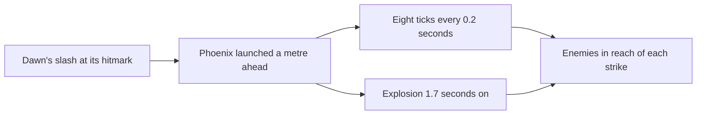

# Diluc

Diluc's kit is its record and one behaviour module, `createDilucKitBehaviour` (`packages/genshin-world/src/services/kit/characters/dilucKit.ts`), avatar 10000016 (`~/Esposter.noindex/genshin-dump-backup-6.6/ExcelBinOutput/AvatarExcelConfigData.json`): four strikes (`~/Esposter/cache/gcsim-v2.47.2/internal/characters/diluc/attack.go:24`), a charged attack, a collision and two plunges, Searing Onslaught's three presses, and Dawn's slashing hit with its phoenix's ticks and explosion. Its multipliers are read from proud skill groups 1631, 1632 and 1639 of the dump (`~/Esposter.noindex/genshin-dump-backup-6.6/ExcelBinOutput/ProudSkillExcelConfigData.json`), and match the wiki's Tempered Sword and Searing Onslaught pages at level 1 (`~/Esposter/cache/genshin-wiki/Category_Diluc_Talents.json`) and gcsim's burst values (`~/Esposter/cache/gcsim-v2.47.2/internal/characters/diluc/zz_diluc.dm.go:214-253`). Dawn's infusion, its phoenix and the A4 passive are built, as the shared effects below.

## Decisions

- **Dawn's phoenix** is a travelling summon launched at the slash's hitmark (`~/Esposter/cache/gcsim-v2.47.2/internal/characters/diluc/burst.go:113`, the phoenix's task at the burst's 100-frame hitmark, `~/Esposter/cache/gcsim-v2.47.2/internal/characters/diluc/burst.go:16`), a metre ahead of the body (`~/Esposter/cache/gcsim-v2.47.2/internal/characters/diluc/burst.go:88`) and moving 14 metres a second (`~/Esposter/cache/gcsim-v2.47.2/internal/characters/diluc/burst.go:89`). It strikes eight ticks, every 0.2 seconds from its launch (`~/Esposter/cache/gcsim-v2.47.2/internal/characters/diluc/burst.go:93-99`), and explodes 1.7 seconds on (`~/Esposter/cache/gcsim-v2.47.2/internal/characters/diluc/burst.go:106`, `:111`), 24.8 metres out.

- **Searing Onslaught's cooldown starts on its first press.** The second and third presses are a chain: each is pressed within four seconds of the one before, and a press inside that window plays its follow-up whatever the cooldown, which the first press set at 10 seconds. The third press closes the chain (`~/Esposter/cache/gcsim-v2.47.2/internal/characters/diluc/skill.go:153`), and a window that lapses ends it. gcsim sets the cooldown on the first use (`~/Esposter/cache/gcsim-v2.47.2/internal/characters/diluc/skill.go:143` for the four-second window, `~/Esposter/cache/gcsim-v2.47.2/internal/characters/diluc/skill.go:150-152` for the cooldown), and the wiki's lapse path ends a chain with the cooldown already running, as its CD of 10s (`~/Esposter/cache/genshin-wiki/Category_Diluc_Talents.json`, Searing Onslaught) "begins counting down immediately after the first hit", so the cooldown always starts on the first press.
- **Dawn's phoenix is priced by the same ICD as its slash.** Its ticks and explosion are 2U of Pyro each under the Elemental Burst internal cooldown (`~/Esposter/cache/gcsim-v2.47.2/internal/characters/diluc/burst.go:59-64` for the slash's tag and poise, and the wiki's Dawn advanced properties (`~/Esposter/cache/genshin-wiki/Category_Diluc_Talents.json`): DoT and explosion 2U, Elemental Burst 5s/5 Hits, poise 100), and carry the slash's 100 poise, as gcsim's copy of the attack does. Their area is a circle to the far corner of gcsim's box: a tick's box is 16 by 8 metres (`~/Esposter/cache/gcsim-v2.47.2/internal/characters/diluc/burst.go:97`), whose far corner is 8.9 metres from its centre, and the explosion's is 16 by 10 (`~/Esposter/cache/gcsim-v2.47.2/internal/characters/diluc/burst.go:109`), 9.4 metres. gcsim places tick _i_ at 1 + 2.8*i* metres (`~/Esposter/cache/gcsim-v2.47.2/internal/characters/diluc/burst.go:94`); the phoenix's own clock puts it 2.8 metres further (`~/Esposter/cache/gcsim-v2.47.2/internal/characters/diluc/burst.go:89`, 14 metres a second over 0.2 seconds), which the kit follows.
- **Its stamina drains a second as it plays.** The table's 40 a second (the wiki's Tempered Sword stamina 40/s (`~/Esposter/cache/genshin-wiki/Category_Diluc_Talents.json`), and the dump's group 1631 at index 6 (`~/Esposter.noindex/genshin-dump-backup-6.6/ExcelBinOutput/ProudSkillExcelConfigData.json`)) is drained each step of the charge, so its 1.2 seconds cost 48 in all, and the charge starts with any stamina. The game holds the charge up to 5 seconds (the wiki's Max Duration, 5s (`~/Esposter/cache/genshin-wiki/Category_Diluc_Talents.json`), and the dump's index 7 (`~/Esposter.noindex/genshin-dump-backup-6.6/ExcelBinOutput/ProudSkillExcelConfigData.json`)) and stops it when the stamina runs out, which the kit does not model.
- **Poise is the wiki's where gcsim gives none.** gcsim sets 120 on Diluc's skill (`~/Esposter/cache/gcsim-v2.47.2/internal/characters/diluc/skill.go:111`) and 100 on his burst (`~/Esposter/cache/gcsim-v2.47.2/internal/characters/diluc/burst.go:62`), as the wiki's advanced properties give 120 (Searing Onslaught) and 100 (Dawn's slash) too (`~/Esposter/cache/genshin-wiki/Category_Diluc_Talents.json`), and gives none to his collision (`~/Esposter/cache/gcsim-v2.47.2/internal/characters/diluc/plunge.go`, whose two poise lines are the low and high plunges, `:85` and `:135`, and whose `plungeCollision` at `:157` sets none), which takes the wiki's 35 (Tempered Sword's Plunging Attack Collision, `~/Esposter/cache/genshin-wiki/Category_Diluc_Talents.json`).
- **Relentless, from Ascension 1, halves the charged attack's stamina.** The talent text's 50% cut (the wiki's Relentless: stamina cost decreased by 50%) is priced by the charged-attack stamina hook at Ascension 1 and above (`packages/genshin-world/src/services/kit/characters/dilucKit.ts`). Its "+3s duration" clause is not built, since the talent text does not name what that duration is; gcsim models neither part.
- **Flowing Flame, Constellation 4, is built from gcsim v2.47.2's `~/Esposter/cache/gcsim-v2.47.2/internal/characters/diluc/cons.go`.** Two seconds after a Searing Onslaught press (`~/Esposter/cache/gcsim-v2.47.2/internal/characters/diluc/skill.go:136-140`), the next press in the combo deals 40% more DMG (`~/Esposter/cache/gcsim-v2.47.2/internal/characters/diluc/diluc.go:54`), for two seconds (`~/Esposter/cache/gcsim-v2.47.2/internal/characters/diluc/cons.go:74`), on its skill strikes only (`~/Esposter/cache/gcsim-v2.47.2/internal/characters/diluc/cons.go:76`). The press's status runs two seconds, so a press that finds it running came within two seconds of the last one, and a follow-up that does not takes a bonus status for those two seconds. The damage hook reads that status from the kit's effects, which `getStrikeDamageBonus` (`packages/genshin-world/src/services/kit/characters/dilucKit.ts`) now receives as an optional fourth argument, as the critical-rate and additive hooks already do.
- **Flaming Sword, Nemesis of the Dark, Constellation 6, is built from gcsim v2.47.2's `~/Esposter/cache/gcsim-v2.47.2/internal/characters/diluc/skill.go` and `~/Esposter/cache/gcsim-v2.47.2/internal/characters/diluc/attack.go`.** Each Searing Onslaught press arms the next two normal attacks for six seconds (`~/Esposter/cache/gcsim-v2.47.2/internal/characters/diluc/skill.go:63-73`, `~/Esposter/cache/gcsim-v2.47.2/internal/characters/diluc/skill.go:68` at 360 frames), which the damage hook (30% DMG, `~/Esposter/cache/gcsim-v2.47.2/internal/characters/diluc/skill.go:66`, normal attacks only) and the normal attack speed hook (30% ATK SPD, `~/Esposter/cache/gcsim-v2.47.2/internal/characters/diluc/skill.go:82`) read. The combo clause, that Searing Onslaught does not interrupt the normal attack combo (`~/Esposter/cache/gcsim-v2.47.2/internal/characters/diluc/attack.go:37-39`), is the kit's `keepsNormalAttackCombo` hook (`packages/genshin-world/src/services/kit/characters/dilucKit.ts`): each press's skill action keeps the combo index when it ends, so the next normal attack continues the string where it stopped. gcsim's diluc `Attack` restores the counter its last normal attack saved when a normal attack starts from the skill's state.
- **Blessing of Phoenix, from Ascension 4,** lengthens Dawn's infusion by 4 seconds to 12 and gives a 20% Pyro DMG Bonus for as long, as the wiki's Blessing of Phoenix gives (`~/Esposter/cache/genshin-wiki/Category_Diluc_Talents.json`) and gcsim's Pyro bonus does (`~/Esposter/cache/gcsim-v2.47.2/internal/characters/diluc/burst.go:30-44`: a base of 480 frames, 8 seconds, and 240 more).

- **Constellation 1 adds 15% DMG to an enemy above half HP.** gcsim's `c1` adds 15% to each attack's damage (`~/Esposter/cache/gcsim-v2.47.2/internal/characters/diluc/cons.go:16`) while the enemy's HP is above half of its maximum (`~/Esposter/cache/gcsim-v2.47.2/internal/characters/diluc/cons.go:24`), and the kit's constants read it the same way (`packages/genshin-world/src/services/kit/characters/dilucKit.ts`).

## Provisional constants

- **The charged attack's timing is provisional.** gcsim does not model it, its diluc package having no charged attack, so the slashes are priced at half a second and a second, the attack ending at a second and a fifth. Its damage is the wiki's cyclic 68.8% and final 124.7% (the dump's group 1631 at indices 4 and 5, 0.688 and 1.247), its poise 60 and 120 from the wiki's Tempered Sword advanced properties.
- **The slash timings and the charge's stop are unsourced.** The half second, the second and the 1.2 seconds have no source in the cached wiki, which gives only the 5-second maximum, nor in gcsim, which has no charged attack; and the charge's stop when stamina runs out is not in the cached wiki either. Both wait on a recording.
- **Constellation 2's and the constellations' wiki wording are not in the cache.** The cached wiki names Searing Ember, Flowing Flame and Flaming Sword but holds none of their texts, so the wording the design takes from the wiki is unverified, and the numbers above are gcsim's.

## Not built

- **Relentless's "+3s duration" clause and the phase-0 passive, Tradition of the Dawn Knight, are not built.** The first has no named referent in the talent text, which says only "its duration is increased by 3s" (the wiki's Relentless), and the second refunds 15% of the ore used when crafting Claymore-type weapons (the wiki's Tradition of the Dawn Knight), outside combat.
- **Constellation 2 is built for a hit on Diluc that costs him HP, and for one a shield takes (`packages/genshin-world/src/services/kit/characters/dilucKit.ts`).** Searing Ember's stacks (`~/Esposter/cache/gcsim-v2.47.2/internal/characters/diluc/cons.go:55-61`: up to three, 10% ATK and 5% ATK SPD, 600 frames, 10 seconds) follow each such hit, one at most every 1.5 seconds. The 1.5 seconds is not sourced: gcsim checks an interval key that no code sets (`~/Esposter/cache/gcsim-v2.47.2/internal/characters/diluc/cons.go:34`, `:47`), and the cached wiki has no text for it, so it is open. gcsim hooks `OnPlayerHit` (`~/Esposter/cache/gcsim-v2.47.2/internal/characters/diluc/cons.go:40-41`), which fires on a shielded hit too, so a strike a shield takes whole counts as a hit on him, whoever owns the shield: the `ShieldAbsorbed` event names the member the strike was on, and an HP loss and a shield's absorb of the same hit share the one interval. A teammate's damageless hit is not built. Constellation 6 needs the next two normal attacks after Searing Onslaught, which the damage hook also needs.

## Key files

| File                                                             | Role                                                                                               |
| :--------------------------------------------------------------- | :------------------------------------------------------------------------------------------------- |
| `packages/genshin-world/src/services/kit/characters/dilucKit.ts` | `createDilucKitBehaviour`, Diluc's kit with Searing Onslaught's chain, Dawn's infusion and phoenix |

## Sources

- Genshin Impact Wiki, cached at `~/Esposter/cache/genshin-wiki/Category_Diluc_Talents.json`: the pages Tempered Sword (the charged attack's and plunges' values, the collision's 35 poise), Searing Onslaught (CD 10s, the 4-second chain, poise 120), Dawn (the slash's poise 100, the DoT and explosion's 2U, the 5s/5 Hits internal cooldown), Relentless, Tradition of the Dawn Knight and Blessing of Phoenix.
- [gcsim v2.47.2](https://github.com/genshinsim/gcsim/tree/v2.47.2/internal/characters/diluc), MIT: the kit's hitmarks, cancel frames and areas, the burst's infusion and A4, and Searing Ember's stacks and 10 seconds in `~/Esposter/cache/gcsim-v2.47.2/internal/characters/diluc/cons.go`. The v2.47.2 source is on disk at `~/Esposter/cache/gcsim-v2.47.2/internal/characters/diluc`, and the lines cited above are in it.
- The dump, `~/Esposter/genshin-parity/text/ExcelBinOutput`: `~/Esposter.noindex/genshin-dump-backup-6.6/ExcelBinOutput/ProudSkillExcelConfigData.json` (groups 1631, 1632 and 1639) and `~/Esposter.noindex/genshin-dump-backup-6.6/ExcelBinOutput/AvatarSkillExcelConfigData.json` (skills 10160, 10161 and 10165, with the skill's CD 10 and the burst's CD 12 and energy cost 40).
- the design's Provisional constants, a pointer within this page: the 1.2 seconds of the charged attack's stamina drain is provisional, grounding requirement "Charged attack stamina drain".
- the design's Not built, which holds the 1.5-second interval as open: grounding requirement "Second constellation stacks Searing Ember on each hit Diluc takes".
- gcsim v2.47.2's `skill.go` and `cons.go`, which give the Flowing Flame window of two seconds: grounding requirement "Fourth constellation adds 40% to a follow-up Searing Onslaught press two seconds after the one before".
- `~/Esposter/cache/genshin-wiki/Category_Diluc_Talents.json`: the cached wiki holds no Flowing Flame text to check it against: grounding requirement "Fourth constellation adds 40% to a follow-up Searing Onslaught press two seconds after the one before".

## Open

- [ ] **The charge stops when its stamina runs out** — no source yet: a source for the stop, since the cached Tempered Sword page gives the stamina drain and the 5-second maximum, not what ends the charge at zero stamina, and gcsim has no charged attack to read it from.
