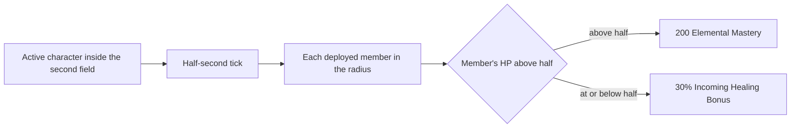

# Diona

Diona's kit is its record and one behaviour module, `createDionaKitBehaviour`, avatar 10000039 (`{data-root}/genshin-dump-backup-6.6/ExcelBinOutput/AvatarExcelConfigData.json`): five strikes (`{data-root}/cache/gcsim-v2.47.2/internal/characters/diona/attack.go:16`), a charged aimed shot, a collision and two plunges (the wiki's Kätzlein Style rows in `{data-root}/cache/genshin-wiki/Category_Diona_Talents.json`), Icy Paws' tap and hold with their paws and shields, and Signature Mix's initial hit with its field. Her multipliers are read from proud skill groups 3931, 3932 and 3939 of the dump (`{data-root}/genshin-dump-backup-6.6/ExcelBinOutput/ProudSkillExcelConfigData.json`); the shield's share of Max HP and flat HP (group 3932 at indices 1 and 2, 7.2% and 692.8 at level 1, the wiki's Icy Paws table in `{data-root}/cache/genshin-wiki/Category_Diona_Talents.json`), its seconds, and the hold's bonus, the tap's cooldown, and the burst's cooldown, energy cost and seconds are read from the same groups, with the tap's 6 seconds at index 3 of group 3932 and the burst's 20 seconds, 80 energy and 12 seconds at indices 4, 5 and 6 of group 3939 (the dump's rows, `{data-root}/genshin-dump-backup-6.6/ExcelBinOutput/AvatarSkillExcelConfigData.json` for skills 10392 and 10395, and gcsim's `{data-root}/cache/gcsim-v2.47.2/internal/characters/diona/skill.go:68` and `{data-root}/cache/gcsim-v2.47.2/internal/characters/diona/burst.go:87`). The shield's seconds are not read from the group's duration: see Provisional constants. A press sets its shield from her Max HP, the hold's at the table's bonus (gcsim's `{data-root}/cache/gcsim-v2.47.2/internal/characters/diona/skill.go:95` and `{data-root}/cache/gcsim-v2.47.2/internal/characters/diona/skill.go:93`, 1.75 with five paws), and Constellation 2 raises either by 15% (`{data-root}/cache/gcsim-v2.47.2/internal/characters/diona/skill.go:96-97`). The field is a circle of radius 7 round her body (gcsim's `{data-root}/cache/gcsim-v2.47.2/internal/characters/diona/burst.go:48`) that heals the active character each two seconds (`{data-root}/cache/gcsim-v2.47.2/internal/characters/diona/burst.go:55-56`), and its six ticks of damage are a summon from the cast. Constellation 1's 15 energy comes as the field ends (`{data-root}/cache/gcsim-v2.47.2/internal/characters/diona/burst.go:83`). From Constellation 6, a second field of the same circle ticks each half-second and buffs every deployed member: 200 Elemental Mastery above half its HP, or 30% Incoming Healing Bonus at or below it (`{data-root}/cache/gcsim-v2.47.2/internal/characters/diona/cons.go:34-54`, with the 200 at `{data-root}/cache/gcsim-v2.47.2/internal/characters/diona/diona.go:38`), each lasting to the next tick. From Ascension 4, Drunkards' Farce cuts the ATK of each enemy the burst's initial hit or a tick strikes by 10% for 15 seconds, the talent table's values (`{data-root}/cache/genshin-wiki/Category_Diona_Talents.json`), which gcsim leaves unbuilt (`{data-root}/cache/gcsim-v2.47.2/internal/characters/diona/asc.go:21`); an enemy struck by the burst stands in for one that enters its AoE. Her Ascension 1 passive, Cat's Tail Secret Menu, is not built, as no kit hook reaches a shielded character's Movement SPD or stamina consumption, and Constellation 4 is not built, as the kit events do not reach it (gcsim's `{data-root}/cache/gcsim-v2.47.2/internal/characters/diona/aimed.go:83` needs the field's status and the aimed shot's charge). The charged aimed shot's frames are gcsim's (`{data-root}/cache/gcsim-v2.47.2/internal/characters/diona/aimed.go:19`, hitmarks 15 and 86).

## Decisions

- **Diona's shields are set as the press starts, and her paws reach 5 metres.** gcsim sets a shield as each paw lands and prices a paw as a circle of radius 0.5 on the primary target (`{data-root}/cache/gcsim-v2.47.2/internal/characters/diona/skill.go:165-169`); an area does not hold a target, so the paws reach as the targeting does, the record's `skill.hits.1.area` giving the 5-metre reach. Each paw's poise and the hold threshold are open (see Provisional constants).

- **Signature Mix's field stands where Diona cast it.** gcsim centres its ticks on the primary target (`{data-root}/cache/gcsim-v2.47.2/internal/characters/diona/burst.go:41`), which the [framework decisions](../README.md#framework-decisions) price at the targeting reach plus the ticks' radius, 21.5. The ticks keep gcsim's 6.5 round the field instead (`{data-root}/cache/gcsim-v2.47.2/internal/characters/diona/burst.go:41`), held as `DiffersFromSource`, as they are a summon from the cast.

- **Constellation 6's buffs ride a second field on the half-second tick.** The wiki's Signature Mix page gives Cat's Tail Closing Time as buffing characters within Signature Mix's radius (its constellation 6 note, with the 30% and 200 values, in `{data-root}/cache/genshin-wiki/Category_Diona_Talents.json`), where gcsim gives the buff to the active character alone (`{data-root}/cache/gcsim-v2.47.2/internal/characters/diona/cons.go:34`). The buff is a second field of the same circle, ticking every half-second from the initial hit (`{data-root}/cache/gcsim-v2.47.2/internal/characters/diona/cons.go:28`), and each tick sets the buffs to last until the next, a duration gcsim does not use (see Provisional constants). The field's tick runs as [shared effects](../README.md#shared-effects) gives it, so the buffs fade within half a second of the body leaving. Party members hold no place of their own in the world, so every deployed member stands in the radius with the body, and each member takes the Elemental Mastery or the Incoming Healing Bonus by its HP share at the tick.

## Provisional constants

- **The shield's seconds read the hold's cooldown.** The kit reads group 3932 at index 4, which the dump gives as 15, the hold's cooldown (the wiki's Holding CD 15s, gcsim's `{data-root}/cache/gcsim-v2.47.2/internal/characters/diona/skill.go:80`), where the shield's duration is index 5, 1.8 seconds at level 1 (the wiki's "1.8–2.4s per Paw", and gcsim's `pawDur`, which adds one such duration for each paw that hits, capped at five). The kit's shield outlasts the game's: the overlay's `parameters.shieldSeconds` reads index 4 (`packages/genshin-world/src/data/kits/diona.json`).
- **The paws' poise is the spec's provisional zero.** The wiki's Icy Paw DMG gives 30 poise each (its advanced properties), but the spec pins that zero as provisional, so the kit's paws deal none.
- **The hold's threshold is open.** The half-second hold threshold has no source in gcsim, whose hold is a release at 29 frames (`{data-root}/cache/gcsim-v2.47.2/internal/characters/diona/skill.go:20`), or in the cached wiki.
- **The plunges' frames are unsourced.** gcsim has no plunge file for Diona, so the plunges' frames wait on a recording.
- **Constellation 6's buffs last until the next tick.** The wiki gives no duration for Cat's Tail Closing Time, and gcsim gives the active character's buff 2 seconds (`{data-root}/cache/gcsim-v2.47.2/internal/characters/diona/cons.go:48`); the kit's rule is its own, and gcsim's is the other source.
- **Constellation 2 adds damage in gcsim too.** gcsim's `{data-root}/cache/gcsim-v2.47.2/internal/characters/diona/cons.go:12-25` gives Icy Paws' elemental-skill attacks 15% DMG at Constellation 2, which the design and the spec leave out, beside the shield. The cached wiki's Shaken, Not Purred text is not in the cache to settle it.
- **Drunkards' Farce's trigger.** The wiki's gameplay note says the 10% ATK cut is not applied on entering Signature Mix's AoE but periodically to enemies inside it on each tick of its damage (`{data-root}/cache/genshin-wiki/Category_Diona_Talents.json`, Drunkards' Farce), and the kit applies it to a strike that stands in for a tick, which has no source.

## Key files

| File                                                             | Role                                                                                                                                     |
| :--------------------------------------------------------------- | :--------------------------------------------------------------------------------------------------------------------------------------- |
| `packages/genshin-world/src/services/kit/characters/dionaKit.ts` | `createDionaKitBehaviour`, Diona's kit with Icy Paws' tap and hold, its shields, Signature Mix's field and its constellations 1, 2 and 6 |

## Sources

- [gcsim v2.47.2](https://github.com/genshinsim/gcsim/tree/v2.47.2/internal/characters/diona), MIT: the kit's hitmarks, cancel frames and areas, Icy Paws' hitmarks, travel and paw count, its shield's duration and cooldown, Signature Mix's frames, ticks and field, and her constellations' shield and energy. The v2.47.2 source is on disk at `{data-root}/cache/gcsim-v2.47.2/internal/characters/diona`, and the lines cited above are in it.
- Genshin Impact Wiki, cached at `{data-root}/cache/genshin-wiki/Category_Diona_Talents.json`: the pages Kätzlein Style (her strikes, charged attack and plunges), Icy Paws (the shield's table, the paws' 30 poise, the CDs and the hold's 1.75 multiplier), Signature Mix (the field's values, 12 seconds, CD 20s, energy 80, poise 50, and Cat's Tail Closing Time), Cat's Tail Secret Menu and Drunkards' Farce.
- The dump, `{data-root}/genshin-parity/text/ExcelBinOutput`: `{data-root}/genshin-dump-backup-6.6/ExcelBinOutput/ProudSkillExcelConfigData.json` (groups 3931, 3932 and 3939) and `{data-root}/genshin-dump-backup-6.6/ExcelBinOutput/AvatarSkillExcelConfigData.json` (skills 10391, 10392 and 10395, with the tap's CD 6 and the burst's CD 20 and energy cost 80).
- `{data-root}/cache/gcsim-v2.47.2/internal/characters/diona/skill.go`, lines 96 to 97 (gcsim): grounds the requirement Constellation 2 shields.
- The wiki gives no duration for Cat's Tail Closing Time, and gcsim sets the buff at 2 seconds (`{data-root}/cache/gcsim-v2.47.2/internal/characters/diona/cons.go:48`): grounds the requirement Constellation 6 buffs the team, its buffs lasting until the next tick.
- Genshin Impact Wiki, Drunkards' Farce's gameplay note on when the ATK cut applies, in the wiki cache above: grounds the requirement Signature Mix cuts the ATK of the enemies it strikes from Ascension 4.
- Genshin Impact Wiki, Icy Paw DMG's advanced properties (30 poise each), in the wiki cache above: grounds the requirement Paws deal no poise.
