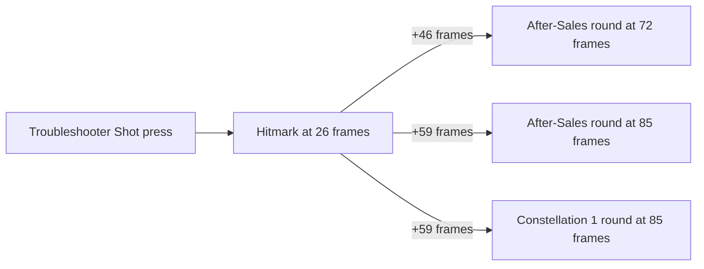

# Dori

Dori's kit is its record and one behaviour module, `createDoriKitBehaviour`, avatar 10000068 (`{data-root}/genshin-parity/text/ExcelBinOutput/AvatarExcelConfigData.json`): three strikes (`{data-root}/cache/gcsim-v2.47.2/internal/characters/dori/attack.go:23`), a charged attack, a collision and two plunges (`{data-root}/cache/genshin-wiki/Category_Dori_Talents.json`), Troubleshooter Shot with its After-Sales Service Round, and Alcazarzaray's Exactitude's Connector field. Her multipliers are read from proud skill groups 6831, 6832 and 6839 of the dump (`packages/genshin-world/src/services/kit/characters/doriKit.ts`, `{data-root}/genshin-parity/text/ExcelBinOutput/ProudSkillExcelConfigData.json`); the skill's cooldown, the burst's cooldown, energy cost and duration, and the charged attack's stamina and maximum duration come from the same groups: the skill's 9 seconds at group 6832's index 2 (gcsim's `{data-root}/cache/gcsim-v2.47.2/internal/characters/dori/skill.go:72`, `9*60`), the burst's 20 seconds, 80 energy and 12 seconds at group 6839's indices 5, 6 and 4 (gcsim's `{data-root}/cache/gcsim-v2.47.2/internal/characters/dori/burst.go:119` and `{data-root}/cache/gcsim-v2.47.2/internal/characters/dori/dori.go:19`), and the charged attack's 40 stamina a second and 5 seconds at group 6831's indices 6 and 7 (the wiki's Marvelous Sword-Dance maximum duration, 5s, `{data-root}/cache/genshin-wiki/Category_Dori_Talents.json`). A press inside its cooldown, or a burst cast short of its energy, is refused by gcsim's action check (`{data-root}/cache/gcsim-v2.47.2/pkg/core/player/exec.go` lines 40 to 46). The particles are not built.

Not yet built: Continuous Healing and Energy Regeneration, which the burst's own clock of 11, 131 and every 120 frames sets (gcsim's `{data-root}/cache/gcsim-v2.47.2/internal/characters/dori/burst.go:115`, `120*i+11`) and which no field can yet heal on; the Electro infusion the burst gives Dori herself (gcsim's `{data-root}/cache/gcsim-v2.47.2/internal/characters/dori/burst.go:76-80`), which waits on a hook that infuses the kit's own character; and the passives and Constellations 2, 4 and 6, which wait on that healing, the self-infusion and the passive hook.

## Decisions

- **The charged attack is provisional.** gcsim has no charged attack for Dori (its attack file has none, `{data-root}/cache/gcsim-v2.47.2/internal/characters/dori/attack.go`), so the spin and the final hit follow [a borrowed charged attack](../README.md#how-a-kit-is-read), with the table's multipliers, its stamina per second and its maximum duration, 5 seconds or 300 frames, which the wiki and the dump both give (`{data-root}/cache/genshin-wiki/Category_Dori_Talents.json`, `{data-root}/genshin-parity/text/ExcelBinOutput/ProudSkillExcelConfigData.json`); the spin lands at the start, a value no source gives (see Provisional constants). The timings stand as estimates until a recording settles them.
- **The Connector ticks run to 772 frames, past the table's 12 seconds.** gcsim runs its 32 ticks (`{data-root}/cache/gcsim-v2.47.2/internal/characters/dori/burst.go:47`) every 24 frames from its hitmark of 28 (`{data-root}/cache/gcsim-v2.47.2/internal/characters/dori/burst.go:18`, `:88`, `24*i+burstHitmark`), the last at 24 × 31 + 28 = 772 frames, or 12.9 seconds, with no duration check, so the field lasts until the last of them, as gcsim has it.
- **Poise.** The wiki's Dori page gives Troubleshooter Shot 30, the Connector 8 and the plunging collision 35 (its advanced properties, `{data-root}/cache/genshin-wiki/Category_Dori_Talents.json`), and the built kit deals 30 for Troubleshooter Shot and 35 for the collision, but none for the Connector, whose burst carries no poise. gcsim gives none of the three: its skill and burst carry no poise, and its plunge's collision (`{data-root}/cache/gcsim-v2.47.2/internal/characters/dori/plunge.go:169`) carries none, the low and high plunges' 150 and 200 at `{data-root}/cache/gcsim-v2.47.2/internal/characters/dori/plunge.go:85` and `:135` being the only ones in that file. Its three normal attacks carry their own, 95.22, 46.5175 and 127.42 (`{data-root}/cache/gcsim-v2.47.2/internal/characters/dori/attack.go` lines 17 and 42), which match the wiki's rows. The wiki's poise fills a hit gcsim gives none, as [framework decisions](../README.md#framework-decisions) sets out, and the built kit takes it for Troubleshooter Shot and the collision, not for the Connector.
- **The After-Sales Service Round lands from the skill's spot.** Its two hits are the skill's own, at 72 and 85 frames, past its 44-frame animation (`{data-root}/cache/gcsim-v2.47.2/internal/characters/dori/skill.go:22`), where gcsim queues them off the first hit's landing, which is the same moment as the skill's 26-frame hitmark: `skillRelease` 16 (`{data-root}/cache/gcsim-v2.47.2/internal/characters/dori/skill.go:15`) plus the default travel of 10 (`{data-root}/cache/gcsim-v2.47.2/internal/characters/dori/skill.go:30`), at `{data-root}/cache/gcsim-v2.47.2/internal/characters/dori/skill.go:66`. Counted from that hitmark, its rounds are 46 and 59 frames (`{data-root}/cache/gcsim-v2.47.2/internal/characters/dori/skill.go:19`, "skillSalesHitmarks"), so 72 and 85.
- **Constellation 1's extra round is cast from the skill's spot as the press starts.** gcsim's "skillSalesHitmarks" (`{data-root}/cache/gcsim-v2.47.2/internal/characters/dori/skill.go:19`) gives a third round the same 59 frames past the skill's hitmark as its second, so it lands at the second round's 85 frames after the press (`{data-root}/cache/gcsim-v2.47.2/internal/characters/dori/cons.go:14`). The kit summons the skill's last hit there, with the body as the skill's own rounds are (`packages/genshin-world/src/services/kit/characters/doriKit.ts`).

## Provisional constants

- **The charged attack's spin timing and both circles are unsourced.** The record holds the spin at 0 frames and the final at 300, against the claymore rule's 30 and 60 frames and 72 of animation (`scripts/src/services/genshinAssets/kits/constants.ts:92-93`), which the overlay names as the source they differ from (`DiffersFromSource`); the cached wiki does not name Dori's weapon type, so that classification is the overlay's. The 0 frames has no source, and the radius of 2 metres on both circles is marked `Unsourced`. Both wait on a recording.

## Key files

| File                                                            | Role                                                                                                                 |
| :-------------------------------------------------------------- | :------------------------------------------------------------------------------------------------------------------- |
| `packages/genshin-world/src/services/kit/characters/doriKit.ts` | `createDoriKitBehaviour`, Dori's kit with Troubleshooter Shot, its After-Sales Service Round and the Connector field |

## Sources

- [gcsim v2.47.2](https://github.com/genshinsim/gcsim/tree/v2.47.2/internal/characters/dori), MIT: Dori's strikes' hitmarks, cancels and poise, Troubleshooter Shot's hitmark and After-Sales Service Round's hits, Alcazarzaray's Exactitude's Connector ticks, and the low and high plunges' hitmarks and poise. The v2.47.2 source is on disk at `{data-root}/cache/gcsim-v2.47.2/internal/characters/dori`, and the lines cited above are in it.
- Genshin Impact Wiki, cached at `{data-root}/cache/genshin-wiki/Category_Dori_Talents.json`: the pages Spirit-Warding Lamp: Troubleshooter Cannon (its CD 9s and poise 30 and 10), Alcazarzaray's Exactitude (its energy cost 80, CD 20s, duration 12s, and the Connector's poise 8) and Marvelous Sword-Dance (Modified) (the strikes' poise, the charged attack's maximum duration of 5s, and the collision's poise 35).
- The dump, `{data-root}/genshin-parity/text/ExcelBinOutput`: `ProudSkillExcelConfigData.json` (groups 6831, 6832 and 6839) and `AvatarSkillExcelConfigData.json` (skills 10681, 10682 and 10685).
- [gcsim v2.47.2](https://github.com/genshinsim/gcsim/tree/v2.47.2/internal/characters/dori), MIT: gives Troubleshooter Shot, the Connector and the plunging collision no poise, as the Decisions above set out; grounds Requirement: Poise from the shot, the Connector and the collision.
- Genshin Impact Wiki, cached at `{data-root}/cache/genshin-wiki/Category_Dori_Talents.json`: the Advanced Properties' poise for Troubleshooter Shot, the Connector and the plunging collision (30, 8 and 35); grounds Requirement: Poise from the shot, the Connector and the collision.
- A recording of the game, not yet taken: it would settle the charged attack's timings, which stand as estimates until it does; grounds Requirement: Provisional charged attack.

## Open

- [ ] **The charged attack's spin lands at the start** — no source yet: no source gives the spin's frame of 0, and gcsim has no charged attack for Dori to take it from.
- [ ] **The charged attack's two circles, radius 2 metres** — no source yet: the wiki and gcsim give no radius for Dori's charged attack, and the record marks it `Unsourced`.
