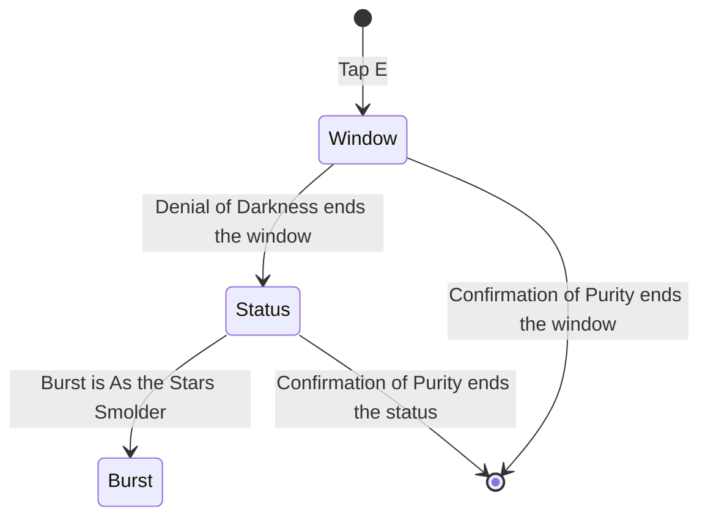

# Durin

Durin's kit is its record and one behaviour module, `createDurinKitBehaviour`, on avatar 10000123 (`{data-root}/genshin-dump-backup-6.6/ExcelBinOutput/AvatarExcelConfigData.json`, named Durin in `{data-root}/genshin-dump-backup-6.6/TextMap/TextMap_MediumEN.json`): his four strikes, a charged attack, a plunge collision and two plunges (`{data-root}/cache/genshin-wiki/Category_Durin_Talents.json`, Radiant Wingslash), Tap E, which opens a six-second window, its two recasts (the same file, Binary Form), and As the Light Shifts and As the Stars Smolder (the same file, Principle of Purity), the burst the Denial of Darkness recast switches to. His multipliers are read from proud skill groups 12331, 12332 and 12339 of the dump (`{data-root}/genshin-dump-backup-6.6/ExcelBinOutput/ProudSkillExcelConfigData.json`), matching gcsim's to six decimal places (the charged attack's index 5, 1.13434, against `zz_durin.dm.go:126`; the white burst's first initial hit, index 0, 1.1896, against `zz_durin.dm.go:233`; the white Dragon's index 6, 0.9464, against `zz_durin.dm.go:339`). The same groups give the charged attack's stamina (12331's index 6, 20), the burst's cooldown and energy cost (12339's indices 10 and 11, 18 seconds and 70), and the skill's cooldown (12332's index 5, 12 seconds).

## Decisions

- **Durin's strikes are physical and land on their hitmarks, with no travel.** gcsim queues each at its hitmark (`attack.go:16`), so the strikes land at 11, 9, 14 and 37 (the third strike's two hits) and 38 frames, in animations of 29, 30, 55 and 66 frames (`attack.go:27`, `:31`, `:35`, `:39`). The first three are circles of 2.15, 2.15 and 2.4 metres, and the last a box of 3.3 by 4.8 metres (`attack.go:18`), every one offset as gcsim has it and physical (`attack.go:58`).
- **His charged attack is a circle of 2.5 metres centred 0.8 metres ahead, at 17 frames in an animation of 58.** It is physical (`charge.go:34`), and costs 20 stamina (the wiki's stamina 20, `{data-root}/cache/genshin-wiki/Category_Durin_Talents.json`, Radiant Wingslash, and the table's index 6 at group 12331, `{data-root}/genshin-dump-backup-6.6/ExcelBinOutput/ProudSkillExcelConfigData.json`), read from the table's index after its multiplier (`charge.go:14`, `:17`, `:41`).
- **Tap E plays no hit of its own, and opens the window.** gcsim's Tap E deals no damage, so the press builds no hit (the wiki's Binary Form page lists damage rows for the two recasts only, `{data-root}/cache/genshin-wiki/Category_Durin_Talents.json`). It starts a window of six seconds (`skill.go:22`, `:60-64`), a stance of Denial of Darkness for his normal attacks, and a skill chain whose one follow-up is Confirmation of Purity. Its cooldown is the table's 12 seconds (`skill.go:65`, `{data-root}/genshin-dump-backup-6.6/ExcelBinOutput/ProudSkillExcelConfigData.json`, group 12332).
- **Confirmation of Purity is the skill's recast, a Pyro circle of 4.5 metres centred 1.2 metres ahead, at 35 frames in an animation of 83.** It ends the window and the Denial of Darkness status (`skill.go:91-92`), and gives the skill's energy of 6 (`{data-root}/cache/genshin-wiki/Category_Durin_Talents.json`, Binary Form's energy regeneration at level 1) once every six seconds, as gcsim's energy ICD does (`skill.go:96-98`, `:23`, `:41`, `:88`).
- **Denial of Darkness is the window's normal attack, three Pyro hits at 32, 37 and 42 frames in an animation of 67.** Each hit is a box 3 metres wide and 7 long, anchored 3 metres behind the body (`skill.go:16`, `:50`, `:123`). It ends the window, gives the same energy, and starts the Denial of Darkness status for 30 seconds (`skill.go:127-130`), which sets the burst to As the Stars Smolder (`burst.go:48`).

- **As the Light Shifts and As the Stars Smolder hit at 97, 121 and 154 frames (`burst.go:16`), in an animation of 104 (`burst.go:34`).** Each is a circle of 6.5 metres round the primary target (`burst.go:73`, `:152`), priced as the burst's targeting reach plus the circle, Pyro at one unit of gauge (the wiki's `gu = 1U` on the Principle of Purity page, `{data-root}/cache/genshin-wiki/Category_Durin_Talents.json`). The Dragon's DoT is a summon on the primary target, of twenty ticks for the white Dragon and sixteen for the black (`burst.go:20-21`, `:87-88`, `:160-161`): the white's ticks are circles of 3.5 metres, from 155.2 frames at 58.8 frames apart (`burst.go:22`, `:24`, `:127`), and the black's circles of 1.5 metres, from 175.4 frames at 73.6 apart (`burst.go:23`, `:25`, `:199`), the black's each travelling 9 frames after its tick, gcsim's default travel (`burst.go:49-51`, `:200`). A new burst ends the Dragon of the other. The Dragon's ticks are held by the named lists, not the burst's own list, which is its three initial hits where gcsim counts twenty. The white Dragon's ticks are index 6, which gcsim's "burstWhiteDoT" gives at level one (0.9464, `zz_durin.dm.go:339`), and the black's are index 7, the table "burstBlackDoT" at `zz_durin.dm.go:356`. The six initial hits take their multipliers from gcsim by reference, not as fixed level-one numbers: indices 0 to 2 for the white and 3 to 5 for the black, of proud skill group 12339 (`{data-root}/genshin-dump-backup-6.6/ExcelBinOutput/ProudSkillExcelConfigData.json`), read from the rows of gcsim's "burstWhiteInitial" and "burstBlackInitial" tables ("zz_durin.dm.go" lines 231 and 284), so each scales with the burst's talent level.
- **The burst's cooldown is 18 seconds and its energy cost 70, both from the table (`{data-root}/genshin-dump-backup-6.6/ExcelBinOutput/ProudSkillExcelConfigData.json`, group 12339's indices 10 and 11).** gcsim's cooldown is "burstCD" (`burst.go:26`, 18 × 60), and its energy cost is the character's maximum energy (`durin.go:22`), which agrees with the table's 70 (the wiki's CD 18s and energy cost 70).
- **His plunges are provisional.** Durin has no plunge file in gcsim; the kit shares the plunge reach and borrows its timings as [a borrowed plunge](../README.md#how-a-kit-is-read) sets out, under his own multipliers. The plunges' poise, 100 low and 150 high, is the wiki's (`{data-root}/cache/genshin-wiki/Category_Durin_Talents.json`, the Radiant Wingslash page, his normal attack page), as is the collision's 25, the exception the [kits README](../README.md#how-a-kit-is-read) gives for a borrowed collision. The [roadmap](../../../../changes/genshin-roadmap/tasks.md) holds the question.
- **The black burst's travel is fixed at gcsim's default of 9 frames.** gcsim reads a `travel` parameter on the burst, and the kit cannot read a parameter of the action yet, so it plays the default.

## Not built

- **His passives and constellations are not built.** They read the burst's state, the Burning and Pyro reactions and the team's buffs, none of which a passive prices yet, so the kit prices his strikes, recasts and bursts without them.
- **The Pyro particles of his recasts are not built.** gcsim drops four Pyro particles on each enemy his recasts strike (`skill.go:153-154`), once every 0.3 seconds (`skill.go:151`), delayed by the particle delay. A kit's hit has no particle drop with its own delay and internal cooldown, so the energy the recasts give is built, and the particles wait on that hook.
- **A skill press after Denial of Darkness, within the window's remaining seconds, plays Confirmation of Purity.** gcsim's Denial of Darkness ends the window, so the next press is Tap E, which the skill's cooldown holds. A kit's skill chain is not ended by its stance's normal attack, so the press still reads the chain's follow-up until the window's seconds run out. This differs from gcsim only in that press, and it waits on a hook that lets a stance end a skill chain.

## Key files

| File                                                             | Role                                                                                                                                                                |
| :--------------------------------------------------------------- | :------------------------------------------------------------------------------------------------------------------------------------------------------------------ |
| `packages/genshin-world/src/services/kit/characters/durinKit.ts` | `createDurinKitBehaviour`, Durin's strikes, charged attack, provisional plunges, Tap E's window and its recasts, and the two Dragon bursts with their status switch |

## Sources

- [gcsim](https://github.com/genshinsim/gcsim/tree/v2.47.2/internal/characters/durin), MIT: each strike's hitmarks, animation and reach, the charged attack's circle, hitmark and animation, Tap E's window, both recasts and Denial of Darkness's status, and the bursts' hitmarks, animations, multipliers and DoT schedules, read from `attack.go`, `charge.go`, `skill.go` and `burst.go`, the multipliers from the talent tables in "zz_durin.dm.go", with `cons.go` and `asc.go` for the mechanics waiting on their hooks.
- The proud skill groups' indices, read from gcsim's data file for the character, which lists each multiplier beside its group.
- [gcsim](https://github.com/genshinsim/gcsim/blob/v2.47.2/internal/characters/bennett/plunge.go), MIT: for want of a plunge file in Durin's own folder, Bennett's plunge timings. The poise comes from the wiki below.
- Genshin Impact Wiki, cached at `{data-root}/cache/genshin-wiki/Category_Durin_Talents.json`: the page Radiant Wingslash (his normal attack page: the collision's poise 25, the low and high plunges' 100 and 150, and the charged attack's stamina 20), and Principle of Purity: As the Light Shifts (the burst's CD 18s, energy cost 70, the hits' poise and gauge 1U).
- The dump, `{data-root}/genshin-parity/text/ExcelBinOutput`: `ProudSkillExcelConfigData.json` (groups 12331, 12332 and 12339) and `AvatarSkillExcelConfigData.json` (skills 11231, 11232 and 11235, with the skill's CD 12 and the burst's CD 18 and energy cost 70).

## Open

- [ ] **The black burst's 9-frame travel** — no source yet: the game's travel for the black Dragon's ticks, since gcsim's 9 frames is its own default (`burst.go:51`).
