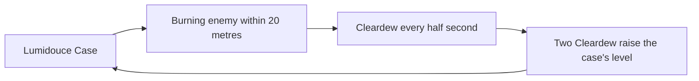

# Emilie

Emilie's kit is its record and one behaviour module, `createEmilieKitBehaviour`, on avatar 10000099: her four strikes, a charged attack, a plunge collision and two plunges, the Lumidouce Case's summon hit (`{data-root}/cache/gcsim-v2.47.2/internal/characters/emilie/skill.go` line 16, "lumidouceSummonHitmark" 37) with Spiritbreath Thorn, and her Constellation 2 and Ascension 4. Her multipliers are read from proud skill groups 9931, 9932 and 9939 of the dump (`{data-root}/genshin-parity/text/ExcelBinOutput/ProudSkillExcelConfigData.json`), matching gcsim's to four decimal places (`{data-root}/cache/gcsim-v2.47.2/internal/characters/emilie/zz_emilie.dm.go` lines 48, 118, 136, 190, 262, which are the dump's 0.485608, 0.91332, 0.639324, 0.4708 and 2.172). The skill cools for 14 seconds (the dump's 9932 at index 6, the wiki's CD 14s in `{data-root}/cache/genshin-wiki/Category_Emilie_Talents.json`), the burst for 13.5 with an energy cost of 50 (the dump's 9939 at indices 2 and 3, the wiki's CD 13.5s and `energycost=50`, and `{data-root}/cache/gcsim-v2.47.2/internal/characters/emilie/emilie.go` line 27), and the charged attack costs 25 stamina (the wiki's `stamina=25`, and the dump's 9931 at index 5).

## Decisions

- **Her strikes are priced as gcsim has them, round the primary target.** Her first, third and fourth are circles centred 0.4 metres ahead, of radii 2, 2.5 and 3, and her second a box of 1.6 by 3 metres on the target (gcsim's `{data-root}/cache/gcsim-v2.47.2/internal/characters/emilie/attack.go` lines 18 to 31). Her strikes and charged attack are physical, so they deal no element and no gauge (`attack.go` line 63, `charge.go` line 32).
- **Spiritbreath Thorn lands with every press.** Its cooldown of 10 seconds (the wiki's `interval=10s` in `{data-root}/cache/genshin-wiki/Category_Emilie_Talents.json`, and the dump's 9932 at index 5) has always run out before the skill's of 14 comes round again, so the skill lands it each time. Its hit at 62 frames (`{data-root}/cache/gcsim-v2.47.2/internal/characters/emilie/skill.go` line 18) falls past the skill's 37-frame animation (`skill.go` line 26), and lands on the action's clock as the framework has late hitmarks.
- **Constellation 2 cuts the Dendro RES of each enemy the skill's hits strike by 30% for 10 seconds.** gcsim applies it to every enemy hit whose damage is not zero (`{data-root}/cache/gcsim-v2.47.2/internal/characters/emilie/cons.go` line 90), for 10 seconds (`cons.go` line 22) at minus 30% Dendro RES (`cons.go` line 101), which the kit reads as an enemy status on each hit, given Emilie's constellations.
- **Ascension 4 adds a DMG Bonus of 0.15 per 1000 of her total ATK, to a cap of 36%, to each strike that lands on a Burning enemy (`{data-root}/cache/gcsim-v2.47.2/internal/characters/emilie/asc.go` lines 60 to 63).** It is read through the kit's strike damage bonus, from her attack as it stands.
- **The plunges' reach is gcsim's**, a circle of radius 1 for the collision and of radii 3 and 5 for the low and high plunge, each centred a metre ahead of the body (`{data-root}/cache/gcsim-v2.47.2/internal/characters/emilie/plunge.go` lines 28 and 33, and `Point{Y: 1}`), with the collision at 41 frames and the plunges' hitmarks at 47 and 49 (`plunge.go` lines 21 to 23). Their poise is 100 and 150 (`plunge.go` lines 27 and 32, and the wiki's Low Plunge `poise7 = 100` and High Plunge `poise8 = 150` in `{data-root}/cache/genshin-wiki/Category_Emilie_Talents.json`). The collision's poise is the wiki's 25 (`poise6 = 25`), and gcsim gives none (`plunge.go` lines 159 to 171 carry no poise).

## Not built

- **The Lumidouce Case, its ticks and its levels wait on the Cleardew hook.** The case strikes every 1.5 seconds at level 1 (`lumidouce.go:25`), and rises to levels 2 and 3 as Cleardew is generated: a Burning enemy within 20 metres of the case (`lumidouce.go:98`) generates one every half second (`lumidouce.go:28`), and two of them raise its level (`lumidouce.go:135-137`). Until a kit can read the Burning enemies in an area and keep the case's scents, the case's ticks and levels are not built, so the skill deals its summon hit and Thorn only.

- **The burst waits on the Cleardew hook.** The burst is the Lumidouce Case at level 3, which strikes a random enemy in its radius of 12 metres every 0.3 seconds (`burst.go:18`, `:20`); a field's tick can draw that enemy, since it is given the world's context and its random source. Until the hook lands the burst's action is a placeholder: it spends the energy and starts the cooldown, and deals nothing.
- **Cleardew Cologne (Ascension 1) and Constellation 1 wait on the Cleardew hook.** Constellation 1 generates Cleardew when a Burning enemy takes Dendro, and Cleardew Cologne spends two of it on a hit from the case.
- **Constellation 6 waits on the Cleardew hook and on a flat damage infusion.** It adds 3 times Emilie's total ATK as flat damage to her normal and charged attacks for 5 seconds (`cons.go:130-131`, `:23`), changes them to Dendro and generates Cleardew, which an infusion that adds flat damage does not yet express.
- **The skill's and the case's particles are not built.** A hit's particles are not a kit step's yet, as the Traveler's and Zhongli's are not.

## Key files

| File                                                              | Role                                                                                                                                                   |
| :---------------------------------------------------------------- | :----------------------------------------------------------------------------------------------------------------------------------------------------- |
| `packages/genshin-world/src/services/kit/characters/emilieKit.ts` | `createEmilieKitBehaviour`, Emilie's kit with her strikes, plunges, the Lumidouce Case's summon hit and Thorn, and her Constellation 2 and Ascension 4 |

## Sources

- [gcsim](https://github.com/genshinsim/gcsim/tree/v2.47.2/internal/characters/emilie), MIT: the strikes' hitmarks, animations and reaches, the charged attack's box, the plunges' circles, collision and hitmarks, the skill's summon hit and Thorn, the burst's animation, Constellation 2 and Ascension 4, and the proud skill groups' indices, read from gcsim's Emilie data file. The v2.47.2 source is on disk at `{data-root}/cache/gcsim-v2.47.2/internal/characters/emilie`, and the lines cited above are in it.
- Genshin Impact Wiki, cached at `{data-root}/cache/genshin-wiki/Category_Emilie_Talents.json`: the pages Fragrance Extraction (the skill's CD 14s, the Thorn's interval 10s, the case's 22 seconds, and the Lumidouce hits' poise), Aromatic Explication (the burst's CD 13.5s and energy cost 50), and Shadow-Hunting Spear (Custom) (her strikes' poise, the charged attack's stamina 25, and the low and high plunges' 100 and 150).
- The dump, `{data-root}/genshin-parity/text/ExcelBinOutput`: `ProudSkillExcelConfigData.json` (groups 9931, 9932 and 9939) and `AvatarSkillExcelConfigData.json` (skills 10991, 10992 and 10995).
- Genshin Impact Wiki, cached at `{data-root}/cache/genshin-wiki/Category_Emilie_Talents.json`, Shadow-Hunting Spear (Custom): the collision's `poise6 = 25`, which grounds Requirement: Plunge poise and the scenario "The collision attack deals poise".
- `{data-root}/cache/gcsim-v2.47.2/internal/characters/emilie/plunge.go`, lines 159 to 171, which carry no poise, so gcsim gives the collision none: grounds Requirement: Plunge poise.
