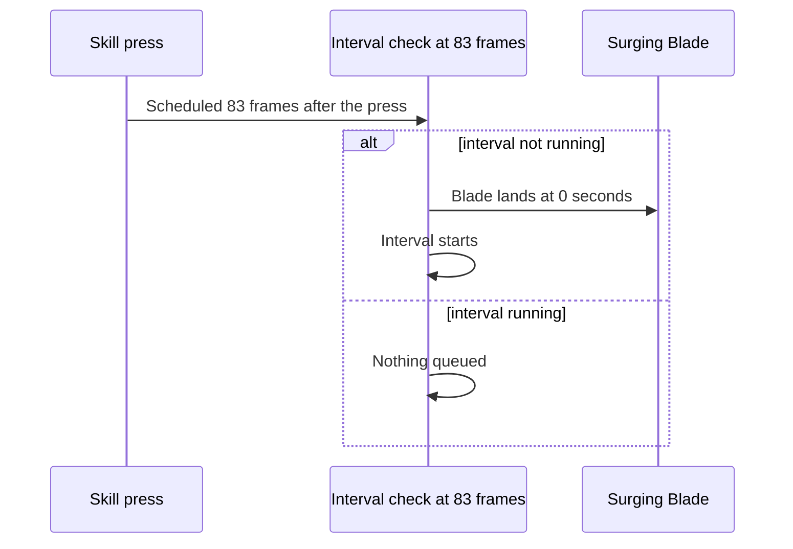

# Escoffier

Escoffier's kit is its record and one behaviour module, `createEscoffierKitBehaviour`, avatar 10000112 (`{data-root}/genshin-dump-backup-6.6/ExcelBinOutput/AvatarExcelConfigData.json`): her three normal attacks, a charged attack, and a low, high and collision plunge, with Low-Temperature Cooking as her skill, Scoring Cuts as her burst, and Rehab Diet from Ascension 1 (`{data-root}/cache/genshin-wiki/Category_Escoffier_Talents.json`). Her multipliers are read from proud skill groups 11231, 11232 and 11239 of the dump (`{data-root}/genshin-dump-backup-6.6/ExcelBinOutput/ProudSkillExcelConfigData.json`), the skill's press, tick, Surging Blade and interval among them and the burst's hit and heal (`{data-root}/cache/gcsim-v2.47.2/internal/characters/escoffier/burst.go:35`). The charged attack costs 25 stamina (the wiki's stamina 25, `{data-root}/cache/genshin-wiki/Category_Escoffier_Talents.json`, and the dump's 11231 at index 5), the skill cools for 15 seconds (the wiki's press CD 15s, `{data-root}/cache/gcsim-v2.47.2/internal/characters/escoffier/skill.go:26`), and the burst costs 60 energy, cooling for 15 seconds (the dump's 11239 at indices 4 and 3, and the wiki's CD 15s and energy cost 60, `{data-root}/cache/genshin-wiki/Category_Escoffier_Talents.json`).

## Not yet built

The parts that depend on another member's hit wait on the hooks named below, as [Not built in the framework](../README.md#not-built-in-the-framework) sets out.

- **Constellation 1 is built.** Her skill and burst each open a 15-second window on an Ascension 4 Escoffier while the deployed team holds only Cryo and Hydro members, as gcsim's `c1` in `cons.go` does (MIT, v2.47.2) (`{data-root}/cache/gcsim-v2.47.2/internal/characters/escoffier/cons.go:15`, `:49`); the cached wiki gives Constellation 1 only its title, Pre-Dinner Dance for Your Taste Buds, so its wording is not checked. In the window each deployed member's Cryo strikes get 60% Crit DMG: her own through `getStrikeCriticalDamageBonus`, a teammate's through `getPartyStrikeBonus`, read beside the element's crit damage as each hit is priced. Two divergences from gcsim: the team is checked on the cast, where gcsim checks it once at init; and the stellar reactions are not built.
- **Constellation 2 waits on the party-hit hook.** Cold Dishes adds 240% of her ATK to each Cryo normal, charged, plunge, Elemental Skill or Burst hit of another member while Frosty Parfait holds, for five hits (`cons.go:18`, `:110`, `:127`). A hit reading another member's buff is not built.
- **Constellation 4 waits on the seeded-roll hook.** Its six extra Rehab Diet ticks and their 1.0-share heal roll on the character's Crit Rate, which the framework does not roll (`cons.go:20-21`, `asc.go:26`).
- **Constellation 6 waits on the party-hit hook.** Special-Grade Frozen Parfait strikes the target once every half second (`cons.go:28`, `:198`), when the active character's normal, charged or plunge hit lands while Frosty Parfait holds. A hit reading the skill's status on another member is not built.
- **Arkhe waits on the Arkhe hook.** The Surging Blade's Arkhe application is gcsim's TODO (`skill.go:75`), so the blade deals its damage and applies no Arkhe, as gcsim gives it.
- **Her skill's cooldown delay waits on the cooldown-delay hook.** gcsim starts the 15 seconds 22 frames after the press (`skill.go:95`). The framework starts every skill's cooldown with the skill, so the cooldown here runs 22 frames early.

## Decisions

- **The plunges are the airborne ones.** gcsim plays her plunges as airborne moves, so the kit takes their frames: the low plunge at 41 frames of a 76-frame animation, the high at 43 of 77, and the collision at 35 (`{data-root}/cache/gcsim-v2.47.2/internal/characters/escoffier/plunge.go:21-23`, `:38`).
- **The strikes, the charged attack and the collision take the wiki's poise, as [framework decisions](../README.md#framework-decisions) fills it where gcsim gives none.** gcsim gives none to a normal attack, the charged attack or the collision (no `PoiseDMG` in `attack.go` or `charge.go`, and none in the collision at `plunge.go`), and the wiki's Kitchen Skills rows give 47.95, 44.27 and 34.11 for the normal attacks, 120 for the charged attack and 25 for the collision, the poise the kit takes.
- **The Surging Blade's interval is checked at its 83rd frame.** gcsim's task checks the 10-second interval 83 frames after the press, and queues the blade and starts the interval there only if it is not running (`{data-root}/cache/gcsim-v2.47.2/internal/characters/escoffier/skill.go` lines 18, 25 and 69 to 93). The kit schedules that check 83 frames after the press, starts the interval there, and lands the blade with its hitmark at 0 seconds. The record has no blade hitmark, so the kit sets it: gcsim's queued attack has zero delay (`{data-root}/cache/gcsim-v2.47.2/internal/characters/escoffier/skill.go` lines 89 and 90), so the blade hits at 0 seconds.

- **Scoring Cuts' heal is one tick of a field.** gcsim heals at frame 97 (`{data-root}/cache/gcsim-v2.47.2/internal/characters/escoffier/burst.go:15`) with no hit of its own, which the framework does not place, so the burst sets a field whose one tick heals the active character, as Diona's Signature Mix heals, and a second tick is kept past its end.
- **Rehab Diet is a field from the burst.** gcsim starts it from the burst on Ascension 1 or above, nine ticks from 157 frames every 58.5 frames (`{data-root}/cache/gcsim-v2.47.2/internal/characters/escoffier/asc.go:11-15`, nine at `asc.go:13`), each healing the active character for 1.3824 of her ATK, so the kit starts the same field from the burst's start.
- **Ascension 4's RES shred is set on each hit from the team as it stands.** gcsim takes 0, 5, 10, 15 or 55% off the enemy's Cryo and Hydro RES (`{data-root}/cache/gcsim-v2.47.2/internal/characters/escoffier/asc.go:19`) for 0 to 4 Hydro or Cryo members the team holds, herself included, for 12 seconds (`{data-root}/cache/gcsim-v2.47.2/internal/characters/escoffier/asc.go:16`), on each enemy her skill and burst hit (`packages/genshin-world/src/services/kit/characters/escoffierKit.ts`). Each hit's status reads its combatant's `deployedElements`, and the burst's hit is set through the burst behaviour's `hits`.
- **Frosty Parfait's ticks are a summon.** Its 21 ticks (`{data-root}/cache/gcsim-v2.47.2/internal/characters/escoffier/skill.go:19`) land on the primary target 5 frames after each tick (`{data-root}/cache/gcsim-v2.47.2/internal/characters/escoffier/skill.go:42-46`), as hits of a summon placed where she cast it, each priced as the target's reach and a circle of radius 1.5 (`{data-root}/cache/gcsim-v2.47.2/internal/characters/escoffier/skill.go:137`), the way the framework prices a hit on a target.

## Key files

| File                                                                 | Role                                                                                                                                  |
| :------------------------------------------------------------------- | :------------------------------------------------------------------------------------------------------------------------------------ |
| `packages/genshin-world/src/services/kit/characters/escoffierKit.ts` | `createEscoffierKitBehaviour`, Escoffier's kit as built, with the Ascension 4 RES shred built and her constellations waiting on hooks |

## Sources

- [gcsim](https://github.com/genshinsim/gcsim/tree/v2.47.2/internal/characters/escoffier), MIT, at v2.47.2: the hitmarks, cancels and reaches of the strikes and the charged attack, the plunges, Low-Temperature Cooking with Frosty Parfait and the Surging Blade, Scoring Cuts, Rehab Diet and the constellations. The v2.47.2 source is on disk at `{data-root}/cache/gcsim-v2.47.2/internal/characters/escoffier`, and the lines cited above are in it.
- Genshin Impact Wiki, cached at `{data-root}/cache/genshin-wiki/Category_Escoffier_Talents.json`: the page Kitchen Skills (the strikes' and charged attack's poise, the collision's 25, the plunges' 100 and 150, the stamina 25), Low-Temperature Cooking (CD 15s, its poise), and Scoring Cuts (CD 15s, energy cost 60).
- The dump, `{data-root}/genshin-parity/text/ExcelBinOutput`: `ProudSkillExcelConfigData.json` (groups 11231, 11232 and 11239) and `AvatarSkillExcelConfigData.json` (skills 11121, 11122 and 11125, with the skill's CD 15 and the burst's CD 15 and energy cost 60).
- Genshin Impact Wiki, cached at `{data-root}/cache/genshin-wiki/Category_Escoffier_Talents.json`: the Kitchen Skills rows' poise for the normal attacks (47.95, 44.27 and 34.11), the charged attack (120) and the collision (25); grounds Requirement: Poise from strikes, charged attack and collision.
- [gcsim](https://github.com/genshinsim/gcsim/tree/v2.47.2/internal/characters/escoffier), MIT, at v2.47.2: gives her normal attacks, charged attack and collision no poise; grounds Requirement: Poise from strikes, charged attack and collision.
