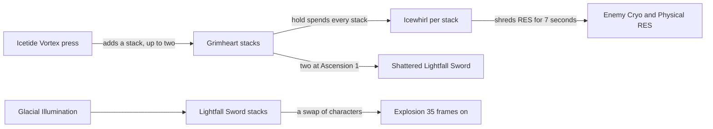

# Eula

Eula's kit is its record and one behaviour module, `createEulaKitBehaviour`, avatar 10000051 (`{data-root}/genshin-parity/text/ExcelBinOutput/AvatarExcelConfigData.json`): five strikes (`attack.go` line 16), a charged attack, a collision and two plunges, Icetide Vortex's press and its hold, and Glacial Illumination with the Lightfall Sword. Her multipliers are read from proud skill groups 5131, 5132 and 5139 of the dump (`{data-root}/genshin-parity/text/ExcelBinOutput/ProudSkillExcelConfigData.json`); the charged attack's stamina (5131's index 7, 40 a second, the wiki's stamina 40/s, `{data-root}/cache/genshin-wiki/Category_Eula_Talents.json`), the press's and the hold's cooldowns (5132's indices 6 and 7, 4 and 10 seconds, the wiki's CD 4s and CDHold 10s, `{data-root}/cache/genshin-wiki/Category_Eula_Talents.json`), and the burst's stack cap, cooldown and energy cost (5139's indices 3, 4 and 5, 30, 20 seconds and 80, the wiki's CD 20s and energy cost 80, `{data-root}/cache/genshin-wiki/Category_Eula_Talents.json`) are read from the same groups. A press's strike gains a Grimheart stack, up to two, for 18 seconds (`skill.go:54-60`, `:110-111`; the wiki's Grimheart Duration 18s, `{data-root}/cache/genshin-wiki/Category_Eula_Talents.json`), and the hold spends the stacks into one Icewhirl each, which shreds the enemy's Cryo and Physical RES for 7 seconds per stack (`skill.go:180-194`). Two stacks raise a Shattered Lightfall Sword at Ascension 1 (`asc.go:12-14`, `:31`), and from Ascension 4 the burst gives a stack while one is up and resets Icetide Vortex's cooldown, written to her party member's skill cooldown as gcsim's `a4` resets it (`asc.go:44-56`). Eula's strikes gain the Lightfall Sword a stack every 0.1 seconds while it is lit (`burst.go:147`), up to 30 (`burst.go:98-99`), and a swap of characters explodes it 35 frames on (`burst.go:162`, `:18`), as gcsim's does. Constellation 1's Physical DMG Bonus (`eula.go` lines 33 to 35), Constellation 4's bonus to Glacial Illumination's initial hit against an enemy under half its HP (`cons.go` lines 14 and 28), and Constellation 6's five starting stacks (`burst.go` lines 41 to 42) and its random extra stack are built. The extra stack is a 50% roll on each stack gained, as gcsim's burstStackCB rolls it (`burst.go` line 154, in the function from line 130). Constellation 2's hold cooldown is not built, as the kit sets no cooldown per constellation and no source gives the hold's cooldown. The charged attack's hits and the hold's minimum seconds are provisional.

## Decisions

- **Eula's charged attack lands its spin at half a second and its final hit at one second, in 1.5 seconds.** Open: no source gives these seconds, as gcsim has no charged attack file (there is no `charge.go` in its `eula` folder) and the wiki gives only the 5-second maximum, so they stand as estimates until a recording reads others.
- **Icetide Vortex's hold begins at half a second.** Open: gcsim takes any hold from the input alone (`skill.go:80`), so the half second has no source.
- **Icetide Vortex's hold strikes at the skill's Hold DMG, index 1 of its group.** gcsim's `skillHold` array copies the burst's Skill DMG, 245.6% at level 1 (`zz_eula.dm.go:289-290`, against the dump's 5139 at index 0 and 5132 at index 1, both 2.456, `{data-root}/genshin-parity/text/ExcelBinOutput/ProudSkillExcelConfigData.json`), and its talent config labels it so, which would deal the hold at the burst's multiplier; the overlay holds the skill's own index as `DiffersFromSource`.

## Key files

| File                                                            | Role                                                                                                                                                                       |
| :-------------------------------------------------------------- | :------------------------------------------------------------------------------------------------------------------------------------------------------------------------- |
| `packages/genshin-world/src/services/kit/characters/eulaKit.ts` | `createEulaKitBehaviour`, Eula's kit with her Grimheart stacks and Icewhirls, Glacial Illumination's Lightfall Sword and its explosion, her charged attack and her plunges |

## Sources

- [gcsim](https://github.com/genshinsim/gcsim/tree/v2.47.2/internal/characters/eula), MIT: the kit's hitmarks, cancel frames and areas, Icetide Vortex's press and hold frames, hits and cooldowns, its Icewhirls and shred, Grimheart's stacks and ICD, Glacial Illumination's frames, Lightfall Sword timings and stack gains, and Constellations 1, 4 and 6.
- Genshin Impact Wiki, cached at `{data-root}/cache/genshin-wiki/Category_Eula_Talents.json`: the pages Favonius Bladework - Edel (the normal attacks' poise and internal cooldown tag `Normal Attack`, the charged attack's 40/s stamina and 5s maximum, and the plunge collision's poise 35), Icetide Vortex (CD 4s, hold CD 10s, Grimheart 18s, the RES decrease's 7s, and the press, hold and Icewhirl poise) and Glacial Illumination (CD 20s, energy cost 80).
- The dump, `{data-root}/genshin-parity/text/ExcelBinOutput`: `ProudSkillExcelConfigData.json` (groups 5131, 5132 and 5139) and `AvatarSkillExcelConfigData.json` (skills 10511, 10512 and 10515).
- `{data-root}/cache/gcsim-v2.47.2/internal/characters/eula/attack.go` line 16: grounds the requirement Basic attacks.
- `{data-root}/cache/gcsim-v2.47.2/internal/characters/eula/plunge.go`: grounds the requirement Basic attacks.
- `{data-root}/cache/gcsim-v2.47.2/internal/characters/eula/skill.go` lines 54 to 60: grounds the requirement Icetide Vortex press adds Grimheart stacks.
- `{data-root}/cache/gcsim-v2.47.2/internal/characters/eula/skill.go` lines 189 and 194: grounds the requirement Icetide Vortex hold spends stacks.
- `{data-root}/cache/gcsim-v2.47.2/internal/characters/eula/burst.go` lines 98 to 99: grounds the requirement Glacial Illumination and the Lightfall Sword.
- `{data-root}/cache/gcsim-v2.47.2/internal/characters/eula/burst.go` line 147 for the 0.1 seconds: grounds the requirement Glacial Illumination and the Lightfall Sword.
- `{data-root}/cache/gcsim-v2.47.2/internal/characters/eula/burst.go` lines 18 and 162: grounds the requirement Lightfall Sword explodes on a swap.
- `{data-root}/cache/gcsim-v2.47.2/internal/characters/eula/asc.go` lines 12 to 14: grounds the requirement Shattered Lightfall Sword from Ascension 1.
- `{data-root}/cache/gcsim-v2.47.2/internal/characters/eula/eula.go` lines 33 to 35: grounds the requirement Constellation 1 Physical DMG Bonus.
- `{data-root}/cache/gcsim-v2.47.2/internal/characters/eula/cons.go` lines 14 and 28: grounds the requirement Constellation 4 bonus against a weakened enemy.
- `{data-root}/cache/gcsim-v2.47.2/internal/characters/eula/burst.go` lines 41 to 42: grounds the requirement Constellation 6 starting stacks.
- `{data-root}/cache/gcsim-v2.47.2/internal/characters/eula/burst.go` line 154: grounds the requirement Constellation 6 extra stack chance.
