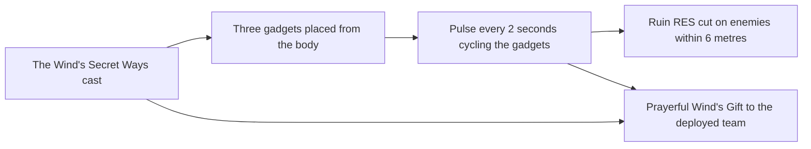

# Faruzan

Faruzan's kit is its record and one behaviour module, `createFaruzanKitBehaviour`, on avatar 10000076 (`{data-root}/genshin-dump-backup-6.6/ExcelBinOutput/AvatarExcelConfigData.json`): four strikes (`{data-root}/cache/gcsim-v2.47.2/internal/characters/faruzan/attack.go` line 16), a fully charged shot, a collision and two plunges (`{data-root}/cache/genshin-wiki/Category_Faruzan_Talents.json`), Wind Realm of Nasamjnin's polyhedron hit (`{data-root}/cache/gcsim-v2.47.2/internal/characters/faruzan/skill.go` lines 56 to 61), and The Wind's Secret Ways' initial hit (`{data-root}/cache/gcsim-v2.47.2/internal/characters/faruzan/burst.go` lines 56 to 62) with its Dazzling Polyhedron. Her multipliers are read from proud skill groups 7631, 7632 and 7639 of the dump (`{data-root}/genshin-dump-backup-6.6/ExcelBinOutput/ProudSkillExcelConfigData.json`, read by `packages/genshin-world/src/services/kit/characters/faruzanKit.ts`), and the skill's and burst's cooldowns and the burst's energy cost from the same groups: the skill's 6 seconds at 7632's index 4, and the burst's 20 seconds and 80 energy at 7639's indices 6 and 7 (the wiki's CD 6s, CD 20s and energy cost 80, `{data-root}/cache/genshin-wiki/Category_Faruzan_Talents.json`; `{data-root}/cache/gcsim-v2.47.2/internal/characters/faruzan/skill.go:73` and `{data-root}/cache/gcsim-v2.47.2/internal/characters/faruzan/burst.go:118`). The polyhedron's Whirlwind Pulses, six through its duration, each shred the enemies near their gadget and give every member of the team Prayerful Wind's Anemo DMG Bonus (`{data-root}/cache/gcsim-v2.47.2/internal/characters/faruzan/burst.go` lines 83 to 93 for the Pulses and 105 to 107 for the buff). The Manifest Gale and Pressurized Collapse, her partial aimed shot, her particles, her passive, and Constellations 1, 4 and 6, are not built, listed below. Constellation 2's 6 seconds more on the polyhedron is built (`{data-root}/cache/gcsim-v2.47.2/internal/characters/faruzan/burst.go` lines 64 to 68): it lengthens the field's lifetime, so its Whirlwind Pulses keep their interval through them.

## Decisions

- **The polyhedron's Pulses are summons of no damage, cast from the three gadgets' places.** gcsim places the gadgets from the body at the cast, offset 5.19 metres across and 10.5 ahead for the top two and 1.5 ahead for the bottom one (`{data-root}/cache/gcsim-v2.47.2/internal/characters/faruzan/burst.go` lines 78 to 80), and cycles each Pulse through them (`{data-root}/cache/gcsim-v2.47.2/internal/characters/faruzan/burst.go:84`). Each Pulse is a summon of a hit with no damage that gives the Perfidious Wind's Ruin RES cut to the enemies within 6 metres of its gadget (`{data-root}/cache/gcsim-v2.47.2/internal/characters/faruzan/burst.go` lines 89 to 91 for the six metres and 154 to 157 for the cut), which the kit's hits carry as an enemy status (`packages/genshin-world/src/services/kit/characters/faruzanKit.ts`). The first Pulse comes 3 seconds after the cast, then one every 2 seconds (`{data-root}/cache/gcsim-v2.47.2/internal/characters/faruzan/burst.go:83`, `:93`), and the field lasts gcsim's 745 frames from the cast (`{data-root}/cache/gcsim-v2.47.2/internal/characters/faruzan/burst.go:66`) with its ticker's 43-frame start, so the sixth Pulse lands at 13 seconds, 780 frames.

- **Prayerful Wind's Gift is given at the cast and on each Pulse, to every member of the deployed team.** gcsim refreshes it on a 239-frame schedule from 43 frames (`{data-root}/cache/gcsim-v2.47.2/internal/characters/faruzan/burst.go` lines 110 to 112 and 116), which keeps the buff up while the polyhedron stands. Here the cast and the Pulses refresh it (`packages/genshin-world/src/services/kit/characters/faruzanKit.ts`), as the 4-second buff (`{data-root}/cache/gcsim-v2.47.2/internal/characters/faruzan/burst.go` line 133) outlasts the 2-second interval between them.
- **The skill's and the burst's hits are priced as circles offset from the body.** The skill's circle is radius 3 three metres ahead (`{data-root}/cache/gcsim-v2.47.2/internal/characters/faruzan/skill.go:58`), priced at 6 round the body, and the burst's radius 6.3 1.5 metres ahead (`{data-root}/cache/gcsim-v2.47.2/internal/characters/faruzan/burst.go:58`), priced at 7.8, as `createCircleReach` gives a circle centred ahead of the body.

## Not built

- **The Manifest Gale is not built.** Wind Realm of Nasamjnin's state makes the next fully charged shot a Hurricane Arrow, consumed one per shot, which Pressurized Collapse and Constellation 1 count on. It waits on a kit's charged attack chosen by a status, which the kit's actions do not take yet. Ascension 1's 60% shorter charge under the state waits on the same hook.
- **Pressurized Collapse is not built.** The Hurricane Arrow's vortex lands 33 frames after the hit, a circle of radius 6 on the enemy the arrow struck, not on the body, and it gives Constellation 4's energy. It waits on a hit placed where an enemy stands rather than where the body does, which the kit's hits do not take.
- **The partial-charge Aimed Shot is not built.** Its physical hit at index 4 needs a second charged-attack action beside the fully charged one, which the kit takes only the one of. The Manifest Gale's Hurricane Arrow waits on the same hook.
- **Her particles are not built.** The skill gives an Anemo particle on its hit, on a 5.5-second cooldown (`skill.go:91`), which waits on a hit that gives particles, as an enemy's HP drops are the only energy a strike gives.
- **Ascension 4's Hurricane Guard is not built.** It adds 32% of her base ATK to Anemo hits of her team's characters while Prayerful Wind's Gift is on them, once each 0.8 seconds (`asc.go:59`, 48 frames), which waits on a party effect that adds to other members' hits.
- **Constellations 1, 4 and 6 are not built.** Constellation 1's second Hurricane Arrow and 4's energy wait on Pressurized Collapse and the Manifest Gale; Constellation 6's 40% CRIT DMG and its extra arrow wait on the same two hooks.
- **Dazzling Polyhedron stands 13.1 seconds, 788 frames, where the table gives 12, and the difference is open.** gcsim's last refresh lands at 788 frames (`burst.go:116`, 43 plus 745), so its sixth Whirlwind Pulse, at 780 frames, still fires inside the standing. The table's 12 seconds (the dump's 7639 at index 5) is 720 frames: gcsim's 745 has no source beyond gcsim, and the page keeps it open rather than settled.
- **Poise is the wiki's where gcsim gives none.** The wiki's Parthian Shot page, Faruzan's own normal attack page, gives 15.6033, 14.7162, 18.5454 and 24.6351 for the four strikes, 20 for the fully charged shot, and 50 and 100 for the low and high plunges. gcsim gives none, so the framework fills them from the wiki, as [framework decisions](../README.md#framework-decisions) sets out, and the Pulse's zero is `Unsourced` in the record (`hits.whirlwindPulse.poiseDamage`).

## Key files

| File                                                               | Role                                                                                                                                                                                                  |
| :----------------------------------------------------------------- | :---------------------------------------------------------------------------------------------------------------------------------------------------------------------------------------------------- |
| `packages/genshin-world/src/services/kit/characters/faruzanKit.ts` | `createFaruzanKitBehaviour`, Faruzan's kit with her four strikes, charged shot and plunges, Wind Realm of Nasamjnin's hit, and The Wind's Secret Ways with its Dazzling Polyhedron's Whirlwind Pulses |

## Sources

- [gcsim](https://github.com/genshinsim/gcsim/tree/v2.47.2/internal/characters/faruzan), MIT: Faruzan's strikes' hitmarks and cancel frames, the fully charged shot's frames, Wind Realm of Nasamjnin's frames and hit, The Wind's Secret Ways' frames, initial hit, the polyhedron's 788 frames, its Pulses and gadgets, and Prayerful Wind's Gift and Perfidious Wind's Ruin.
- Genshin Impact Wiki, cached at `{data-root}/cache/genshin-wiki/Category_Faruzan_Talents.json`: the pages Parthian Shot (the strikes', shots' and plunges' poise), Wind Realm of Nasamjnin (CD 6s, skill poise 200) and The Wind's Secret Ways (CD 20s, duration 12s, energy cost 80, and the Prayerful Wind's and Perfidious Wind's benefit durations of 4s).
- The dump, `{data-root}/genshin-parity/text/ExcelBinOutput`: `ProudSkillExcelConfigData.json` (groups 7631, 7632 and 7639) and `AvatarSkillExcelConfigData.json` (skills 10761, 10762 and 10765).
