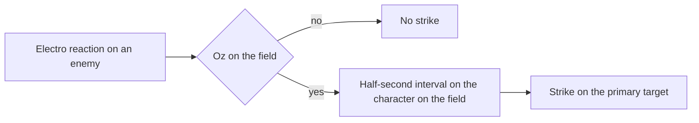

# Fischl

Fischl's kit is its record and one behaviour module, `createFischlKitBehaviour`, avatar 10000031: five arrows, a fully charged aimed shot, a collision and two plunges (`{data-root}/cache/genshin-wiki/Category_Fischl_Talents.json`), Nightrider's Oz and Midnight Phantasmagoria. Her multipliers are read from proud skill groups 3131, 3132 and 3139 of the dump (`{data-root}/genshin-dump-backup-6.6/ExcelBinOutput/ProudSkillExcelConfigData.json`), and they match the wiki where it gives one (`{data-root}/cache/genshin-wiki/Category_Fischl_Talents.json`): Oz's attack at 3132's first parameter (88.8%, the wiki's level-1 Oz's ATK DMG), its summoning damage at the second (115.44%, the wiki's Summoning DMG) and Midnight Phantasmagoria's Falling Thunder at 3139's first (208%, the wiki's level-1 value). The Bolts of Downfall hits match the wiki's ranges only to its one decimal place (44.1% against the dump's 44.118, and the wiki's 44.1–93.4% range, `{data-root}/cache/genshin-wiki/Category_Fischl_Talents.json`). The skill's duration and cooldown (`{data-root}/genshin-dump-backup-6.6/ExcelBinOutput/ProudSkillExcelConfigData.json`, 3132's indices 3 and 4, 10 and 25 seconds, the wiki's 10s and 25s (`{data-root}/cache/genshin-wiki/Category_Fischl_Talents.json`); `{data-root}/cache/gcsim-v2.47.2/internal/characters/fischl/skill.go` line 76 and line 128) and the burst's cooldown and cost (`{data-root}/genshin-dump-backup-6.6/ExcelBinOutput/ProudSkillExcelConfigData.json`, 3139's indices 4 and 5, 15 seconds and 60 energy, the wiki's CD 15s and energy cost 60 (`{data-root}/cache/genshin-wiki/Category_Fischl_Talents.json`); `{data-root}/cache/gcsim-v2.47.2/internal/characters/fischl/burst.go` line 80) are read from the same groups. Oz is a summon that spawns 18 frames into the press (`{data-root}/cache/gcsim-v2.47.2/internal/characters/fischl/skill.go` line 21), or 113 into the burst (`{data-root}/cache/gcsim-v2.47.2/internal/characters/fischl/burst.go` line 16), and attacks every 59 frames while it stands (`{data-root}/cache/gcsim-v2.47.2/internal/characters/fischl/skill.go` line 24); one stands at a time, the newer replacing the one standing, and a swap during the burst spawns its Oz a frame after the swap, plus the core's swap delay. Undone Be Thy Sinful Hex's Thundering Retribution from Ascension 4, and Gaze of the Deep's, Devourer of All Sins', Her Pilgrimage of Bleak's and Evernight Raven's effects from one, two, four and six constellations (`{data-root}/cache/genshin-wiki/Category_Fischl_Talents.json`) answer the kit events below. Stellar Predator, the skill's recast, the particles and her Hexerei kit are not built.

## Decisions

- **Oz's summon has the wiki's 80 poise and its attacks the wiki's 10, and the attacks' poise is open.** The wiki's Nightrider rows pair 80 with Summon DMG and 10 with Oz's ATK DMG (`{data-root}/cache/genshin-wiki/Category_Fischl_Talents.json`). The record gives the summon 80, marked unsourced, and gives Oz's attacks no poise, and gcsim gives neither (no `PoiseDMG` in `{data-root}/cache/gcsim-v2.47.2/internal/characters/fischl/skill.go`), so the attacks' 10 is open. Oz's attacks carry the Elemental Skill internal cooldown tag (`{data-root}/cache/gcsim-v2.47.2/internal/characters/fischl/skill.go` lines 144 and 145). gcsim's 59-frame tick is its own assumed rate (`{data-root}/cache/gcsim-v2.47.2/internal/characters/fischl/skill.go` line 24, "assume consistent 59f tick rate"), where the wiki gives one-second intervals (`{data-root}/cache/genshin-wiki/Category_Fischl_Talents.json`); the kit keeps gcsim's 59, open. Midnight Phantasmagoria's gauge is the wiki's 2U, the record's source for it, where gcsim's Durability 25 (`{data-root}/cache/gcsim-v2.47.2/internal/characters/fischl/burst.go` line 40) reads as 1U.
- **One Oz stands at a time.** gcsim's spawn records its own source and sets its duration, 600 frames and 720 at Constellation 6 (`{data-root}/cache/gcsim-v2.47.2/internal/characters/fischl/skill.go` lines 128 to 131), so the newer Oz replaces the one standing. The wiki's Midnight Phantasmagoria says the burst refreshes an Oz already on the field (`{data-root}/cache/genshin-wiki/Category_Fischl_Talents.json`), which leaves one Oz with a fresh duration. Oz stands from its spawn frame (the kit's `spawnSeconds`) for what reads whether it is on the field.
- **Thundering Retribution strikes the primary target, and which enemy it strikes is open.** gcsim lands it on the primary target in a circle of 0.5 metres (`{data-root}/cache/gcsim-v2.47.2/internal/characters/fischl/asc.go` line 64), beside its own TODO that it should strike the closest enemy within 15 metres of the reaction (`{data-root}/cache/gcsim-v2.47.2/internal/characters/fischl/asc.go` line 60); the wiki's Undone Be Thy Sinful Hex says the closest enemy to the character (`{data-root}/cache/genshin-wiki/Category_Fischl_Talents.json`), and the kit does not build that. The record reads the area as radius 15.5 round Fischl, the 15-metre targeting plus that circle. It needs Oz on the field (`{data-root}/cache/gcsim-v2.47.2/internal/characters/fischl/asc.go` lines 38 to 40), and its half-second interval is kept on the character on the field (`{data-root}/cache/gcsim-v2.47.2/internal/characters/fischl/asc.go` lines 41 to 45). It is dealt as Elemental Skill DMG (`{data-root}/cache/gcsim-v2.47.2/internal/characters/fischl/asc.go` line 50), gcsim's tag for it; whether that explodes Yoimiya's Aurous Blaze is not checked against her page, open.

- **Gaze of the Deep and Evernight Raven strike in gcsim's own boxes, not the reach of the attack they join.** Gaze of the Deep is a box of 0.1 by 1 metres from the body toward the primary target (`{data-root}/cache/gcsim-v2.47.2/internal/characters/fischl/attack.go` lines 77 to 82), and Evernight Raven a box from the body (`{data-root}/cache/gcsim-v2.47.2/internal/characters/fischl/cons.go` lines 29 to 30); the record's radius-1 area for Gaze of the Deep is unsourced. Gaze of the Deep strikes along with Fischl's own arrow while Oz is away (`{data-root}/cache/gcsim-v2.47.2/internal/characters/fischl/attack.go` line 63), and Evernight Raven along with the field's normal attacks while Oz stands (`{data-root}/cache/gcsim-v2.47.2/internal/characters/fischl/fischl.go` lines 61 to 63, and `{data-root}/cache/gcsim-v2.47.2/internal/template/minazuki/minazuki.go` lines 113 to 160). The joined reach is open.
- **Gaze of the Deep's joint attack deals Normal Attack DMG, as gcsim tags it** (`{data-root}/cache/gcsim-v2.47.2/internal/characters/fischl/attack.go` line 67). The cached wiki gives Constellation 1 only its name (`{data-root}/cache/genshin-wiki/Category_Fischl_Talents.json`), so the wording the wiki gives is open.
- **Her Pilgrimage of Bleak heals a frame after the full Oz's spawn and after a swap's, at Constellation 4.** gcsim queues the heal at each spawn plus one frame (`{data-root}/cache/gcsim-v2.47.2/internal/characters/fischl/burst.go` lines 117 to 118), which is 114 frames into the burst for the full spawn, and passes it to the swap spawn too (`{data-root}/cache/gcsim-v2.47.2/internal/characters/fischl/burst.go` lines 85 and 91). The cached wiki gives the constellation only its name, so the swap heal rests on gcsim alone, open.
- **The swap's Oz spawns a frame after the swap, and its first attack 63 frames later, plus the core's swap delay.** gcsim adds the core's swap delay to both (`{data-root}/cache/gcsim-v2.47.2/internal/characters/fischl/burst.go` lines 18 to 19, and 88 to 91), so the kit's frames hold only where that delay is zero. The delay is not read here, open.
- **Devourer of All Sins adds 2 to the summon's multiplier and widens its circle to 3 metres.** gcsim's Constellation 2 does both (`{data-root}/cache/gcsim-v2.47.2/internal/characters/fischl/skill.go` lines 62 to 65), and the record's 3.1544 is the summon's 1.1544 (`{data-root}/genshin-dump-backup-6.6/ExcelBinOutput/ProudSkillExcelConfigData.json`) plus 2. The record's summon and Devourer areas (radius 17 and 18) and the 80 poise are unsourced, where gcsim's summon circle is radius 2, or 3 at Constellation 2 (`{data-root}/cache/gcsim-v2.47.2/internal/characters/fischl/skill.go` lines 61 to 65), round the primary target; the areas are open.

## Key files

| File                                                              | Role                                                                                                            |
| :---------------------------------------------------------------- | :-------------------------------------------------------------------------------------------------------------- |
| `packages/genshin-world/src/services/kit/characters/fischlKit.ts` | `createFischlKitBehaviour`, Fischl's kit with Oz, its swap spawn, Thundering Retribution and her constellations |

## Sources

- Genshin Impact Wiki, cached at `{data-root}/cache/genshin-wiki/Category_Fischl_Talents.json`: the pages Bolts of Downfall (the hits' ranges and poise), Nightrider (Oz's ATK and summon DMG, CD 25s, duration 10s, and the poise rows 80, 10, 40, 40 and 10 with their titles), Midnight Phantasmagoria (Falling Thunder 208% at level 1, gauge 2U, poise 150, CD 15s, energy cost 60, and its duration reset) and Undone Be Thy Sinful Hex (the Electro-related reactions and the closest-enemy targeting). The constellation pages, Gaze of the Deep, Her Pilgrimage of Bleak, Evernight Raven and Devourer of All Sins, carry only their names in the cache.
- [gcsim v2.47.2](https://github.com/genshinsim/gcsim/tree/v2.47.2/internal/characters/fischl), MIT, on disk at `{data-root}/cache/gcsim-v2.47.2/internal/characters/fischl` (`{data-root}/cache/gcsim-v2.47.2/internal/characters/fischl/skill.go`, `{data-root}/cache/gcsim-v2.47.2/internal/characters/fischl/burst.go`, `{data-root}/cache/gcsim-v2.47.2/internal/characters/fischl/asc.go`, `{data-root}/cache/gcsim-v2.47.2/internal/characters/fischl/attack.go`, `{data-root}/cache/gcsim-v2.47.2/internal/characters/fischl/cons.go`, `{data-root}/cache/gcsim-v2.47.2/internal/characters/fischl/fischl.go`), with the watcher template at `{data-root}/cache/gcsim-v2.47.2/internal/template/minazuki/minazuki.go`: Fischl's multipliers' order, Oz's spawn, ticks and the burst's spawn on a swap, Thundering Retribution's and the constellations' areas, delays and multipliers.

## Open

- [ ] **Gaze of the Deep's area is a radius of 1 metre** — no source yet: gcsim's box is 0.1 by 1 metres, and no source gives a radius.
