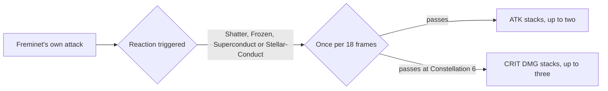

# Freminet

Freminet's kit is its record and one behaviour module, `createFreminetKitBehaviour`, on avatar 10000085 (`{data-root}/genshin-parity/text/ExcelBinOutput/AvatarExcelConfigData.json`): four strikes, a charged attack, a collision and two plunges (`{data-root}/cache/genshin-wiki/Category_Freminet_Talents.json`), Pressurized Floe's Upward Thrust, a cryo circle two metres ahead of the body (`{data-root}/cache/gcsim-v2.47.2/internal/characters/freminet/skill.go:81-85`), Spiritbreath Thorn, a cryo circle queued 62 frames after each press of the skill once nine seconds have passed since the last (`{data-root}/cache/gcsim-v2.47.2/internal/characters/freminet/skill.go:28`, `:122-126`), and Shadowhunter's Ambush, a cryo burst on the target (`{data-root}/cache/gcsim-v2.47.2/internal/characters/freminet/burst.go:17`, `:41` for the Cryo element, and the wiki's AoE Cryo DMG, "Category_Freminet_Talents.json"). His multipliers are read from proud skill groups 8531, 8532 and 8539 of the dump (`{data-root}/genshin-parity/text/ExcelBinOutput/ProudSkillExcelConfigData.json`). The charged attack's stamina is 8531's index 6 (40, in the same file), and the burst's cooldown and energy cost are 8539's indices 2 and 3 (15 seconds and 60, the wiki's CD 15s and energy cost 60, "Category_Freminet_Talents.json"). The skill's cooldown is 10 seconds, the dump's skill row 10852 (`{data-root}/genshin-parity/text/ExcelBinOutput/AvatarSkillExcelConfigData.json`, cdTime 10.0) and the wiki's CD 10s, as `{data-root}/cache/gcsim-v2.47.2/internal/characters/freminet/skill.go:90` (`cd := 600`) and `:95` set it. Each strike, the plunges and the thrust deal physical or cryo damage as gcsim gives them (`{data-root}/cache/gcsim-v2.47.2/internal/characters/freminet/attack.go:57` and `:96`, `plunge.go:87`, `skill.go:74`), with their poise (`{data-root}/cache/gcsim-v2.47.2/internal/characters/freminet/attack.go:18`, `plunge.go:27`, `:32`; the wiki's Flowing Eddies and Pressurized Floe poise rows in "Category_Freminet_Talents.json" match them).

The charged attack is provisional. gcsim gives Freminet no charged attack (his folder has no `charge.go`), so it is borrowed as [a borrowed charged attack](../README.md#how-a-kit-is-read) sets out, from the fourth strike's hitmark, animation and reach (`attack.go:17`, `:21`, `:39-40`), with the table's charged multiplier and stamina, and a yes-or-no question is on the roadmap.

Constellations 4 and 6 are built: a Shatter, Frozen, Superconduct or Stellar-Conduct that Freminet's own attack triggers gives him up to two stacks of 9% ATK, and from Constellation 6 up to three of 12% CRIT DMG, each for six seconds, once every 18 frames (`{data-root}/cache/gcsim-v2.47.2/internal/characters/freminet/cons.go:128-131` for the four reactions, `:77` for the 18 frames, `:85-86` and `:93` for the ATK stacks, `:112-113` and `:120` for the CRIT DMG stacks, and `:90`, `:117` for the six seconds).

Not built: Pressurized Floe's Pers Time stance, which holds the frost of each strike and the stacks it gains, and the detonation that replaces the skill on its next press; Shadowhunter's Ambush's stalking state, which lowers the skill's cooldown to three seconds and resets it (`burst.go:16`, `skill.go:92-95`); his ascension passives (`asc.go:21`, `:28`); and Constellations 1 and 2, which act on the detonation's hits and the stance's stacks (`cons.go:24-35` for the 15% CRIT Rate on pressure attacks, `:43-50` for the stacks).

## Decisions

- **Freminet's charged attack is provisional at 42 frames, in the fourth strike's circle of radius 2.4 half a metre ahead of him, for 40 stamina.** gcsim gives him none (his folder has no `charge.go`), so the record takes the fourth strike's hitmark, animation and reach, the table's attack multiplier at 8531's index 4 and its stamina at index 6; a recording of the attack showing another timing, reach or stamina would replace them.
- **Pressurized Floe's upward thrust and Shadowhunter's Ambush each apply 1U of Cryo; Spiritbreath Thorn applies none.** gcsim gives the thrust and the burst a durability of 25, one unit of gauge (`{data-root}/cache/gcsim-v2.47.2/internal/characters/freminet/skill.go:75`, `burst.go:42`; the wiki's 1U on both, `{data-root}/cache/genshin-wiki/Category_Freminet_Talents.json`), and Spiritbreath Thorn a durability of 0 (`{data-root}/cache/gcsim-v2.47.2/internal/characters/freminet/skill.go:119`), so the record's overlay cites the first two's gauge and Spiritbreath Thorn takes none.

## Key files

| File                                                                | Role                                                                                                                                               |
| :------------------------------------------------------------------ | :------------------------------------------------------------------------------------------------------------------------------------------------- |
| `packages/genshin-world/src/services/kit/characters/freminetKit.ts` | `createFreminetKitBehaviour`, Freminet's kit with his strikes, charged attack, plunges, Pressurized Floe's upward thrust and Shadowhunter's Ambush |

## Sources

- [gcsim](https://github.com/genshinsim/gcsim/tree/v2.47.2/internal/characters/freminet), MIT, on disk at `{data-root}/cache/gcsim-v2.47.2/internal/characters/freminet`: Freminet's strikes' hitmarks, cancel frames, reaches and poise, the low and high plunges and their collision, Pressurized Floe's Upward Thrust and Shadowhunter's Ambush with their gauge, and Constellations 4 and 6's stacks, their ICD and their values.
- Genshin Impact Wiki, cached at `{data-root}/cache/genshin-wiki/Category_Freminet_Talents.json`: Flowing Eddies (the four strikes' poise, which gcsim's `attack.go:18` matches), Pressurized Floe (CD 10s, the thrust's 1U and poise 75, the Frost hits' poise 25) and Shadowhunter's Ambush (CD 15s, energy cost 60, duration 10s).
- The dump, `{data-root}/genshin-parity/text/ExcelBinOutput`: `ProudSkillExcelConfigData.json` (groups 8531, 8532 and 8539) and `AvatarSkillExcelConfigData.json` (skills 10851, 10852 and 10855).
