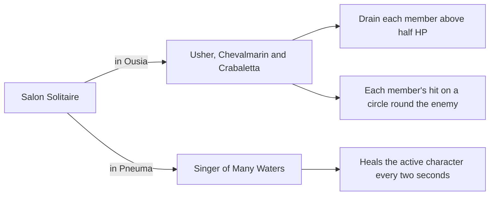

# Furina

Furina's kit is its record and one behaviour module, `createFurinaKitBehaviour`, on avatar 10000089 (`packages/genshin-world/src/services/kit/characters/furinaKit.ts`): four strikes, a charged attack that turns her Arkhe, a collision and two plunges, Salon Solitaire and Let the People Rejoice. Her multipliers are read from proud skill groups 8931, 8932 and 8939 of the dump (`~/Esposter.noindex/genshin-dump-backup-6.6/ExcelBinOutput/ProudSkillExcelConfigData.json`). The charged attack's stamina is 8931's index 5 (20), the Arkhe hits' cooldowns are 8931's indices 10 and 11 (6 seconds each, the six seconds of `~/Esposter/cache/gcsim-v2.47.2/internal/characters/furina/attack.go:52`), the skill's cooldown is 8932's index 10 (20 seconds, the wiki's CD 20s), and the burst's cooldown and energy cost are 8939's indices 6 and 7 (15 seconds and 60, `~/Esposter/cache/gcsim-v2.47.2/internal/characters/furina/burst.go:178`; the wiki's CD 15s and energy cost 60). (`packages/genshin-world/src/services/kit/characters/furinaKit.ts`)

She starts in Ousia, a status she holds for as long as she is not in Pneuma. Each strike that lands opens her Arkhe's own hit, Spiritbreath Thorn in Ousia or Surging Blade in Pneuma, a normal attack's Hydro hit with no gauge (`~/Esposter/cache/gcsim-v2.47.2/internal/characters/furina/attack.go:65` for the Hydro element, `:66` for the zero Durability) that strikes 30 frames on (`~/Esposter/cache/gcsim-v2.47.2/internal/characters/furina/attack.go:83`), once within each one's six-second cooldown (`~/Esposter/cache/gcsim-v2.47.2/internal/characters/furina/attack.go:52`). The charged attack's circle strikes 33 frames in, or 22 frames in after a normal attack, as its 11-frame windup is taken then (`~/Esposter/cache/gcsim-v2.47.2/internal/characters/furina/charge.go:16`, `:32`, `:51-57`), and her Arkhe turns a frame after the strike is queued (`~/Esposter/cache/gcsim-v2.47.2/internal/characters/furina/charge.go:75`). While Salon Solitaire lasts, the other Arkhe's summons take over from the ones out, for the seconds it has left, as `~/Esposter/cache/gcsim-v2.47.2/internal/characters/furina/charge.go:55-70` queues the other Arkhe's summon on the switch while the skill status holds, and `~/Esposter/cache/gcsim-v2.47.2/internal/characters/furina/skill.go:183-190` stops the old summon's ticks by their source. (`packages/genshin-world/src/services/kit/characters/furinaKit.ts`)

Salon Solitaire in Ousia strikes a bubble round her at 18 frames (`~/Esposter/cache/gcsim-v2.47.2/internal/characters/furina/skill.go:26`, `:121`) and brings out Gentilhomme Usher, Surintendante Chevalmarin and Mademoiselle Crabaletta with it, each on gcsim's mean schedule (`~/Esposter/cache/gcsim-v2.47.2/internal/characters/furina/skill.go:34-45`; the random spread round the mean is not taken, below). As each attacks the primary target (`~/Esposter/cache/gcsim-v2.47.2/internal/characters/furina/skill.go:211`, `:247`, `:283`), it drains every member of the deployed team above half HP (`~/Esposter/cache/gcsim-v2.47.2/internal/characters/furina/skill.go:341`) by its share of that member's Max HP through `changeKitMemberHealth` (`~/Esposter/cache/gcsim-v2.47.2/internal/characters/furina/skill.go:351-356`), and its hit, a share of Furina's Max HP, lands on a circle round that enemy once its attack has travelled, a tenth harder for each member it drained (`~/Esposter/cache/gcsim-v2.47.2/internal/characters/furina/skill.go:198`). Chevalmarin's and Usher's hits count under internal cooldown tags of their own (`~/Esposter/cache/gcsim-v2.47.2/internal/characters/furina/skill.go:204`, `:239`), gcsim's Salon group of one in two over 30 seconds (`~/Esposter/cache/gcsim-v2.47.2/pkg/core/attacks/icd_groups.dm.go:107`, `:174`), and Crabaletta's under none (`~/Esposter/cache/gcsim-v2.47.2/internal/characters/furina/skill.go:275`). In Pneuma the skill brings out the Singer of Many Waters 10 frames in, which heals the character on the field by a flat amount and a share of her Max HP every two seconds (`~/Esposter/cache/gcsim-v2.47.2/internal/characters/furina/skill.go:98`, `:155-160`, `:49`). The skill lasts 30 seconds from its summons, as the skill table has it (8932's index 1; gcsim has 1736 frames, about 28.9 seconds, `~/Esposter/cache/gcsim-v2.47.2/internal/characters/furina/skill.go:21`), and a new one ends the summons of the one before (`~/Esposter/cache/gcsim-v2.47.2/internal/characters/furina/skill.go:123`). (`packages/genshin-world/src/services/kit/characters/furinaKit.ts`)

Let the People Rejoice strikes a circle round her at 98 frames (`~/Esposter/cache/gcsim-v2.47.2/internal/characters/furina/burst.go:21`, `:176`), a share of her Max HP, and its Fanfare starts at 95 frames (`~/Esposter/cache/gcsim-v2.47.2/internal/characters/furina/burst.go:174`) for 18 seconds, as the burst table has it (8939's index 1); gcsim's 18.2 seconds (`~/Esposter/cache/gcsim-v2.47.2/internal/characters/furina/burst.go:22`) is not taken. It ends the one before. Each change to a member's HP while it lasts, every `HealthChanged` event, gives a point of Fanfare for each 1% of that member's HP changed (8939's index 2), up to 300 (index 3). The first lands 6 frames on and opens a 35-frame window a frame later, and those within the window land as it closes, gcsim's estimate of the game's debounce (`~/Esposter/cache/gcsim-v2.47.2/internal/characters/furina/burst.go:25-26`, `:53-72`). Each point gives every member of the deployed team 0.07% DMG Bonus to every element and Physical, and 0.01% Incoming Healing Bonus (8939's indices 4 and 5, `~/Esposter.noindex/genshin-dump-backup-6.6/ExcelBinOutput/ProudSkillExcelConfigData.json`), for the seconds the Fanfare has left. (`packages/genshin-world/src/services/kit/characters/furinaKit.ts`)

Ascension 1's Endless Waltz starts when another character's heal runs past full HP on the character on the field: every member of the deployed team regenerates 2% of their own Max HP every two seconds while the last such heal is under four seconds old (`~/Esposter/cache/gcsim-v2.47.2/internal/characters/furina/asc.go:24-45`, `:62`). Ascension 4 raises the Salon members' DMG by 0.7% for each 1,000 of her Max HP, up to 28%, and cuts the Singer's interval by 0.4% for each 1,000, up to 16% (`~/Esposter/cache/gcsim-v2.47.2/internal/characters/furina/asc.go:95-96`). Constellation 1 starts the Fanfare at 150 and raises its most by 100, Constellation 2 gives 250% more Fanfare from each change, and Constellation 4 gives her 4 energy as a Salon member's hit lands or the Singer heals, once each five seconds (`~/Esposter/cache/gcsim-v2.47.2/internal/characters/furina/burst.go:171`, `:77`, `:79`, `:42`; `~/Esposter/cache/gcsim-v2.47.2/internal/characters/furina/cons.go:43-51`; `~/Esposter/cache/gcsim-v2.47.2/internal/characters/furina/skill.go:317`). (`packages/genshin-world/src/services/kit/characters/furinaKit.ts`)

Not built yet:

- **Constellation 2's Max HP**, 0.35% for each point of Fanfare past its most, waits on a buff to Max HP, as a buff adds to an attribute and Max HP is never computed again from it. The Fanfare is held at its most instead (`~/Esposter/cache/gcsim-v2.47.2/internal/characters/furina/burst.go:83-84`).
- **Constellation 6's Center of Attention**, the Hydro infusion that cannot be overridden and the share of her Max HP added to her strikes, charged attack and plunges for six hits, waits on a hit's flat DMG that reads the team's effects, as `additiveBaseDamageBonus` reads the combatant alone, and on a count of the infused hits (`~/Esposter/cache/gcsim-v2.47.2/internal/characters/furina/charge.go:37-41`, `~/Esposter/cache/gcsim-v2.47.2/internal/characters/furina/cons.go:76-91`).
- **Salon Solitaire's particles** are not built, as no kit's are (gcsim's particle timing is `~/Esposter/cache/gcsim-v2.47.2/internal/characters/furina/skill.go:327-331`).
- **The drain on a character in the burst's iframes.** Gcsim drains no character on the field during its own burst, while still counting it for the DMG, and waits on a field tick that reads the active character's action (`~/Esposter/cache/gcsim-v2.47.2/internal/characters/furina/skill.go:346-348`).
- **Endless Waltz from a whole team's heal.** Gcsim starts it from a heal on the whole team (target -1) with the overheal the heal reports (`~/Esposter/cache/gcsim-v2.47.2/internal/characters/furina/asc.go:24-37`), so a heal that runs past full HP on any member can start it; the kit reads each member's `HealthChanged` alone, so such a heal starts it only when it runs past full HP on the character on the field. It waits on an event that carries a heal's whole overflow.
- **The schedule's jitter.** Gcsim gives each Salon member a random spread round its mean interval (`~/Esposter/cache/gcsim-v2.47.2/internal/characters/furina/skill.go:52-59`); the kit takes the mean.
- **Pneuma's skill animation** is gcsim's Ousia one, 54 frames, though gcsim gives Pneuma's 57 and a 10-frame delay to its cooldown; the charged attack after a strike is not 11 frames shorter as gcsim has it (`~/Esposter/cache/gcsim-v2.47.2/internal/characters/furina/skill.go:64`, `:72`, `:23`; `~/Esposter/cache/gcsim-v2.47.2/internal/characters/furina/charge.go:32`).

Her strikes, charged attack and Arkhe hits take the wiki's poise, 48.43 to 79.66 a strike, 120 for the charged attack and 20 for each Arkhe hit, and Let the People Rejoice's circle takes the wiki's 120 (the cached Soloist's Solicitation and Let the People Rejoice rows, `Category_Furina_Talents.json`), as gcsim gives them none (no `PoiseDMG` in `~/Esposter/cache/gcsim-v2.47.2/internal/characters/furina/attack.go`, `~/Esposter/cache/gcsim-v2.47.2/internal/characters/furina/charge.go` or `~/Esposter/cache/gcsim-v2.47.2/internal/characters/furina/burst.go`). Gcsim gives the Salon's hits no PoiseDMG, and each member takes the poise of its own row on the Salon Solitaire page: Gentilhomme Usher 15, Surintendante Chevalmarin 10 and Mademoiselle Crabaletta 30, cited by row, while the Ousia Bubble takes the wiki's 20. A Salon member with no enemy within the skill's reach neither drains nor strikes, a provisional reading: gcsim strikes its primary target (`~/Esposter/cache/gcsim-v2.47.2/internal/characters/furina/skill.go:211`, `:247`, `:283`), and the no-target case is not read here. Each is provisional until a recording settles it. (`packages/genshin-world/src/services/kit/characters/furinaKit.ts`)

## Key files

| File                                                              | Role                                                                                                                                                                                                                |
| :---------------------------------------------------------------- | :------------------------------------------------------------------------------------------------------------------------------------------------------------------------------------------------------------------ |
| `packages/genshin-world/src/services/kit/characters/furinaKit.ts` | `createFurinaKitBehaviour`, Furina's kit with her strikes and Arkhe hits, the charged attack's turn, plunges, Salon Solitaire's members and Singer, Let the People Rejoice's Fanfare, Endless Waltz and Ascension 4 |

## Sources

- [gcsim](https://github.com/genshinsim/gcsim/tree/v2.47.2/internal/characters/furina), MIT, on disk at `~/Esposter/cache/gcsim-v2.47.2/internal/characters/furina`: her strikes' hitmarks, cancel frames and reaches, the Arkhe hits and their cooldowns, the charged attack and its turn of her Arkhe, the plunges' frames, reaches and poise, Salon Solitaire's bubble, members, schedules, drain and Singer, the burst's hit and Fanfare with its debounce, Endless Waltz, Ascension 4 and the constellations; `~/Esposter/cache/gcsim-v2.47.2/pkg/core/attacks/icd_groups.dm.go`, the Salon's internal cooldown group.
- The dump, `~/Esposter.noindex/genshin-dump-backup-6.6/ExcelBinOutput/`: `ProudSkillExcelConfigData.json` (groups 8931, 8932 and 8939, read at talent level 1: each multiplier's index, the Arkhe hits' and skill's cooldowns, the skill's and burst's durations, the Fanfare's share of HP, most and bonuses, and the burst's cooldown and energy cost) and `AvatarSkillExcelConfigData.json` (skills 10891, 10892 and 10895).
- Genshin Impact Wiki, cached at `~/Esposter/cache/genshin-wiki/Category_Furina_Talents.json`: Soloist's Solicitation (the strikes' poise 48.4344 to 79.6608, the charged attack's 120, the Arkhe hits' 20), Salon Solitaire (CD 20s, duration 30s, and the poise rows Ousia Bubble 20, Usher 15, Chevalmarin 10 and Crabaletta 30) and Let the People Rejoice (CD 15s, energy cost 60, duration 18s, poise 120).
- `~/Esposter/cache/gcsim-v2.47.2/internal/characters/furina/attack.go` lines 28, 52 and 131: grounds "Strikes open Arkhe hits".
- `~/Esposter/cache/gcsim-v2.47.2/internal/characters/furina/charge.go` line 46 and lines 59 to 67: grounds "Charged attack turns the Arkhe".
- `~/Esposter/cache/gcsim-v2.47.2/internal/characters/furina/skill.go` lines 141 to 150: grounds "Salon Solitaire brings out Ousia members".
- `~/Esposter/cache/gcsim-v2.47.2/internal/characters/furina/skill.go` lines 155 to 162: grounds "Salon Solitaire brings out Pneuma's Singer".
- `~/Esposter/cache/gcsim-v2.47.2/internal/characters/furina/skill.go` lines 21, 97 and 123: grounds "Salon Solitaire's summons stand for 30 seconds".
- `~/Esposter/cache/gcsim-v2.47.2/internal/characters/furina/burst.go` lines 76 to 77: grounds "Let the People Rejoice builds Fanfare from HP changes".
- `~/Esposter/cache/gcsim-v2.47.2/internal/characters/furina/burst.go` lines 127 to 145: grounds "Let the People Rejoice's Fanfare points give DMG and healing bonuses".
- `~/Esposter/cache/gcsim-v2.47.2/internal/characters/furina/asc.go` lines 20, 32 to 36, 42 to 45, 62 and 66: grounds "Endless Waltz from another character's overheal".
- `~/Esposter/cache/gcsim-v2.47.2/internal/characters/furina/asc.go` line 91: grounds "Ascension 4 raises Salon members' DMG" and "Ascension 4 speeds the Singer".
- `~/Esposter/cache/gcsim-v2.47.2/internal/characters/furina/asc.go` line 95: grounds "Ascension 4 raises Salon members' DMG".
- `~/Esposter/cache/gcsim-v2.47.2/internal/characters/furina/asc.go` line 96: grounds "Ascension 4 speeds the Singer".
