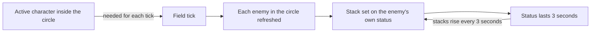

# Ganyu

Ganyu's kit is its record and one behaviour module, `createGanyuKitBehaviour`, avatar 10000037 (`{data-root}/genshin-dump-backup-6.6/ExcelBinOutput/AvatarExcelConfigData.json`): six strikes (`{data-root}/cache/gcsim-v2.47.2/internal/characters/ganyu/attack.go:16`), a fully charged shot with its Frostflake Arrow and Bloom (`{data-root}/cache/gcsim-v2.47.2/internal/characters/ganyu/aimed.go:32`), a collision and two plunges (the wiki's Plunging Attack rows in `{data-root}/cache/genshin-wiki/Category_Ganyu_Talents.json`), Trail of the Qilin's Ice Lotus with its taunt and explosion, and Celestial Shower's field. Her multipliers are read from proud skill groups 3731, 3732 and 3739 (`{data-root}/genshin-dump-backup-6.6/ExcelBinOutput/ProudSkillExcelConfigData.json`); the Ice Lotus taunt's seconds and cooldown, and the burst's seconds, cooldown and energy cost (`{data-root}/genshin-dump-backup-6.6/ExcelBinOutput/ProudSkillExcelConfigData.json`: 3732's indices 2 and 3 are 6 seconds and 10 seconds, 3739's indices 1 to 3 are 15 seconds, 15 seconds and 60 energy). Undivided Heart's 20% CRIT Rate goes to each Frostflake Arrow after the first from Ascension 1 (gcsim `{data-root}/cache/gcsim-v2.47.2/internal/characters/ganyu/aimed.go:101`), Harmony between Heaven and Earth's 20% Cryo DMG Bonus to the active character inside the shower's field from Ascension 4 (gcsim `{data-root}/cache/gcsim-v2.47.2/internal/characters/ganyu/burst.go:49` and `{data-root}/cache/gcsim-v2.47.2/internal/characters/ganyu/burst.go:73`), and Constellation 1's Cryo RES cut on the arrows and their Bloom come from one (gcsim `{data-root}/cache/gcsim-v2.47.2/internal/characters/ganyu/cons.go:20`, the cut at `{data-root}/cache/gcsim-v2.47.2/internal/characters/ganyu/cons.go:34`). Constellation 2's extra charge is built as the skill's charge bonus (gcsim `{data-root}/cache/gcsim-v2.47.2/internal/characters/ganyu/ganyu.go:33`, two charges from Constellation 2). Constellation 4's DMG taken on each enemy in the shower's field is built, as the decision below sets out. Constellation 6's charge skip is built from the Ice Lotus (gcsim `{data-root}/cache/gcsim-v2.47.2/internal/characters/ganyu/skill.go:39`). The particles are not built.

## Decisions

- **Her charged attack's shot is the Frostflake Arrow, so it reads the table's Frostflake Arrow DMG and not the Fully-Charged Aimed Shot's.** The kit's charged attack is gcsim's default hold of 2, where `{data-root}/cache/gcsim-v2.47.2/internal/characters/ganyu/aimed.go:92` sets the arrow's multiplier to `ffa` (index 8, 128% at level 1 of group 3731, `{data-root}/genshin-dump-backup-6.6/ExcelBinOutput/ProudSkillExcelConfigData.json`) and the Bloom's to `ffb` (index 9, 217.6%), the two hits queued from the one task; `fullaim` (index 7, 124%) is the hold of 1, a shot with no arrow, which the kit does not play. The tables join the first hit at index 7, so the overlay names index 8 as differing from them.
- **Ganyu's Ice Lotus explodes with its second multiplier, and her Bloom is the shot's own hit.** gcsim queues one lotus multiplier for both hits (gcsim `{data-root}/cache/gcsim-v2.47.2/internal/characters/ganyu/skill.go:35` and `{data-root}/cache/gcsim-v2.47.2/internal/characters/ganyu/skill.go:37`); here the flower reads the table's first, 120% of group 3732 (`{data-root}/genshin-dump-backup-6.6/ExcelBinOutput/ProudSkillExcelConfigData.json`), and the explosion its second, 132%. The wiki gives 132% as the skill's Skill DMG at level 1 and 120% as the Ice Lotus's Inherited HP (`{data-root}/cache/genshin-wiki/Category_Ganyu_Talents.json`), so the flower's 120% is open (see Open). The explosion lands as the taunt runs out, 373 frames after the cast, gcsim's (`{data-root}/cache/gcsim-v2.47.2/internal/characters/ganyu/skill.go:37`). The Bloom outlasts the shot's 113-frame animation and lands 131 frames on (`{data-root}/cache/gcsim-v2.47.2/internal/characters/ganyu/aimed.go:17`, `{data-root}/cache/gcsim-v2.47.2/internal/characters/ganyu/aimed.go:130`: the task at 103 frames, the arrow's 10-frame travel (`{data-root}/cache/gcsim-v2.47.2/internal/characters/ganyu/aimed.go:52`), then the Bloom's 18 frames), queued past the shot's end as gcsim queues it, so it is dealt as a charged attack. The Ice Lotus's health is open (see Open), so it stands until its seconds run out.
- **Constellation 6's charge skip starts the next fully charged shot 83 frames in.** gcsim's aimed shot takes 83 frames off its animation and each hitmark while the status stands (`{data-root}/cache/gcsim-v2.47.2/internal/characters/ganyu/aimed.go` line 83), and adds the status at the Ice Lotus's cast for 1800 frames (`{data-root}/cache/gcsim-v2.47.2/internal/characters/ganyu/skill.go:39` and `:40`, under Constellation 6). Here the shot starts past its charge, which lands its hits and ends it the same 83 frames sooner. The skip stands for 30 seconds and is spent by the shot it starts.

- **Constellation 4's stacks are counted on each enemy's own status, and step on the field's first tick and every tenth tick after it, every 3 seconds, starting at 5%.** gcsim applies its status to every enemy in the shower's area on each tick, 18 frames apart, and adds a stack on each tick at a multiple of 180 frames, up to five, for 3 seconds (`{data-root}/cache/gcsim-v2.47.2/internal/characters/ganyu/cons.go:14`, `{data-root}/cache/gcsim-v2.47.2/internal/characters/ganyu/burst.go` lines 86 to 99, the increase test at line 88). The wiki's Westward Sojourn gives the same: 5% at the start, rising by 5% every 3 seconds to 25%, kept for 3 seconds after an enemy leaves the field (cached `{data-root}/cache/genshin-wiki/Category_Ganyu_Talents.json`, Celestial Shower's Constellation 4 note). Here each enemy in the field's circle is refreshed on every field tick, and its stack count is set on the enemy's own copy of the status, since an enemy status's refresh carries no stacks. The field's ticks wait on the body as [shared effects](../README.md#shared-effects) gives them, so the stacks grow only then, where gcsim's ticks do not wait on the body.

## Open

- [ ] **The Ice Lotus takes no health in the kit** — contradicted by `{data-root}/cache/genshin-wiki/Category_Ganyu_Talents.json`: gives its Inherited HP as 120% to 255% of Max HP.
- [ ] **Constellation 1's Cryo RES cut lasts 5 seconds or 6** — no source yet: the Constellation 1 wiki page is not in `{data-root}/cache/genshin-wiki/`, and gcsim's `{data-root}/cache/gcsim-v2.47.2/internal/characters/ganyu/cons.go` gives 300 frames beside a comment that says 6 seconds, which the kit's `packages/genshin-world/src/services/kit/characters/ganyuKit.ts` comment also cites from the wiki.
- [ ] **The record's area is a 12.5-metre circle** — contradicted by `{data-root}/cache/gcsim-v2.47.2/internal/characters/ganyu/burst.go`: its field is a 10-metre circle ("burstArea").
- [ ] **The Ice Lotus flower's 120% multiplier** — contradicted by `{data-root}/cache/gcsim-v2.47.2/internal/characters/ganyu/zz_ganyu.dm.go`: its level-1 lotus table is 1.32, which both hits use.

## Key files

| File                                                             | Role                                                                                                                                                   |
| :--------------------------------------------------------------- | :----------------------------------------------------------------------------------------------------------------------------------------------------- |
| `packages/genshin-world/src/services/kit/characters/ganyuKit.ts` | `createGanyuKitBehaviour`, Ganyu's kit with the Frostflake Arrow and its Bloom, Ice Lotus, Celestial Shower's field and her passives and constellation |

## Sources

- [gcsim v2.47.2](https://github.com/genshinsim/gcsim/tree/v2.47.2/internal/characters/ganyu), MIT: Ganyu's strikes' hitmarks and cancels, the shot's and Bloom's frames, Ice Lotus's flower and explosion, Celestial Shower's ticks and hits, Constellation 4's status and stacks, and Undivided Heart's, Harmony's and Constellation 1's values. The v2.47.2 source is on disk at `{data-root}/cache/gcsim-v2.47.2/`.
- The Genshin Impact Wiki pages for Trail of the Qilin, Celestial Shower, Undivided Heart and Harmony between Heaven and Earth are cached in `{data-root}/cache/genshin-wiki/Category_Ganyu_Talents.json`: Undivided Heart's 5 seconds, Westward Sojourn's stacking, and the Ice Lotus's Inherited HP.
