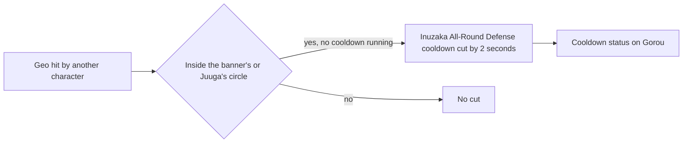

# Gorou

Gorou's kit is its record and one behaviour module, `createGorouKitBehaviour`, avatar 10000055 (`~/Esposter/genshin-parity/text/ExcelBinOutput/AvatarExcelConfigData.json`): four strikes (`~/Esposter/cache/gcsim-v2.47.2/internal/characters/gorou/attack.go` line 19), a fully charged shot (`~/Esposter/cache/gcsim-v2.47.2/internal/characters/gorou/aimed.go`), a collision and two plunges (`~/Esposter/cache/genshin-wiki/Category_Gorou_Talents.json`), Inuzaka All-Round Defense with its General's War Banner, and Juuga with its field that follows the body and its Crystal Collapse. His multipliers are read from proud skill groups 5531, 5532 and 5539 (`packages/genshin-world/src/services/kit/characters/gorouKit.ts`); the skill's cooldown and the banner's seconds, and the burst's seconds, cooldown and energy cost, are read from the same groups (`~/Esposter/genshin-parity/text/ExcelBinOutput/ProudSkillExcelConfigData.json`: 5532's indices 3 and 4 are the skill's 10-second cooldown and the banner's 10 seconds, 5539's indices 2 to 4 are Juuga's 9 seconds, its 20-second cooldown and 80 energy). The banner's flat DEF and Crunch's 15% Geo DMG Bonus reach the active character on each tick for two seconds (gcsim `~/Esposter/cache/gcsim-v2.47.2/internal/characters/gorou/skill.go` `gorouSkillBuffField`, a 120-frame buff), Crunch from a team of three Geo characters (gcsim `~/Esposter/cache/gcsim-v2.47.2/internal/characters/gorou/gorou.go`, `geoCharCount > 2`), and Juuga's ticks do the same from its field (`~/Esposter/cache/gcsim-v2.47.2/internal/characters/gorou/burst.go`, line 52). From Ascension 1 Juuga adds 25% DEF to the party for twelve seconds (gcsim `~/Esposter/cache/gcsim-v2.47.2/internal/characters/gorou/asc.go`, `a1Buff`), and from Ascension 4 the skill and burst add a share of his DEF to their base damage, 156% and 15.6% of DEF (gcsim `~/Esposter/cache/gcsim-v2.47.2/internal/characters/gorou/asc.go`). Constellations 1, 4 and 6 are built: Constellation 1 reads the Geo hits in the field's circle from the enemy hit events (gcsim `~/Esposter/cache/gcsim-v2.47.2/internal/characters/gorou/cons.go` `c1`), Constellation 4 heals the active character from a field's own ticks (gcsim `~/Esposter/cache/gcsim-v2.47.2/internal/characters/gorou/burst.go`, the heal at line 76), and Constellation 6 gives the party's Geo strikes CRIT DMG through the element CRIT effect (gcsim `~/Esposter/cache/gcsim-v2.47.2/internal/characters/gorou/cons.go` `c6`, a 720-frame modifier). Constellation 2 extends General's Glory on Lunar-Crystallize reactions (gcsim `~/Esposter/cache/gcsim-v2.47.2/internal/characters/gorou/cons.go` `c2`), which the kit does not read. A cast inside its cooldown is refused by gcsim's action check (`~/Esposter/cache/gcsim-v2.47.2/pkg/core/player/exec.go`, lines 40 to 46).

## Decisions

- **Juuga's field follows the body, so its centre is the body's ground point on each step.** The field moves with the active character, as gcsim's field does (gcsim `~/Esposter/cache/gcsim-v2.47.2/internal/characters/gorou/burst.go`, the burst's area is a circle round `Player`), and its radius is unbounded, so its buffs reach the character on the field wherever it goes (`packages/genshin-world/src/services/kit/characters/gorouKit.ts`): while General's Glory stands the player is always inside the field's area (gcsim `~/Esposter/cache/gcsim-v2.47.2/internal/characters/gorou/skill.go`, the check at line 111 applies only when General's War Banner alone stands). A following field takes the same step as a following summon, and no other field moves (`packages/genshin-world/src/services/kit/characters/gorouKit.ts`).
- **Crystal Collapse is one following summon with its five ticks set out at the cast.** A field's tick has no body to strike from, and a summon that follows the body holds every tick, which ends where the field does (`packages/genshin-world/src/services/kit/characters/gorouKit.ts`), 9 seconds from the hit, as gcsim's collapse stops there (gcsim `~/Esposter/cache/gcsim-v2.47.2/internal/characters/gorou/gorou.go`, `generalGloryDuration` of 9 × 60 frames).
- **The first Crystal Collapse hit lands 91 frames after the burst's hit, its collapse task's 90 and its own 1, and a tick on the field's last frame does not land.** gcsim starts the collapse in `Tasks.Add(c.gorouCrystalCollapse(c.Core.F), 90)` at `~/Esposter/cache/gcsim-v2.47.2/internal/characters/gorou/burst.go:64`, inside the burst's hit task, and the collapse's `QueueAttack` at `~/Esposter/cache/gcsim-v2.47.2/internal/characters/gorou/burst.go:129` adds a delay of 1, so `hits.crystalCollapse.hitmarkFrames` reads 122 from the cast (the burst's 31, the 90 and the 1) and the kit sets the ticks out from that hitmark, each 90 frames after the last (`packages/genshin-world/src/services/kit/characters/gorouKit.ts`). The task checks the field on its own frame and finds it spent on the 540th (`~/Esposter/cache/gcsim-v2.47.2/internal/characters/gorou/burst.go:108`, generalGloryDuration), so the kit sets out the five ticks that fall before the field ends, not the sixth that would fall 1 frame after it.
- **Constellation 1 reads the Geo hits in the banner's or Juuga's circle as enemy hit events, once every 10 seconds.** gcsim (`~/Esposter/cache/gcsim-v2.47.2/internal/characters/gorou/cons.go`, lines 20 to 59) cuts Inuzaka All-Round Defense's cooldown by 2 seconds (`ReduceActionCooldown` of 120 frames) for a Geo hit by another character inside the General's War Banner's or General's Glory's area, with an internal cooldown of 600 frames. Both circles are 8 metres (gcsim `~/Esposter/cache/gcsim-v2.47.2/internal/characters/gorou/skill.go` line 54, the banner's `eFieldArea`, and `~/Esposter/cache/gcsim-v2.47.2/internal/characters/gorou/cons.go` line 39, Juuga's circle round Gorou), and Juuga's field is unbounded, so the circle is checked from its centre here rather than read from the field's radius (`packages/genshin-world/src/services/kit/characters/gorouKit.ts`). The cut is `changeKitSkillCooldown`, and the cooldown is a status on Gorou (`packages/genshin-world/src/services/kit/characters/gorouKit.ts`).

- **Constellation 6's CRIT DMG is an element CRIT effect on every party member's Geo, restarted by each cast.** gcsim (`~/Esposter/cache/gcsim-v2.47.2/internal/characters/gorou/cons.go` `c6`, a 720-frame attack modifier on every character; `~/Esposter/cache/gcsim-v2.47.2/internal/characters/gorou/gorou.go` lines 73 to 86 for the values) gives every character a Geo attack modifier for 12 seconds, only at Constellation 6 (`~/Esposter/cache/gcsim-v2.47.2/internal/characters/gorou/skill.go` line 69), at 10%, 20% or 40% for one, two or three Geo characters on the team at the cast. The effect's source names it, so the next cast restarts each member's effect rather than stacking a second, and the team's Geo count is `countGeoCharacters`, which the Crunch count reads too (`packages/genshin-world/src/services/kit/characters/gorouKit.ts`).
- **Constellation 4's heal is a non-stacked field keyed by its id, so a new burst replaces the one standing.** gcsim (`~/Esposter/cache/gcsim-v2.47.2/internal/characters/gorou/burst.go`) queues the heal 1.5 seconds (90 frames) after the burst's hit, at line 76, and reruns it every 1.5 seconds (line 182) while General's Glory stands, healing the active character by half of Gorou's DEF at the cast (line 177, `TotalDEF() * 0.5`), after Ascension 1's buff, at his live Healing Bonus, and only when two Geo characters are on the team at the cast (line 69). The field lasts as long as Juuga's, so its ticks stop where the buffs stop, and the id's restart replaces the chain as gcsim's `qFieldSrc` does (line 63). The heal is `changeKitMemberHealth`, which the kit's other heals use too (`packages/genshin-world/src/services/kit/characters/gorouKit.ts`).

## Key files

| File                                                             | Role                                                                                                                                                        |
| :--------------------------------------------------------------- | :---------------------------------------------------------------------------------------------------------------------------------------------------------- |
| `packages/genshin-world/src/services/kit/characters/gorouKit.ts` | `createGorouKitBehaviour`, Gorou's kit with the General's War Banner, Juuga's following field, its Crystal Collapse summon and Constellation 4's heal field |

## Sources

- [gcsim](https://github.com/genshinsim/gcsim/tree/v2.47.2/internal/characters/gorou), MIT: the kit's hitmarks, the banner's and Juuga's ticks, Crystal Collapse's interval and the circles, the Constellation 1 cut and its internal cooldown, Constellation 4's heal and its tick, and Constellation 6's modifier. The v2.47.2 source is on disk at `~/Esposter/cache/gcsim-v2.47.2`, which the citations above read.
