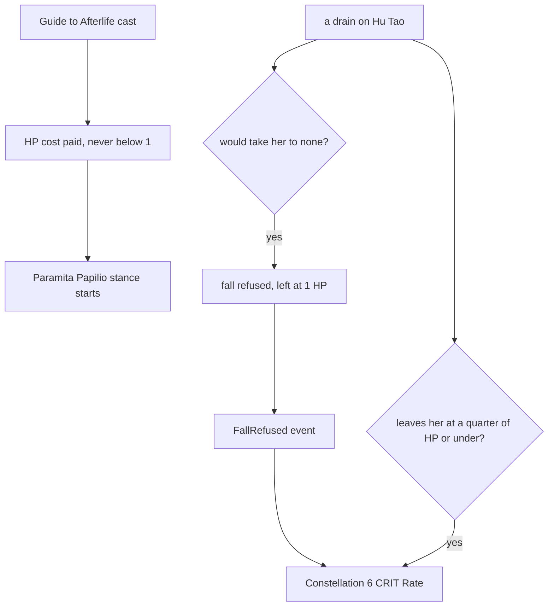

# Hu Tao

Hu Tao's kit is its record and one behaviour module, `createHuTaoKitBehaviour`, avatar 10000046: a six-strike string with its seventh hit (the wiki's Secret Spear of Wangsheng rows `hit5`, two values, and `hit6`, in `{data-root}/cache/genshin-wiki/Category_Hu_Tao_Talents.json`), a charged attack, a collision and two plunges, Guide to Afterlife's Paramita Papilio stance with its strikes and charged attack, and Spirit Soother's hit and heal. The heal is a share of her Max HP for each enemy the hit strikes, up to five a cast, read from proud skill group 4639 at indices 2 and 3, with the larger share taken at or under the half-HP threshold of index 6 (`{data-root}/genshin-parity/text/ExcelBinOutput/ProudSkillExcelConfigData.json`: 6.2625% and 8.35% of Max HP at level 1, and 0.5); the cached wiki's Spirit Soother page (`{data-root}/cache/genshin-wiki/Category_Hu_Tao_Talents.json`, its value rows 6.26% and 8.35% at level 1, up to five triggers) and gcsim v2.47.2 (MIT) `{data-root}/cache/gcsim-v2.47.2/internal/characters/hutao/zz_hutao.dm.go` (its regen tables, lines 305 and 323, read by `burst.go` lines 22 to 31) give the same two shares. Her multipliers are read from proud skill groups 4631, 4632 and 4639 of the same dump; the charged attack's stamina, the Paramita's seconds and the skill's cooldown, and the burst's cooldown and energy cost are read from the same groups (4631's index 8 is the charged attack's 25 stamina, the wiki's Secret Spear of Wangsheng `chargedStamina= 25`; 4632's index 4 is the Paramita's 9 seconds, gcsim `{data-root}/cache/gcsim-v2.47.2/internal/characters/hutao/skill.go` line 41; 4632's index 5 is the skill's 16-second cooldown, `skill.go` line 71; 4639's index 4 is the burst's 15 seconds, `{data-root}/cache/gcsim-v2.47.2/internal/characters/hutao/burst.go` line 78, and its index 5 the 60 energy the wiki's Spirit Soother gives, `energycost=60`). The stance is a stance on her for its seconds, which infuses her normal attacks, charged attack and plunges with Pyro (the wiki's Guide to Afterlife text, "Converts attack DMG to Pyro DMG", in `{data-root}/cache/genshin-wiki/Category_Hu_Tao_Talents.json`) and raises her ATK by her ATK share of Max HP as a buff from the same seconds (4632's index 1, 3.841% at level 1, the wiki's Guide to Afterlife `atkincrease_1=3.84`; gcsim `{data-root}/cache/gcsim-v2.47.2/internal/characters/hutao/skill.go` lines 35 to 45). All three end as she leaves the field, as gcsim's exit deletes the Paramita's ATK, which its infusion reads (`{data-root}/cache/gcsim-v2.47.2/internal/characters/hutao/hutao.go` lines 61 to 67). Guide to Afterlife's HP cost is built: 30% of her current HP, the share read from its skill group (4632's index 0, 0.3; gcsim `skill.go` line 56), paid through the party's HP as the stance starts (`{data-root}/cache/gcsim-v2.47.2/internal/characters/hutao/skill.go` lines 52 to 58, the drain) and never taking her below 1 HP (the wiki's note, "No HP will be consumed if Hu Tao has exactly 1 HP left", in `{data-root}/cache/genshin-wiki/Category_Hu_Tao_Talents.json`). Spirit Soother's hit is its half HP multiplier, the burst group's index 1, while her HP is at or under half of its Max HP, the threshold read at index 6, as the burst starts (379.09% at level 1, the wiki's `lowhpskilldmg_1=379.09`; gcsim `{data-root}/cache/gcsim-v2.47.2/internal/characters/hutao/burst.go` lines 24 to 31). Blood Blossom is built: the Paramita's charged attack puts it on each enemy it hits (the wiki's Guide to Afterlife text, "Charged Attacks apply the Blood Blossom effect to the enemies hit", in `{data-root}/cache/genshin-wiki/Category_Hu_Tao_Talents.json`), and it ticks every 4 seconds for 9.5 seconds on that enemy, each tick a Pyro hit of 1U at the skill group's index 2 (64% at level 1, the dump's 4632 index 2 at 0.64 and the wiki's `bloodblossomdmg_1=64`; gcsim `{data-root}/cache/gcsim-v2.47.2/internal/characters/hutao/skill.go` lines 107 and 111, a 240-frame interval and a 570-frame duration). Gcsim counts the Blood Blossom tick as the skill's one hit, and the record holds that hit as the named list `hits.bloodBlossom`, so the skill's own list is empty. Her Ascension 1 passive, Flutter By, is built: when the Paramita ends, each ally but her gains 12% CRIT Rate for 8 seconds (the wiki's Flutter By text in `{data-root}/cache/genshin-wiki/Category_Hu_Tao_Talents.json`; gcsim `{data-root}/cache/gcsim-v2.47.2/internal/characters/hutao/asc.go` lines 9 to 27, a 480-frame buff). Her Ascension 4 passive, Sanguine Rouge, is built as a 33% Pyro DMG Bonus while her HP is at or under half, as the wiki's Sanguine Rouge text (33%, `{data-root}/cache/genshin-wiki/Category_Hu_Tao_Talents.json`) and gcsim v2.47.2 give it (`{data-root}/cache/gcsim-v2.47.2/internal/characters/hutao/asc.go` lines 44 to 49). Constellation 1 is built: the charged attack's stamina multiplier is zero while a stance is on her, which the kit reads from its character (gcsim `{data-root}/cache/gcsim-v2.47.2/internal/characters/hutao/hutao.go` lines 70 to 77, which return 0 while the Paramita is active) (see Open). Constellation 2 is built: Blood Blossom's tick adds 10% of her Max HP as it stood when the effect was applied, which the status keeps as its `wielderMaxHealth`, and Spirit Soother applies Blood Blossom to each enemy its hit strikes, as the game's English text gives it (`{data-root}/genshin-parity/text/TextMap/TextMap_MediumEN.json`, key 3620258903; gcsim `{data-root}/cache/gcsim-v2.47.2/internal/characters/hutao/skill.go` lines 138 to 140 add the same 10% of Max HP to each tick from the second constellation). Constellation 4 is built as each other deployed member's 12% CRIT Rate for 15 seconds when an enemy Blood Blossom marked is defeated (gcsim `{data-root}/cache/gcsim-v2.47.2/internal/characters/hutao/cons.go` lines 70 to 90, a 900-frame buff). Constellation 6 is built as her 100% CRIT Rate for 10 seconds when a drain leaves her at a quarter of her HP or under, once a minute, and as a refusal of the fall that would take her to none, which leaves her at 1 HP, as gcsim v2.47.2 (MIT) `{data-root}/cache/gcsim-v2.47.2/internal/characters/hutao/cons.go` revives her to 1 HP (the threshold at line 41, the 100% CRIT at line 18 with its application at lines 54 to 60, the 600-frame buff at line 55, the 3600-frame cooldown at line 62, and "SetHPByAmount(1)" at line 50): the refusal starts the minute's cooldown, and the CRIT Rate follows the `FallRefused` event. The refusal is asked only on the paths named in the kits README, so Xiao's and Kuki's drains and drownParty's leave her at none without it. The Paramita's strike reaches and its charged attack's frames are as gcsim gives them (`{data-root}/cache/gcsim-v2.47.2/internal/characters/hutao/attack.go` lines 16 and 19 for the strikes' hitmarks and hitboxes, with the fifth strike's two hits at line 16, and `{data-root}/cache/gcsim-v2.47.2/internal/characters/hutao/charge.go` lines 18 and 19 for the charged attack's hitmarks), and the plunges' frames are provisional, and their poise is gcsim's 100 low and 150 high (`{data-root}/cache/gcsim-v2.47.2/internal/characters/hutao/plunge.go` lines 38 and 43).

## How it works

Guide to Afterlife pays its HP cost as the stance starts, and a drain that would take Hu Tao to none is refused at 1 HP, which starts the Constellation 6 CRIT Rate.

## Open

- [ ] **The stance's ATK rise reads the share of Max HP with no cap (whether the cap binds at her levels is not checked)** — contradicted by `{data-root}/cache/gcsim-v2.47.2/internal/characters/hutao/skill.go:35-38`: gcsim caps the share at four times her base ATK.
- [ ] **Constellation 1's charged attack costs zero stamina** — no source yet: the constellation's wording, which the cached Hu Tao wiki page (`{data-root}/cache/genshin-wiki/Category_Hu_Tao_Talents.json`) names as Crimson Bouquet without giving; gcsim's `{data-root}/cache/gcsim-v2.47.2/internal/characters/hutao/hutao.go:70-77` gives the zero while the Paramita is active, and the kit's `getChargedAttackStaminaMultiplier` (`packages/genshin-world/src/services/kit/characters/huTaoKit.ts`, line 167) carries it until the wording is cached.

## Key files

| File                                                             | Role                                                                                                                                                                                |
| :--------------------------------------------------------------- | :---------------------------------------------------------------------------------------------------------------------------------------------------------------------------------- |
| `packages/genshin-world/src/services/kit/characters/huTaoKit.ts` | `createHuTaoKitBehaviour`, Hu Tao's kit with her string, charged attack, Guide to Afterlife's Paramita stance and its Pyro infusion and ATK buff, and Spirit Soother's hit and heal |

## Sources

- The game's English text for Ominous Rainfall, TextMap key 3620258903 of its `TextMap_MediumEN.json`: "Increases the Blood Blossom DMG by an amount equal to 10% of Hu Tao's Max HP at the time the effect is applied", and Spirit Soother will also apply the Blood Blossom effect.
- [gcsim v2.47.2 Hu Tao plunge file](https://github.com/genshinsim/gcsim/blob/v2.47.2/internal/characters/hutao/plunge.go), MIT: the plunges' poise, 150 for the high plunge and 100 for the low. The v2.47.2 source is on disk at `{data-root}/cache/gcsim-v2.47.2`, which the line references above read.
- [Secret Spear of Wangsheng](https://genshin-impact.fandom.com/wiki/Secret_Spear_of_Wangsheng), [Spirit Soother](https://genshin-impact.fandom.com/wiki/Spirit_Soother) and [Guide to Afterlife](https://genshin-impact.fandom.com/wiki/Guide_to_Afterlife), Genshin Impact Wiki: the poise of her strikes, charged attack and collision, the Paramita's charged attack, Spirit Soother's hit and Blood Blossom.
- `{data-root}/cache/gcsim-v2.47.2/internal/characters/hutao/attack.go`, line 16: grounds "String of six strikes and a seventh hit".
- `{data-root}/cache/gcsim-v2.47.2/internal/characters/hutao/skill.go`, line 56: grounds "Guide to Afterlife costs HP".
- `{data-root}/cache/gcsim-v2.47.2/internal/characters/hutao/burst.go`, line 24: grounds "Spirit Soother's half-HP hit".
- `{data-root}/cache/gcsim-v2.47.2/internal/characters/hutao/skill.go`, line 107: grounds "Blood Blossom on enemies her charged attack hits".
- `{data-root}/cache/gcsim-v2.47.2/internal/characters/hutao/skill.go`, line 111: grounds "Blood Blossom ticks every four seconds for 9.5 seconds".
- The game's text, TextMap key 3620258903 in `{data-root}/genshin-parity/text/TextMap/TextMap_MediumEN.json`: grounds "Second constellation adds to Blood Blossom's DMG" and "Second constellation has Spirit Soother apply Blood Blossom".
- `{data-root}/cache/gcsim-v2.47.2/internal/characters/hutao/skill.go`, line 135: grounds scenario "Blood Blossom ticks for 9.5 seconds".
- `{data-root}/cache/gcsim-v2.47.2/internal/characters/hutao/hutao.go` lines 70 to 77: grounds scenario "A charged attack during the Paramita stance costs no stamina".
