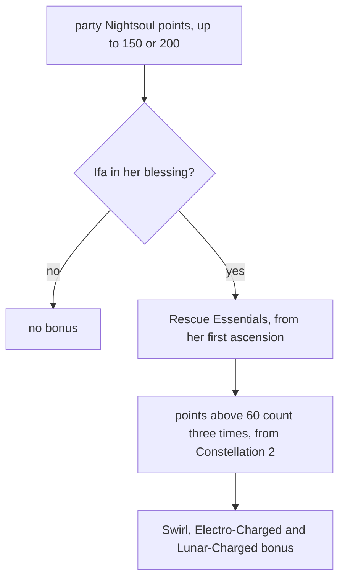

# Ifa

Ifa's kit is its record and one behaviour module, `createIfaKitBehaviour`, avatar 10000113 (`{data-root}/genshin-dump-backup-6.6/ExcelBinOutput/AvatarExcelConfigData.json`): her three normal attacks (`{data-root}/cache/gcsim-v2.47.2/internal/characters/ifa/attack.go` line 18), a charged attack, Compound Sedation Field's hit as her burst, and the low plunge with its collision (`{data-root}/cache/gcsim-v2.47.2/internal/characters/ifa/plunge.go` lines 17 and 18), all played outside her Blessing. Her multipliers are read from proud skill groups 11331, 11332 and 11339 (`{data-root}/genshin-dump-backup-6.6/ExcelBinOutput/ProudSkillExcelConfigData.json`: 11331's index 4 is the charged attack's 50 stamina, 11332's index 4 the skill's 7.5 seconds and index 3 its 80 points, and 11339's index 2 the burst's 15 seconds and index 3 its 60 energy). The charged attack costs 50 stamina, the burst 60 energy with a 15-second cooldown, and the skill cools for 7.5 seconds.

## How it works

Rescue Essentials reads the party's Nightsoul points only while Ifa's own blessing holds, and Constellation 2 changes how points above 60 count.

## Not yet built

Ifa's kit is built around the Nightsoul Blessing. Her skill's press enters the blessing with its points, which drain eight a second, and a press in it leaves it. Still waiting on the Nightsoul hook: Tonic Shot in place of her strikes, her healing, her plunge's gate, and Ascension 4 and the constellations that read the points.

- **Tonic Shot and its healing wait on the Nightsoul hook.** Inside the blessing her normal attacks and charged attack are Tonic Shot, a circle of radius 3 on the target that heals on its tap and hold, and both hits exist only in the blessing, so none is built.
- **The skill's blessing is entered; Tonic Shot is not.** The press enters the Nightsoul Blessing with 80 points (gcsim `{data-root}/cache/gcsim-v2.47.2/internal/characters/ifa/skill.go` line 67), which drain eight a second as gcsim's do (0.8 a point every 6 frames, `{data-root}/cache/gcsim-v2.47.2/internal/characters/ifa/skill.go` lines 99 and 100), and a press in the blessing leaves it. gcsim starts the 7.5-second cooldown on the blessing's exit; here it starts on the press, and the kit does not hold the cooldown her leaving sets.
- **Her plunge gate waits on the Nightsoul hook.** gcsim lets the low plunge and its collision begin only after the blessing ends, for 26 frames (`{data-root}/cache/gcsim-v2.47.2/internal/characters/ifa/skill.go` line 91, the "plungeAvailableKey" status). The framework has no such gate, so the plunges are not held back until the hook lands.
- **The sedation marks wait on the sedation-mark hook.** Compound Sedation Field marks each enemy in its area, up to four marks (gcsim `{data-root}/cache/gcsim-v2.47.2/internal/characters/ifa/burst.go` line 22, "sedationMarkCap" of 4), and each mark strikes the enemy with its aura at 38 frames (line 20). The framework holds an aura only on an enemy, and the mark's hit reads no aura of a kit's own, so the marks are not built. The burst's own hit is built.
- **Ifa's Ascension 4 and her Constellations 1 and 6 wait on the Nightsoul hook, and Constellation 4's wind current waits on a restraining field the burst does not build.** Ascension 4 adds 80 Elemental Mastery for 10 seconds after each Nightsoul burst (gcsim `{data-root}/cache/gcsim-v2.47.2/internal/characters/ifa/asc.go` lines 61 and 65), and the constellations read the blessing's points or Tonic Shot's hits, so none is built but Constellation 4's Elemental Mastery, which the burst's start adds from the constellation alone (100 for 15 seconds, gcsim `{data-root}/cache/gcsim-v2.47.2/internal/characters/ifa/cons.go` lines 53 and 56).

## Decisions

- **Rescue Essentials, her Ascension 1, add to the party's reactions from the party's Nightsoul points.** Each point adds 1.5% DMG to the Swirl and Electro-Charged reactions the party makes, and 0.2% to Lunar-Charged, up to 150 points, through the party reaction hook (gcsim `{data-root}/cache/gcsim-v2.47.2/internal/characters/ifa/asc.go` lines 41 and 46, `0.015 * ns` and `0.002 * ns`, and line 30 for the cap). The wiki's passive text (`{data-root}/cache/genshin-wiki/Category_Ifa_Talents.json`) says Rescue Essentials come from "every 1 Nightsoul point out of the total in his entire party", and the description (TextMap 2399084017 in `{data-root}/genshin-dump-backup-6.6/TextMap/TextMap_MediumEN.json`) says the damage is per "Rescue Essentials point Ifa has", so the kit sums the deployed team's points up to 150 as gcsim's getTeamNightsoul does (`{data-root}/cache/gcsim-v2.47.2/internal/characters/ifa/asc.go`, line 26), and counts them only while her own blessing holds (gcsim `{data-root}/cache/gcsim-v2.47.2/internal/characters/ifa/asc.go` line 22). From Constellation 2 the points above 60 count three times over, and the cap is 200, as gcsim's `c2BonusPoints` and `c2CapIncrease` give them (`{data-root}/cache/gcsim-v2.47.2/internal/characters/ifa/cons.go`, lines 29 to 45, applied at `{data-root}/cache/gcsim-v2.47.2/internal/characters/ifa/asc.go` lines 28 and 30). The in-game text of Constellation 2 is not read: the wiki's Constellation table lists levels 1, 3, 4, 5 and 6, but not level 2, and the dump's talent rows, keyed by obfuscated fields, were not decoded, so the rule is gcsim's alone. The Swirl and Electro-Charged values are the proud skill 1132101's record (`{data-root}/genshin-dump-backup-6.6/ExcelBinOutput/ProudSkillExcelConfigData.json`); the Lunar-Charged 0.2% has no record field, so it is the description's own figure, and each contributor takes it. The Stellar Swirl value is not built: the description's placeholder resolves to zero in the record, where gcsim gives 0.2%. "Nearby" is not modelled, as gcsim does not model it either, so every deployed member's reaction takes it. Direct Lunar-Charged hits take it too, as the direct Lunar pricing reads the party reaction bonuses its Lunar reaction takes.

- **Her low plunge and collision are gcsim's numbers, ungated.** The low plunge lands at 38 frames of a 71-frame animation (gcsim `{data-root}/cache/gcsim-v2.47.2/internal/characters/ifa/plunge.go` lines 17 and 22), and its collision at 32 frames (`collisionHitmark`, 38 less 6) as a circle of radius 1.5 (line 88). gcsim begins them only after the blessing, which the page's Not yet built names, so until the hook they can be played outside it.
- **Her high plunge takes gcsim's High_Plunge circle, with its timing unsourced.** gcsim's `{data-root}/cache/gcsim-v2.47.2/internal/characters/ifa/plunge.go` gives no high landing, and the template's "HighPlungeAttack" is not implemented for Ifa (`{data-root}/cache/gcsim-v2.47.2/internal/template/character/character.go`, lines 157 and 158), so the record's high frame count and hitmark are unsourced placeholders (71 frames and a hitmark of 0). Her `{data-root}/cache/gcsim-v2.47.2/internal/characters/ifa/config.yml` does name a `High_Plunge` hitbox, a circle of radius 3.5 on the player (lines 102 to 105), and the record takes that circle as its reach.
- **Her hits' poise waits on the record.** gcsim gives her hits none, so the wiki's values are the poise her normal attacks, charged attack and plunges take: 10.1, 8.9 and 14 for the three normal attacks, 80 for the charged attack, and 50 and 100 for the low and high plunges (cached `{data-root}/cache/genshin-wiki/Category_Ifa_Talents.json`, Rite of Dispelling Winds). `packages/genshin-world/src/data/kits/ifa.json` carries no poise key, so every hit deals zero poise until the record holds them; the [roadmap](../../../../changes/genshin-roadmap/tasks.md) holds the build.
- **The skill's press has no hit, with the table's cooldown.** gcsim starts the 7.5 seconds on the blessing's exit rather than its press (`{data-root}/cache/gcsim-v2.47.2/internal/characters/ifa/skill.go` line 87), so the cooldown here is started on the press (the 7.5 is 11332's index 4, `{data-root}/genshin-dump-backup-6.6/ExcelBinOutput/ProudSkillExcelConfigData.json`). The press's hit waits on Tonic Shot.
- **Compound Sedation Field's hit is built alone.** Its burst hit is a plain area hit on the primary target (gcsim `{data-root}/cache/gcsim-v2.47.2/internal/characters/ifa/burst.go` line 19, the burst's hitmark of 41 frames, and line 57, the circle of radius 6 on the primary target), and the marks it sets go on the sedation-mark hook.

## Key files

| File                                                           | Role                                                                                                                                                                                                                                                       |
| :------------------------------------------------------------- | :--------------------------------------------------------------------------------------------------------------------------------------------------------------------------------------------------------------------------------------------------------- |
| `packages/genshin-world/src/services/kit/characters/ifaKit.ts` | `createIfaKitBehaviour`, Ifa's three normal attacks, charged attack, Compound Sedation Field's hit, and her plunges outside her Nightsoul Blessing, her skill's press entering and leaving the blessing, with Tonic Shot and the rest waiting on the hooks |

## Sources

- [gcsim](https://github.com/genshinsim/gcsim/tree/v2.47.2/internal/characters/ifa), MIT, at v2.47.2: the strikes' and the charged attack's hitmarks, cancels and reaches, the low plunge and its collision, the `High_Plunge` hitbox in `{data-root}/cache/gcsim-v2.47.2/internal/characters/ifa/config.yml`, the skill's blessing, Compound Sedation Field and its marks, and the passives and constellations the hook waits on. The v2.47.2 source is on disk at `{data-root}/cache/gcsim-v2.47.2`, which the line references above read.
- [Category:Ifa Talents](https://genshin-impact.fandom.com/wiki/Category:Ifa_Talents), Genshin Impact Wiki: the poise of her normal attacks, charged attack and plunges, with the Rite of Dispelling Winds page it lists. The cached copy is `{data-root}/cache/genshin-wiki/Category_Ifa_Talents.json`, which the Not yet built poise bullet reads; this link was not re-opened when it was written.
- `{data-root}/cache/gcsim-v2.47.2/internal/characters/ifa/cons.go`, lines 29 to 45: the second constellation's rule that the party's points above 60 count three times over and the cap rises to 200, grounding "Second constellation counts the party's points above 60 three times over", "Second constellation raises the cap to 200 points", "First ascension's Rescue Essentials add to the party's Swirl and Electro-Charged reactions" and "First ascension's Rescue Essentials add to the party's Lunar-Charged reactions".
- `{data-root}/cache/genshin-wiki/Category_Ifa_Talents.json`: the wiki's Constellation table lists levels 1, 3, 4, 5 and 6, but not level 2, grounding the note in "Second constellation counts the party's points above 60 three times over" that the in-game text is not read.
- `{data-root}/cache/gcsim-v2.47.2/internal/characters/ifa/cons.go`, lines 29 to 31: the rule that below the second constellation the points above 60 count once and the cap stays at 150, grounding "Below her second constellation the party's points count once".
- `{data-root}/cache/gcsim-v2.47.2/internal/characters/ifa/cons.go`, lines 52 to 56: the fourth constellation's 100 Elemental Mastery for 15 seconds when the burst starts, grounding "Fourth constellation adds 100 Elemental Mastery for 15 seconds after her burst".
- `{data-root}/cache/gcsim-v2.47.2/internal/characters/ifa/skill.go`, lines 67, 99 to 100 and 106 to 110: the blessing's entry with 80 points, its drain and its exit, grounding "Skill press enters the Nightsoul Blessing" and "Skill press leaves the Nightsoul Blessing".
- `{data-root}/cache/gcsim-v2.47.2/internal/characters/ifa/asc.go`, lines 22 to 30, 41 and 46: the Rescue Essentials' blessing gate, party points, cap and reaction values, grounding "First ascension's Rescue Essentials add to the party's Swirl and Electro-Charged reactions", "First ascension's Rescue Essentials add to the party's Lunar-Charged reactions", "First ascension's Rescue Essentials count the party's Nightsoul points", "First ascension's Rescue Essentials count the points only while her blessing lasts" and "Rescue Essentials add nothing below her first ascension".
- `{data-root}/genshin-dump-backup-6.6/ExcelBinOutput/ProudSkillExcelConfigData.json`, group 11332 index 4: the skill's 7.5-second cooldown, grounding "Skill cooldown without a hit yet".
- `{data-root}/cache/gcsim-v2.47.2/internal/characters/ifa/attack.go`, line 18: grounds scenario "The three normal attacks play in order".
- `{data-root}/genshin-dump-backup-6.6/ExcelBinOutput/ProudSkillExcelConfigData.json`, group 11331 index 4: grounds scenario "The charged attack costs 50 stamina".
- `{data-root}/cache/gcsim-v2.47.2/internal/characters/ifa/plunge.go` lines 17 and 22: grounds scenario "The low plunge and its collision land".
- `{data-root}/cache/gcsim-v2.47.2/internal/characters/ifa/plunge.go` lines 18 and 88: grounds scenario "The low plunge and its collision land".
- `{data-root}/cache/gcsim-v2.47.2/internal/characters/ifa/config.yml` lines 102 to 105: grounds requirement "Provisional high plunge" and scenario "The high plunge reaches a circle of 3.5 metres on her body".
- `{data-root}/cache/gcsim-v2.47.2/internal/characters/ifa/burst.go` line 57: grounds scenario "Casting the burst strikes the primary target".
- `{data-root}/genshin-dump-backup-6.6/ExcelBinOutput/ProudSkillExcelConfigData.json`, group 11339 index 3: grounds scenario "Casting the burst strikes the primary target".
- `{data-root}/genshin-dump-backup-6.6/ExcelBinOutput/ProudSkillExcelConfigData.json`, group 11339 index 2: grounds scenario "Casting the burst strikes the primary target".
