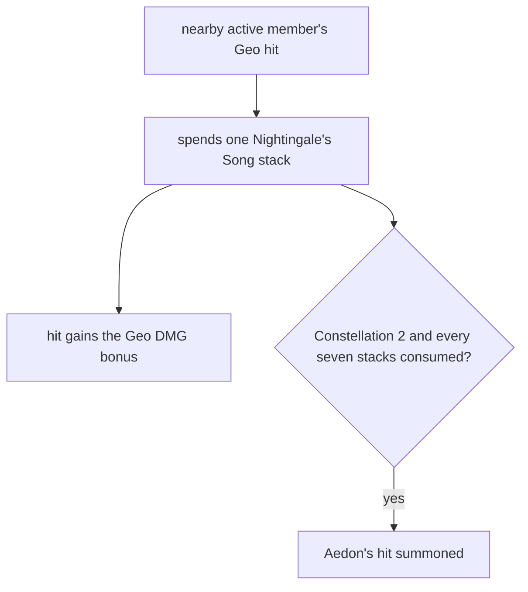

# Illuga

Illuga's kit is its record and one behaviour module, `createIllugaKitBehaviour`, avatar 10000127 (`{data-root}/genshin-dump-backup-6.6/ExcelBinOutput/AvatarExcelConfigData.json`). Its moves are the wiki's rows (`{data-root}/cache/genshin-wiki/Category_Illuga_Talents.json`): the normal attack's 1-Hit to 4-Hit, the Charged Attack, and the Plunging Attack Collision, Low Plunge and High Plunge. gcsim has no folder for Illuga at v2.47.2, so Illuga's record follows [the kits index](../README.md).

## How it works

Each Geo hit a nearby active member lands spends a Nightingale's Song stack for its bonus, and at Constellation 2 every seven stacks consumed summons Aedon's hit.

## Decisions

- **Illuga is a pole user.** The installed game's avatar table gives his `weaponType` as `WEAPON_POLE` (`{data-root}/genshin-dump-backup-6.6/ExcelBinOutput/AvatarExcelConfigData.json`, avatar 10000127).
- **His Press keeps Keqing's skill as its donor, a judgment call for the coordinator.** Keqing's Lightning Stiletto is a thrown projectile (`{data-root}/cache/genshin-wiki/Category_Keqing_Talents.json`, 'Hurls a Lightning Stiletto'), the nearest shape to Aedon's flight, but Illuga's Tap is a dash toward enemies in front (`{data-root}/cache/genshin-wiki/Category_Illuga_Talents.json`), so the shape only partly matches.
- **His Hold DMG borrows its action frames and first hit's area from Zhongli's pole hold.** Zhongli's hold (10000030) is, in the built record, 16 hits with the first at a 48-frame hitmark (`packages/genshin-world/src/data/kits/zhongli.json`). The record gives no shape to choose among pole holds, so Zhongli's, the first one tried, is a tie-break the coordinator should confirm. Both of Illuga's Hold hits take the donor's first area, and their hitmarks are its 48 spread over the action (24 and 48), Unsourced. Its element is Geo, Unsourced, as the wiki reads Aedon's dash. The donor's figures are open: see Open.
- **Illuga borrows Xiao's, Keqing's, Xiangling's and Bennett's hitmarks and areas, provisional.** His strikes and charged attack take Xiao's, his Press Keqing's, and his burst Xiangling's. His plunges and collision borrow Bennett's hitmarks and areas, as `NoActionFile`.
- **Illuga's Press reads its "Press DMG" label for two hits, and his burst its "Skill DMG" label for two.** The wiki's Dawnbearing Songbird page (cached in `{data-root}/cache/genshin-wiki/Category_Illuga_Talents.json`) gives the Press DMG and Hold DMG rows, with the labels the kit reads.
- **The Nightingale's Song Geo DMG bonus is read from the burst's proud group.** Its label, "Geo DMG Bonus" with the format "{param3:F1P} Elemental Mastery" (`{data-root}/genshin-dump-backup-6.6/TextMap/TextMap_MediumEN.json`), is the dump's bare value 0.336 at level 1 (`{data-root}/genshin-dump-backup-6.6/ExcelBinOutput/ProudSkillExcelConfigData.json`, proud skill 1273901, index 2), so it is a Tables-sourced parameter with no overlay entry. Each stack spent on a Geo hit adds 33.6% of Illuga's Elemental Mastery to that hit's base damage (`{data-root}/genshin-dump-backup-6.6/ExcelBinOutput/ProudSkillExcelConfigData.json`, index 2; the nearby active party members' Geo hits consume the stack, `{data-root}/cache/genshin-wiki/Category_Illuga_Talents.json`). The same row gives 21 stacks at index 4, and its 20 seconds sit at index 6 (`{data-root}/genshin-dump-backup-6.6/ExcelBinOutput/ProudSkillExcelConfigData.json`), which the burst's state reads.
- **Aedon's hit takes the burst's first hit's area, with no hitmark and no poise, Unsourced.** Constellation 2's text gives the damage, 400% of Elemental Mastery and 200% of DEF from talent 1272 (its `paramList` is 4 and 2, `{data-root}/genshin-dump-backup-6.6/ExcelBinOutput/AvatarTalentExcelConfigData.json`; the text, with its seven stacks, is `{data-root}/genshin-dump-backup-6.6/TextMap/TextMap_MediumEN.json`), yet no area, hitmark or poise. The kit takes the burst's area and owes a recording of Aedon.
- **Aedon's hit deals Elemental Burst DMG.** Constellation 2's text says the damage "is considered Elemental Burst DMG" (`{data-root}/genshin-dump-backup-6.6/TextMap/TextMap_MediumEN.json`), and gcsim has no folder for Illuga to say otherwise, so the summon names that kind as it casts.
- **"Nearby" reads as the deployed team, and "active party members" as the member on the field.** Torchforger's Covenant and Lightkeeper's Oath give the other deployed members; Solarhunting Wolf's 200 DEF goes to the active member only (talent 1274's `paramList` is 200, `{data-root}/genshin-dump-backup-6.6/ExcelBinOutput/AvatarTalentExcelConfigData.json`). Both readings are provisional.
- **Lightkeeper's Oath's values are the passive's and Nightmare Orioles' talent rows.** The passive's paramList (`{data-root}/genshin-dump-backup-6.6/ExcelBinOutput/ProudSkillExcelConfigData.json`, proud skill 1272101) is 5% CRIT Rate, 10% CRIT DMG, 50 Elemental Mastery and 20 seconds, and talent 1276's `paramList` (`{data-root}/genshin-dump-backup-6.6/ExcelBinOutput/AvatarTalentExcelConfigData.json`) gives 10% CRIT Rate, 30% CRIT DMG and 80 Elemental Mastery. The passive's list repeats each CRIT pair, and the kit reads one pair (`packages/genshin-world/src/services/kit/characters/illugaKit.ts`). The passive is unlocked at ascension 1 (`{data-root}/cache/genshin-wiki/Category_Illuga_Talents.json`, its Torchforger's Covenant talent note).

## Not built

- **The stacks Geo Constructs give Nightingale's Song are not built.** The state's gain helper exists, but the kit does not read the constructs on the field.
- **Constellation 1 is talent 1271, which is not built.** Its openConfig is `Illuga_Constellation_1` (`{data-root}/genshin-dump-backup-6.6/ExcelBinOutput/AvatarTalentExcelConfigData.json`), and the TextMap names it Vigilant Sentinel, key 1793938489, which the bullet below gives.
- **Vigilant Sentinel is not built.** After Illuga triggers a Geo-related Reaction on the field, he regains 12 Elemental Energy at most once every 15 seconds (`{data-root}/genshin-dump-backup-6.6/TextMap/TextMap_MediumEN.json`, key 796583231; talent 1271's `paramList` is 12 and 15, `{data-root}/genshin-dump-backup-6.6/ExcelBinOutput/AvatarTalentExcelConfigData.json`).

## Open

- [ ] **The built record gives Zhongli's pole hold 16 hits, the first at a 48-frame hitmark** — contradicted by Zhongli's skill source, cited on the [Zhongli](../zhongli/design.md) page: gcsim queues one hit at 48 frames in a 96-frame hold.
- [ ] **Aedon's hit takes the burst's first hit's area, with no hitmark and no poise** — no source yet: a source giving Aedon's hit an area, hitmark or poise; the constellation text gives only the damage and one nearby opponent.
- [ ] **Press reads its 'Press DMG' label for two hits** — no source yet: a source giving the Press DMG row's hit count; the cached Dawnbearing Songbird page gives its rows without one.
- [ ] **The burst reads its 'Skill DMG' label for two hits** — no source yet: a source giving the burst's Skill DMG hit count; the cached Shadowless Reflection page, Illuga's burst, gives one Skill DMG row over 13 levels with no hit count.

## Key files

| File                                                              | Role                                                                                                                                                                     |
| :---------------------------------------------------------------- | :----------------------------------------------------------------------------------------------------------------------------------------------------------------------- |
| `packages/genshin-world/src/services/kit/characters/illugaKit.ts` | `createIllugaKitBehaviour`, his burst, the Nightingale's Song stacks and their Geo DMG bonus, Torchforger's Covenant's Lightkeeper's Oath, and Constellations 2, 4 and 6 |
| `packages/genshin-world/src/data/kits/illuga.json`                | Illuga's overlay                                                                                                                                                         |

## Sources

- [Illuga](https://genshin-impact.fandom.com/wiki/Illuga) and [Category:Illuga Talents](https://genshin-impact.fandom.com/wiki/Category:Illuga_Talents), Genshin Impact Wiki: Illuga's multipliers, energy, cooldowns and costs, and the Dawnbearing Songbird text read from the category page. The cached category is `{data-root}/cache/genshin-wiki/Category_Illuga_Talents.json`.
- Illuga's clips, `Ani_Avatar_Boy_Pole_Illuga_*`, read as the [kits README](../README.md#sources) gives.
- [gcsim](https://github.com/genshinsim/gcsim/tree/v2.47.2/internal/characters/xiao), MIT at v2.47.2: Xiao's strike hitmarks and areas for Illuga, [Keqing](https://github.com/genshinsim/gcsim/tree/v2.47.2/internal/characters/keqing)'s for his Press and [Xiangling](https://github.com/genshinsim/gcsim/tree/v2.47.2/internal/characters/xiangling)'s for his burst. The v2.47.2 source is on disk at `{data-root}/cache/gcsim-v2.47.2`.
- The built record of Zhongli (10000030), for the Hold's donor above.
- The installed game's TextMap and avatar talent table, for Illuga's constellations: Elk With Fanged Antlers (talent 1272), Solarhunting Wolf (1274) and Nightmare Orioles (1276), and the Torchforger's Covenant passive (P1272101) it enhances.
- The installed game's proud skill group 12739, Shadowless Reflection's, for the Geo DMG bonus of a stack, whose label is read from its TextMap.
- `{data-root}/genshin-parity/text/TextMap/TextMap_MediumEN.json`, hash 1078666392: the game's text naming the nearby active party members as the ones whose hits spend a stack, grounding "A nearby active member's Geo hit spends a stack and gains the bonus".
- `{data-root}/cache/genshin-wiki/Category_Illuga_Talents.json`: the 33.6 Geo DMG Bonus at talent level 1, grounding "A nearby active member's Geo hit spends a stack and gains the bonus".
- `{data-root}/genshin-parity/text/TextMap/TextMap_MediumEN.json`, hash 3921016055: the game's text giving Aedon's hit 400% of Elemental Mastery and 200% of DEF, grounding "Constellation 2 summons Aedon's hit".
- `{data-root}/genshin-parity/text/TextMap/TextMap_MediumEN.json`, hash 2798755983: the game's text giving the condition and the 200 DEF, grounding "Constellation 4 gives the active member DEF".
- `{data-root}/genshin-dump-backup-6.6/ExcelBinOutput/AvatarTalentExcelConfigData.json`, talent 1274: the 200 DEF, grounding "Constellation 4 gives the active member DEF".
- `{data-root}/genshin-parity/text/TextMap/TextMap_MediumEN.json`, hash 208718975: the game's text giving the 10% CRIT Rate, 30% CRIT DMG and 80 Elemental Mastery, grounding "Constellation 6 enhances Lightkeeper's Oath".
- `{data-root}/genshin-dump-backup-6.6/ExcelBinOutput/AvatarTalentExcelConfigData.json`, talent 1276: the 10% CRIT Rate, 30% CRIT DMG and 80 Elemental Mastery, grounding "Constellation 6 enhances Lightkeeper's Oath".
