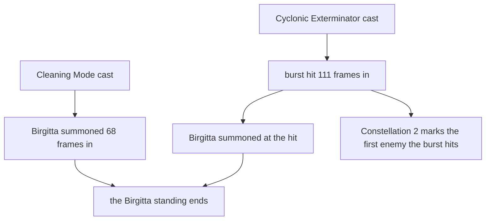

# Ineffa

Ineffa's kit is its record and one behaviour module, `createIneffaKitBehaviour`, avatar 10000116: her four strikes, a charged attack, Cleaning Mode as her skill, Cyclonic Exterminator as her burst, a low, high and collision plunge, and her Moonsign Benediction. Her multipliers are read from proud skill groups 11631, 11632 and 11639, with the skill's damage, shield, Birgitta's damage and durations among them (`{data-root}/genshin-dump-backup-6.6/ExcelBinOutput/ProudSkillExcelConfigData.json`: 11632's index 4 is the shield's 20 seconds, index 5 Birgitta's 20 seconds and index 6 the skill's 16-second cooldown; 11639's index 1 the burst's 15 seconds and index 2 its 60 energy). The charged attack takes 25 stamina (11631's index 6), the skill has a 16-second cooldown (`{data-root}/cache/genshin-wiki/Category_Ineffa_Talents.json`), and the burst has 60 energy and 15 seconds (`{data-root}/cache/genshin-wiki/Category_Ineffa_Talents.json`).

## How it works

Cleaning Mode and Cyclonic Exterminator each summon Birgitta at their own timing, and each summon ends the Birgitta standing on the field.

## Not yet built

- **Her Ascension 1 passive and Constellation 6 are not built.** Ascension 1 and Constellation 6 read Lunar-Charged: a bonus Lunar-Charged attack on Birgitta's discharge while Lunar-Charged holds, and a bonus attack. Lunar-Charged and the direct Lunar hit are built ([combat](../../combat/design.md#lunar-reactions)), and the discharge gcsim places on its primary target lands on `KitContext.primaryTarget`, so they wait only on her kit's next pass. gcsim's Constellation 6 gate is the Lunar-Charged reaction's own attack, which the kit does not hear (`{data-root}/cache/gcsim-v2.47.2/internal/characters/ineffa/cons.go` line 174, "c6IcdKey").

## Decisions

- **Her Ascension 4 passive, Panoramic Permutation Protocol, is built as the burst's Elemental Mastery.** gcsim gives her 6% of her total ATK as Elemental Mastery for 20 seconds from the burst (`{data-root}/cache/gcsim-v2.47.2/internal/characters/ineffa/asc.go` lines 67 and 80).

- **Her Moonsign Benediction.** It turns the party's Electro-Charged into Lunar-Charged (`{data-root}/cache/genshin-wiki/Category_Ineffa_Talents.json`) and gives the party's Lunar-Charged 0.7% Base DMG Bonus for each 100 of her ATK, at most 14%, as gcsim's `{data-root}/cache/gcsim-v2.47.2/internal/characters/ineffa/asc.go` has it (lines 96 and 110, `min(TotalAtk / 100 * 0.007, 0.14)`).
- **The skill's shield is a task's.** gcsim places Cleaning Mode's shield 4 frames in (`{data-root}/cache/gcsim-v2.47.2/internal/characters/ineffa/skill.go` line 39), so the skill sets a task that runs then, and the shield reads her ATK as it stands as the task runs: the table's share of ATK plus its flat HP (`{data-root}/cache/gcsim-v2.47.2/internal/characters/ineffa/shield.go` line 15, the 11632 rows at indices 1 and 2). It is Electro and lasts the 20 seconds the table gives it, from its placement (`{data-root}/cache/gcsim-v2.47.2/internal/characters/ineffa/shield.go` line 25, `Expires` at 20 × 60 frames).
- **Birgitta is summoned on her cast's own timing, not its first frame.** Cleaning Mode summons her 42 frames after its hit, at 68 frames (`{data-root}/cache/gcsim-v2.47.2/internal/characters/ineffa/skill.go` line 40, `skillHitmark + 42`), and Cyclonic Exterminator summons her at its hit, at 111 frames (`{data-root}/cache/gcsim-v2.47.2/internal/characters/ineffa/burst.go` lines 15 and 49). Each summon sets the one on the field to end, as gcsim restarts her discharges, so Birgitta is never on the field twice (`{data-root}/cache/gcsim-v2.47.2/internal/characters/ineffa/skill.go` line 54, `{data-root}/cache/gcsim-v2.47.2/internal/characters/ineffa/burst.go` line 48).
- **Birgitta's discharges.** Each lands 42 frames after her spawn and every 119 frames after, ten in all (`{data-root}/cache/gcsim-v2.47.2/internal/characters/ineffa/skill.go` lines 55 and 83), on a circle the framework centres on the targeted enemy with a radius of 4 metres (`{data-root}/cache/gcsim-v2.47.2/internal/characters/ineffa/skill.go` line 81). She stands for 1,200 frames from her spawn (`{data-root}/cache/gcsim-v2.47.2/internal/characters/ineffa/skill.go` line 54, `20 * 60`).
- **The plunges are borrowed.** There is no gcsim plunge file for Ineffa; her plunges follow [how a kit is read](../README.md#how-a-kit-is-read), and the manual verification list holds the question.
- **Her strikes, charged attack and burst take the wiki's poise.** gcsim gives them none, so each takes the wiki's value (`{data-root}/cache/genshin-wiki/Category_Ineffa_Talents.json`, Cyclonic Duster and Supreme Instruction: Cyclonic Exterminator): 32.4, 31.8, 21.2 and 52.2 from the first strike to the fourth, 120 for the charged attack and 200 for the burst.
- **Birgitta's Electro particles.** Each discharge that lands rolls a particle with a chance of 0.66 (`Rand.Float64() < 0.66`, `{data-root}/cache/gcsim-v2.47.2/internal/characters/ineffa/skill.go` line 97), as gcsim's `baseParticleCB` does (`{data-root}/cache/gcsim-v2.47.2/internal/characters/ineffa/skill.go` lines 87 to 98), and the particle lands 100 frames later, the default ParticleDelay (`{data-root}/cache/gcsim-v2.47.2/pkg/core/player/character/character.go` line 144). The delay is a status that counts the particles it holds, so a second particle pending while the first is due lands both when the later one does, as `delayKitEnergy` gives every delayed energy. Discharges come 119 frames apart within a chain, so gcsim's 18-frame internal cooldown on the particle (`{data-root}/cache/gcsim-v2.47.2/internal/characters/ineffa/skill.go` line 95, 0.3 × 60) never binds and is not kept.
- **Constellation 1's Carrier Flow Composite is a 20-second Lunar-Charged DMG Bonus on the party, read from Ineffa's ATK.** gcsim's `{data-root}/cache/gcsim-v2.47.2/internal/characters/ineffa/cons.go` gives every character a reaction bonus of 2.5% per 100 of her total ATK, at most 50% (`{data-root}/cache/gcsim-v2.47.2/internal/characters/ineffa/cons.go` line 45), while its "c1OnShield" status holds for 20 seconds (`{data-root}/cache/gcsim-v2.47.2/internal/characters/ineffa/cons.go` line 57), and `{data-root}/cache/gcsim-v2.47.2/internal/characters/ineffa/shield.go` starts that status on each shield she casts (line 30). The kit's party reaction hook gives the bonus to every Lunar-Charged reaction a member makes, the direct Lunar-Charged hit included, from her ATK as `getBuffedCombatant` prices it, and her shield's `ShieldCast` event starts the 20 seconds.
- **Constellation 2 marks the burst's first enemy.** gcsim's `{data-root}/cache/gcsim-v2.47.2/internal/characters/ineffa/cons.go` places her shield 37 frames into the burst (line 65), as the skill's shield, so it replaces the skill's one. It also marks the first enemy the burst's hit strikes (c2MakeCB): the mark is an enemy status set on the burst's own `EnemyHit` event, read after the hit's check so that hit does not take it. The mark's next hit, from anyone, or 60 frames on, whichever comes first (line 111, `c2Atk` at 60 frames), fires the Punishment Edit on it: a Lunar-Charged direct hit of 3 times her ATK (`Mult` 3) in a circle of 6 metres (line 107 onwards, `NewCircleHitOnTarget(e, nil, 6)`). The burst's hit is the one gcsim's `done` flag guards, so a second enemy it strikes is not marked, here by the mark's presence on the enemies the context holds.
- **Constellation 4's energy goes to Ineffa herself, on her party's reactions.** gcsim's `{data-root}/cache/gcsim-v2.47.2/internal/characters/ineffa/cons.go` gives her 5 Energy on any Lunar-Charged reaction on an enemy, with a 4 second internal cooldown (lines 140 and 141, `4 * 60`), and her own reactions count. The hook reads the reactions of any party member, her own included, and holds the cooldown as a status.

## Key files

| File                                                              | Role                                                                                                                                                                  |
| :---------------------------------------------------------------- | :-------------------------------------------------------------------------------------------------------------------------------------------------------------------- |
| `packages/genshin-world/src/services/kit/characters/ineffaKit.ts` | `createIneffaKitBehaviour`, Ineffa's four strikes, charged attack, Cleaning Mode and its shield, Birgitta and Cyclonic Exterminator, plunges and Moonsign Benediction |

## Sources

- [gcsim](https://github.com/genshinsim/gcsim/tree/v2.47.2/internal/characters/ineffa), MIT, at v2.47.2: the strikes and the charged attack as the index gives them, Cleaning Mode and its shield and Birgitta, Cyclonic Exterminator, the Moonsign Benediction, and her Ascension 1 passive and constellations not yet built. The v2.47.2 source is on disk at `{data-root}/cache/gcsim-v2.47.2`, which the line references above read.
- [Hosted game data](../../hosted-game-data/design.md): proud skill groups 11631, 11632 and 11639, with the skill-kit record behind her cooldowns and energy cost.
