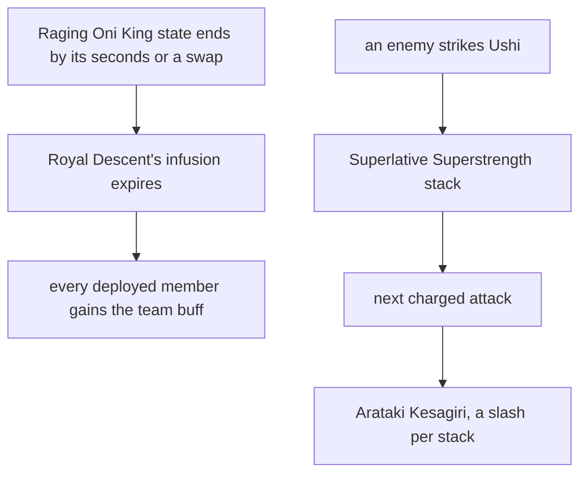

# Itto

Itto's kit is its record and one behaviour module, `createIttoKitBehaviour`, on avatar 10000057: four strikes, the Saichimonji Slash as his charged attack, a collision and two plunges, Masatsu Zetsugi's hit with Ushi, and Royal Descent's ATK bonus per DEF with its Geo conversion and Normal ATK SPD. His multipliers are read from proud skill groups 5731, 5732 and 5739 (`{data-root}/genshin-parity/text/ExcelBinOutput/ProudSkillExcelConfigData.json`); the table indexes of his strikes, the Saichimonji Slash, the Arataki Kesagiri's slashes and the plunges, Ushi's share of his Max HP and its seconds, the skill's cooldown and the burst's cooldown and energy cost are read from the same groups. The conversion reaches his strikes, slashes and plunges with the reaches gcsim gives them under the burst.

Superlative Superstrength is a resource of up to 5 on the team's effects (gcsim `{data-root}/cache/gcsim-v2.47.2/internal/characters/itto/itto.go` lines 119 and 120). His second strike gives 1 as it lands and his fourth 2, and as the Raging Oni King his first and third 1 each (gcsim `{data-root}/cache/gcsim-v2.47.2/internal/characters/itto/attack.go` lines 121 to 127; the wiki's Fight Club Legend text in `{data-root}/cache/genshin-wiki/Category_Arataki_Itto_Talents.json`). Ushi gives 1 the first time Masatsu Zetsugi's hit strikes, 1 as it takes an enemy's strike, at most once every 2 seconds, and 1 as it leaves, its seconds run out, its health spent or a second Ushi sending it away (gcsim `skill.go` lines 34 and 111, and `{data-root}/cache/gcsim-v2.47.2/internal/characters/itto/ushi.go` line 26). Ushi is a taunt on the enemy the skill turned to, holding all of Itto's Max HP for 6 seconds from the hit (gcsim `{data-root}/cache/gcsim-v2.47.2/internal/characters/itto/skill.go` line 95, `6*60`; the wiki's Masatsu Zetsugi page in `{data-root}/cache/genshin-wiki/Category_Arataki_Itto_Talents.json` gives a 6-second duration and Inherited HP of 100% Max HP, which proud group 5732's index 1 holds at 1). While he holds stacks a stance turns his charged attack into the Arataki Kesagiri for them, at no stamina: a combo slash from the left and the right in turn for each stack but the last, then the final slash, with its poise from gcsim (`{data-root}/cache/gcsim-v2.47.2/internal/characters/itto/charge.go` lines 225, 228, 233 and 240) and its hitmarks, windups, boxes and circles unsourced. His Ascension 4 passive, Bloodline of the Crimson Oni, is built, and so is Constellation 1: two stacks 75 frames after Royal Descent's cast, then one at each of 1, 1.5 and 2 seconds after that (gcsim `{data-root}/cache/gcsim-v2.47.2/internal/characters/itto/burst.go` line 90 and `{data-root}/cache/gcsim-v2.47.2/internal/characters/itto/cons.go` lines 16 to 22). Arataki Ichiban's ATK SPD, which gcsim gives each slash for the next at 10%, to 30% (`{data-root}/cache/gcsim-v2.47.2/internal/characters/itto/asc.go` lines 14 and 31), and Constellation 6's stack save are not built.

## How it works

Constellation 4's team buff starts when Royal Descent's state ends, and each Superlative Superstrength stack gives the next charged attack one more Arataki Kesagiri slash.

## Decisions

- **Itto's charged attack is the Saichimonji Slash while he holds no stacks.** gcsim's charged attack is the Saichimonji Slash only with no Superlative Superstrength (`charge.go` line 202), and the Arataki Kesagiri combo and final slashes with stacks, which the kit plays as a stance while he holds them.
- **The Arataki Kesagiri is one charged attack holding every slash its stacks buy, and spends them as it starts.** gcsim plays each slash as its own charged attack, spending a stack (`charge.go` line 273) and choosing the next slash from the stacks then held, so a stack gained mid-combo lengthens it. The kit's charged attack starts only once a strike ends, so it cannot chain one into another: the stance holds the whole combo for the stacks at its start, and lasts as long as the combo plays so its slashes keep the burst's conversion and their kind of attack. A stack gained while it plays waits for the next charged attack.
- **Ushi is a taunt with no explosion, and gives its stack as an enemy's strike damages it.** Ushi flees without dealing damage, so it carries no explosion. Each strike it takes is a `TauntDamaged` event, which gives Itto a stack off a 2-second cooldown (`{data-root}/cache/genshin-wiki/Category_Arataki_Itto_Talents.json`, the Ushi text: "Only 1 stack can be gained in this way every 2s") of his own (`skill.go` line 34), the talent's "only 1 stack can be gained in this way every 2s"; gcsim leaves that stack to a parameter that defaults to none (`skill.go` lines 54 to 62), since its enemies do not strike.
- **Masatsu Zetsugi's gauge is 1U**, the Durability of 25 gcsim gives it (`skill.go` line 75).
- **Constellation 1's stacks are scheduled from the cast, not gained at it.** gcsim queues the two stacks 75 frames after the burst (`burst.go` line 90), and its three timers after those, so the kit schedules them with `scheduleKitTask` in the same order. That gives 2 at once and then 3 more, at 1, 1.5 and 2 seconds after the first two (`cons.go` lines 16 to 22, timers at 60, 90 and 120 frames).
- **Royal Descent ends as Itto leaves the field.** gcsim's `itto-exit` deletes the burst's ATK and ATK SPD on a swap, which its Geo conversion reads (`burst.go` lines 123 to 131), so the burst's buff and infusion each end on a swap (`isEndedOnSwap`).
- **Constellation 2 restores Energy and cuts Royal Descent's cooldown for each Geo member of the team.** gcsim (MIT) `{data-root}/cache/gcsim-v2.47.2/internal/characters/itto/cons.go`'s `c2` (lines 25 to 34) gives 6 Energy and cuts the burst's cooldown by 1.5 seconds for each Geo member, at most three, 9 frames after the cast (`{data-root}/cache/gcsim-v2.47.2/internal/characters/itto/burst.go` line 97). Its count is taken at `Init` over the team, which does not change in a battle, so the kit counts the deployed team's Geo members as the burst starts, Itto included, and cuts the cooldown on the party member as Navia's and Raiden's constellations do.
- **Constellation 4's team buff starts when the Raging Oni King state ends.** gcsim (MIT) `{data-root}/cache/gcsim-v2.47.2/internal/characters/itto/cons.go`'s `c4` (lines 36 to 57) gives every member 20% ATK and 20% DEF for 10 seconds once the state ends, by its seconds or Itto's leaving the field (`burst.go` and `itto.go`'s exit). The state is Royal Descent's Geo conversion infusion, so the kit gives the buffs on that infusion's expiry, and a swap's end reaches it as an expiry too, since the step drops a swap-ended effect as expired.
- **Constellation 6's first part is the Charged Attacks' CRIT DMG; its stack save is not built.** gcsim (MIT) `{data-root}/cache/gcsim-v2.47.2/internal/characters/itto/cons.go`'s `c6` (lines 59 to 73) gives 70% CRIT DMG to `AttackTagExtra` attacks, the charged attacks, through the strike's CRIT DMG hook. Its other part, the Arataki Kesagiri's stack save, is `c6Proc`, a roll taken once per battle (`itto.go`), which the kit does not roll yet.
- **The Arataki Kesagiri's hitmarks and frames are not read from gcsim, and its areas are only partly read.** gcsim picks each slash's hitbox row and hitmark by the state the stacks leave, and subtracts a windup from the hitmark, so no line gives the record's value and they are Unsourced. Its radii sit in gcsim's hitbox table, which the area reader does not resolve yet, so the record marks them Unsourced although gcsim gives them; the [character kits proposal](../../../../changes/genshin-character-kits/design.md) holds that reader. Each slash's poise is cited at the line that sets it (`{data-root}/cache/gcsim-v2.47.2/internal/characters/itto/charge.go` lines 225, 228, 233 and 240), each slash's multiplier is gcsim's, joined to proud skill group 5731 at the index its row gives, and the stamina waits for a reader that joins a slash to its talent row.

## Open

- [ ] **Royal Descent lasts 13.25 seconds** — contradicted by `{data-root}/genshin-parity/text/ExcelBinOutput/ProudSkillExcelConfigData.json`: group 5739's index 3 gives 11 seconds.
- [ ] **Ushi's stack for an enemy's strike comes only from the gcsim ushihit parameter** — no source yet: gcsim sets it at `{data-root}/cache/gcsim-v2.47.2/internal/characters/itto/skill.go` lines 56 to 62 and 100 to 105, and the game's own strike gate is not read here.
- [ ] **Superlative Superstrength stacks have no expiry in the kit** — contradicted by `{data-root}/cache/genshin-wiki/Category_Arataki_Itto_Talents.json`: gives its duration as 60s.
- [ ] **The Arataki Kesagiri's hitmarks, frames and areas match the game** — no source yet: gcsim picks each slash's row and hitmark by the stacks left and subtracts a windup, so no line gives the record's values, which the record marks Unsourced.

## Key files

| File                                                            | Role                                                                                                                                                                                                              |
| :-------------------------------------------------------------- | :---------------------------------------------------------------------------------------------------------------------------------------------------------------------------------------------------------------- |
| `packages/genshin-world/src/services/kit/characters/ittoKit.ts` | `createIttoKitBehaviour`, Itto's kit with Masatsu Zetsugi's hit and Ushi, the Saichimonji Slash, Superlative Superstrength and the Arataki Kesagiri, the plunges and Royal Descent's ATK bonus and Geo conversion |

## Sources

- [gcsim](https://github.com/genshinsim/gcsim/tree/v2.47.2/internal/characters/itto), MIT: the kit's hitmarks, cancel frames and areas, the Saichimonji Slash's frames, circle and poise, the Arataki Kesagiri's poise, Superlative Superstrength's cap and the stacks each strike and Ushi give, Ushi's placement and seconds, Masatsu Zetsugi's Durability, the plunges' frames, reaches and poise, Masatsu Zetsugi's hit and its frames, Royal Descent's ATK bonus and Normal ATK SPD, and the table indexes its data-mined file annotates. The v2.47.2 source is on disk at `{data-root}/cache/gcsim-v2.47.2`.
- The cached wiki category `{data-root}/cache/genshin-wiki/Category_Arataki_Itto_Talents.json` (Fight Club Legend, Masatsu Zetsugi: Akaushi Burst!, Royal Descent: Behold, Itto the Evil!, Arataki Ichiban): the poise rows of the strikes (82.9, 77.9, 98.3, 124.5), the Saichimonji Slash (120), the Arataki Kesagiri (143.4, 81.7, 143.4), the collision (35), the low and high plunges (150 and 200), Masatsu Zetsugi (250), Royal Descent's energy cost of 70, and Superlative Superstrength's 60-second duration, and the stamina attribute that names the Saichimonji Slash alone (`stamina=20`, with no Arataki Kesagiri cost), which backs the no-stamina stance.
