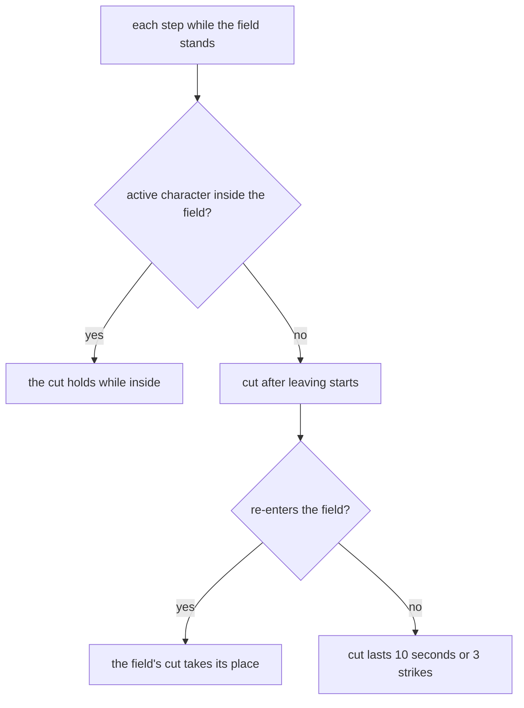

# Jean

Jean's kit is its record and one behaviour module, `createJeanKitBehaviour`, on avatar 10000003 (`packages/genshin-world/src/services/kit/characters/jeanKit.ts`): five strikes, a charged attack, a collision and two plunges, Gale Blade's press and its hold, and Dandelion Breeze's blast. Her multipliers are read from proud skill groups 331, 332 and 339 (`~/Esposter.noindex/genshin-dump-backup-6.6/ExcelBinOutput/ProudSkillExcelConfigData.json`), and match the wiki's Favonius Bladework, Gale Blade and Dandelion Breeze values to two decimal places (her first strike at level 1 is 48.33% on the wiki, proud 331's index 0 is 0.48332, `~/Esposter/cache/genshin-wiki/Category_Jean_Talents.json`); the skill's cooldown and longest hold and the burst's cooldown and cost are read from the same groups. Dandelion Breeze's field, its activation heal and regeneration, and its entering and exiting damage are built as the [shared effects](../README.md), with A1's party heal on her strikes, A4's energy back, Spiraling Tempest's DMG bonus on a held Gale Blade from one constellation, Constellation 2's party speed on each pickup and Constellation 4's Anemo RES cut in the field. The activation heal's off-field members, the field's Anemo on the character, and Gale Blade's pull are not built, and its hold's stamina is open.

## How it works

Constellation 6's cut is held by each step of Dandelion Breeze's field, and a character who leaves the field keeps the cut for 10 seconds or three strikes.

## Decisions

- **Jean's reaches are priced with their offsets, and Gale Blade's box to its far corner.** gcsim centres her first, fourth and fifth strikes and her charged attack's 160-degree fan ahead of the body, so each reach is its offset plus its radius, while her second and third strikes' fans of 150 and 30 degrees behind it, so each reaches its radius less the offset, 1.7 and 1.8 metres. gcsim's rectangle spawns on its near edge, so Gale Blade's box (`~/Esposter/cache/gcsim-v2.47.2/internal/characters/jean/skill.go:52`), 4 wide and 4.1 long from the body, is priced as the circle to its far corner, 4.56 metres. (`packages/genshin-world/src/services/kit/characters/jeanKit.ts`)
- **Gale Blade starts on its release, and its hold plays the same blast.** gcsim lands the blast 21 frames past the hold (`~/Esposter/cache/gcsim-v2.47.2/internal/characters/jean/skill.go` lines 15 and 31, `hitmark := skillHitmark + hold`), so the press and the hold start on the release, and the hold is released by itself at the 5 seconds the cap gives (`~/Esposter/cache/gcsim-v2.47.2/internal/characters/jean/skill.go` line 30, `min(hold, 300)`; proud 332's index 2 is 5). The hold's pull is not built, and its 20 stamina a second drains only while an action plays, not while its skill is held, which the Open list holds against the wiki's rate. (`packages/genshin-world/src/services/kit/characters/jeanKit.ts`)
- **Constellation 2's party speed is read on the pickup, while Jean is on the field.** Each particle or orb she collects while she is the active character gives every party member 15% Movement SPD and 15% ATK SPD for 15 seconds, the ATK SPD as the Normal ATK SPD the kit reads, as gcsim's `~/Esposter/cache/gcsim-v2.47.2/internal/characters/jean/cons.go` gives it (ATK SPD 0.15 for 900 frames, lines 22 to 40), which checks that Jean is on the field. A pickup made while another character is active gives nothing. (`packages/genshin-world/src/services/kit/characters/jeanKit.ts`)
- **Constellation 4's Anemo RES cut is an enemy status each field tick gives.** Each tick of Dandelion Breeze's field, the activation included, gives each enemy within the field's circle a 40% cut of Anemo RES for 1.2 seconds, as gcsim's `~/Esposter/cache/gcsim-v2.47.2/internal/characters/jean/cons.go` gives it (lines 45 to 54: -0.4 Anemo RES for 72 frames, 1.2 seconds) at the field's start and each of its ticks. An enemy that leaves the field keeps the cut until those seconds run out. (`packages/genshin-world/src/services/kit/characters/jeanKit.ts`)
- **Spiraling Tempest is an Anemo DMG Bonus for the held blast.** From one constellation, a Gale Blade held a second or more (`~/Esposter/cache/gcsim-v2.47.2/internal/characters/jean/skill.go` line 45, `hold >= 60`) plays a variant that adds 40% to Jean's Anemo DMG Bonus for its 46 frames (`~/Esposter/cache/gcsim-v2.47.2/internal/characters/jean/skill.go` line 21, `InitAbilSlice(46)`), the hit it lands within, as gcsim's `c1` adds its 40% to the blast's DMG bonus (`~/Esposter/cache/gcsim-v2.47.2/internal/characters/jean/cons.go` lines 14 to 17). The bonus is a buff on Jean, so any other Anemo hit of hers landing in those frames, such as her field's, takes it too. Its faster pull is not built. (`packages/genshin-world/src/services/kit/characters/jeanKit.ts`)
- **Dandelion Breeze's field ticks every second from 40 frames, and its first tick is the activation.** gcsim heals at 40 frames (`~/Esposter/cache/gcsim-v2.47.2/internal/characters/jean/burst.go` line 16, `burstStart`) and regenerates the character on the field every 60 frames from 100 to 640, ten times (`~/Esposter/cache/gcsim-v2.47.2/internal/characters/jean/burst.go` lines 100 and 101), so the field's tick 0 is the activation heal of 251.2% of Jean's ATK plus 1540 and ticks 1 to 10 the regeneration of 25.12% plus 154, each to the character on the field (proud 339's indices 2, 3, 4 and 5). gcsim's field status runs to 640 frames (`~/Esposter/cache/gcsim-v2.47.2/internal/characters/jean/burst.go` line 50). (`packages/genshin-world/src/services/kit/characters/jeanKit.ts`)
- **The activation heal reaches only the character on the field.** The wiki heals every party member (`~/Esposter.noindex/cache/genshin-wiki/Category_Jean_Talents.json`, the Dandelion Breeze text: 'regenerates a large amount of HP for all party members'), but a field's tick reads the character on the field alone, and a member's heal is a share of its own Max HP, which only its combatant holds. Carrying the team's combatants into a tick changes `stepKitEffects`'s context for every kit's tests, so the off-field members' share is left until it does. The field's Anemo on the character in it is not built either. (`packages/genshin-world/src/services/kit/characters/jeanKit.ts`)
- **The field's entering and exiting damage strike every enemy inside it as it opens and as it ends.** The wiki's notes give one instance of each to all enemies within the field when it is created and when it dissipates, at 78.4% (proud 339's index 1, `~/Esposter.noindex/genshin-dump-backup-6.6/ExcelBinOutput/ProudSkillExcelConfigData.json`) and 2U of Anemo with 50 poise (the wiki's Dandelion Breeze poise row 2), so a summon standing at the cast lands them at 40 and 640 frames, reaching the field's 6 metres. The record keeps the 6 as `DiffersFromSource`: gcsim's circle on the primary target (`~/Esposter/cache/gcsim-v2.47.2/internal/characters/jean/burst.go:58` and `~/Esposter/cache/gcsim-v2.47.2/internal/characters/jean/burst.go:62`) is priced at the skill's 15-metre targeting, the [kits README](../README.md#framework-decisions)'s rule for a summon at the cast, reaching its own 21. An enemy walking in or out between is not struck, as gcsim does not track one either. The entering hit's 40 frames are gcsim's `burstStart` (`~/Esposter/cache/gcsim-v2.47.2/internal/characters/jean/burst.go` line 16), the same constant as the activation's. (`packages/genshin-world/src/services/kit/characters/jeanKit.ts`)
- **Constellation 6's cut is held by the field's step and counted by the strikes on a member.** Each step while Dandelion Breeze's field stands, the active character inside it holds 35% DMG Reduction for the field's seconds. A character the step finds outside the field, or no longer active, starts the cut that lasts after leaving: 10 seconds, and a status of 3 strikes that each `PartyMemberStruck` counts down, shielded strikes included, ending the cut at the last. Re-entering takes the field's cut and drops the one after leaving, and the field's end ends the cut without it. The wiki's constellation text decides, since gcsim leaves Constellation 6 unimplemented (`~/Esposter/cache/gcsim-v2.47.2/internal/characters/jean/cons.go` lines 62 and 63). (`packages/genshin-world/src/services/kit/characters/jeanKit.ts`)
- **Let the Wind Lead gives its energy at the activation.** From Ascension 4 the field's tick 0 adds a fifth of the burst's 80 energy, 16, to Jean, up to its cost (the energy cost of 80 in `~/Esposter.noindex/genshin-dump-backup-6.6/ExcelBinOutput/ProudSkillExcelConfigData.json`, group 339's index 7, and the wiki's energy cost of 80; gcsim's `burst.go` spends energy at line 128, 41 frames in); gcsim adds it a frame later, at 41 (`~/Esposter/cache/gcsim-v2.47.2/internal/characters/jean/asc.go` line 41). (`packages/genshin-world/src/services/kit/characters/jeanKit.ts`)
- **A party heal may roll without a shield.** Wind Companion, from Ascension 1, is the party heal of each of Jean's strikes, unshielded: a 50% roll heals every member by 15% of her ATK (`~/Esposter/cache/gcsim-v2.47.2/internal/characters/jean/asc.go` lines 8 and 24 to 29), read through `healKitParty` with an ATK share beside its DEF share. A strike rolls on each enemy it reaches until one heal passes, as Breastplate's does; the wiki's note gives each enemy its own heal, and gcsim rolls once a strike. (`packages/genshin-world/src/services/kit/characters/jeanKit.ts`)

## Open

- [ ] **Jean's plunges reach 1, 3 and 5 metres** — no source yet: gcsim has no plunge file for her.
- [ ] **Jean's plunges carry the wiki's poise: 25 for the collision, 100 low and 150 high** — no source yet: `packages/genshin-world/src/data/kits/jean.json` holds no plunge or poise entries, so it neither confirms nor contradicts the figures.
- [ ] **Gale Blade's press and hold plays a hold level from one second** — no source yet: the wiki's text on the short hold is not read against gcsim's one-second gate (`~/Esposter/cache/gcsim-v2.47.2/internal/characters/jean/skill.go` line 45).
- [ ] **Gale Blade's 20 stamina a second drains while its skill is held, at the wiki's rate** — no source yet: the wiki's text on the hold is not read against the kit's drain.
- [ ] **Constellation 6's 35% DMG Reduction, its 10 seconds and its 3 strikes** — no source yet: gcsim leaves Constellation 6 unimplemented (`~/Esposter/cache/gcsim-v2.47.2/internal/characters/jean/cons.go` line 63), and the cached wiki category gives Constellation 6 only its title, Lion's Fang, Fair Protector of Mondstadt.

## Not built

- **Jean's talent levels are not built.** When the West Wind Arises and Outbursting Gust raise talent levels, which the [talents](../../talents/design.md) page holds.

## Key files

| File                                                            | Role                                                                                                                  |
| :-------------------------------------------------------------- | :-------------------------------------------------------------------------------------------------------------------- |
| `packages/genshin-world/src/services/kit/characters/jeanKit.ts` | `createJeanKitBehaviour`, Jean's kit with Gale Blade's hold, Dandelion Breeze's field and damage, and A1's party heal |

## Sources

- [Favonius Bladework](https://genshin-impact.fandom.com/wiki/Favonius_Bladework), [Gale Blade](https://genshin-impact.fandom.com/wiki/Gale_Blade) and [Dandelion Breeze](https://genshin-impact.fandom.com/wiki/Dandelion_Breeze), Genshin Impact Wiki: Jean's strikes', charged attack's and plunges' gauges, internal cooldowns and poise, Gale Blade's gauge, poise, stamina and longest hold, and the burst's and the field's gauges and poise, the field's 10 seconds and 10 regenerations, and its entering and exiting damage on every enemy inside it.
- [Wind Companion](https://genshin-impact.fandom.com/wiki/Wind_Companion), [Let the Wind Lead](https://genshin-impact.fandom.com/wiki/Let_the_Wind_Lead), [Spiraling Tempest](https://genshin-impact.fandom.com/wiki/Spiraling_Tempest), [People's Aegis](https://genshin-impact.fandom.com/wiki/People%27s_Aegis), [Lands of Dandelion](https://genshin-impact.fandom.com/wiki/Lands_of_Dandelion) and [Lion's Fang, Fair Protector of Mondstadt](https://genshin-impact.fandom.com/wiki/Lion%27s_Fang,_Fair_Protector_of_Mondstadt), Genshin Impact Wiki: Jean's A1 heal and its per-enemy rolls, A4's 16 energy, and her constellations.
- [Dandelion Breeze](https://genshin-impact.fandom.com/wiki/Dandelion_Breeze), Genshin Impact Wiki: the activation heal, "she instantly regenerates a large amount of HP for all party members", and the entering and exiting hit's poise, `|poise2 = 50` for Entering/Exiting DMG, with `|gu2 = 2U`.
- [Wind Companion](https://genshin-impact.fandom.com/wiki/Wind_Companion), Genshin Impact Wiki: each enemy's own roll, "Each individual hit has a 50% chance to heal".
- [gcsim v2.47.2](https://github.com/genshinsim/gcsim/tree/v2.47.2/internal/characters/jean), MIT: the kit's hitmarks, cancel frames and areas (`~/Esposter/cache/gcsim-v2.47.2/internal/characters/jean/attack.go` lines 18 to 20 and `~/Esposter/cache/gcsim-v2.47.2/internal/characters/jean/config.yml`), the charged attack's 160-degree fan (`~/Esposter/cache/gcsim-v2.47.2/internal/characters/jean/charge.go` lines 40 to 45, `NewCircleHitOnTargetFanAngle`), the field's heal and damage frames (`~/Esposter/cache/gcsim-v2.47.2/internal/characters/jean/burst.go`), A1's roll (`~/Esposter/cache/gcsim-v2.47.2/internal/characters/jean/asc.go`), A4's energy (`~/Esposter/cache/gcsim-v2.47.2/internal/characters/jean/asc.go`), C1's DMG bonus, and C2's party speed and C4's Anemo RES cut in `~/Esposter/cache/gcsim-v2.47.2/internal/characters/jean/cons.go`; the v2.47.2 source is on disk at `~/Esposter/cache/gcsim-v2.47.2`; and gcsim's [rectangle](https://github.com/genshinsim/gcsim/blob/v2.47.2/pkg/core/info/rectangle.go), spawned on its near edge, which Gale Blade's box is.
