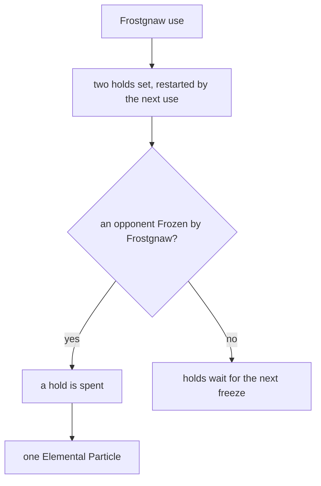

# Kaeya

Kaeya's kit is its record and one behaviour module, `createKaeyaKitBehaviour`, on avatar 10000015 (`{data-root}/genshin-dump-backup-6.6/ExcelBinOutput/AvatarExcelConfigData.json`): five strikes (`{data-root}/cache/gcsim-v2.47.2/internal/characters/kaeya/attack.go` line 16), a charged attack (`{data-root}/cache/gcsim-v2.47.2/internal/characters/kaeya/charge.go` line 16), a collision and two plunges (`{data-root}/cache/gcsim-v2.47.2/internal/characters/kaeya/plunge.go`), Frostgnaw with its A1 heal (`{data-root}/cache/gcsim-v2.47.2/internal/characters/kaeya/skill.go` line 46), and Glacial Waltz's thirteen icicles (`{data-root}/cache/gcsim-v2.47.2/internal/characters/kaeya/burst.go` line 45). Its multipliers are read from proud skill groups 1531, 1532 and 1539 (`{data-root}/genshin-dump-backup-6.6/ExcelBinOutput/ProudSkillExcelConfigData.json`), and match gcsim's to six decimal places (`{data-root}/cache/gcsim-v2.47.2/internal/characters/kaeya/zz_kaeya.dm.go`) and the wiki's Ceremonial Bladework, Frostgnaw and Glacial Waltz values to two decimal places (`{data-root}/cache/genshin-wiki/Category_Kaeya_Talents.json`). Glacial Waltz's icicles are a summon, built as the [shared effects](../README.md).

## How it works

Each use of Frostgnaw sets two holds, and a freeze the skill makes spends one hold for an Elemental Particle, while a freeze by another attack spends none.

## Decisions

- **Kaeya's groups are 1531, 1532 and 1539, not the talent table's 2531 and 2539.** The table names 2531 for his strikes and 2539 for his icicle, and their level-1 values, 46.6% for the first strike and 54.3% for the icicle, agree with neither the wiki nor gcsim. The 15xx groups carry the wiki's numbers: proud 1531's index 0 is 0.5375 (`{data-root}/genshin-dump-backup-6.6/ExcelBinOutput/ProudSkillExcelConfigData.json`), the wiki's first-strike row `hit1_1` is 53.75 (`{data-root}/cache/genshin-wiki/Category_Kaeya_Talents.json`), and gcsim's `{data-root}/cache/gcsim-v2.47.2/internal/characters/kaeya/zz_kaeya.dm.go` line 38 is 0.5375, so the kit reads those; the stats run owns that group choice (`scripts/src/services/genshinAssets/stats/`).
- **Frostgnaw's cooldown is the wiki's 6 seconds.** The skill table's 21 seconds is held in Open, as it was not read here; the proud skill group 1532's index 1 holds the 6 (`{data-root}/genshin-dump-backup-6.6/ExcelBinOutput/ProudSkillExcelConfigData.json`), as gcsim's 360 frames do (`{data-root}/cache/gcsim-v2.47.2/internal/characters/kaeya/skill.go` line 68). Frostgnaw's damage against Water, its 4U gauge, is not built. A1's heal is built as a hit's `healAttackShare`: each enemy Frostgnaw strikes heals Kaeya by 15% of his ATK, read as the hit is priced (gcsim `{data-root}/cache/gcsim-v2.47.2/internal/characters/kaeya/skill.go` lines 46 to 54, the A1 heal at Ascension 1).
- **Ascension 4's Glacial Heart is built from the wiki's text, with no cooldown and two particles a use.** An opponent Frozen by Frostgnaw drops one Elemental Particle, and the wiki (`{data-root}/cache/genshin-wiki/Category_Kaeya_Talents.json`) caps a use of Frostgnaw at two, so each use sets two holds that each freeze spends, restarted by the next use. The wiki gives no element for the particle; gcsim's Glacial Heart drops it as Cryo (`{data-root}/cache/gcsim-v2.47.2/internal/characters/kaeya/skill.go` line 114), and its per-use cap of two is its `a4Count` (`{data-root}/cache/gcsim-v2.47.2/internal/characters/kaeya/skill.go` lines 94 to 114). No cooldown is kept, as the wiki states none. Only a freeze by the skill counts, not one by a hit of another attack.
- **Kaeya's reaches are priced with their offsets.** Its strikes are priced at offsets of 0.8, 1.2, -0.2, 0.3 and 0.5 metres (`{data-root}/cache/gcsim-v2.47.2/internal/characters/kaeya/attack.go` line 19), its charge at 1 and 1.3 metres (`{data-root}/cache/gcsim-v2.47.2/internal/characters/kaeya/charge.go` line 17), and its plunges a metre ahead of the body (`{data-root}/cache/gcsim-v2.47.2/internal/characters/kaeya/plunge.go` lines 93 and 143).

- **Constellation 6's Energy on the cast is built.** gcsim (MIT) `{data-root}/cache/gcsim-v2.47.2/internal/characters/kaeya/burst.go` gives 15 Energy 52 frames after the cast at Constellation 6 (lines 67 and 68), which the kit schedules as a task on the burst's start.

## Not built

- **Constellation 6's fourth icicle is not built.** Its extra icicle sets the icicles' spacing to 120 frames over four, not three (`{data-root}/cache/gcsim-v2.47.2/internal/characters/kaeya/burst.go` lines 51 and 55, `offset := 120 / count`), and the record's icicle hits are timed for three, so they do not give it. Constellation 2 is built: each enemy defeated during Glacial Waltz extends it by 2.5 seconds, up to 15 seconds in all (`{data-root}/cache/gcsim-v2.47.2/internal/characters/kaeya/cons.go` line 39), as the kit hears `EnemyDefeated`.
- **Glacial Waltz's activation knockback is not built.** Its 400 poise is the wiki's Glacial Waltz poise row, with no damage, and no area for it is cited, so the icicles alone are built; the area is in Open.

## Open

- [ ] **The talent table's 21-second skill duration** — no source yet: the table's row for the skill, which this pass did not read; the table's own note is the only source for the figure, and it says the 21 seconds is not the cooldown.
- [ ] **Glacial Waltz's knockback area** — no source yet: the area of the activation knockback, which no cited source gives; its 400 poise is the wiki's (`{data-root}/cache/genshin-wiki/Category_Kaeya_Talents.json`).

- [ ] **Glacial Waltz's thirteen icicles** — contradicted by `{data-root}/cache/gcsim-v2.47.2/internal/characters/kaeya/burst.go`: three icicles, with thirteen ticks in all.

## Key files

| File                                                             | Role                                                                |
| :--------------------------------------------------------------- | :------------------------------------------------------------------ |
| `packages/genshin-world/src/services/kit/characters/kaeyaKit.ts` | `createKaeyaKitBehaviour`, Kaeya's kit with Glacial Waltz's icicles |

## Sources

- [Ceremonial Bladework](https://genshin-impact.fandom.com/wiki/Ceremonial_Bladework), [Frostgnaw](https://genshin-impact.fandom.com/wiki/Frostgnaw) and [Glacial Waltz](https://genshin-impact.fandom.com/wiki/Glacial_Waltz), Genshin Impact Wiki: Kaeya's strikes', charged attack's and plunges' poise, Frostgnaw's gauge and poise, and Glacial Waltz's icicle damage, gauge and poise.
- [gcsim v2.47.2](https://github.com/genshinsim/gcsim/tree/v2.47.2/internal/characters/kaeya), MIT: the kit's hitmarks, cancel frames and areas, the icicles' ticks, and the values its talent file gives, which its multipliers match.
- [gcsim v2.47.2 skill file](https://github.com/genshinsim/gcsim/blob/v2.47.2/internal/characters/kaeya/skill.go), MIT: Frostgnaw's A1, the heal of 15% of Kaeya's ATK from each enemy it strikes.
- [gcsim v2.47.2 constellation file](https://github.com/genshinsim/gcsim/blob/v2.47.2/internal/characters/kaeya/cons.go), MIT: Constellations 1, 2 and 4.
- [Kaeya](https://genshin-impact.fandom.com/wiki/Kaeya), Genshin Impact Wiki: Glacial Heart, the Ascension 4 passive whose particles the kit builds, with its two-use cap and no cooldown. gcsim v2.47.2 implements the same particles, the Cryo drop and the cap of two (`{data-root}/cache/gcsim-v2.47.2/internal/characters/kaeya/skill.go` lines 94 to 114), which the Decisions cite.
- The cached wiki pages `Ceremonial Bladework` (hit1_1 53.75, poise 27.3), `Frostgnaw` (poise 140) and `Glacial Waltz` (poise 400), in `{data-root}/cache/genshin-wiki/Category_Kaeya_Talents.json`.
