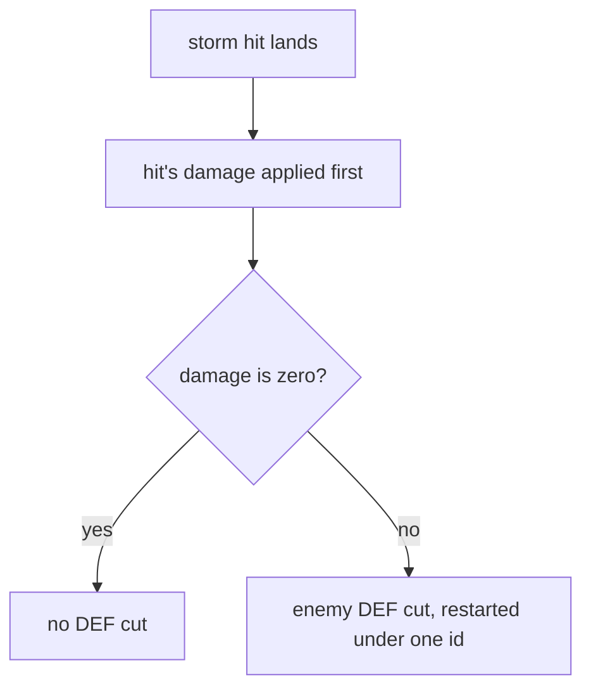

# Kamisato Ayaka

Kamisato Ayaka's kit is its record and one behaviour module, `createAyakaKitBehaviour`, avatar 10000002 (`{data-root}/genshin-parity/text/ExcelBinOutput/AvatarExcelConfigData.json`): five strikes, the fourth of three hits (`{data-root}/cache/gcsim-v2.47.2/internal/characters/ayaka/attack.go` line 18), a three-hit charged attack, a collision and two plunges (`{data-root}/cache/genshin-wiki/Category_Kamisato_Ayaka_Talents.json`), Kamisato Art: Hyouka, Kamisato Art: Soumetsu's storm and Kamisato Art: Senho's Cryo infusion. Her multipliers are read from proud skill groups 231, 232 and 239, (`packages/genshin-world/src/services/kit/characters/ayakaKit.ts`, the table [Bennett's kit](../bennett/design.md) cites), and match the wiki's Kamisato Art: Kabuki, Hyouka and Soumetsu values to two decimal places (`{data-root}/cache/genshin-wiki/Category_Kamisato_Ayaka_Talents.json`). Soumetsu's storm is a summon of nineteen cuts and a bloom (`{data-root}/cache/gcsim-v2.47.2/internal/characters/ayaka/burst.go` lines 40 to 90), built as the shared effects below, with Blizzard Blade Seki no To's two smaller storms from two constellations, and Senho's infusion is built on the kit's sprint hook. Senho's Cryo application and its movement, A1's and A4's effects and her other constellations are not built.

## How it works

Constellation 4's DEF cut is applied after a storm hit's damage lands, so a hit that deals no damage applies none.

## Decisions

- **Ayaka's reaches are priced with their offsets, and her fifth strike round her body.** gcsim centres her first, second and fourth strikes and her plunges ahead of the body, which prices each reach as its offset plus its radius (`{data-root}/cache/gcsim-v2.47.2/internal/characters/ayaka/attack.go` lines 20-22 and 67-72, `{data-root}/cache/gcsim-v2.47.2/internal/characters/ayaka/plunge.go` lines 28, 33 and 92); her third strike's 60-degree fan, centred half a metre behind, reaches 2.3 metres (`{data-root}/cache/gcsim-v2.47.2/internal/characters/ayaka/attack.go` offset -0.5, radius 2.8). Her fifth strike is a circle of 0.8 metres gcsim centres on the primary target (`{data-root}/cache/gcsim-v2.47.2/internal/characters/ayaka/attack.go` lines 48-51, "N5 is a bullet"), which an area does not hold, so it is priced round her body, as Mona's strikes are (`packages/genshin-world/src/services/kit/characters/ayakaKit.ts`).
- **Ayaka's charged attack reaches every enemy within 5 metres.** gcsim and the wiki lock it on an enemy within 5 metres and strike each enemy within 4 metres of that one (`{data-root}/cache/gcsim-v2.47.2/internal/characters/ayaka/charge.go` lines 69 and 77-80; the wiki's cached Kamisato Art: Kabuki page, Gameplay Notes, `{data-root}/cache/genshin-wiki/Category_Kamisato_Ayaka_Talents.json`), so it is priced as the 5-metre circle round her body, which an area's target does not yet hold. The wiki's 0.5-second internal cooldown for it (the Kabuki page's `icdtype8`) is priced under the standard one, the only group a kit's hit is priced under.
- **Soumetsu's storm stands where Ayaka cast it.** The wiki's Soumetsu page (`{data-root}/cache/genshin-wiki/Category_Kamisato_Ayaka_Talents.json`) says the storm moves forward continuously and holds still once it touches an enemy, and gcsim centres its cuts and bloom on the primary target (`{data-root}/cache/gcsim-v2.47.2/internal/characters/ayaka/burst.go` lines 41-49 and 75-89), and neither gives its speed, so the storm is a summon standing at the cast, its cuts reaching 3.3 metres (the 3-metre circle at an offset of 0.3) and its bloom 5. The bloom's 5 is held as `DiffersFromSource`, since gcsim's circle on the primary target is priced under the [kits README](../README.md#framework-decisions)'s reach rule, reaching its own 20. Blizzard Blade Seki no To's two smaller storms stand with it, each at a fifth of its multipliers (`{data-root}/cache/gcsim-v2.47.2/internal/characters/ayaka/burst.go` lines 54-70 and 93-109), their cuts reaching 1.8 metres (the 1.5-metre circle at an offset of 0.3, `{data-root}/cache/gcsim-v2.47.2/internal/characters/ayaka/burst.go` line 105) and their bloom 3, which are held as `DiffersFromSource` as the large bloom's 5 is, the reach rule pricing gcsim's circles on the primary target at 18 each. All three are provisional until a recording measures the storm's path.
- **Senho's infusion runs from the sprint.** The kit's `onSprint` (`packages/genshin-world/src/services/kit/characters/ayakaKit.ts`) restarts a 5-second Cryo infusion on each step of the sprint, so it runs out 5 seconds after the sprint ends, as the game gives it on her reappearing (the wiki's cached Kamisato Art: Senho page (`{data-root}/cache/genshin-wiki/Category_Kamisato_Ayaka_Talents.json`) gives its Infusion Duration as 5.0s, and gcsim's `{data-root}/cache/gcsim-v2.47.2/internal/characters/ayaka/dash.go` lines 52-56 give 300 frames). An attack ends the sprint in the game, so the infusion over the sprint itself changes no hit. Senho's Cryo application as she reappears is not built, since the hook runs on each step of the sprint and nothing marks where the sprint ends, and A4, which restores 10 Stamina and gives an 18% Cryo DMG Bonus when that application hits, waits on it. Senho's own movement, its fog, its stamina of 10 to start and 15 a second and its crossing of water, is the controller's and is not built.
- **Ayaka's Ascension 1 is a 6-second status her Hyouka starts, read as a DMG Bonus on her Normal and Charged attacks.** gcsim v2.47.2 (MIT) `{data-root}/cache/gcsim-v2.47.2/internal/characters/ayaka/asc.go` lines 12-27 give it as an additive DMG bonus of 0.3 on each Normal and Extra (Charged) attack, for 360 frames, with no element named, so it is read on each strike's attack tag and not on an element; the wiki's cached Amatsumi Kunitsumi Sanctification page (`{data-root}/cache/genshin-wiki/Category_Kamisato_Ayaka_Talents.json`) gives 30% for 6s.
- **Constellation 4 is a 30% DEF cut on each enemy her storms strike, for 6 seconds, as an enemy status on the storm hits.** gcsim v2.47.2 `{data-root}/cache/gcsim-v2.47.2/internal/characters/ayaka/cons.go` lines 42-57 attaches its callback to every burst queue and cuts the enemy's DEF by 0.3 for 360 frames (line 46 returns on zero damage, lines 55-56 give the mod). It reads the same `defenseReduction` the defence multiplier already sums across an enemy's statuses. Each strike restarts it under one id, so it does not stack (`{data-root}/cache/gcsim-v2.47.2/pkg/enemy/mods.go` lines 49-52 add the mod through `modifier.Add`, which overwrites a mod of the same key). The callback runs after the hit's damage lands and returns early when that damage is zero, so the cut does not reduce the hit that applies it, and a zero-damage hit applies none. The kit gives the storm hits `enemyStatusAfterDamage` (`packages/genshin-world/src/services/kit/characters/ayakaKit.ts`), which `strikeEnemy` applies after the damage only when the hit deals damage.
- **Constellation 6, Dance of Suigetsu, is a 298% DMG bonus on her Charged Attacks on a clear and recharge timer.** The wiki's cached Kamisato Art: Kabuki page (`{data-root}/cache/genshin-wiki/Category_Kamisato_Ayaka_Talents.json`) names the constellation Dance of Suigetsu; the kit's code (`packages/genshin-world/src/services/kit/characters/ayakaKit.ts`) calls the bonus's status Usurahi Butou, a name no cached source gives. gcsim's `{data-root}/cache/gcsim-v2.47.2/internal/characters/ayaka/cons.go` lines 61-85 clear the bonus 0.5 seconds after the first Charged Attack hit on an enemy (the 30-frame timer, line 80), and it returns 10 seconds after that clear (the 600-frame timer, line 79), 10.5 seconds in all from the hit; line 85 gives the 298%. The kit keeps the timer as one status of 10.5 seconds that starts at that hit, and the bonus is on until it starts and while its first 0.5 seconds run. The bonus is read on each Charged Attack strike, as gcsim's extra-attack mod is.

## Provisional constants

- **Ayaka's charged attack's reach past its 5-metre lock is open.** gcsim's `{data-root}/cache/gcsim-v2.47.2/internal/characters/ayaka/charge.go` lines 77-80 and the wiki's Kabuki page strike each enemy within 4 metres of the locked enemy, and the wiki says that hitscan runs even once the locked target has left the initial range, so an enemy beyond 5 metres can be struck; the spec's scenario that an enemy beyond 5 metres is not struck disagrees with that source. The kit prices the strike as the 5-metre circle round her body, which an area cannot follow a lock with, until areas can.
- **Constellation 1's roll is open on the element.** gcsim's `{data-root}/cache/gcsim-v2.47.2/internal/characters/ayaka/cons.go` line 24 returns unless the hit deals Cryo, and its comment says "Normal or Charged Attacks deal Cryo DMG". The kit's `snowsweptSakuraHit` in `ayakaKit.ts` rolls on every normal and charged hit, and Ayaka's strikes are Physical unless Senho infuses them, so the spec's first-constellation scenario (a normal attack's hit) is open against its source until the kit checks the element. The roll itself is gcsim's (`{data-root}/cache/gcsim-v2.47.2/internal/characters/ayaka/cons.go` line 33): a 50% roll that cuts the skill's cooldown by 18 frames (line 36) under a 6-frame internal cooldown (line 37).

## Not built

- **Ayaka's A4 is not built.** gcsim v2.47.2 `{data-root}/cache/gcsim-v2.47.2/internal/characters/ayaka/asc.go` gives it as 10 Stamina and an 18% Cryo DMG Bonus for 600 frames on the Senho's closing Cryo application's first enemy hit; the infusion does not build that application yet. C3 and C5 raise talent levels, which the [talents](../../talents/design.md) page holds.

## Key files

| File                                                             | Role                                                                               |
| :--------------------------------------------------------------- | :--------------------------------------------------------------------------------- |
| `packages/genshin-world/src/services/kit/characters/ayakaKit.ts` | `createAyakaKitBehaviour`, Ayaka's kit with Soumetsu's storms and Senho's infusion |

## Sources

- [Kamisato Art: Kabuki](https://genshin-impact.fandom.com/wiki/Kamisato_Art:_Kabuki), [Kamisato Art: Hyouka](https://genshin-impact.fandom.com/wiki/Kamisato_Art:_Hyouka), [Kamisato Art: Soumetsu](https://genshin-impact.fandom.com/wiki/Kamisato_Art:_Soumetsu) and [Kamisato Art: Senho](https://genshin-impact.fandom.com/wiki/Kamisato_Art:_Senho), Genshin Impact Wiki: Ayaka's strikes', charged attack's and plunges' gauges and poise, the charged attack's lock-on, Hyouka's and the storm's gauges, internal cooldowns and poise, the storm's path, and Senho's infusion, Cryo application and stamina.
- [Amatsumi Kunitsumi Sanctification](https://genshin-impact.fandom.com/wiki/Amatsumi_Kunitsumi_Sanctification), [Kanten Senmyou Blessing](https://genshin-impact.fandom.com/wiki/Kanten_Senmyou_Blessing) and [Blizzard Blade Seki no To](https://genshin-impact.fandom.com/wiki/Blizzard_Blade_Seki_no_To), Genshin Impact Wiki: Ayaka's A1 and A4, and the second constellation's smaller storms, their share and their gauges and poise.
- [gcsim v2.47.2](https://github.com/genshinsim/gcsim/tree/v2.47.2/internal/characters/ayaka), MIT: the kit's hitmarks, cancel frames and areas, the storm's cuts and bloom, the smaller storms' areas, and Senho's infusion.
- The game data dump's `{data-root}/genshin-parity/text/ExcelBinOutput/ProudSkillExcelConfigData.json`: proud skill groups 231, 232 and 239 at level 1 (231's indices 0-3, 6, 7 and 9-11, 232's 0, 239's 0-1) match the cached Kabuki scaling table's `hit1_1` to `plungehigh_1` (45.73 to 159.68), Hyouka's `skilldmg_1` (239.2) and Soumetsu's `cuttingdmg_1` (112.3) and `bloomdmg_1` (168.45) to two decimal places.
- [gcsim v2.47.2 asc.go](https://github.com/genshinsim/gcsim/blob/v2.47.2/internal/characters/ayaka/asc.go) and [gcsim v2.47.2 cons.go](https://github.com/genshinsim/gcsim/blob/v2.47.2/internal/characters/ayaka/cons.go) (MIT): Amatsumi Kunitsumi Sanctification's bonus and window, Constellation 4's DEF cut, Constellation 6's clear and recharge, and Ascension 4's stamina and Cryo bonus.
