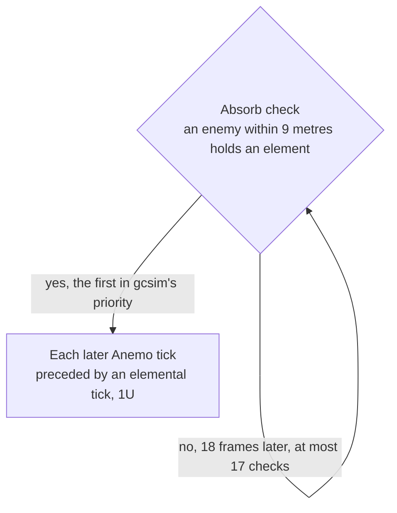

# Kazuha

Kazuha's kit is its record and one behaviour module, `createKazuhaKitBehaviour`, on avatar 10000047: five strikes, a charged attack of two slashes, a collision and two plunges, Chihayaburu's press and hold, and Kazuha Slash with its five-tick Autumn Whirlwind. His multipliers are read from proud skill groups 4731, 4732 and 4739; the charged attack's stamina, the skill's and hold's cooldowns, and the burst's cooldown and energy cost come from the same groups, each level-1 row matching the wiki's scaling table (see Sources). Constellation 1 takes a tenth off both skill cooldowns (`skill.go` lines 102-103 and 152-153, 324 and 486 frames), which is open against the wiki (see Provisional constants). Constellation 2's field gives Elemental Mastery within the Autumn Whirlwind (`cons.go` lines 18-63, and `kazuha.go` lines 50-52 for its 200), and Constellation 6 gives him an Anemo infusion for five seconds after each press, hold or slash (`cons.go` lines 66-80, called from `skill.go` lines 105-110 and 155-160). Constellation 6's Elemental Mastery damage bonus on his normal, charged and plunging attacks (`cons.go` lines 82-95) is not built. His Ascension 4 passive, Poetics of Fuubutsu, is built as the Swirl Elemental Mastery bonus, which the wiki's Poetics page and `asc.go` lines 35-63 give as 0.04% for each point of Elemental Mastery for 8 seconds. His Ascension 1 absorption of Chihayaburu and Constellation 4's Energy effects are not built. The poise of the skills, the burst and the collision is none as built, the wiki's values held on the roadmap, as gcsim gives none.

The Autumn Whirlwind absorbs an element as gcsim's does: a check from 81 frames, the frame before the slash (`burst.go` lines 65 and 79), then every 18 frames for at most 17 checks (`burst.go` line 132; the last at 369 frames), reaching 9 metres round where he cast it (the 8-metre circle a metre ahead, `burst.go` line 32). It takes the first of Pyro, Hydro, Electro and Cryo any enemy in reach holds, in gcsim's priority (`burst.go` line 126), and from then each tick still to come lands an elemental tick in that element, 1U, just ahead of its Anemo tick.

## Decisions

- **Chihayaburu's hold is reached at half a second, and its skill, hold, collision and burst deal no poise as built, the wiki's figures held on the roadmap.** The table and the wiki give no seconds for a press's hold, so the kits README's half second stands for a hold with no figure, as the other holds do. gcsim gives the skill and its hold no poise (no `PoiseDMG` in `skill.go`), so the wiki's 150 (the Chihayaburu page's Press DMG) and 300 (Hold DMG) are the skill's and the hold's targets; gcsim gives the collision none either (`plunge.go`'s collision after line 284 sets no `PoiseDMG`), nor the burst's first hit or its ticks (`burst.go`), so the wiki's 25 (the Garyuu Bladework page), 250 (the Kazuha Slash page's Slashing DMG) and 75 per tick (its DoT) are their targets.
- **The Autumn Whirlwind's absorb check is a field beside the summon, as Sucrose's is.** The field runs gcsim's checks on its own schedule and takes an element once; the summon then holds the elemental tick ahead of each Anemo tick still to come, so the element lands first and the Anemo tick Swirls it, in gcsim's order.

## Provisional constants

- **The Autumn Whirlwind's reach is open at 9 metres.** gcsim draws its ticks' 9-metre circle one metre ahead of him (`burst.go` line 48, `Point{Y: 1}`), so its reach is 10 metres forward on the same rule that gives the absorb check its 9, and the page's 9 round the cast point holds the radius, not the reach. Open until the summon's circle holds its offset.
- **Constellation 1 is open against the wiki.** gcsim takes a tenth off both skill cooldowns, which the kit models, and also resets the skill's cooldown on each Kazuha Slash at Constellation 1 (`burst.go` lines 106-108), which the kit does not. The wiki's Kazuha Slash page gives Scarlet Hills as the reset of Chihayaburu's cooldown upon Kazuha Slash, which is the reset alone, so the tenth is open until the wiki and gcsim agree.

## Open

- **Whether the built hits carry the wiki's poise.** `kazuhaKit.ts` has no poise field and `packages/genshin-world/src/data/kits/kaedehara-kazuha.json` no poise entries, so the figures in the decision above are unbuilt.

## Key files

| File                                                              | Role                                                                                                                                                                                |
| :---------------------------------------------------------------- | :---------------------------------------------------------------------------------------------------------------------------------------------------------------------------------- |
| `packages/genshin-world/src/services/kit/characters/kazuhaKit.ts` | `createKazuhaKitBehaviour`, Kazuha's kit with Chihayaburu's press and hold, Kazuha Slash and its Autumn Whirlwind with its absorb check and elemental ticks, and his constellations |

## Sources

- [gcsim](https://github.com/genshinsim/gcsim/tree/v2.47.2/internal/characters/kazuha), MIT: the kit's hitmarks, cancel frames and areas, the charged attack's and plunges' frames and circles, Chihayaburu's press and hold, Kazuha Slash's hitmarks and circle, the Autumn Whirlwind's five ticks, its absorb check's schedule, circle and order, and its elemental ticks, and Constellations 1, 2 and 6.
- The game data dump's `ProudSkillExcelConfigData.json`: proud skill groups 4731 (level 1 indices 0-8), 4732 (0 to 3) and 4739 (0 to 5) match the cached wiki's Garyuu Bladework, Chihayaburu and Kazuha Slash scaling tables to two decimal places, the hits at 44.98, 45.24, 25.8 and 30.96, 60.72 and 25.37%, the press at 192%, the hold at 260.8%, the slash at 262.4%, the DoT at 120% and the elemental DMG at 36%.
- The wiki's cached Poetics of Fuubutsu page (0.04% for each point of Elemental Mastery, for 8 seconds), and its Kazuha Slash page's Scarlet Hills and Yamaarashi Tailwind talent notes (Constellation 1's reset of Chihayaburu's cooldown, Constellation 2's 200 Elemental Mastery within the Autumn Whirlwind). The cache holds no text for Constellation 6, Crimson Momiji.
- [Garyuu Bladework](https://genshin-impact.fandom.com/wiki/Garyuu_Bladework), [Chihayaburu](https://genshin-impact.fandom.com/wiki/Chihayaburu) and [Kazuha Slash](https://genshin-impact.fandom.com/wiki/Kazuha_Slash), Genshin Impact Wiki: the poise of his strikes, charged attack, collision, skill, hold, burst and Autumn Whirlwind's ticks.
