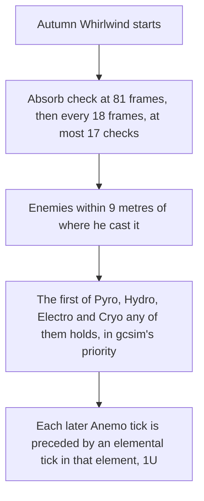

# Kazuha

Kazuha's kit is its record and one behaviour module, `createKazuhaKitBehaviour`, on avatar 10000047: five strikes, a charged attack of two slashes, a collision and two plunges, Chihayaburu's press and hold, and Kazuha Slash with its five-tick Autumn Whirlwind. His multipliers are read from proud skill groups 4731, 4732 and 4739; the charged attack's stamina, the skill's and hold's cooldowns, and the burst's cooldown and energy cost come from the same groups. Constellation 1 takes a tenth off both skill cooldowns, and Constellation 6 gives him an Anemo infusion for five seconds after each press, hold or slash. His Ascension passives are not built: the absorption of Chihayaburu, the Swirl Elemental Mastery bonus and Constellation 2's field. The poise of the skills, the burst and the collision is provisional.

The Autumn Whirlwind absorbs an element as gcsim's does: a check from 81 frames, the frame before the slash, then every 18 frames for at most 17 checks, reaching 9 metres round where he cast it. It takes the first of Pyro, Hydro, Electro and Cryo any enemy in reach holds, in gcsim's priority, and from then each tick still to come lands an elemental tick in that element, 1U, just ahead of its Anemo tick.

## Decisions

- **Chihayaburu's hold is reached at half a second, and its skill, burst and collision deal 0 poise.** The table and the wiki give no seconds for a press's hold, so Venti's half second stands, as the other holds do; gcsim gives those three no poise, so each reads 0.
- **The Autumn Whirlwind's absorb check is a field beside the summon, as Sucrose's is.** The field runs gcsim's checks on its own schedule and takes an element once; the summon then holds the elemental tick ahead of each Anemo tick still to come, so the element lands first and the Anemo tick Swirls it, in gcsim's order.

## Key files

| File                                                              | Role                                                                                                                                                                                |
| :---------------------------------------------------------------- | :---------------------------------------------------------------------------------------------------------------------------------------------------------------------------------- |
| `packages/genshin-world/src/services/kit/characters/kazuhaKit.ts` | `createKazuhaKitBehaviour`, Kazuha's kit with Chihayaburu's press and hold, Kazuha Slash and its Autumn Whirlwind with its absorb check and elemental ticks, and his constellations |

## Sources

- [gcsim](https://github.com/genshinsim/gcsim/tree/v2.47.2/internal/characters/kazuha), MIT: the kit's hitmarks, cancel frames and areas, the charged attack's and plunges' frames and circles, Chihayaburu's press and hold, Kazuha Slash's hitmarks and circle, the Autumn Whirlwind's five ticks, its absorb check's schedule, circle and order, and its elemental ticks, and Constellations 1 and 6.
