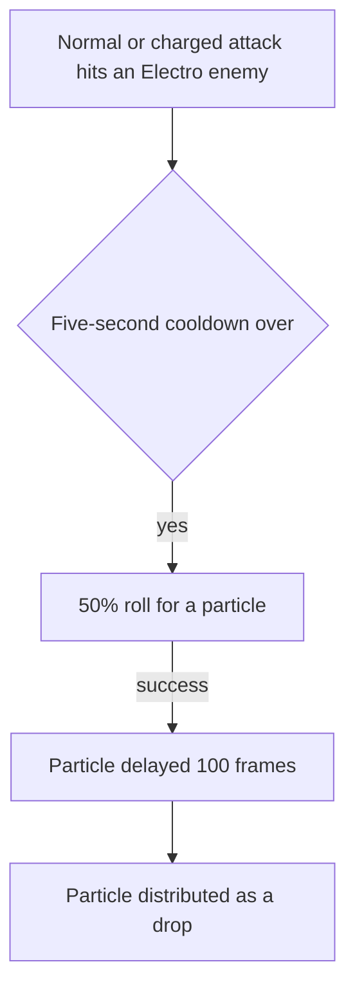

# Keqing

Keqing's kit is its record and one behaviour module, `createKeqingKitBehaviour`, on avatar 10000042 (`{data-root}/genshin-dump-backup-6.6/ExcelBinOutput/AvatarExcelConfigData.json`): five strikes (`{data-root}/cache/gcsim-v2.47.2/internal/characters/keqing/attack.go` line 16), a charged attack of two slashes (`{data-root}/cache/gcsim-v2.47.2/internal/characters/keqing/charge.go` line 16), a collision and two plunges, Stellar Restoration with its Lightning Stiletto's recast, and Starward Sword's initial hit, eight slashes and final strike. Her multipliers are read from proud skill groups 4231, 4232 and 4239 (`{data-root}/genshin-dump-backup-6.6/ExcelBinOutput/ProudSkillExcelConfigData.json`); the charged attack's stamina, the skill's recast and cooldown, and the burst's cooldown and energy cost are read from the same groups (see Sources; the charged attack's stamina is open, see Provisional constants). The recast is a follow-up press inside the Stiletto's five seconds and twenty frames (`{data-root}/cache/gcsim-v2.47.2/internal/characters/keqing/skill.go` line 74), and from Ascension 1 it infuses her attacks with Electro for five seconds as it starts, the shared infusion. The wiki's Thundering Penance page gives the five seconds (`{data-root}/cache/genshin-wiki/Category_Keqing_Talents.json`), and gcsim holds the infusion 20 frames longer (`{data-root}/cache/gcsim-v2.47.2/internal/characters/keqing/asc.go` line 19). Starward Sword's ten hits are Electro under the burst's internal cooldown, on a circle of radius 8 round her body (`{data-root}/cache/gcsim-v2.47.2/internal/characters/keqing/burst.go` lines 44-57). Her Ascension 4 passive, Starward Sword's CRIT Rate and Energy Recharge, is built (`{data-root}/cache/gcsim-v2.47.2/internal/characters/keqing/asc.go` lines 31-43: 15% each for 8 seconds, which the wiki's Aristocratic Dignity page also gives, `{data-root}/cache/genshin-wiki/Category_Keqing_Talents.json`). Constellations 1, 2, 4 and 6 are built. Her other passives are not, as no kit event reaches a value the fetched sources give. The skill's and the charged attack's gauge and frames, the fifth strike's reach on a target, and the plunges are provisional.

## Decisions

- **Keqing's Stiletto recast is a press inside a window, and her Starward Sword slashes are priced by their own hitmarks.** gcsim spaces the eight slashes 11 frames apart from 82 (`{data-root}/cache/gcsim-v2.47.2/internal/characters/keqing/burst.go` lines 50-51), and the final strike at 197 frames (line 57); each is its own hit under the burst's internal cooldown, so the slashes are not one hit repeated. The recast's infusion is the shared infusion.
- **Constellation 1's recast hits are a summon's two hits.** gcsim's two Electro hits of 50% of ATK, 3 frames into the recast and at its hitmark (`{data-root}/cache/gcsim-v2.47.2/internal/characters/keqing/skill.go` lines 88-112), are a summon's hits copied from the recast's own hit with their element, talent multiplier and poise set. The wiki's point-blank condition is not checked, as gcsim does not check it.
- **Constellation 4 counts gcsim's reactions.** The Electro-related reactions are gcsim's list (`{data-root}/cache/gcsim-v2.47.2/internal/characters/keqing/cons.go` lines 44-73): Overloaded, Electro-Charged, Lunar-Charged, Superconduct, Aggravate, Quicken and Hyperbloom, with Swirl and Crystallize counting only when they are Electro. gcsim counts Hyperbloom whatever its element, and the kit does too. gcsim also subscribes to Stellar Conduct (`{data-root}/cache/gcsim-v2.47.2/internal/characters/keqing/cons.go` line 67), which the list leaves out, as the framework names no Stellar Conduct reaction (see Provisional constants).
- **Constellation 6 keys its bonus by kind of action.** The start of each Normal Attack, Charged Attack, Elemental Skill and Burst gives a 6% Electro DMG Bonus from a source of its own, so a repeat of the same kind restarts it and the four kinds stack, as gcsim's per-source keys do (`{data-root}/cache/gcsim-v2.47.2/internal/characters/keqing/cons.go` lines 75-83 for the 480-frame bonus, `{data-root}/cache/gcsim-v2.47.2/internal/characters/keqing/keqing.go` line 45 for the 6%, and the calls at `{data-root}/cache/gcsim-v2.47.2/internal/characters/keqing/attack.go` line 86, `{data-root}/cache/gcsim-v2.47.2/internal/characters/keqing/charge.go` line 85, `{data-root}/cache/gcsim-v2.47.2/internal/characters/keqing/skill.go` line 70 and `{data-root}/cache/gcsim-v2.47.2/internal/characters/keqing/burst.go` line 60).
- **Constellation 2's particle is a delayed Electro particle from the hit that rolls it.** gcsim's roll is 50%, on a normal or charged attack's hit on an enemy under Electro, at most once every 5 seconds (`{data-root}/cache/gcsim-v2.47.2/internal/characters/keqing/cons.go` lines 15-40). The kit reads the enemy's aura once the hit has landed, as gcsim's attack callback does, and holds the cooldown as a status. A pass delays one particle by the default ParticleDelay of 100 frames (cited on the [Ineffa](../ineffa/design.md) page), and the particle is distributed as a drop when the delay runs out, as Birgitta's is.

## Provisional constants

- **The charged attack's stamina is open against the wiki.** The kit reads the 25 as a rate a second (the record's `chargedAttack.staminaPerSecond`, index 8 of group 4231, its cause Unsourced), where the wiki's Yunlai Swordsmanship page says Keqing's Charged Attack costs 25 Stamina, a flat cost, instead of the 20 most Sword characters pay. Open until the record names the cost the wiki gives.
- **Constellation 4's Stellar Conduct is open against gcsim.** gcsim's Constellation 4 also counts Stellar Conduct (`{data-root}/cache/gcsim-v2.47.2/internal/characters/keqing/cons.go` line 67), which the list above does not, since the framework names no such reaction. Open until the framework names one.

## Key files

| File                                                              | Role                                                                                                                                                                                          |
| :---------------------------------------------------------------- | :-------------------------------------------------------------------------------------------------------------------------------------------------------------------------------------------- |
| `packages/genshin-world/src/services/kit/characters/keqingKit.ts` | `createKeqingKitBehaviour`, Keqing's kit with Stellar Restoration and its Lightning Stiletto's recast and infusion, Starward Sword's slashes and final strike, and Constellation 2's particle |

## Sources

- The game data dump's `{data-root}/genshin-parity/text/ExcelBinOutput/ProudSkillExcelConfigData.json` (`{data-root}/genshin-dump-backup-6.6/ExcelBinOutput/ProudSkillExcelConfigData.json`): proud skill groups 4231 (level 1 indices 0-9), 4232 (0 to 3) and 4239 (0 to 4) match the cached wiki's Yunlai Swordsmanship, Stellar Restoration and Starward Sword scaling tables to two decimal places: the hits at 41.02, 41.02, 54.44, 31.48 and 34.4, 66.99%, the charged attack at 76.8 and 86%, the plunge at 63.93%, the Stiletto's 50.4%, the slash's 168% and the thunderclap's 84% with its 7.5-second cooldown, and Starward Sword's 88%, 24% and 188.8% with its 12-second cooldown and 40 energy. gcsim's "ConsumeEnergy(55)" (`{data-root}/cache/gcsim-v2.47.2/internal/characters/keqing/burst.go` line 63) differs from the table's 40, and the kit reads the table.
- The wiki's cached Stellar Restoration page (the Stiletto lasts 5 seconds), Thundering Penance (the 5-second infusion), Aristocratic Dignity (15% CRIT Rate and 15% Energy Recharge for 8 seconds), all in `{data-root}/cache/genshin-wiki/Category_Keqing_Talents.json`.
- [gcsim v2.47.2](https://github.com/genshinsim/gcsim/tree/v2.47.2/internal/characters/keqing), MIT: the kit's hitmarks, cancel frames and areas, Stellar Restoration and its recast's frames and circles, Constellations 1, 2, 4 and 6 in `{data-root}/cache/gcsim-v2.47.2/internal/characters/keqing/cons.go` and `{data-root}/cache/gcsim-v2.47.2/internal/characters/keqing/skill.go`, Starward Sword's hitmarks and circle, and the burst's cooldown and energy cost.
- `attack.go` line 16 in `{data-root}/cache/gcsim-v2.47.2/internal/characters/keqing/`, grounding "Five strikes and two-slash charged attack".
- `charge.go` line 16 in `{data-root}/cache/gcsim-v2.47.2/internal/characters/keqing/`, grounding "Five strikes and two-slash charged attack".
- `skill.go` line 74 in `{data-root}/cache/gcsim-v2.47.2/internal/characters/keqing/`, grounding "Stellar Restoration leaves Lightning Stiletto for a recast".
- `burst.go` line 44 in `{data-root}/cache/gcsim-v2.47.2/internal/characters/keqing/`, grounding "Starward Sword strikes its initial hit, eight slashes and final strike".
- `skill.go` lines 98 to 104 and 110 in `{data-root}/cache/gcsim-v2.47.2/internal/characters/keqing/`, grounding "Keqing's Constellation 1".
- `cons.go` lines 36 to 37 in `{data-root}/cache/gcsim-v2.47.2/internal/characters/keqing/`, grounding "Keqing's Constellation 2".
- The delay of Constellation 2's particle (`character.go` line 144, cited on the [Ineffa](../ineffa/design.md) page), grounding "Keqing's Constellation 2".
- `keqing.go` line 40 in `{data-root}/cache/gcsim-v2.47.2/internal/characters/keqing/`, grounding "Keqing's Constellation 4".
- `cons.go` line 51 in `{data-root}/cache/gcsim-v2.47.2/internal/characters/keqing/`, grounding "Keqing's Constellation 4".
- `keqing.go` line 45 in `{data-root}/cache/gcsim-v2.47.2/internal/characters/keqing/`, grounding "Keqing's Constellation 6".
- `cons.go` line 77 in `{data-root}/cache/gcsim-v2.47.2/internal/characters/keqing/`, grounding "Keqing's Constellation 6".
