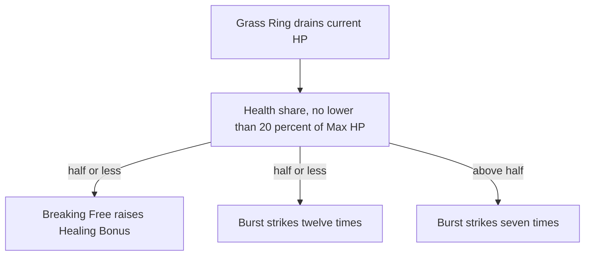

# Kuki

Kuki's kit is its record and one behaviour module, `createKukiKitBehaviour` (`packages/genshin-world/src/services/kit/characters/kukiKit.ts`), on avatar 10000065 (`{data-root}/genshin-dump-backup-6.6/ExcelBinOutput/AvatarExcelConfigData.json`): four strikes (`{data-root}/cache/gcsim-v2.47.2/internal/characters/kuki/attack.go`, line 22), a charged attack of two slashes (`{data-root}/cache/gcsim-v2.47.2/internal/characters/kuki/charge.go`, line 16), a collision and two plunges, Grass Ring of Sanctification with its ring and drain, and Gyoei Narukami Kariyama Rite's seven hits, or twelve at half her health or less. Her multipliers are read from proud skill groups 6531, 6532 and 6539, each level-1 row matching the wiki's scaling tables (see Sources; `{data-root}/cache/genshin-wiki/Category_Kuki_Shinobu_Talents.json`); the charged attack's 20 stamina (group 6531 index 6), the burst's 15-second cooldown and 60 energy (group 6539 indices 5 and 6), and the skill's 12-second duration and 15-second cooldown (group 6532 indices 5 and 6) are read from the same groups (`{data-root}/genshin-dump-backup-6.6/ExcelBinOutput/ProudSkillExcelConfigData.json`). The ring starts at its 23rd frame and ticks every 90 frames, healing the active character by the table's 3% of her Max HP and 288.89 flat (`{data-root}/cache/gcsim-v2.47.2/internal/characters/kuki/skill.go` lines 70-80 and the tick's heal, `{data-root}/cache/gcsim-v2.47.2/internal/characters/kuki/skill.go`, lines 127 to 132) and striking 2 frames after each tick, and a second cast replaces it (`{data-root}/cache/gcsim-v2.47.2/internal/characters/kuki/skill.go`, line 73, `{data-root}/cache/gcsim-v2.47.2/internal/characters/kuki/skill.go`, line 105). The cast drains 30% of her current HP, to no lower than 20% of her Max HP (`{data-root}/cache/gcsim-v2.47.2/internal/characters/kuki/skill.go` lines 31-47). Each burst hit is a share of her Max HP as flat damage (`{data-root}/cache/gcsim-v2.47.2/internal/characters/kuki/burst.go` line 34). Ascension 1's Breaking Free, Ascension 4 and Constellations 1 and 2 are built. Constellations 4 and 6 are not built, as the kit's own notes say. The plunges' reaches are provisional, and the plunges take the wiki's poise.

## Decisions

- **Kuki's HP-based damage and drain are read from her Max HP and the party's health share.** A kit has no current HP for her, so each burst hit is her Max HP's share as flat damage (`{data-root}/cache/gcsim-v2.47.2/internal/characters/kuki/burst.go` line 34), and the cast's drain lowers her health share by 30% of her current HP, to no lower than 20%, as gcsim drains only while she is above 20% (`{data-root}/cache/gcsim-v2.47.2/internal/characters/kuki/skill.go` lines 31-47). The kit represents the drain as a one-tick field at the cast, as Xiao's drain is a field, and reads her party health share as the cast starts (`packages/genshin-world/src/services/kit/characters/kukiKit.ts` lines 26-29).
- **The burst's twelve hits continue at the record's gap of 17 frames.** gcsim casts seven hits above half her health and twelve at half or less, each 17 frames apart from 50 (`{data-root}/cache/gcsim-v2.47.2/internal/characters/kuki/burst.go` lines 14 and 46-52, `interval = 2*60/7`). The record's seven hits sit at 50, 67, 84, 101, 118, 135 and 152 frames, the same 17-frame gap, so the kit's five further hits at that gap (`packages/genshin-world/src/services/kit/characters/kukiKit.ts` lines 54-60) match gcsim's loop.
- **Constellation 1 widens the burst's hits from 4 to 6 metres.** gcsim's burst radius is 4, and 6 from Constellation 1 (`{data-root}/cache/gcsim-v2.47.2/internal/characters/kuki/burst.go` lines 44-49), and the kit's Constellation 1 burst hits are the wider ones (`packages/genshin-world/src/services/kit/characters/kukiKit.ts` lines 40-41 and 94-96, 139).
- **Constellation 2 adds three seconds to the ring.** gcsim gives the ring 3 more seconds from Constellation 2 (`{data-root}/cache/gcsim-v2.47.2/internal/characters/kuki/skill.go` lines 62-72), and the kit adds the same (`packages/genshin-world/src/services/kit/characters/kukiKit.ts` lines 20-23 and 106).
- **Ascension 4's Elemental Mastery bonuses are the ring's healing and tick damage, and the initial hit's damage at every Ascension.** gcsim's Ascension 4 adds 75% of Elemental Mastery to the ring's healing (`{data-root}/cache/gcsim-v2.47.2/internal/characters/kuki/asc.go` lines 31-36) and 25% to each tick's damage (`{data-root}/cache/gcsim-v2.47.2/internal/characters/kuki/asc.go` lines 41-46). Its initial hit adds 25% of Elemental Mastery as flat damage without an Ascension check (`{data-root}/cache/gcsim-v2.47.2/internal/characters/kuki/skill.go` line 58). The kit does the same (`packages/genshin-world/src/services/kit/characters/kukiKit.ts` lines 30-31, 39, 87-90 and 111-112).
- **Breaking Free raises the Healing Bonus at Ascension 1 while her health is at half or less.** gcsim's note on Ascension 1 gives the +15% Healing Bonus at 50% health or less (`{data-root}/cache/gcsim-v2.47.2/internal/characters/kuki/asc.go` line 9), and the kit reads her health share for it (`packages/genshin-world/src/services/kit/characters/kukiKit.ts` lines 33-36 and 47-50).

## Provisional constants

- **The plunges' reaches are the generic plunges', and the plunges take the wiki's poise.** gcsim's `{data-root}/cache/gcsim-v2.47.2/internal/characters/kuki/` folder has no plunge file (only `asc`, `attack`, `burst`, `charge`, `cons`, `kuki` and `skill`), so the 1, 3 and 5-metre reaches are the kit's own. Open until a plunge source gives the reaches.
- **The burst's energy is the table's 60, where gcsim calls "ConsumeEnergy(4)".** The table's 60 is proud group 6539 index 6 and the wiki's `energycost=60`; gcsim's `{data-root}/cache/gcsim-v2.47.2/internal/characters/kuki/burst.go` line 60 consumes 4.

## Not built

- **Constellation 4 is not built.** The kit needs charged and plunging hits as events, which only normal attacks emit (`packages/genshin-world/src/services/kit/characters/kukiKit.ts` lines 72-73). gcsim's Thundergrass Mark is set on normal, charged and plunging hits (`{data-root}/cache/gcsim-v2.47.2/internal/characters/kuki/cons.go` lines 20-40, with a 5-second cooldown), and its flat hit of 9.7% of her Max HP is at `{data-root}/cache/gcsim-v2.47.2/internal/characters/kuki/cons.go` line 53.
- **Constellation 6 is not built.** The kit needs a lethal hit held at 1 HP once a minute, which damage taken does not allow (`packages/genshin-world/src/services/kit/characters/kukiKit.ts` line 74). gcsim gives 150 Elemental Mastery for 15 seconds when her HP is 25% or less, once every 60 seconds (`{data-root}/cache/gcsim-v2.47.2/internal/characters/kuki/cons.go` lines 62-83).

## Key files

| File                                                            | Role                                                                                                                                                                             |
| :-------------------------------------------------------------- | :------------------------------------------------------------------------------------------------------------------------------------------------------------------------------- |
| `packages/genshin-world/src/services/kit/characters/kukiKit.ts` | `createKukiKitBehaviour`, Kuki's kit with her strikes, charged attack and plunges, Grass Ring of Sanctification with its ring and drain, and Gyoei Narukami Kariyama Rite's hits |

## Sources

- [gcsim v2.47.2](https://github.com/genshinsim/gcsim/tree/v2.47.2/internal/characters/kuki), MIT: the strikes' hitmarks at 12, 13, 13 and 23 frames and their reaches (`{data-root}/cache/gcsim-v2.47.2/internal/characters/kuki/attack.go` lines 15-16 and 54-68), the charged attack's hitmarks at 14 and 25 with a 2.8-metre circle (`{data-root}/cache/gcsim-v2.47.2/internal/characters/kuki/charge.go` lines 16 and 47), Grass Ring of Sanctification's start at 23 frames, its 90-frame ticks and their strike two frames on (`{data-root}/cache/gcsim-v2.47.2/internal/characters/kuki/skill.go` lines 16-17 and 70-80, and "bellTick"), its drain (`{data-root}/cache/gcsim-v2.47.2/internal/characters/kuki/skill.go` lines 31-47) and its Constellation 2 duration (`{data-root}/cache/gcsim-v2.47.2/internal/characters/kuki/skill.go` lines 62-72), Gyoei Narukami Kariyama Rite's hits and Constellation 1 radius (`{data-root}/cache/gcsim-v2.47.2/internal/characters/kuki/burst.go` lines 14-61), and Ascension 1, Ascension 4 and Constellations 4 and 6 (`{data-root}/cache/gcsim-v2.47.2/internal/characters/kuki/asc.go` lines 9 and 31-46, `{data-root}/cache/gcsim-v2.47.2/internal/characters/kuki/cons.go` lines 20-83).
- The game data dump's `{data-root}/genshin-dump-backup-6.6/ExcelBinOutput/ProudSkillExcelConfigData.json`: proud skill group 6531 (level 1 indices 0-9) matches the wiki's strikes, charged attack and plunges to two decimal places, at 48.76, 44.55, 59.34 and 76.11%, the charged attack at 55.63 and 66.77% with 20 stamina, and the plunges at 63.93, 127.84 and 159.68%; group 6532 (0 to 6) gives the skill's 75.71% DMG, its 3% Max HP plus 288.89 heal, the ring's 25.24% DMG, its 30% drain share, a 12-second duration and a 15-second cooldown; and group 6539 (0 to 6) gives the burst's 3.6% Max HP per instance, its 25.23 and 43.26% totals, its 15-second cooldown and 60 energy.
- [Shinobu's Shadowsword](https://genshin-impact.fandom.com/wiki/Shinobu%27s_Shadowsword), Genshin Impact Wiki: the strikes' poise of 51.03, 46.62, 62.1 and 79.65, the charged attack's 60 and 60, the collision's 25 at 0U, the Low Plunge's 100 and the High Plunge's 150.
- [Sanctifying Ring](https://genshin-impact.fandom.com/wiki/Sanctifying_Ring), Genshin Impact Wiki: the skill's 30 poise, the ring's ticks at 10 poise and the Thundergrass Mark (Constellation 4) at 20 poise.
- [Gyoei Narukami Kariyama Rite](https://genshin-impact.fandom.com/wiki/Gyoei_Narukami_Kariyama_Rite), Genshin Impact Wiki: the burst's first and remaining hits at 20 poise each, its 2s and 3.5s durations and its energy of 60.
