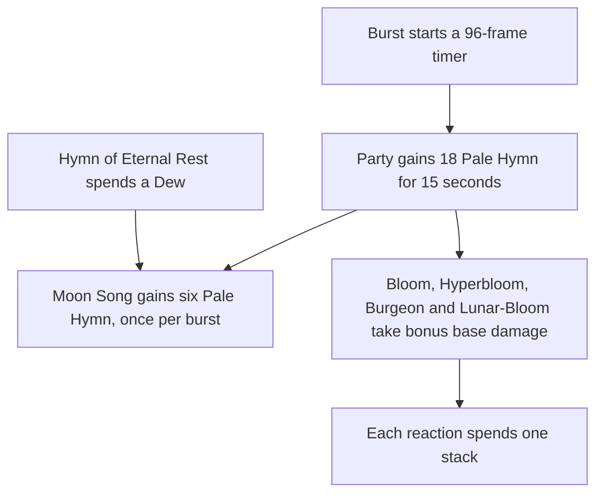

# Lauma

Lauma's kit is its record and one behaviour module, `createLaumaKitBehaviour`, on avatar 10000119 (`{data-root}/genshin-parity/text/ExcelBinOutput/AvatarExcelConfigData.json`): her three strikes (`{data-root}/cache/gcsim-v2.47.2/internal/characters/lauma/attack.go` line 21), a charged attack, a plunge collision and two plunges (`{data-root}/cache/genshin-wiki/Category_Lauma_Talents.json`), Hymn of Hunting's press and Hymn of Eternal Rest's hold with the Frostgrove Sanctuary each plants, and the Moonsign Benediction that turns the party's Bloom into [Lunar-Bloom](../../combat/design.md#lunar-reactions). Her multipliers are read from proud skill groups 11931, 11932 and 11939 (`packages/genshin-world/src/services/kit/characters/laumaKit.ts`, `{data-root}/genshin-parity/text/ExcelBinOutput/ProudSkillExcelConfigData.json`), and match gcsim's values to six decimal places. The press's cooldown of 12 seconds, the burst's cooldown of 15 and energy cost of 60 are the game's: the skill rows 11192 and 11195 of `{data-root}/genshin-parity/text/ExcelBinOutput/AvatarSkillExcelConfigData.json` hold them, and the press's 12 is also at index 9 of group 11932. Her burst lands no hit of its own (`{data-root}/cache/gcsim-v2.47.2/internal/characters/lauma/burst.go`), so its action has none; the Pale Hymn it gives is described below.

## Decisions

- **Her strikes land at their hitmarks, with no travel.** gcsim queues each strike's damage at its hitmark, so the strikes land at 14, 11 and 16 frames in animations of 29, 33 and 38 frames. The first two are boxes of 2 metres by 8 and the third a box of 2.8 metres by 8, each on the body's near edge, as gcsim's boxes are drawn (`{data-root}/cache/gcsim-v2.47.2/internal/characters/lauma/attack.go`, the hitmarks and animations on lines 17 to 34, the boxes on line 18).
- **Her charged attack, Spiritcall Prayer, lands after its animation.** gcsim queues its hit at 73 frames and its animation ends at 68, so the hit lands 5 frames past the action's end. The kit keeps gcsim's hitmark and does not stretch the action to fit it. It is a box of 2.8 metres by 8, and Dendro as her element (`{data-root}/cache/gcsim-v2.47.2/internal/characters/lauma/charge.go` lines 67 to 73).
- **The charged attack's stamina is not sourced.** gcsim draws stamina only in the Spirit Envoy state, which is not built (`{data-root}/cache/gcsim-v2.47.2/internal/characters/lauma/charge.go`, the deer's stamina bleed), so the charged attack outside it has no cost there, but the record marks the cost `Unclassified`; see Provisional constants.
- **The press plants its sanctuary where the body stands.** gcsim places the Frostgrove Sanctuary on the body when the press is cast, and it ticks eight times from 62 frames, every 117 frames, for 15 seconds (`{data-root}/cache/gcsim-v2.47.2/internal/characters/lauma/skill.go` lines 19 to 22, 60 to 63). Each tick is a circle of 6 metres round that point (`{data-root}/cache/gcsim-v2.47.2/internal/characters/lauma/skill.go` line 266), dealing Dendro at her ATK share and her Elemental Mastery, and the kit's summon holds those eight hits.
- **The press and each sanctuary tick shed the RES of the Dendro and Hydro enemies they strike.** gcsim gives the shred 2.5% at the first level, for 10 seconds, on each enemy a press or a tick hits (`{data-root}/cache/gcsim-v2.47.2/internal/characters/lauma/skill.go` lines 226 to 240, the table's first value 0.025, `{data-root}/cache/gcsim-v2.47.2/internal/characters/lauma/zz_lauma.dm.go` line 252). The kit applies it to each enemy a hit strikes as the hit lands, through the enemy status's RES reduction.
- **Constellation 4's energy is a Sanctuary tick's strike.** From Constellation 4, each Frostgrove Sanctuary tick that strikes an enemy restores 5 energy to Lauma, once every 5 seconds, as gcsim's tick callback does (`{data-root}/cache/gcsim-v2.47.2/internal/characters/lauma/cons.go` lines 120 to 128). The tick's hits carry it on their own `onStrike`, so the press and the hold, whose hits are not the ticks, give none, and the cooldown is her status.
- **Constellation 1's heal is a Lunar-Bloom's own, given the status her burst gives.** From Constellation 1 her burst sets a status for 20 seconds (`{data-root}/cache/gcsim-v2.47.2/internal/characters/lauma/cons.go` line 66, called from `{data-root}/cache/gcsim-v2.47.2/internal/characters/lauma/burst.go` line 51), and while it holds each Lunar-Bloom reaction, from whichever member, schedules a heal of 5 times her Elemental Mastery to the active character, 5 frames on, as gcsim's Lunar-Bloom callback does (`{data-root}/cache/gcsim-v2.47.2/internal/characters/lauma/cons.go` lines 44 to 56). The heal is held back by a 1.9-second cooldown on her (`{data-root}/cache/gcsim-v2.47.2/internal/characters/lauma/cons.go` line 44). The Spirit Envoy's deer, which lengthens and cheapens it, is not built with the Spirit Envoy.
- **The hold is Hymn of Eternal Rest while the party holds Dew.** gcsim refuses the hold with no Dew, so the kit plays the press for a hold then. The hold's Dendro hit lands at 45 frames in an animation of 64 (`{data-root}/cache/gcsim-v2.47.2/internal/characters/lauma/skill.go` lines 23 and 46), planting the same sanctuary as the press, and it spends up to three Dew on a direct Lunar-Bloom hit at the same hitmark, 152% of her Elemental Mastery at the first level for each Dew spent (`{data-root}/cache/gcsim-v2.47.2/internal/characters/lauma/skill.go` lines 153 to 170, the table's first value 1.52, `{data-root}/cache/gcsim-v2.47.2/internal/characters/lauma/zz_lauma.dm.go` line 198, and the wiki's 152%, `{data-root}/cache/genshin-wiki/Category_Lauma_Talents.json`), on a circle of 6 metres round her. The Dew is spent as the hold starts, where gcsim spends it at 29 frames, since the hit's multiplier is set as it is cast. The skill cools for 12 seconds either way (`{data-root}/cache/gcsim-v2.47.2/internal/characters/lauma/skill.go` lines 99 and 172). The half second the press must be held to become the hold is provisional, as gcsim takes the hold as a parameter, and its question is on the [roadmap](../../../../changes/genshin-roadmap/tasks.md).
- **Her Moonsign Benediction turns Bloom into Lunar-Bloom.** As gcsim's ascension file gives it (`{data-root}/cache/gcsim-v2.47.2/internal/characters/lauma/asc.go` line 113), it adds 0.0175% Base DMG Bonus to the party's Lunar-Bloom for each point of her Elemental Mastery, at most 14%, read as the team's buffs leave her.
- **Her plunges are provisional.** gcsim has no plunge file for Lauma either, so her plunges borrow Bennett's timings (see Provisional constants), with the wiki's 100 and 50 poise for the high and low plunges, on the reach every kit shares and with multipliers from her table; the [roadmap](../../../../changes/genshin-roadmap/tasks.md) asks about it.

## Pale Hymn

Her burst starts a 96-frame timer as a status (`{data-root}/cache/gcsim-v2.47.2/internal/characters/lauma/burst.go` line 41), and when the timer runs out the party gains 18 Pale Hymn for 15 seconds (`{data-root}/genshin-parity/text/ExcelBinOutput/ProudSkillExcelConfigData.json`, group 11939) and her burst is up for 15 seconds, as gcsim (MIT) `{data-root}/cache/gcsim-v2.47.2/internal/characters/lauma/burst.go` sets them. The timer's expiry is the gain, so the 96 frames run on the kit's own clock. A Dew Hymn of Eternal Rest spends as it is cast gives Moon Song six Pale Hymn a Dew while the burst is up, and only once in each burst, as gcsim's internal cooldown does (`{data-root}/cache/gcsim-v2.47.2/internal/characters/lauma/skill.go` lines 182 to 190). A Dew spent before the burst waits 15 seconds for it, and is given when the gain lands. Each Bloom, Hyperbloom, Burgeon or Lunar-Bloom reaction spends one stack, Moon Song's before the burst's, from the reaction event, as gcsim spends one on each Bloom hit (`{data-root}/cache/gcsim-v2.47.2/internal/characters/lauma/burst.go` line 97, with the stack taken in `consumePaleHymn` at lines 133 to 142, its Constellation 6 stack first).

While the party holds any Pale Hymn, each Bloom, Hyperbloom, Burgeon and Lunar-Bloom reaction the party makes takes base damage of her Elemental Mastery times the burst's table value: 2.7776 at talent level 1 for Bloom, Hyperbloom and Burgeon, and 2.2224 for Lunar-Bloom, as gcsim (MIT) `{data-root}/cache/gcsim-v2.47.2/internal/characters/lauma/burst.go` gives them in bloomDmgIncrease and lunarBloomDmgIncrease. The values are the third and fourth entries (indices 2 and 3) of the burst's proud skill group 11939's `paramList`, read at her burst's talent level as `paleHymnBloomDamageIncrease` and `paleHymnLunarBloomDamageIncrease`, and the bonus comes through the party reaction hook from her kit, on her own Elemental Mastery. From Constellation 2 each Bloom, Hyperbloom and Burgeon takes 5 more of that ratio, and each Lunar-Bloom 4 more, as gcsim (MIT) `{data-root}/cache/gcsim-v2.47.2/internal/characters/lauma/cons.go` gives them. Those two constants stay in the kit, cited here, rather than in the record.

Two differences from gcsim are named here. The kit spends one stack for each reaction on each enemy from the reaction event, after the hit is priced, where gcsim spends one for each enemy hit with a Bloom tag (`{data-root}/cache/gcsim-v2.47.2/internal/characters/lauma/burst.go` lines 83 to 97), so Bountiful Core's hits, which are not reaction types here, spend none. And the Dew is spent as the hold starts, where gcsim spends it at 29 frames, as the hold's own note says.

## Provisional constants

- **The charged attack's stamina is unsourced.** gcsim draws stamina only in the Spirit Envoy state, and the wiki's Spiritcall Prayer lists no stamina figure, but the record marks the cost `Unclassified` (`lauma.json`), so the zero is not measured. The spec's no-stamina requirement rests on this.
- **Her plunges' timings are not in her record or her kit yet.** `lauma.json` has no plunge keys and `laumaKit.ts` none, so the Bennett timings this page names (gcsim `{data-root}/cache/gcsim-v2.47.2/internal/characters/bennett/plunge.go`, 36 and 38 frames) are not hers in the build.
- **The Constellation 1 window's opening by her Elemental Skill is not checked.** gcsim also starts the 20-second window on the skill (`{data-root}/cache/gcsim-v2.47.2/internal/characters/lauma/skill.go` line 57), which the kit does not follow; the cached wiki has the constellation's name only, so the in-game rule is not checked here.

## Not built

- **The Spirit Envoy state waits on a stance that drains stamina.** Her charged attack's first press, when the state is ready, enters a deer state that drains 25 stamina a second (`{data-root}/cache/gcsim-v2.47.2/internal/characters/lauma/charge.go` line 49, and `deerStateStaminaBleed` at lines 149 to 159), blocks dashing and ends on any other action (Open below). The kit has no stance that drains stamina or ends on an action, so that first press is not built, and the charged attack is always Spiritcall Prayer.
- **Her Ascension 4 passive, Cleansing for the Spring, is built on her Elemental Skill, its press and the Frostgrove Sanctuary's ticks alike, as the sanctuary's summon strikes as her Elemental Skill, as gcsim tags its ticks. Its 0.04% a point and its 32% cap are the game's (group 11922's first two entries, 0.0004 and 0.32, `{data-root}/genshin-parity/text/ExcelBinOutput/ProudSkillExcelConfigData.json`, and the wiki's text); gcsim's `{data-root}/cache/gcsim-v2.47.2/internal/characters/lauma/asc.go` line 88 uses 0.004 a point, ten times the game's, and the kit follows the game. Its Spirit Envoy cooldown cut waits on the Spirit Envoy state. Constellation 6 and her other passives are not built.** Each reads the Pale Hymn, the Spirit Envoy or the Moonsign's level, or the Frostgrove Sanctuary's own timing.

## Open

- [ ] **The Spirit Envoy's deer state blocks dashing and ends on any other action** — no source yet: gcsim's `{data-root}/cache/gcsim-v2.47.2/internal/characters/lauma/charge.go` lines 28 to 36 set the deer state's frames by action, and the dash is not set apart there; the deer state's own transition rules would settle it.

## Key files

| File                                                             | Role                                                                                                                                                                                                                                                   |
| :--------------------------------------------------------------- | :----------------------------------------------------------------------------------------------------------------------------------------------------------------------------------------------------------------------------------------------------- |
| `packages/genshin-world/src/services/kit/characters/laumaKit.ts` | `createLaumaKitBehaviour`, Lauma's strikes, charged attack, Hymn of Hunting's press and Hymn of Eternal Rest's hold with its Frostgrove Sanctuary, RES shred and Lunar-Bloom hit, her Moonsign Benediction and her Pale Hymn stacks and their spending |

## Sources

- [gcsim](https://github.com/genshinsim/gcsim/tree/v2.47.2/internal/characters/lauma), MIT: each strike's hitmark, animation and box, the charged attack's hit, animation and box, the press's hitmark, animation and circle, the Frostgrove Sanctuary's ticks, duration and circle, the RES shred and its duration, the hold's hitmark, animation, Dew and Lunar-Bloom hit, and the burst's animation, read from its attack, charge, skill and burst files, with its charge file for the stamina and its ascension file for the Moonsign Benediction.
- The proud skill groups' indices, read from gcsim's data file for the character, which lists each multiplier beside its group.
- [gcsim](https://github.com/genshinsim/gcsim/blob/v2.47.2/internal/characters/bennett/plunge.go), MIT: the plunges' timings, which her kit does not yet carry (see Provisional constants).
- The game data, `{data-root}/genshin-parity/text/ExcelBinOutput/`: the skill rows 11192 and 11195 in `AvatarSkillExcelConfigData` (cooldowns 12 and 15, the burst's energy cost 60), and the groups 11922 (her Ascension 4) and 11932 and 11939 in `ProudSkillExcelConfigData`, whose parameters the multiplier check matched at every talent level.
- The cached wiki, `{data-root}/cache/genshin-wiki/Category_Lauma_Talents.json`: the plunges' and strikes' poise, the press's and hold's poise, the 152% a Dew and the Cleansing for the Spring text.
- [Peregrination of Linnunrata](https://genshin-impact.fandom.com/wiki/Peregrination_of_Linnunrata) and [Runo: Dawnless Rest of Karsikko](https://genshin-impact.fandom.com/wiki/Runo:_Dawnless_Rest_of_Karsikko), Genshin Impact Wiki: the poise of her strikes, collision, plunges, press, hold and Frostgrove Sanctuary's ticks.
