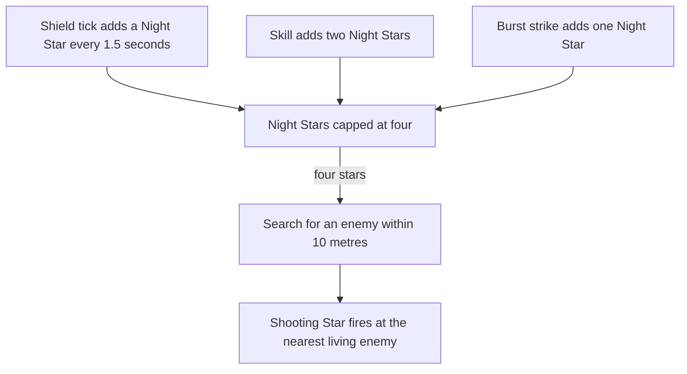

# Layla

Layla's kit is its record and one behaviour module, `createLaylaKitBehaviour`, on avatar 10000074 (`{data-root}/genshin-dump-backup-6.6/ExcelBinOutput/AvatarExcelConfigData.json`, named Layla in `{data-root}/genshin-dump-backup-6.6/TextMap/TextMap_MediumEN.json`): three strikes, a charged attack of two slashes, a collision and two plunges, Nights of Formal Focus with its Cryo hit and the shield it sets on the team, and Starlight Slug's field, which strikes from the body's place every 1.5 seconds for twelve seconds. Her multipliers are read from proud skill groups 7431, 7432 and 7439 (`{data-root}/genshin-dump-backup-6.6/ExcelBinOutput/ProudSkillExcelConfigData.json`); the charged attack's stamina, the skill's cooldown and shield, and the burst's cooldown and energy cost are read from the same groups. The burst's strike is its talent level's share of her Max HP as flat damage, with no ATK multiplier (`burst.go` line 46). Starlight Slug's tick reaches every enemy within 12 metres of the body, the radius of gcsim's field (`burst.go` line 52), where gcsim picks the closest one, which overstates a tick against several enemies; the record's 13.5-metre strike area is unsourced (see Provisional constants). Her Night Stars are built, with the Shooting Stars they fire, and so are her Ascension 4 and Constellation 2 passives, Constellation 4's Dawn Star, and Constellation 6's 40% DMG and shorter Night Stars tick (`{data-root}/cache/gcsim-v2.47.2/internal/characters/layla/cons.go`, lines 42 to 50). Her Ascension 1 and Constellation 1's team shields are not built. Her plunges' frames and poise are provisional: they take Bennett's timings and the wiki's poise, but her record carries only the collision's poise, so the low and high plunges wait (see Decisions).

## Decisions

- **Starlight Slug's ticks are the field's strikes, so `burst.hits` is empty.** gcsim queues eight ticks across the burst's twelve seconds, from 36 frames every 90 frames (`burst.go` lines 16 and 49 to 54), each striking from the field, so the record reads them as `hits.starlightSlugStrike` and keeps `burst.hits` empty, where gcsim counts eight.
- **Layla's plunges take Bennett's timings and the wiki's poise, and her record does not carry them yet.** gcsim has no plunge file for her, so the design lands the collision, low and high plunge at Bennett's frames, 36 for the low hit and 38 for the high (`{data-root}/cache/gcsim-v2.47.2/internal/characters/bennett/plunge.go`), with the wiki's 100 and 150 poise on the low and high and its 25 on the collision (`Category_Layla_Talents.json`, Sword of the Radiant Path), and her own multipliers. Her record carries only the collision's 25 poise, so the frames and the low and high poise wait; see Provisional constants. Her animation would move them if it showed otherwise.
- **Constellation 6 is a DMG Bonus on the hit and a shorter tick.** Starlight Slug's ticks and each Shooting Star carry 40% DMG Bonus on their own hits, where gcsim's attack mod names the burst's attacks and the Shooting Stars, and the Night Stars' tick is 1.2 seconds, the 1.5 seconds scaled by gcsim's 0.8, from the tick's field (`cons.go` lines 42 to 50, `shield.go` lines 204 to 206).
- **Constellation 1's Curtain absorbs 20% more, as its shield's health is scaled (`skill.go` lines 50 to 53, `shield *= 1.2`).** The shield the skill sets is the one it sets for Layla; the team shields the same constellation gives members not under a Curtain need the Cryo effectiveness a shield does not carry, so they wait.
- **The Shooting Star hit is recorded from gcsim's `shield.go`, and it fires once four Night Stars are built.** Its travel is 35, 33, 30 and 28 frames for four, three, two and one Night Stars (`frames.shootingStarTravels`, `shield.go` line 20), and its hitmark is the four-star 35. Its circle is 0.8 m, centred on the target (`TargetCentred`, `shield.go` line 145), dealt as Ice (gcsim's Cryo, `shield.go` lines 126 to 128) with one unit of gauge (`{data-root}/cache/genshin-wiki/Category_Layla_Talents.json`, Shooting Star DMG's `gu2 = 1U`) and multiplier group 7432 index 1 (starDmg, 0.1472 at level 1 to 0.26496 at level 10, the game data's values, `{data-root}/genshin-dump-backup-6.6/ExcelBinOutput/ProudSkillExcelConfigData.json`). Its element, gauge and multiplier are read from gcsim through the named hit of starDmg, joined by that multiplier, wherever the queue call sits in the character's folder. Its hitmark is the one value still `Unclassified`, because gcsim's delay for it is the travel of the stars left, which the reader cannot evaluate. The kit builds the Night Stars as gcsim's `shield.go` has them: the shield's tick adds one every 1.5 seconds, a skill adds two and a burst strike one while the shield is up, each under its internal cooldown of 0.3 and 0.5 seconds, and the stars cap at four (`shield.go` lines 52 to 67 and 201 to 206, `skill.go` line 84, `burst.go` line 69). Four stars fire one Shooting Star each: a search every 0.1 seconds for an enemy within 10 metres, and the first 0.5 seconds after one is found, then one every 0.45 seconds (`shield.go` lines 82, 96 to 105 and 155), each at the nearest living enemy in reach, or when none is in reach, at the one the search or the star before it aimed at, as gcsim's `shootStars` keeps its last target. Ascension 4 adds 1.5% of her Max HP as flat damage to each shot (`asc.go` line 29), and Constellation 2 gives her 1 Energy on a shot's first hit (`shield.go` lines 138 to 139).

- **Constellation 4's Dawn Star is granted by the first Shooting Star and priced by the kit's strike hooks.** gcsim's `shootStars` (`shield.go`, lines 112 to 117) gives `layla-c4` for three seconds to every party member when the first Shooting Star fires, and its `c4` (`cons.go`, lines 18 to 38) adds 5% of Layla's Max HP as flat damage to each Normal or Charged Attack a holder lands on an enemy, removing the status 0.05 seconds later. The kit prices her own strikes through its own strike hook and each member's through its party strike hook, both off her Max HP, and removes a holder's status 0.05 seconds after its `EnemyHit`, so a hit on several enemies is priced on each as gcsim's `OnEnemyHit` prices it.

## Provisional constants

- **The record's 13.5-metre strike area is unsourced, and gcsim's and the kit's field use 12.** `hits.starlightSlugStrike.area` in `layla.json` reads 13.5 with cause `Unsourced`; gcsim's circle is 12 round the body (`burst.go` line 52), and `laylaKit.ts` holds `STARLIGHT_SLUG_RADIUS` at 12. The record should be brought to the source; this pass does not change it.
- **The record's Starlight Slug hitmark of 42 frames is unsourced, and gcsim's tick releases at 56.** `burst.go` line 76 queues each tick's strike at `tickRelease`, 56 frames, landing 22 frames later with its travel; the record's 42 has no source.
- **The record's Starlight Slug duration of 755 frames is unsourced, and gcsim's is 756.** `burst.go` line 49 runs the status for 12 seconds, 720 frames, from the burst's start at 36 (line 16).
- **Her plunges' frames and low and high poise are not in her record.** `layla.json` carries only the collision's poise, 25 (wiki), so the Bennett frames of Decision 2 are the design's, not yet her record's.

## Key files

| File                                                             | Role                                                                                                                                                                                                |
| :--------------------------------------------------------------- | :-------------------------------------------------------------------------------------------------------------------------------------------------------------------------------------------------- |
| `packages/genshin-world/src/services/kit/characters/laylaKit.ts` | `createLaylaKitBehaviour`, Layla's kit with her strikes, charged attack, Nights of Formal Focus's hit and shield, and Starlight Slug's field and its strikes; her plunges are not in the record yet |

## Sources

- [gcsim](https://github.com/genshinsim/gcsim/tree/v2.47.2/internal/characters/layla), MIT: Layla's strikes' hitmarks, cancel frames and reaches, the charged attack's slashes, Nights of Formal Focus's hit, frames and shield, and Starlight Slug's field, its ticks, release and travel, and Constellation 4's Dawn Star from `cons.go`.
- [gcsim](https://github.com/genshinsim/gcsim/blob/v2.47.2/internal/characters/bennett/plunge.go), MIT: the plunges' timings, borrowed as Layla's own folder has none, and not yet in her record (see Provisional constants).
- The game data, `{data-root}/genshin-parity/text/ExcelBinOutput/`: group 7432's index 1 (starDmg) at 0.1472 on level 1 and 0.26496 on level 10, group 7431's index 5 at 20 (the charged attack's stamina), group 7439's indices 1 and 3 at 12 and 40 (the burst's cooldown and energy cost, which skill row 10745 also gives), and skill row 10742's cooldown of 12.
- The cached wiki, `{data-root}/cache/genshin-wiki/Category_Layla_Talents.json`: the strikes' and charged attack's poise, the collision's 25, the low plunge's 100 and high plunge's 150, and the charged attack's stamina of 20.
- [Sword of the Radiant Path](https://genshin-impact.fandom.com/wiki/Sword_of_the_Radiant_Path) and [Nights of Formal Focus](https://genshin-impact.fandom.com/wiki/Nights_of_Formal_Focus), Genshin Impact Wiki: the poise of her strikes, charged attack, collision, plunges, skill and Shooting Star.
