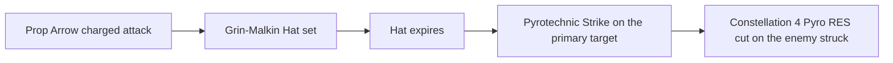

# Lyney

Lyney's kit is its record and one behaviour module, `createLyneyKitBehaviour`, on avatar 10000084: four strikes, a Prop Arrow as his charged attack with the Grin-Malkin Hat it sets, a collision and two plunges (`{data-root}/cache/genshin-wiki/Category_Lyney_Talents.json`), Bewildering Lights' press, and Wondrous Trick: Miracle Parade's Explosive Firework with the hat it sets. His strikes, plunges and Prop Arrow are physical or Pyro as gcsim deals them, and his skill and burst are Pyro (`{data-root}/cache/gcsim-v2.47.2/internal/characters/lyney/attack.go` line 53 for the strikes, `{data-root}/cache/gcsim-v2.47.2/internal/characters/lyney/aimed.go` line 136 for the Prop Arrow, `{data-root}/cache/gcsim-v2.47.2/internal/characters/lyney/skill.go` line 60 and `{data-root}/cache/gcsim-v2.47.2/internal/characters/lyney/burst.go` lines 67 and 106 for the skill and burst). His multipliers are read from proud skill groups 8431, 8432 and 8439 (`{data-root}/genshin-dump-backup-6.6/ExcelBinOutput/ProudSkillExcelConfigData.json`); the skill's and burst's cooldowns and the burst's energy cost come from the same groups. Each hat's Pyrotechnic Strike travels 36 frames to the primary target after the hat expires, gcsim's default (`{data-root}/cache/gcsim-v2.47.2/internal/characters/lyney/lyney.go` line 49): the Prop Arrow's strike lands 387 frames after the cast, and the burst's 563 frames after it. The record marks both 387 and 563 `Unsourced` (see Provisional constants).

Not built yet: the tap-released Physical Aimed Shot and the Pyro shot at a partial hold, which a kit's single charged attack cannot hold beside the Prop Arrow, so the hold for each waits on a kit with several charged attacks; the Prop Surplus that the Prop Arrow adds, its bonus per stack and its heal on Bewildering Lights, and the HP drain the Prop Arrow takes from him, which read his own HP; the hats' kill and skill explosions, which need a hit when a hat is removed early; the hat limit that kills the oldest hat for a newer one; the burst's ticks, which strike each enemy within four metres once while the burst's mark is not on it; the skill-aligned Spiritbreath Thorn, which needs a cooldown a hit cannot read; his Ascension 1 passive and Constellations 1 and 6. Constellation 6 stays open until its strike frame is added through the kit generator.

Provisional: his plunges' timings and poise. gcsim's folder has no plunge file, so the design gives the collision, low and high plunge Bennett's shared timings, but `lyney.json` carries no plunge keys yet. The wiki's poise is 10 for the collision, and 50 and 100 for the low and high plunges (`{data-root}/cache/genshin-wiki/Category_Lyney_Talents.json`, Normal Attack rows 13 to 15). Their multipliers are the table's entries 5, 6 and 7, counted from zero as the record's index counts them: the `Plunge DMG` row, then the first and second values of `Low/High Plunge DMG`, which group 8431 gives as 0.568288, 1.136335 and 1.419344 at level 1.

## Provisional constants

- **The Prop Arrow's strike at 387 frames and the burst's at 563 are `Unsourced`.** gcsim gives each hat's duration (238 frames for the Prop Arrow, `{data-root}/cache/gcsim-v2.47.2/internal/characters/lyney/aimed.go` line 29; 245 for the burst, `{data-root}/cache/gcsim-v2.47.2/internal/characters/lyney/aimed.go` line 30) and the 36-frame travel (`{data-root}/cache/gcsim-v2.47.2/internal/characters/lyney/lyney.go` line 49), but no literal places the hat's creation, so the sums 387 and 563 are the record's, not derived here.
- **Lyney's plunges have no record keys.** See Provisional above; their timings stay the design's until `lyney.json` carries them.

## Decisions

- **Ascension 4's DMG bonus reads the team's Pyro members as the strike's combatant carries them.** gcsim gives 60% on a strike at an enemy affected by Pyro, 20% more for each other Pyro member of the team, up to 100%. Lyney's own Pyro is among the team's, so the bonus counts the others with it, and the strike's hook reads the enemy's auras and the combatant's `deployedElements` (gcsim `{data-root}/cache/gcsim-v2.47.2/internal/characters/lyney/asc.go` lines 38 to 56: 60% at Ascension 4, plus 20% for each other Pyro member, and the cap of 100%).
- **Constellation 4's Pyro RES cut rides on the Prop Arrow's Pyrotechnic Strike.** That strike is the Pyro Charged Attack the constellation names, so the hit carries the status from Constellation 4 through `enemyStatus`. gcsim gives it 20% for 6 seconds on the Pyro Charged Attack's hit (`{data-root}/cache/gcsim-v2.47.2/internal/characters/lyney/cons.go` lines 126 to 128).

## Key files

| File                                                             | Role                                                                                                                                                             |
| :--------------------------------------------------------------- | :--------------------------------------------------------------------------------------------------------------------------------------------------------------- |
| `packages/genshin-world/src/services/kit/characters/lyneyKit.ts` | `createLyneyKitBehaviour`, Lyney's kit with his strikes, Prop Arrow and hat, plunges, Bewildering Lights' press, and Miracle Parade's Explosive Firework and hat |

## Sources

- [gcsim](https://github.com/genshinsim/gcsim/tree/v2.47.2/internal/characters/lyney), MIT: Lyney's strikes' hitmarks, cancel frames and reach, the Prop Arrow and its Grin-Malkin Hat, Bewildering Lights' hit and reach, and Wondrous Trick: Miracle Parade's Explosive Firework and its hat with their timings and the Pyrotechnic Strike's travel.
- The game data, `{data-root}/genshin-parity/text/ExcelBinOutput/`: groups 8431, 8432 and 8439 (the normal attack, Bewildering Lights and Miracle Parade groups, skill rows 10841, 10842 and 10845), with the skill's and burst's 15-second cooldowns and the burst's 60 energy on row 10845.
- The cached wiki, `{data-root}/cache/genshin-wiki/Category_Lyney_Talents.json`: the Normal Attack's plunge poise (10, 50 and 100), Miracle Parade's poise of 40, and Bewildering Lights' poise of 60.

## Open

- [ ] **Lyney's plunges are physical or Pyro** — no source yet: gcsim's folder has no plunge file to give their element.
- [ ] **The 387-frame Prop Arrow strike** — provisional: the record marks the 387 Unsourced.
- [ ] **The 563-frame Miracle Parade strike** — provisional: the record marks the 563 Unsourced.
