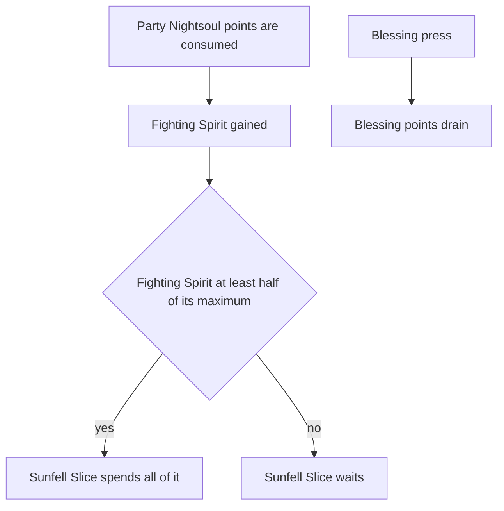

# Mavuika

Mavuika's kit is its record and one behaviour module, `createMavuikaKitBehaviour`, avatar 10000106: her four strikes, a charged attack, and the low, high and collision plunges, played when she is not in her Blessing. Her multipliers are read from proud skill groups 10631, 10632 and 10639 (`{data-root}/genshin-parity/text/ExcelBinOutput/ProudSkillExcelConfigData.json`), with the skill's 15-second cooldown from the second and the burst's 18 from the third (index 7 of group 10639). The charged attack costs the 50 stamina gcsim's charge takes (`{data-root}/cache/gcsim-v2.47.2/internal/characters/mavuika/mavuika.go` lines 80 to 93).

## Not yet built

Her Nightsoul state is built on the shared primitive: her skill's press enters the Flamestrider Blessing with her points, which drain as gcsim's do. Her Flamestrider's strikes and the Fighting Spirit that the party's Nightsoul points feed still wait on the Nightsoul hook.

- **The skill's Flamestrider is entered, its Ring of Searing Radiance is not.** The press enters the Blessing with 80 points, or 120 from Constellation 1 (the wiki's point limit of 80, `{data-root}/cache/genshin-wiki/Category_Mavuika_Talents.json`; `{data-root}/cache/gcsim-v2.47.2/internal/characters/mavuika/cons.go` lines 18 to 22), drains them five a second as gcsim mavuika/skill.go does (`{data-root}/cache/gcsim-v2.47.2/internal/characters/mavuika/skill.go` lines 68 to 81), and a press while in it refills them to their maximum (`skill.go` lines 112 to 148). Its Ring of Searing Radiance hit, the drain's pause while her burst lasts and its extra drain on the bike and in the charged attack are not built, so the press has no hit yet and spends its 15-second cooldown. While the blessing lasts, her strikes, charged attack, sprint and plunges are the Flamestrider's, not the ones built here.
- **Sunfell Slice waits on Fighting Spirit.** The burst needs at least half her Fighting Spirit, 100 of gcsim's maximum of 200 (`{data-root}/cache/gcsim-v2.47.2/internal/characters/mavuika/burst.go` line 20), and spends it all rather than energy, as the wiki's Fighting Spirit text gives it (`{data-root}/cache/genshin-wiki/Category_Mavuika_Talents.json`); its ATK share grows with the Fighting Spirit spent, at 1.6% ATK a point. Fighting Spirit is fed by the party's Nightsoul points as they are consumed. Until the hook lands, the burst's energy cost is unreachable, so it cannot be cast and has no hit.
- **The Flamestrider's strikes, charged attack and plunges wait on the Nightsoul hook.** gcsim's bike strikes, biked charged attack and bike plunges replace hers inside the blessing, the stance the Nightsoul hook waits on, and a stance holds no plunges to play in place of the kit's.
- **Ascension 1 and 4 and Constellations 1, 2 and 4 wait on the Nightsoul hook.** Ascension 1 gives 30% ATK for ten seconds on each Nightsoul burst (`{data-root}/cache/gcsim-v2.47.2/internal/characters/mavuika/asc.go` lines 19 to 26), Constellation 1 changes the Fighting Spirit each point gives, and the others read the blessing's Flamestrider or its burst, so none is built.

## Decisions

- **The strikes are the ring-state ones.** gcsim's ring-state attack is her four strikes outside the Flamestrider, and this kit takes those until the Flamestrider hook is built. The second and third strikes are boxes of 3.3 by 4.3 and 2.8 by 5.0 metres (`{data-root}/cache/gcsim-v2.47.2/internal/characters/mavuika/attack.go` line 19), priced as the circle to their far corner, as the framework prices a box (the framework's pricing is not checked here).
- **Her plunge collision is the framework's.** gcsim queues the collision only when a plunge's collision option is set (`{data-root}/cache/gcsim-v2.47.2/internal/characters/mavuika/plunge.go` lines 103 to 109). The framework's collision strikes on every plunge, which the Emilie page's manual question covers.
- **Her charged attack costs the stamina gcsim's `ActionStam` gives a charge (`mavuika.go` lines 90 and 91).** The table's stamina index is the same 50 (index 5 of group 10631, which the game data gives as 50 at level 1), so the table and gcsim agree.

## Key files

| File                                                               | Role                                                                                                                                                                                                    |
| :----------------------------------------------------------------- | :------------------------------------------------------------------------------------------------------------------------------------------------------------------------------------------------------ |
| `packages/genshin-world/src/services/kit/characters/mavuikaKit.ts` | `createMavuikaKitBehaviour`, Mavuika's four strikes, charged attack and plunges outside her Nightsoul Blessing, her skill's press entering it with its points, and her burst waiting on Fighting Spirit |

## Sources

- [gcsim](https://github.com/genshinsim/gcsim/tree/v2.47.2/internal/characters/mavuika), MIT, at v2.47.2: Mavuika's four strikes' hitmarks, cancels, poise and reaches, the charged attack and plunges' frames and reaches, and the skill and burst the Nightsoul hook waits on.
- The game data, `{data-root}/genshin-parity/text/ExcelBinOutput/`: groups 10631, 10632 and 10639 (skill rows 11061, 11062 and 11065), with the skill's 15-second and the burst's 18-second cooldowns on rows 11062 and 11065, and group 10631's index 5 at 50.
- The cached wiki, `{data-root}/cache/genshin-wiki/Category_Mavuika_Talents.json`: the Nightsoul point limit of 80, the burst's at-least-50% Fighting Spirit rule, and the Sunfell Slice row's 1.6% ATK a point.
