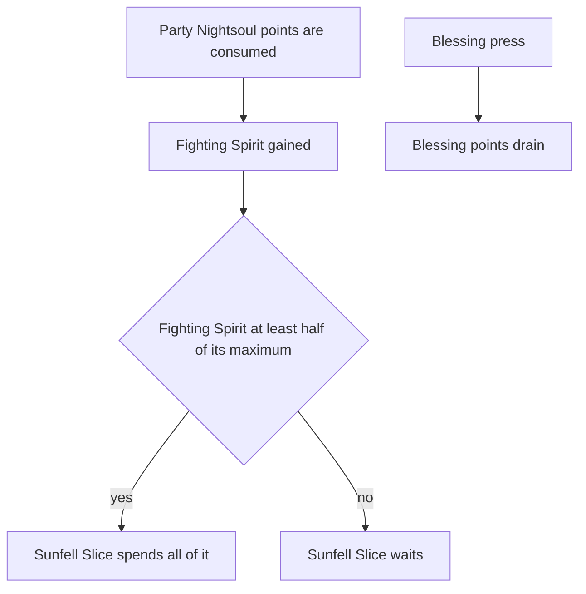

# Mavuika

Mavuika's kit is its record and one behaviour module, `createMavuikaKitBehaviour`, avatar 10000106 (`{data-root}/genshin-parity/text/ExcelBinOutput/AvatarExcelConfigData.json`, the row with that id): her four strikes, a charged attack, and the low, high and collision plunges, played when she is not in her Blessing. Her multipliers are read from proud skill groups 10631, 10632 and 10639 (`{data-root}/genshin-parity/text/ExcelBinOutput/ProudSkillExcelConfigData.json`), with the skill's 15-second cooldown from the second (index 13 of group 10632) and the burst's 18 from the third (index 7 of group 10639). The charged attack costs the 50 stamina gcsim's charge takes (`{data-root}/cache/gcsim-v2.47.2/internal/characters/mavuika/mavuika.go` lines 80 to 93).

## Not yet built

Her Nightsoul state is built on the shared primitive: her skill's press enters the Nightsoul's Blessing, in the Ring of Searing Radiance state, with her points, which drain as gcsim's do. Her Flamestrider's strikes and the Fighting Spirit that the party's Nightsoul points feed still wait on the Nightsoul hook.

- **The press enters the Ring of Searing Radiance state, whose hit is not built.** The press enters the Blessing with 80 points, or 120 from Constellation 1 (the wiki's `nightsoulpointlimit=80` on The Named Moment, `{data-root}/cache/genshin-wiki/Category_Mavuika_Talents.json`; `{data-root}/cache/gcsim-v2.47.2/internal/characters/mavuika/cons.go` lines 18 to 22), drains them five a second as gcsim mavuika/skill.go does (`{data-root}/cache/gcsim-v2.47.2/internal/characters/mavuika/skill.go` lines 68 to 81), and a press while in it refills them to their maximum (`skill.go` lines 112 to 120 and 148, with the clamp at `{data-root}/cache/gcsim-v2.47.2/internal/template/nightsoul/nightsoul.go` lines 160 to 166). The press's own hit, The Named Moment (`skill.go` lines 223 to 241), and the Ring's hit (`skill.go` lines 297 to 327) are not built, and the press exits the bike into the ring (`skill.go` line 242), so the press has no hit yet and spends its 15-second cooldown (`skill.go` line 243). The drain's pause while her burst lasts (`{data-root}/cache/gcsim-v2.47.2/internal/characters/mavuika/burst.go` lines 25 to 30) and its extra drain on the bike and in the charged attack (`skill.go` lines 74 to 79) are not built. Her strikes, charged attack, sprint and plunges are the Flamestrider's only while she rides it, which the skill's hold enters (`skill.go` lines 193 to 214), and those are not the ones built here.
- **Sunfell Slice waits on Fighting Spirit.** The burst needs at least half her Fighting Spirit, 100 of gcsim's maximum of 200 (`{data-root}/cache/gcsim-v2.47.2/internal/characters/mavuika/mavuika.go` line 99 and `burst.go` line 20), and spends it all rather than energy, as the wiki's Fighting Spirit text gives it (`{data-root}/cache/genshin-wiki/Category_Mavuika_Talents.json`, "Hour of Burning Skies", and gcsim's `burst.go` lines 43 to 46); its ATK share grows with the Fighting Spirit spent, at 1.6% ATK a point (the wiki's `sunfellslicedmgbonus_1` on the same page). Fighting Spirit is fed by the party's Nightsoul points as they are consumed (`burst.go` lines 119 to 126). Until the hook lands, the burst's energy cost is unreachable, so it cannot be cast and has no hit.
- **The Flamestrider's strikes, charged attack and plunges wait on the Nightsoul hook.** gcsim's bike strikes (`{data-root}/cache/gcsim-v2.47.2/internal/characters/mavuika/attack.go` lines 22 to 27), biked charged attack and bike plunges (`plunge.go` lines 71 and 81) replace hers inside the Flamestrider, the stance the Nightsoul hook waits on.
- **Ascension 1 and 4 and Constellations 1, 2 and 4 wait on the Nightsoul hook.** Ascension 1 gives 30% ATK for ten seconds on each Nightsoul burst (`{data-root}/cache/gcsim-v2.47.2/internal/characters/mavuika/asc.go` lines 19 to 26), Constellation 1 changes the Fighting Spirit each point gives (`{data-root}/cache/gcsim-v2.47.2/internal/characters/mavuika/cons.go` lines 27 to 32), and the others read the blessing's Flamestrider or its burst (Ascension 4 is "Kiongozi", on the wiki page of that title in `{data-root}/cache/genshin-wiki/Category_Mavuika_Talents.json`), so none is built.

## Decisions

- **The strikes are the ring-state ones.** gcsim's ring-state attack is her four strikes outside the Flamestrider, and this kit takes those until the Flamestrider hook is built. The second and third strikes are boxes of 3.3 by 4.3 and 2.8 by 5.0 metres (`{data-root}/cache/gcsim-v2.47.2/internal/characters/mavuika/attack.go` line 19), priced as the circle to their far corner (the first Open item below).
- **Her plunge collision is the framework's.** gcsim queues the collision only when a plunge's collision option is set (`{data-root}/cache/gcsim-v2.47.2/internal/characters/mavuika/plunge.go` lines 103 to 109). The framework's collision strikes on every plunge (the second Open item below).
- **Her charged attack costs the stamina gcsim's `ActionStam` gives a charge (`mavuika.go` lines 90 and 91).** The table's stamina index is the same 50 (index 5 of group 10631, which the game data gives as 50 at level 1), so the table and gcsim agree.

## Key files

| File                                                               | Role                                                                                                                                                                                                    |
| :----------------------------------------------------------------- | :------------------------------------------------------------------------------------------------------------------------------------------------------------------------------------------------------ |
| `packages/genshin-world/src/services/kit/characters/mavuikaKit.ts` | `createMavuikaKitBehaviour`, Mavuika's four strikes, charged attack and plunges outside her Nightsoul Blessing, her skill's press entering it with its points, and her burst waiting on Fighting Spirit |

## Sources

- [gcsim](https://github.com/genshinsim/gcsim/tree/v2.47.2/internal/characters/mavuika), MIT, at v2.47.2: Mavuika's four strikes' hitmarks, cancels, poise and reaches, the charged attack and plunges' frames and reaches, and the skill and burst the Nightsoul hook waits on.
- The game data, `{data-root}/genshin-parity/text/ExcelBinOutput/`: `ProudSkillExcelConfigData.json` groups 10631 (normal attack), 10632 (skill) and 10639 (burst) at level 1, with index 5 of 10631 at 50, index 13 of 10632 at 15, index 7 of 10639 at 18, index 8 of 10639 at 200 and index 2 of 10639 at 0.016; `AvatarSkillExcelConfigData.json` rows 11061, 11062 and 11065, with cdTime 15 on 11062 and 18 on 11065; and the `AvatarExcelConfigData.json` row 10000106.
- The cached wiki, `{data-root}/cache/genshin-wiki/Category_Mavuika_Talents.json`: The Named Moment's `nightsoulpointlimit=80` and `cd=15s`, Hour of Burning Skies' at-least-50% Fighting Spirit rule and `sunfellslicedmgbonus_1=1.6% ATK per Fighting Spirit`, and the "Kiongozi" page for Ascension 4.

## Open

- [ ] **The second and third strikes are priced as the circle to their far corner, as the framework prices a box** — no source yet: the Mavuika module and her record carry no strike shapes, and the framework's own box test (`packages/genshin-world/src/services/kit/checkIsInKitHitbox.ts` lines 14 to 16) reaches a box by the gap to its edges, not by a circle to its far corner. A page or code that builds the strike shapes would settle it.
- [ ] **The framework's collision strikes on every plunge, where gcsim queues one only when the plunge's collision option is set** — no source yet: the Emilie page carries no such question, and the framework's plunge collision code has not been read here.
