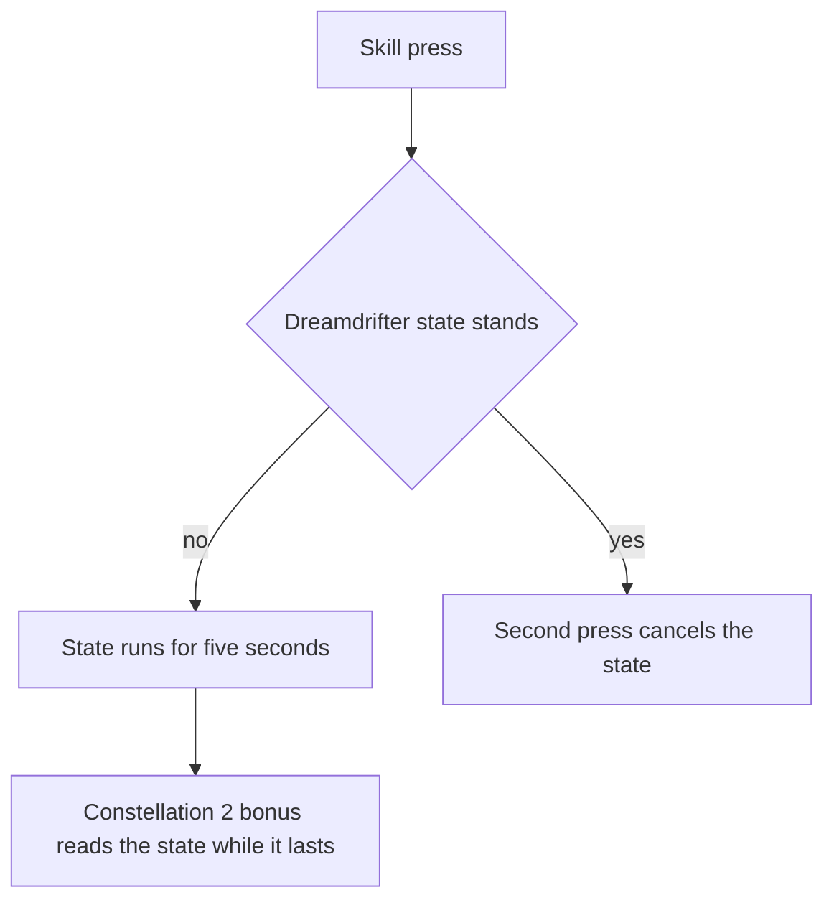

# Yumemizuki Mizuki

Mizuki's kit is its record and one behaviour module, `createMizukiKitBehaviour`, on avatar 10000109 (`packages/genshin-world/src/services/kit/characters/mizukiKit.ts`): three strikes, a charged attack, two plunges and the collision between them, her skill's activation hit and her burst's. Her multipliers are read from proud skill groups 10931, 10932 and 10939 (`{data-root}/genshin-dump-backup-6.6/ExcelBinOutput/ProudSkillExcelConfigData.json`), matching gcsim's to four decimal places at talent level 1, the only level opened so far (see Open). The skill's cooldown is 15 seconds, the burst's 15 seconds and 60 energy, and the charged attack takes 50 stamina.

## Decisions

- **Her strikes are circles of 0.7 metres centred on the primary target, landing ten frames past their hitmarks.** gcsim queues each strike's damage with a travel of 10 frames, its default, so the strikes land at 17, 29 and 47 frames in animations of 34, 38 and 98 frames (`{data-root}/cache/gcsim-v2.47.2/internal/characters/mizuki/attack.go` lines 16, 24, 32, 41, 52 to 56 and 73 to 79). Each is Anemo at one unit of gauge, with the wiki's poise, 9.802, 8.796 and 13.382 (`{data-root}/cache/genshin-wiki/Category_Yumemizuki_Mizuki_Talents.json`, rows 1 to 3), as gcsim gives none. (`packages/genshin-world/src/services/kit/characters/mizukiKit.ts`)
- **Her charged attack is a circle of 8.5 metres centred on the primary target at 39 frames, in an animation of 81.** gcsim gives its circle 3.5 metres round the primary target (`{data-root}/cache/gcsim-v2.47.2/internal/characters/mizuki/charge.go` lines 15, 18 and 50), and a reach on a target is the strike zone's 5 metres plus that, as [combat](../../combat/design.md) reaches an enemy within the hit's radius plus the capsule's (the framework's rule, not checked here). gcsim delays it 14 frames when it is cast out of the air (`{data-root}/cache/gcsim-v2.47.2/internal/characters/mizuki/charge.go` line 45), a windup the kit does not hold: a kit's action has no hook that times it by the state it starts from, so the kit times it from idle, as gcsim does. (`packages/genshin-world/src/services/kit/characters/mizukiKit.ts`)
- **Her skill's activation hit is a circle of 5.5 metres round the body at 2 frames, with 30 poise, in an animation of 50 frames.** It is Anemo at one unit of gauge (`{data-root}/cache/gcsim-v2.47.2/internal/characters/mizuki/skill.go` lines 19, 21, 23, 43 and 83 to 97; its 30 poise is `PoiseDMG` at line 82, from the constant at line 22). (`packages/genshin-world/src/services/kit/characters/mizukiKit.ts`)
- **Her burst's hit is a circle of 8 metres centred on the primary target at 93 frames, with 100 poise, in an animation of 94 frames.** It is Anemo at two units of gauge, as gcsim's 50 durability gives it (`{data-root}/cache/gcsim-v2.47.2/internal/characters/mizuki/burst.go` lines 17, 18, 24, 31 and 58); its 100 poise is `PoiseDMG` at line 53, from the constant at line 19. (`packages/genshin-world/src/services/kit/characters/mizukiKit.ts`)
- **Her skill's press enters the Dreamdrifter state for five seconds, and a press in it cancels the state.** gcsim gives the state its five-second duration (`{data-root}/cache/gcsim-v2.47.2/internal/characters/mizuki/skill.go` lines 37 and 124, `dreamDrifterBaseDuration`) and cancels it on a second press (`Skill`). The state is the kit's status, so it ends on its timer or the press. (`packages/genshin-world/src/services/kit/characters/mizukiKit.ts`)
- **Constellation 2's party bonus is a DMG Bonus on each other member's Pyro, Hydro, Cryo or Electro strike, 0.04% for each point of her Elemental Mastery, while the state lasts.** gcsim (MIT) gives it in `{data-root}/cache/gcsim-v2.47.2/internal/characters/mizuki/cons.go` (`c2EMMultiplier` 0.0004 on line 22, refreshed every half second on line 23); the kit reads her Elemental Mastery as each strike is priced, and the strike's element as its striker's, through `getKitHitElement`. (`packages/genshin-world/src/services/kit/characters/mizukiKit.ts`)
- **Her plunges are provisional.** Mizuki has no plunge in gcsim, so her collision, low and high plunge take Bennett's timings and reaches, with the wiki's poise: 5 for the collision, 100 high and 50 low. Her record, `packages/genshin-world/src/data/kits/yumemizuki-mizuki.json`, carries only that poise and no plunge frames or reaches, so the timings are the design's until the record takes them. The [roadmap](../../../../changes/genshin-roadmap/tasks.md) asks whether a recording of her plunges agrees. (`packages/genshin-world/src/services/kit/characters/mizukiKit.ts`)

## Not built

- **The snack pick-ups wait on the kit leaving them.** Her burst leaves a snack every 90 frames for 12 seconds (`{data-root}/cache/gcsim-v2.47.2/internal/characters/mizuki/burst.go` lines 20, 25 and 100), each a gadget that explodes on its own or when a member collects it, healing that member by a share of Elemental Mastery and flat HP. A snack is a `KitPickUp`, its explosion on running out an answer to its `EffectExpired` and its pickup's heal or Munen Shockwave its `onPickedUp`, so the heal, the shockwave and Constellation 4, which reads the snacks, wait only on her kit. The larger reach gcsim gives her pickups in the Dreamdrifter state (`{data-root}/cache/gcsim-v2.47.2/internal/characters/mizuki/snack.go:76`) is not a radius a pick-up holds, so it waits on the state as well.
- **Ascension 1 (Swirl extends the Dreamdrifter), Ascension 4 (the party's hits while she drifts) and Constellations 1 and 6 are not built.** The state is built; the Swirl buff it gives the party is not, and each of them reads the state or that Swirl. Constellation 4 waits on her kit leaving the snacks as well.
- **The charged attack's windup waits on a hook that times an action by the state it starts from**, the 14 frames gcsim gives it when it is cast out of the air (`{data-root}/cache/gcsim-v2.47.2/internal/characters/mizuki/charge.go` line 45), as above.

## Key files

| File                                                              | Role                                                                                                                                                                                                                                           |
| :---------------------------------------------------------------- | :--------------------------------------------------------------------------------------------------------------------------------------------------------------------------------------------------------------------------------------------- |
| `packages/genshin-world/src/services/kit/characters/mizukiKit.ts` | `createMizukiKitBehaviour`, Mizuki's three strikes and charged attack, provisional plunges, the activation hit of her skill and her burst's hit, and the Dreamdrifter state its press enters with its clouds, the snacks waiting on their hook |

## Sources

- [gcsim skill.go](https://github.com/genshinsim/gcsim/tree/v2.47.2/internal/characters/mizuki), MIT: the Dreamdrifter state's five-second duration and its cancel on a second press.
- [gcsim](https://github.com/genshinsim/gcsim/tree/v2.47.2/internal/characters/mizuki), MIT: each strike's hitmark, animation and travel, the charged attack's hit, animation and windup, the skill's activation, poise, animation and cooldown delay, and the burst's hit, poise, animation and cooldown, read from its attack, charge, skill and burst files.
- The proud skill groups' indices, read from gcsim's data file for the character, which lists each multiplier beside its group. Checked against the game data at every talent level: gcsim's multiplier blocks match their groups 10931, 10932 and 10939 exactly, save the Swirl and Stellar Swirl blocks below (groups from skill rows 11091, 11092 and 11095 in `{data-root}/genshin-parity/text/ExcelBinOutput/AvatarSkillExcelConfigData.json`, the skill's cooldown of 15 seconds on row 11092, and the burst's cooldown of 15 seconds and 60 energy on row 11095). The Swirl block matches at 100 times the dump's per-point value, as gcsim states it per 100 points of Elemental Mastery (`{data-root}/cache/gcsim-v2.47.2/internal/characters/mizuki/skill.go` line 154). The Stellar Swirl block matches no proud group, so it stays open below.
- The cached wiki, `{data-root}/cache/genshin-wiki/Category_Yumemizuki_Mizuki_Talents.json`: the strikes' poise rows 1 to 3, the charged attack's stamina of 50, and the collision and plunge poise rows (5, 50 and 100).
- [Pure Heart, Pure Dreams](https://genshin-impact.fandom.com/wiki/Pure_Heart,_Pure_Dreams), Genshin Impact Wiki: the poise for her strikes, charged attack, collision and plunges.

## Open

- [ ] **the Stellar Swirl block matches a proud group to four decimal places at every talent level** — no source yet: the proud group that holds its values; gcsim's `{data-root}/cache/gcsim-v2.47.2/internal/characters/mizuki/skill.go` line 157 and `{data-root}/genshin-dump-backup-6.6/ExcelBinOutput/ProudSkillExcelConfigData.json` disagree.
