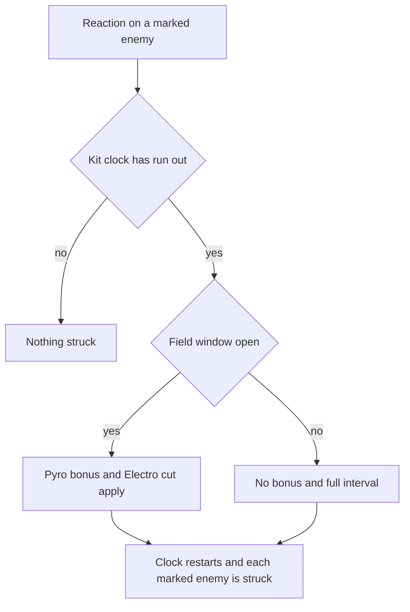

# Nahida

Nahida's kit is its record and one behaviour module, `createNahidaKitBehaviour`, on avatar 10000073 (see [Gorou's kit](../gorou/design.md) for the avatar table): four strikes (`{data-root}/cache/gcsim-v2.47.2/internal/characters/nahida/attack.go` line 14), a charged attack, a collision and two plunges (`{data-root}/cache/genshin-wiki/Category_Nahida_Talents.json`), and All Schemes to Know with its press and its full hold, which strike the enemies within their reach as Dendro and mark each enemy they strike with Seeds of Skandha. A reaction on a marked enemy sets off Tri-Karma Purification, which strikes every marked enemy. Illusory Heart's field is cast by her burst: its Pyro count gives Tri-Karma a damage bonus while the field holds her, its Electro count cuts Tri-Karma's interval, and its Hydro count extends the field. Her multipliers are read from proud skill groups 7331 (the charged attack), 7332 (the skill, and Tri-Karma's ATK and Elemental Mastery multipliers among its indices) and 7339 (the burst, and the Pyro, Electro and Hydro rows of Illusory Heart among its indices); the charged attack's stamina, the skill's cooldowns, and the burst's cooldown and energy cost are read from the same groups (`packages/genshin-world/src/services/kit/characters/nahidaKit.ts`, `{data-root}/genshin-parity/text/ExcelBinOutput/ProudSkillExcelConfigData.json`). Her hold is gcsim's full hold of 300 frames (`{data-root}/cache/gcsim-v2.47.2/internal/characters/nahida/skill.go`'s `skillHold` clamps the hold to between 1 and 300 frames), and a shorter hold has no level of its own, so its release plays the press here; gcsim takes any hold length, so that rule is the kit's own (see Provisional constants). Her Ascension passives (Illusory Heart's Elemental Mastery buff and the Tri-Karma bonus from Elemental Mastery beyond 200) and Constellation 2's CRIT on the reactions of a marked enemy are not built. Bennett's timings are borrowed for the plunges, and their poise is the wiki's.

## Decisions

- **Seeds of Skandha is an enemy status, one per enemy, keyed by its id `nahida-seeds-of-skandha`.** It lasts 25 seconds (1500 frames, `{data-root}/cache/gcsim-v2.47.2/internal/characters/nahida/skill.go`'s "skillMarkTargets"), and a new mark restarts it, as gcsim's status refresh does. Each enemy carries at most one of her marks, so there is no source field to key on: the id names her skill (`packages/genshin-world/src/services/kit/characters/nahidaKit.ts`). Tri-Karma's targets are the enemies that carry the status.
- **The mark cap of eight is per cast, counted on a status of Nahida's.** gcsim resets its count at each cast of All Schemes to Know (`{data-root}/cache/gcsim-v2.47.2/internal/characters/nahida/skill.go` line 50) and counts every enemy the cast strikes, including one already marked (lines 137 to 142), so a cast refreshes marks until it has marked eight. Here a status of hers, `nahida-seeds-of-skandha-marks`, carries the count as stacks, restarted by each cast; the press and the full hold's strikes add to it through `onStrike`, which runs for each enemy a hit strikes.
- **Tri-Karma fires from a reaction on a marked enemy, from any character on the team.** It reads `ReactionTriggered`, as gcsim subscribes to every reaction event of the enemy, shatter included (`{data-root}/cache/gcsim-v2.47.2/internal/characters/nahida/nahida.go` lines 47 to 49). `emitKitEvent` reaches the kit of every deployed character, on the field or off it, so the trigger does not wait on Nahida being active. A reaction on an enemy with no mark does nothing.
- **One kit clock gates Tri-Karma, a status of hers of 2.5 seconds cut by the Electro count.** The clock is a status, restarted at each trigger that passes the gate, so a reaction within the interval strikes nothing. gcsim recomputes the interval once a second (`{data-root}/cache/gcsim-v2.47.2/internal/characters/nahida/skill.go` lines 145 to 154, which also starts the status at line 191); here it is read at each trigger, so only a trigger in the first second after the field's window opens or closes can take the other interval.
- **Tri-Karma strikes every marked enemy at once, through `queueKitPassiveHit` with each enemy as its target.** The hit is Nahida's own record hit, Dendro, at the skill's ATK multiplier, with `additiveBaseDamageBonus` set to Elemental Mastery times the skill's Elemental Mastery multiplier (gcsim's `{data-root}/cache/gcsim-v2.47.2/internal/characters/nahida/skill.go` lines 186 to 215: the ATK multiplier "triKarmaAtk", index 2 of group 7332, and the Elemental Mastery multiplier "triKarmaEM", index 3). That term reuses `elementalMasteryMultiplier`, which Alhaitham's kit already uses for the same flat-damage shape, and lives in a shared module so the two kits do not carry twins.
- **The Pyro bonus is the Tri-Karma hit's `damageBonus`, set at each trigger.** It applies when the field's window is open and the Pyro count is at least one. gcsim applies it as an attack modifier that lasts a second from each in-field tick (`{data-root}/cache/gcsim-v2.47.2/internal/characters/nahida/burst.go` lines 51 to 58, "NewBaseWithHitlag(burstKey, 60)"); the window here is the same second.
- **The first Tri-Karma strike of a trigger gives three Dendro particles, once every 7 seconds.** This follows gcsim's particle callback on the first target (`{data-root}/cache/gcsim-v2.47.2/internal/characters/nahida/skill.go` lines 121 to 129, three particles on a seven-second status). The strike's 3-frame queue delay is not kept: a passive hit lands in the step it is raised, as `queueKitPassiveHit` documents.
- **Illusory Heart's field is cast by the burst at the burst's own timing.** The field has a radius of 20 metres, centred one metre ahead of the body (`{data-root}/cache/gcsim-v2.47.2/internal/characters/nahida/burst.go` line 32), and lasts 15 seconds plus the Hydro count's extension (lines 25 to 29). The field starts 66 frames after the cast (line 72), and its first tick comes 30 frames later, at 96 frames, then every 30 frames as gcsim's tick loop runs it (`{data-root}/cache/gcsim-v2.47.2/internal/characters/nahida/burst.go` line 39). A tick the body stands inside opens a one-second window, which is when Tri-Karma takes the Pyro bonus and the Electro cut.
- **Element counts are read from the deployed team at each use, clamped to two.** gcsim counts them once at init (`{data-root}/cache/gcsim-v2.47.2/internal/characters/nahida/nahida.go` lines 53 to 62), which matches a team that does not change in a run; the count is at most two (the clamp at lines 70 to 77), so a third member of an element does not raise it.
- **Constellation 1's Shrine tally adds one to each of the Pyro, Hydro and Electro counts before the clamp**, as gcsim's `{data-root}/cache/gcsim-v2.47.2/internal/characters/nahida/cons.go` `c1` does (`{data-root}/cache/gcsim-v2.47.2/internal/characters/nahida/nahida.go` lines 65 and 66, ahead of the clamp), so with no character of an element on the team its count is still one, and the first row of its table applies. The Hydro count's extension therefore applies with no Hydro character when Nahida has Constellation 1.
- **Constellation 2's defence reduction and Lunar-Bloom CRIT are built; its reaction CRIT is not.** The defence reduction is an enemy status with `defenseReduction` 0.3 for eight seconds, added on each Quicken, Aggravate or Spread that lands on an enemy she has marked, as gcsim's "OnQuicken", "OnAggravate" and "OnSpread" callbacks do (`{data-root}/cache/gcsim-v2.47.2/internal/characters/nahida/cons.go` lines 56 to 71). The Lunar-Bloom CRIT is a party strike bonus on another member's direct Lunar-Bloom hit that lands on a marked enemy (`{data-root}/cache/gcsim-v2.47.2/internal/characters/nahida/cons.go` lines 73 to 78). (`{data-root}/cache/gcsim-v2.47.2/internal/characters/nahida/nahida.go` line 96 gates the whole of Constellation 2 at two.) Its reaction CRIT is not built: gcsim adds 20% to the CRIT Rate, under a TODO asking whether that is right, and sets CRIT DMG to 100% outright (`{data-root}/cache/gcsim-v2.47.2/internal/characters/nahida/cons.go` lines 43 to 45), which a hook that only adds cannot express.
- **Constellation 4 counts the marked enemies within 30 metres each step.** (`{data-root}/cache/gcsim-v2.47.2/internal/characters/nahida/nahida.go` line 91 gates it at Constellation 4.) `onStep` counts them with `checkIsInAttackArea` on a full circle of 30 metres, and keeps the count as the stacks of a status of hers that does not expire. `getPassiveBonuses` reads it as Elemental Mastery: 80 plus 20 for each enemy up to four, and nothing for none (`{data-root}/cache/gcsim-v2.47.2/internal/characters/nahida/cons.go` lines 102 to 115: the 30-metre circle at line 105, `min(len, 4)`, and `80 + count*20`). A passive hook gets no enemies, so the count is read each step, where gcsim reads it as the stat is priced.
- **Karmic Oblivion queues from a normal or charged attack's hit on a marked enemy, on every marked enemy.** Those hits carry an `onStrike`, which queues `karmicOblivionHit`: Tri-Karma's own record hit at 200% of ATK, with Elemental Mastery times 4, dealt as Elemental Skill DMG (`{data-root}/cache/gcsim-v2.47.2/internal/characters/nahida/cons.go` lines 128 and 168). The ten seconds start with the burst (the 600-frame status in `{data-root}/cache/gcsim-v2.47.2/internal/characters/nahida/burst.go`), the six instances are the status's count (`{data-root}/cache/gcsim-v2.47.2/internal/characters/nahida/cons.go` line 145), and the 0.2-second gate is its own status (line 154). `queueSeedsHit` is the loop Tri-Karma and Karmic Oblivion share.
- **Plunges keep Bennett's timings and take the wiki's poise.** No plunge file exists in her gcsim folder, so the record takes Bennett's timings for the collision, low and high plunge (frames 36 and 38 for the low and high hits), the wiki's poise of 5 for the collision, and the wiki's 50 and 100 for the low and high plunges (`{data-root}/cache/gcsim-v2.47.2/internal/characters/bennett/plunge.go` lines 21 to 23 for the timings; `{data-root}/cache/genshin-wiki/Category_Nahida_Talents.json`, poise rows 6 to 8), under her own multipliers. The record has no plunge keys (see Provisional constants). A different animation of hers would move them.

## Provisional constants

- **The short hold's press rests on an `Unsourced` threshold.** `packages/genshin-world/src/data/kits/nahida.json` marks `skillHolds.0.minimumHeldSeconds` (5) `Unsourced`. gcsim takes any hold length (`{data-root}/cache/gcsim-v2.47.2/internal/characters/nahida/skill.go` line 51 sends any non-zero hold to the hold path), so a hold under the full hold has no gcsim value to play the press from. Open until the game's rule or a recording settles it.
- **The full hold's strike is gcsim's, and its cause should say so.** `skillHolds.0.action.hits.0.hitmarkFrames` (332) is `Unsourced`, though gcsim queues the strike at `hold+3+30` with the hold at 299 frames (`{data-root}/cache/gcsim-v2.47.2/internal/characters/nahida/skill.go` lines 98 to 111), which is 332.
- **The Illusory Heart and Tri-Karma rows are `Unsourced` though gcsim gives them.** The field's radius, first tick, interval and length, the Hydro extension and Electro cut and Pyro bonus rows, and Tri-Karma's Elemental Mastery at index 3 of group 7332 carry `Unsourced` in `packages/genshin-world/src/data/kits/nahida.json`; gcsim's `{data-root}/cache/gcsim-v2.47.2/internal/characters/nahida/burst.go` lines and the `{data-root}/cache/gcsim-v2.47.2/internal/characters/nahida/zz_nahida.dm.go` comments (`{0}` to `{5}`, `{2}` and `{3}`) name them. The causes should name gcsim.
- **The plunges have no record keys.** `packages/genshin-world/src/data/kits/nahida.json` has no plunge keys, so Bennett's timings and the wiki's poise are the design's until the record takes them.

## Key files

| File                                                                   | Role                                                                                                                                                           |
| :--------------------------------------------------------------------- | :------------------------------------------------------------------------------------------------------------------------------------------------------------- |
| `packages/genshin-world/src/services/kit/characters/nahidaKit.ts`      | `createNahidaKitBehaviour`, Nahida's kit: her strikes, charged attack, plunges, All Schemes to Know's marks, Tri-Karma Purification and Illusory Heart's field |
| `packages/genshin-world/src/services/kit/characters/nahidaKit.test.ts` | Nahida's record reads, marks, Tri-Karma's triggers, interval, bonuses and field                                                                                |
| `packages/genshin-world/src/services/kit/characters/alhaithamKit.ts`   | Imports the shared Elemental Mastery multiplier                                                                                                                |
| `scripts/src/services/genshinAssets/kits/`                             | Nahida's gcsim tables for the record: Tri-Karma's hit and parameters, the burst's per-count rows, and the field's area and timing                              |

## Sources

- [gcsim](https://github.com/genshinsim/gcsim/tree/v2.47.2/internal/characters/nahida), MIT: Nahida's strikes' hitmarks, cancel frames and boxes, the charged attack's box and frames, All Schemes to Know's press and hold frames, reaches and cooldowns; the mark's status and cap, Tri-Karma's interval and trigger, Illusory Heart's field and ticks, and the tables Tri-Karma and Illusory Heart read ([zz_nahida.dm.go](https://github.com/genshinsim/gcsim/blob/v2.47.2/internal/characters/nahida/zz_nahida.dm.go): triKarmaAtk, triKarmaEM, burstTriKarmaDmgBonus, burstTriKarmaCDReduction, burstTriKarmaDurationExtend).
- [gcsim](https://github.com/genshinsim/gcsim/blob/v2.47.2/internal/characters/bennett/plunge.go), MIT: the plunges' timings, borrowed as Nahida's own folder has none.
- The game data, `{data-root}/genshin-parity/text/ExcelBinOutput/`: groups 7331, 7332 and 7339 (skill rows 10731, 10732 and 10735), with the press's 5-second cooldown on row 10732 and the burst's 13.5 seconds and 50 energy on row 10735.- The cached wiki, `{data-root}/cache/genshin-wiki/Category_Nahida_Talents.json`: the poise rows 1 to 8, the charged attack's 80, the collision's 5, and the low and high plunges' 50 and 100.
