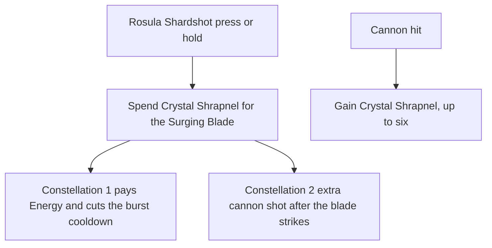

# Navia

Navia's kit is its record and one behaviour module, `createNaviaKitBehaviour`, on avatar 10000091 (`{data-root}/genshin-dump-backup-6.6/ExcelBinOutput/AvatarExcelConfigData.json`, named Navia in `{data-root}/genshin-dump-backup-6.6/TextMap/TextMap_MediumEN.json`): four strikes, a charged attack, a collision and two plunges, Rosula Shardshot with its press and hold and the Surging Blade each shot fires, and As the Sunlit Sky's Singing Salute with its blast and its cannon's ticks (`{data-root}/cache/genshin-wiki/Category_Navia_Talents.json`). Her multipliers are read from proud skill groups 9131, 9132 and 9139 (`{data-root}/genshin-dump-backup-6.6/ExcelBinOutput/ProudSkillExcelConfigData.json`), except the hold's pellet hit and cannon hits one to sixteen, which carry level-one literals and are open below; her skill's cooldown and the burst's cooldown and energy cost are read from the same groups, and her two skill charges are a literal, as gcsim sets them (`navia.go:27`). Crystal Shrapnel is gained from the blast's and the cannon's hits, up to six, once each 2.4 seconds (`burst.go:54`, `:79`, `:104-116`; proud group 9139 index 5), and spent by each shot (the wiki's Ceremonial Crystalshot page, `{data-root}/cache/genshin-wiki/Category_Navia_Talents.json`, gives the stack limit of six; group 9139 index 5 is the 2.4 seconds, `{data-root}/genshin-dump-backup-6.6/ExcelBinOutput/ProudSkillExcelConfigData.json`). From Ascension 1, Undisclosed Distribution Channels puts a Geo infusion on her for four seconds as each shot fires, whose hits carry 40% DMG Bonus (the dump's `Navia_PermanentSkill_1` row, proud group 9121, gives 0.4 and 4 in `{data-root}/genshin-dump-backup-6.6/ExcelBinOutput/ProudSkillExcelConfigData.json`; `asc.go:16-41`), so her normal attacks, charged attack and plunges deal Geo and more of it; an infusion cast on her earlier is still the one her attacks take, where the game lets no other infusion override hers. Constellation 4 is built (`cons.go:72-85`), and Constellation 6 keeps the Shrapnel past three (`skill.go:201-205`). The charged attack has no source in gcsim, which gives Navia four strikes and no charge (`attack.go`), so its hits, reach and length are provisional; the wiki's Blunt Refusal page gives its cyclic and final hits at the multipliers of proud group 9131's indices 4 and 5, but no timing or reach. The shot prices five pellets landing on the target, the count with no Crystal Shrapnel (`skill.go:164`), and each cannon tick strikes every enemy within 13 metres of her, where gcsim aims each tick at one random enemy within 10 metres (`burst.go:121-132`, open below).

## Not yet built

- **Crystal Shrapnel from the party's Crystallize shards and Lunar-Crystallize.** Navia gains a Shrapnel when a party member obtains a shard or triggers Lunar-Crystallize. A shard's pickup is a `CrystallizeShardPickedUp` event and a Lunar-Crystallize is a reaction among a `ReactionTriggered`'s, the two gcsim gains a Shrapnel on (`{data-root}/cache/gcsim-v2.47.2/internal/characters/navia/skill.go:263`, `:276`), so it waits only on the kit answering them.
- **Pulling shards to her during a hold.** gcsim draws each shard within 12 metres into Navia while the hold charges (`skill.go:132-137`, `:339-369`). Waits on a pickup that moves the shards toward the body, as `pickUpCrystallizeShards` reads a fixed reach round the body.
- **The Shrapnel's DMG, extra pellets and CRIT past three stacks.** A shot's damage per stack past three, its pellets past three and its CRIT are not priced, where gcsim adds 15% DMG per stack past three and two pellets per stack up to three (`skill.go:240-242`, `:164`). Waits on a hit whose talent multiplier and DMG bonus read the team's effects as it prices, since a hit's `talentMultiplier` and `damageBonus` are static numbers and a variant exists only for a burst and a hold.
- **Constellation 6's CRIT DMG.** Waits on a per-hit CRIT DMG on a `KitHit`, where gcsim adds 45% CRIT DMG per stack past three (`skill.go:248-249`).
- **The shot's Geo particles.** A hit has no output of particles to the party, where gcsim queues three or four Geo particles, four half the time (`skill.go:218-234`). Waits on a hit that grants particles.
- **The Surging Blade's place.** gcsim drops it on the enemy in the shot's cone when one stands there (`skill.go:313-318`), and 3.6 metres ahead of Navia otherwise. The kit has the blade 3.6 metres ahead always, as a step has no enemy's position to read. Waits on a summon placed on an enemy the shot struck.
- **The charged attack's timing and reach.** gcsim models no charged attack for Navia, and the wiki's Blunt Refusal page gives cyclic spin hits and a final slash, over a maximum of 5 seconds, with no timing or reach. The two hits at half a second and a second, and their 2.5-metre circle, stay Razor's until a source or a recording gives them.
- **Cannon ticks reach every enemy within 13 metres.** gcsim aims each tick at one random enemy within 10 metres of Navia and strikes a 3-metre circle about a point up to 1.2 metres from it (`burst.go:121-145`, `:74-78`). The kit's 13-metre circle has no gcsim source for its reach and waits on a recording that shows the reach of a tick.
- **Constellation 2 fires on the blade's strike, not the shot's.** gcsim fires it on each shot's own pellet hit, once per use (`skill.go:185-192`, `cons.go:30-33`). The kit's `skill` entry is `onStart` only, so the first enemy the blade strikes stands in for the shot's hit until a pellet hit can carry the trigger.
- **The hold's blade lands at a fixed 104 frames.** gcsim fires a hold 40 frames plus its held frames in, and its blade 64 frames after that (`skill.go:57-58`, `:128`, `:322-334`), so the record's 104 frames holds only for a hold with no held frames added.
- **Two multipliers are level-one literals.** The hold's pellet hit (4.7376, which is 3.948 times 1.2) and cannon hits one to sixteen (0.4315) are fixed in `navia.json` at their talent level 1 values of proud groups 9132 and 9139, where gcsim reads them by talent level. At talent level 10 they are 8.5277 and 0.7767.

## Decisions

- **Constellation 1 pays from `castShot`, on a press and a hold alike.** gcsim's `Skill` fires `c1` on both (`skill.go:194-198`), from the Shrapnel the shot clears, so the shot reads the stacks it spends, pays up to three of them through `gainPartyMemberEnergy`, and cuts the party member's `burstCooldownSeconds`. gcsim's `c1` pays three Energy and one second for each of up to three (`cons.go:19-26`). Both exist on the framework, so the pay is built here rather than waiting on an engine step.
- **Constellation 2 is built on each press's and hold's blade.** The blade's hit takes a CRIT Rate of 12% for each Shrapnel the shot consumes, three at most (`skill.go:245-247`), and the first enemy the blade strikes is struck once more by a cannon shot 30 frames later, the blade's one extra shot per use (`cons.go:34-66`; gcsim fires it on the shot's own hit, open below). The shot is a cannon hit of the burst's, so it gains Crystal Shrapnel and applies Constellation 4's Geo RES cut as a cannon hit does (`cons.go:59-66`). gcsim draws the point the shot lands round uniformly over the disk of 1.2 metres about the enemy (`cons.go:61`, `{data-root}/cache/gcsim-v2.47.2/pkg/core/info/shape.go:48-60`), and the kit draws it the same way from the world's random source: a bearing, then a distance. The two `hits.surgingBlades` are the press's blade and the hold's, where gcsim's one `surgingBlade` serves both shots, and their hitmarks run from the action's start: gcsim's 64 frames run from each shot's firing (`skill.go:322-334`), which it sets 11 frames into a press (`skill.go:55`, `:113`) and 40 frames plus the hold's held frames into a hold (`skill.go:57-58`, `:128`); the hold's fixed 104 frames is open below.
- **Crystal Shrapnel is a status on Navia that her burst's hits gain and her shot spends.** The cannon's ticks are one summon with every shot placed at its tick, since the framework's field ticks on one fixed interval and gcsim's ticks alternate between 42 and 48 frames. Each shot consumes the Shrapnel at its start, as gcsim spends it at the shot's firing (`skill.go:200-205`, 11 frames into a press). The first shot lands at 163 frames, the burst's 154 and the tick's 9 (`burst.go:19`, `:78`), and the later shots follow gcsim's steps from it, 42 frames apart with 48 after the second, fifth, eighth and so on tick (`burst.go:68-88`). gcsim's loop runs seventeen ticks to frame 720 (`burst.go:18`), so the record has seventeen cannon shots: the first from gcsim's 163, the call landing there, and the later ones held `Unsourced` at gcsim's frames.
- **The Crystal Shrapnel lasts the 300 seconds the skill table gives** (proud group 9132 index 2, `{data-root}/genshin-dump-backup-6.6/ExcelBinOutput/ProudSkillExcelConfigData.json`; the wiki's Ceremonial Crystalshot page, `{data-root}/cache/genshin-wiki/Category_Navia_Talents.json`), **and a gain restarts it** (the wiki's wording, the same file: "the duration of the Crystal Shrapnel stacks you already have will be reset").
- **Navia's charged attack is provisional.** gcsim gives her none, so the record takes Razor's charge timing: two hits at half a second and a second with the table's index 4 and 5, ending at 1.2 seconds, in a circle of 2.5 metres round her, her first strike's reach. A recording's hitmarks, length or reach would replace them.

- **Ascension 4 reads the deployed team's built combatants as the passive's third argument.** `getPassiveBonuses` receives the combatants of the deployed members, from `getDeployedCombatants`, and Navia counts the Pyro, Electro, Cryo and Hydro among them, two at most, at 20% ATK each. gcsim v2.47.2 counts them once at init (`navia.go:33-34`, `asc.go:46-70`) and this counts them each time the attack is priced, which agree while the deployed team is fixed.

## Key files

| File                                                             | Role                                                                                                                                                                                                                   |
| :--------------------------------------------------------------- | :--------------------------------------------------------------------------------------------------------------------------------------------------------------------------------------------------------------------- |
| `packages/genshin-world/src/services/kit/characters/naviaKit.ts` | `createNaviaKitBehaviour`, Navia's kit with her strikes, charged attack and plunges, Rosula Shardshot's press and hold with Surging Blade, and As the Sunlit Sky's Singing Salute with its cannon and Crystal Shrapnel |

## Sources

- [gcsim](https://github.com/genshinsim/gcsim/tree/v2.47.2/internal/characters/navia), MIT: the kit's hitmarks, cancel frames and reaches, the plunges' frames, reaches and poise, Rosula Shardshot's frames, pellet reach, travel delay, press and hold firing, the Surging Blade's timing and ICD, As the Sunlit Sky's Singing Salute's frames, blast, cannon spacing and Crystal Shrapnel gain, and Constellation 4 and 6.
- The proud skill groups 9121, 9131, 9132 and 9139 in the hosted game data: each multiplier's index, the cooldowns, the energy cost, and the Crystal Shrapnel's duration and gain cooldown, read at talent levels 1 and 10.
- The cached Genshin wiki's `{data-root}/cache/genshin-wiki/Category_Navia_Talents.json` (the Blunt Refusal and Ceremonial Crystalshot pages): the charged attack's cyclic and final hits, and the Shrapnel's 300-second duration and refresh.
- No YouTube or Bilibili reference snapshot for Navia is in the repo, so no claim here rests on video.

## Open

- [ ] **A hold with no held frames added fires its blade 104 frames in** — contradiction: the Not yet built bullet (line 16) and the Decisions bullet (line 30) give a hold's firing as 40 frames plus its held frames, while gcsim's `{data-root}/cache/gcsim-v2.47.2/internal/characters/navia/skill.go` line 57 sets `skillHoldCDStart` to 41, and line 128 fires at that constant plus the held frames less one (line 126). The activation value of 1 (line 58) therefore fires at 41, and its blade, queued 28 and then 36 frames later (lines 322 to 334), lands at 105, one frame after the record's 104.
- [ ] **A Crystallize shard's Crystal Shrapnel gain is a `CrystallizeShardPickedUp` event** — contradiction: the Not yet built bullet (line 7) names a shard's pickup as that event and cites `{data-root}/cache/gcsim-v2.47.2/internal/characters/navia/skill.go` line 276, but line 276 subscribes to `event.OnShielded` and returns unless the shield is a `shield.Crystallize` (line 279); the Lunar-Crystallize subscription the same bullet cites at line 263 is `event.OnLunarCrystallize`.
- [ ] **An infusion cast on her earlier is still the one her attacks take** — no source yet: gcsim's `{data-root}/cache/gcsim-v2.47.2/internal/characters/navia/asc.go` lines 16 to 19 say the Geo conversion "cannot be overridden by other Elemental infusions", which does not say what an infusion cast before hers does; a recording of the game's infusion order, or a source that states it, would settle it.
- [ ] **The charged attack's two hits at half a second and a second, ending at 1.2 seconds, are Razor's charge timing** — no source yet: Razor's record (`packages/genshin-world/src/data/kits/razor.json` lines 2 to 4 and 8 to 10) gives the two hits' areas and no timing, and the timing in Razor's kit was not read; the record's 2.5-metre reach is its own (`packages/genshin-world/src/data/kits/navia.json` lines 8 to 10 and 13 to 15).
