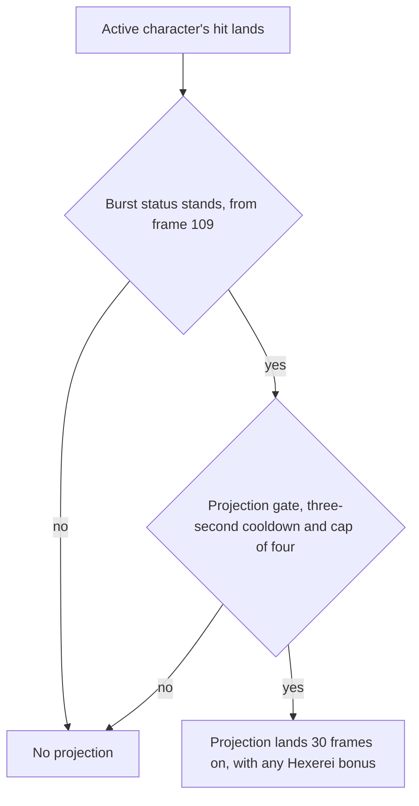

# Nicole

Nicole's kit is its record and one behaviour module, `createNicoleKitBehaviour`, avatar 10000131 (`{data-root}/genshin-dump-backup-6.6/ExcelBinOutput/AvatarExcelConfigData.json`): her three strikes, the charged attack, the collision, the two plunges, the skill's hit, shield and team buff, the burst's hit and its projections. Both her skill and her burst are Pyro.

Her cooldowns are 16 and 15 seconds, her energy cost 60 and her charged stamina 50, all read from the table (the skill's 16 seconds is group 13132's index 7, as `skill.go:78` sets it; the burst's 15 seconds is group 13139's index 4, `burst.go:106`, and its 60 energy index 5; the 50 stamina is group 13131's index 4), and her skill and burst take their talent multipliers from proud skill groups 13131, 13132 and 13139 (`{data-root}/genshin-dump-backup-6.6/ExcelBinOutput/ProudSkillExcelConfigData.json`).

gcsim sources: Nicole's attack, charge, skill and burst files, with the table data in gcsim's Nicole data file.

## Decisions

- **Her plunges borrow Bennett's plunge file, with the wiki's poise.** gcsim gives Nicole no plunge file (`nicole/` has no `plunge.go`), so her two plunges take Bennett's timings and reaches, and their poise is the wiki's 100 high and 50 low (Low Plunge 50 and High Plunge 100 on the Allegoria page of `{data-root}/cache/genshin-wiki/Category_Nicole_Talents.json`).
- **The burst's hit is her record's.** Her burst is a circle of 6.5 metres on her primary target (`burst.go:109`); the 21.5-metre area that would price it round the targeting zone is unsourced and open below.
- **The skill's hit is a circle of 5 metres round her body** (`skill.go:46`), recorded by hand, as its hitbox has no name in gcsim's press list, so it names no cause for it.
- **The skill's shield and team buff come on at frame 8, one frame before its hitmark (`skill.go` line 17, `skillHitmark` 9).** gcsim queues both on her task at `skillHitmark-1` (`skill.go:76`), so they land together, and a recast removes the buff it gave at cast, before its own snapshot, as gcsim deletes it there.
- **The shield is cast by Nicole and covers the team.** gcsim's shield is added to the player's shields, which is the whole team (`shield.go:27`), and a kit's shield carries its caster, which `castKitShield` takes as Nicole.
- **The buff reaches each deployed member, Nicole included.** gcsim applies it to every character in the party (`skill.go:65`), so it goes to each member `getDeployedCharacterIds` returns.
- **The burst starts its status one frame after its hit.** gcsim's task at `burstHitmark+1` starts `burstKey` and clears the projections (`burst.go:111-114`), so a hit before frame 109 projects nothing, and a recast removes the status it gave at cast (`burst.go:91`).
- **A projection copies each hit the active character lands, at its own element and hitbox.** It is dealt as the projected character's own element, reaches the enemies inside the projected character's hitbox anchored on the enemy the hit struck, and lands 30 frames after the hit (`burst.go:17`). The hitbox is gcsim's `projectionHitbox` table (`burst.go:42-86`), with the default circle for a character the table does not name (`burst.go:85-86`).
- **A projection reaches by its hitbox alone.** Its hit has no area of its own, since its target and its hitbox decide what it reaches.
- **The projections follow every hit of the active character, physical included.** gcsim's enemy-hit event fires for each hit on an enemy, and the kit raises its `EnemyHit` event for each one, carrying the element the hit was dealt as where it deals one. A physical hit projects too (`burst.go:140-152` filters by no element), dealt at the projected character's element.
- **The Hexerei bonus is priced at the projection's tick.** gcsim's `hexereiOnProjection` (`asc.go:111-123`) adds three times her attack when she and the projected character are Hexerei and two or more Hexerei are deployed. The set is the wiki's Hexerei Characters category (`packages/genshin-world/src/services/kit/countKitHexereiMembers.ts`), so the bonus follows it.
- **The ascension buff is an upgrade bounded by her skill's buff.** gcsim's a1UpgradeBuff (`asc.go:90`, called at `:85`) gives the character the upgrade for as long as the skill's buff on it stands at most, and a repeat upgrade replaces the mod with the same key, so `upgradeAscensionBuff` adds the new one over the old, which restarts it. Her skill's cast takes every upgrade off, as a1OnSkillRemoveBuff does (`asc.go:50-55`, called at `skill.go:54`).
- **A swap's upgrade is a pending field, so a later swap cancels it.** gcsim's `a1Src` token (`asc.go:34`, `:42`) makes a queued upgrade return when a newer swap has set it. The kit keeps the pending upgrade as a field with the id `nicole-a1-swap`, and a swap schedules its own under that id, which replaces the pending one. A Hexerei swapped in gets a task with no delay, as gcsim's `delay = 0` for char.IsHexerei does (`asc.go:36-38`).
- **A swap away takes the upgrade off the character it leaves before the sixth constellation.** gcsim's OnCharacterSwap subscriber deletes `a1Key` on the character it leaves, when that is not Nicole, only while "c6DeleteA1OnSwap" holds, which is `Cons < 6` (`asc.go:24-29`, `cons.go:235-236`).
- **The fourth ascension reads the element of the active character's hit.** gcsim's `a4Init` (`asc.go:60-85`, its element switch at `:72`) upgrades her own buff on each elemental hit by the active character. A physical hit carries no element in the kit, so it is excluded.
- **The first constellation projects from each hit of the active character, on a cooldown of its own.** gcsim's `c1Init` (`cons.go:22`, `:44`) takes any hit of the active character with no element filter, so a physical hit projects at the striker's element. Its six-second cooldown (`cons.go:42`) is Nicole's own (`nicole-c1-icd`), separate from the burst's three-second one, and it shares the burst's scheduling and Hexerei bonus, with multiplier six (`cons.go:55`) and a 4.5-metre circle about the enemy (`cons.go:59`) in place of the burst's own.
- **The second constellation's team buff is at the skill's snapshot, and its RES reduction is a ticker per upgraded character.** gcsim's c2OnSkillAddBuff (`cons.go:71`, `:84-88`) adds ATK 300 to every party member in the skill's queued task (`skill.go`, the same task as the skill's buff), and c2OnSkillRemoveBuff takes it off at cast. Its c2OnUpgrade starts `c2Ticker` on each A1 upgrade of a character that holds an A1 buff, every 0.3 seconds (`cons.go:135`): each enemy within 10 metres of the player (`cons.go:122`) takes a quarter off its RES (`cons.go:132`) for the character's element for one second (`cons.go:130`). The kit keeps one field per upgraded character (`nicole-c2-ticker|<id>`), which a newer upgrade of that character replaces, and each enemy's status has an id per element, so `addEnemyStatus` refreshes it.
- **The fourth constellation's stacks are a status on the striker, spent by the hits that land.** gcsim's `c4OnUpgrade` (`cons.go:193-195`) gives the upgraded character a 16-second cooldown, then a 20-second status with eight tags, and its `c4Init` (`cons.go:138`, `:149-155`) takes one tag on each `OnEnemyHit` whose attack tag is a burst, skill, normal, charged or plunging attack. The kit keeps the status with its stacks and takes one in its enemy-hit handler. The enemy-hit event carries the attack tag of the strike that landed it, so a projection, which has none, neither gets the bonus nor spends a stack.
- **The fourth constellation's flat damage is a striker-side hook, read by each strike.** The bonus is 0.7 of Nicole's attack (`cons.go:170`). Another member's strike takes it through her `getPartyStrikeBonus`, and her own strikes through `getStrikeAdditiveBaseDamageBonus`, which is a kit behaviour hook like the other strike hooks, and the passive modules and artifact sets feed it too. Each enemy struck prices with the stacks left after the enemy before it lands, as gcsim's `OnEnemyHit` does one hit at a time.
- **The sixth constellation's defence ignore is a striker-side hook, as the fourth's damage is.** gcsim's `c6Init` (`cons.go:209`) adds 0.4 to the hit's `IgnoreDefPercent` on each `OnEnemyHit` by a character holding the first ascension's mod. The kit reads the striker's upgrade: `getStrikeDefenceIgnored` for her own strikes and the deployed party hook's `defenseIgnored` for the team's. `strikeKitEnemies` sums both with the hit's own into the priced hit, and `strikeEnemy` hands it to `getDamage` as its `defenseIgnored`.
- **Her upgrades reach the team, and her own buff lasts the skill's time, from the sixth constellation.** gcsim's a1UpgradeBuff (`asc.go:90`) calls `c6OnUpgrade` (`cons.go:220`), which upgrades each other character with duration -1 when Nicole is the one upgraded, and `c6SelfBuffDur` (`cons.go:213-215`, which returns 8 seconds below six) gives her own fourth-ascension upgrade -1 too, so each lasts as long as the skill's buff on its character. The swap's removal of the buff already stops at the sixth, as c6DeleteA1OnSwap does.

## Constellation levels

Her third and fifth constellations raise her skill and burst levels from the constellation table, as [the constellations page](../../constellations/design.md) builds them.

## Not yet built

- **The burst's 21.5-metre area is unsourced.** gcsim's burst is a 6.5-metre circle on the primary target (`burst.go:109`). The 21.5 metres, the targeting zone's radius plus the circle's, is in neither the overlay nor the kit code, so its reach waits on the record that holds it being read.

## Key files

| File                                                              | Role                                                                                                                                                                                                 |
| :---------------------------------------------------------------- | :--------------------------------------------------------------------------------------------------------------------------------------------------------------------------------------------------- |
| `packages/genshin-world/src/services/kit/characters/nicoleKit.ts` | `createNicoleKitBehaviour`, Nicole's module: her skill's shield and team buff, her burst's projections, and her first and fourth ascension buffs, her first, second, fourth and sixth constellations |
| `packages/genshin-world/src/data/kits/nicole.json`                | Nicole's overlay: her skill's shield and buff parameters (talent table group 13132) and her projection multiplier (group 13139)                                                                      |

## Sources

- [gcsim](https://github.com/genshinsim/gcsim/tree/v2.47.2/internal/characters/nicole), MIT: the timings of her strikes, her charged attack, skill, burst and elements, and her table data file ("zz_nicole.dm.go", which holds the shield's 2.21184 and 1386.6697).
- The proud skill groups 13131, 13132 and 13139 in the hosted game data: the multipliers, the shield and buff parameters, the cooldowns, the burst's energy and the charged stamina, read at talent level 1.
- The cached Genshin wiki's "Category_Nicole_Talents.json" (the Allegoria page): the plunge poise rows, 50 low and 100 high.
- No YouTube or Bilibili reference snapshot for Nicole is in the repo, so no claim here rests on video.
- `{data-root}/cache/gcsim-v2.47.2/internal/characters/nicole/attack.go` line 17, grounding the requirement Nicole's three strikes.
- `{data-root}/cache/gcsim-v2.47.2/internal/characters/nicole/charge.go` line 47, grounding the requirement Nicole's charged attack and plunges.
- `{data-root}/cache/gcsim-v2.47.2/internal/characters/nicole/skill.go` line 46, grounding the requirement Nicole's Pyro skill.
- `{data-root}/cache/gcsim-v2.47.2/internal/characters/nicole/skill.go` line 78, grounding the requirement Nicole's Pyro skill.
- `{data-root}/cache/gcsim-v2.47.2/internal/characters/nicole/burst.go` line 109, grounding the requirement Nicole's Pyro burst.
- `{data-root}/cache/gcsim-v2.47.2/internal/characters/nicole/nicole.go` line 24, grounding the requirement Nicole's Pyro burst.
- `{data-root}/cache/gcsim-v2.47.2/internal/characters/nicole/burst.go` line 106, grounding the requirement Nicole's Pyro burst.
- `{data-root}/cache/gcsim-v2.47.2/internal/characters/nicole/skill.go` lines 17 and 76, grounding the requirements Nicole's skill shields the team and Nicole's skill buffs the team's ATK.
- `{data-root}/cache/gcsim-v2.47.2/internal/characters/nicole/skill.go` line 20, grounding the requirements Nicole's skill shields the team and Nicole's skill buffs the team's ATK.
- `{data-root}/cache/gcsim-v2.47.2/internal/characters/nicole/burst.go` lines 17, 137 and 149, grounding the requirement Nicole's burst projections.
- `{data-root}/cache/gcsim-v2.47.2/internal/characters/nicole/asc.go` lines 22, 36 to 38 and 72 to 85, grounding the requirements Nicole's first ascension and Nicole's fourth ascension.
- `{data-root}/cache/gcsim-v2.47.2/internal/characters/nicole/cons.go` lines 213 to 218, grounding the requirement Nicole's fourth ascension.
- `{data-root}/cache/gcsim-v2.47.2/internal/characters/nicole/cons.go` lines 42 and 55, grounding the requirement Nicole's first constellation.
- `{data-root}/cache/gcsim-v2.47.2/internal/characters/nicole/burst.go` line 17, grounding the requirement Nicole's first constellation.
- `{data-root}/cache/gcsim-v2.47.2/internal/characters/nicole/cons.go` lines 71, 84 to 88, 122 and 132, grounding the requirements Nicole's second constellation gives the team ATK and Nicole's second constellation lowers RES.
- `{data-root}/cache/gcsim-v2.47.2/internal/characters/nicole/cons.go` lines 170 and 195, grounding the requirement Nicole's fourth constellation hit bonus.
- `{data-root}/cache/gcsim-v2.47.2/internal/characters/nicole/cons.go` lines 190 to 193, grounding the requirement Nicole's fourth constellation stack refresh.
- `{data-root}/cache/gcsim-v2.47.2/internal/characters/nicole/cons.go` lines 209, 213 to 218 and 220, grounding the requirements Nicole's sixth constellation ignores defence and Nicole's sixth constellation holds her upgrades.

## Open

- [ ] **The Hexerei set is the wiki's Hexerei Characters category** — no source yet: the cached wiki has no Hexerei Characters category page; its talent pages name only their own character as Hexerei.
- [ ] **The burst's projections round a 21.5-metre area of the targeting zone** — no source yet: gcsim's `{data-root}/cache/gcsim-v2.47.2/internal/characters/nicole/burst.go` line 109 gives the burst's hit a 6.5-metre circle on the primary target, and neither `packages/genshin-world/src/data/kits/nicole.json` nor `packages/genshin-world/src/services/kit/characters/nicoleKit.ts` holds 21.5; the record that would hold it was not located.
