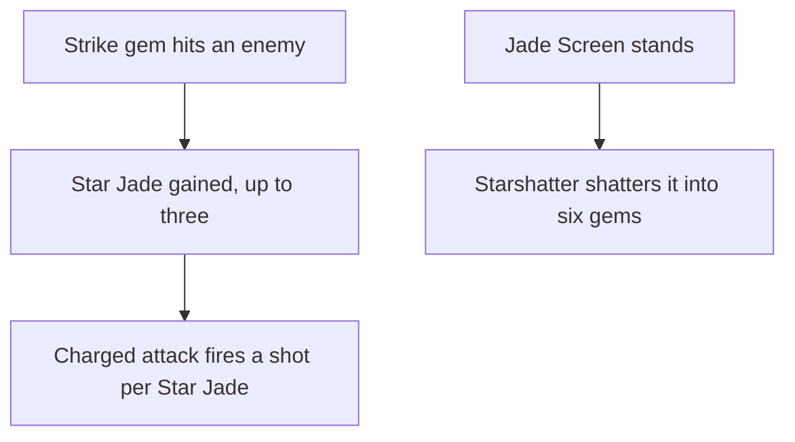

# Ningguang

Ningguang's kit is its record and one behaviour module, `createNingguangKitBehaviour`, on avatar 10000027: two strikes in turn, each of two gems, a charged attack, a collision and two plunges, Jade Screen's hit and its screen, and Starshatter's six gems. Her multipliers are read from proud skill groups 2731, 2732 and 2739, and match the wiki's Sparkling Scatter, Jade Screen and Starshatter values to two decimal places (`{data-root}/cache/genshin-wiki/Category_Ningguang_Talents.json`); the charged attack's stamina, the skill's cooldown, and the burst's cooldown and cost are read from the same groups (`{data-root}/genshin-dump-backup-6.6/ExcelBinOutput/ProudSkillExcelConfigData.json`, group 2731's index 3 is the 50 stamina; group 2732's index 3 the skill's 12 seconds, which `{data-root}/cache/gcsim-v2.47.2/internal/characters/ningguang/skill.go` line 61 sets as 720 frames; group 2739's index 1 the burst's 12 seconds, `{data-root}/cache/gcsim-v2.47.2/internal/characters/ningguang/burst.go` line 75, and its index 2 the 40 energy, which the wiki's Starshatter `energycost=40` (`{data-root}/cache/genshin-wiki/Category_Ningguang_Talents.json`) matches). Every gem lands from a summon, and each strike whose gems strike an enemy gives her a Star Jade up to three, a field that ends as she leaves the field, which her charged attack fires beside its own gem. The screen is a summon standing 3 metres ahead of her for 30 seconds (`{data-root}/cache/gcsim-v2.47.2/internal/characters/ningguang/skill.go` lines 47 and 64), which lands the skill's hit round it, and Starshatter shatters it into six gems more, priced as she stood when she cast it. Backup Plan's free charged attack from Ascension 1 (`{data-root}/cache/genshin-wiki/Category_Ningguang_Talents.json`) is built, and Piercing Fragments' wider gems, Shock Effect's cooldown reset, Exquisite be the Jade's Elemental RES and Grandeur Be the Seven Stars' seven Star Jades from one, two, four and six constellations. Strategic Reserve, the screen's endurance and its blocking of projectiles, the skill's particles, and the seven jades' expiry are not built.

## Decisions

- **Ningguang's strikes are Left and Twirl in turn, and her charged attack is the Left charge.** gcsim draws each strike at random from the two of Left, Right and Twirl the last was not (`{data-root}/cache/gcsim-v2.47.2/internal/characters/ningguang/attack.go` line 89), and the framework plays a kit's strikes in their order, so the string plays Left and Twirl in turn, one such draw, from Left, gcsim's strike after a dash. After either, gcsim plays the faster Left charge, so the kit's one charged attack is exact after every strike. It skips 15 frames of its windup after a strike (`{data-root}/cache/gcsim-v2.47.2/internal/characters/ningguang/charge.go` lines 103 to 108), so its charge lands at 20 frames, its Star Jades at 30, or 25 for seven (`{data-root}/cache/gcsim-v2.47.2/internal/characters/ningguang/charge.go` lines 29, 34 and 39), and it ends at 37. Each strike's two gems land 10 frames past gcsim's hitmarks, its default travel (`{data-root}/cache/gcsim-v2.47.2/internal/characters/ningguang/attack.go` lines 35 to 37 and line 57), at 39 and 37 frames, and the strikes end at 61 and 66.
- **Ningguang's gems land from summons, priced round her body.** Each strike, the charged attack, the skill and the burst casts its hits from a summon as it starts, priced as she stood then, as gcsim snapshots an attack as it queues it, and landing whatever cancels the action, as gcsim's queued attacks do. gcsim centres every gem on the primary target, which an area does not hold, and that target lies within the strikes' 5-metre targeting, so a gem reaches those 5 metres plus its radius: 5.5 for a strike's gem, a Star Jade and a Starshatter gem (`{data-root}/cache/gcsim-v2.47.2/internal/characters/ningguang/attack.go` line 84, `{data-root}/cache/gcsim-v2.47.2/internal/characters/ningguang/burst.go` line 46), 6.5 for the charged attack's (`{data-root}/cache/gcsim-v2.47.2/internal/characters/ningguang/charge.go` line 116, radius 1.5), and 8.5 for a strike's gem from one constellation (`{data-root}/cache/gcsim-v2.47.2/internal/characters/ningguang/attack.go` lines 85 to 86, radius 3.5), from Piercing Fragments, from one constellation. Jade Screen's hit is gcsim's circle of 5 metres round the screen itself (`{data-root}/cache/gcsim-v2.47.2/internal/characters/ningguang/skill.go` line 54).
- **A Star Jade is a field gained as a strike's gem strikes.** The first of a strike's two gems to strike an enemy gives Ningguang a Star Jade unless she holds 3, as the wiki (`{data-root}/cache/genshin-wiki/Category_Ningguang_Talents.json`) and gcsim (`{data-root}/cache/gcsim-v2.47.2/internal/characters/ningguang/attack.go` line 79) give it on the gem's hit, and gcsim's one guarded callback over both gems gives one a strike: a field with no edge that ends on the swap's kit event once she has left the field, as gcsim clears the jades on a swap (`{data-root}/cache/gcsim-v2.47.2/internal/characters/ningguang/ningguang.go` lines 72 to 77). Her Star Jades are the fields of hers that tick each step. A hit gives its striker something back through its `onStrike`, run for each enemy it strikes, so a strike whose gems miss gives none. A charged attack fires a shot for every jade she holds beside its own gem, and spends them (`{data-root}/cache/gcsim-v2.47.2/internal/characters/ningguang/charge.go` line 150).
- **Jade Screen is a summon, and Starshatter shatters it into gems priced as she stood when she cast it.** The skill's start shatters a screen she has standing, as only one stands (`{data-root}/cache/gcsim-v2.47.2/internal/characters/ningguang/skill.go` line 71), and casts a summon 3 metres ahead of where she faces for gcsim's 1800 frames (`{data-root}/cache/gcsim-v2.47.2/internal/characters/ningguang/skill.go` lines 47 and 64), which lands the skill's hit round it at 17 frames (`{data-root}/cache/gcsim-v2.47.2/internal/characters/ningguang/skill.go` line 15), 1U of Geo (`{data-root}/cache/genshin-wiki/Category_Ningguang_Talents.json`) with gcsim's 133.2 poise (`{data-root}/cache/gcsim-v2.47.2/internal/characters/ningguang/skill.go` line 35). Starshatter's start casts its six gems at gcsim's 62 to 124 frames (`{data-root}/cache/gcsim-v2.47.2/internal/characters/ningguang/burst.go` line 15), and shatters a standing screen into six gems more at 154 frames (`{data-root}/cache/gcsim-v2.47.2/internal/characters/ningguang/burst.go` lines 57 and 64), gcsim's 30 past the last, which gcsim marks as still to measure, from a summon priced by the screen's caster, as gcsim snapshots them with the skill. gcsim checks only that a screen stands, not that it is the wiki's "nearby", and so does the kit. Each gem is the wiki's 1U (`{data-root}/cache/genshin-wiki/Category_Ningguang_Talents.json`) where gcsim gives 2U (`{data-root}/cache/gcsim-v2.47.2/internal/characters/ningguang/burst.go` line 41).
- **Exquisite be the Jade's Elemental RES is the active member's while a screen stands, provisionally.** From four constellations, each step while a Jade Screen stands buffs the active member's RES to each of the seven elements by 10% (the wiki's talent note names it in `{data-root}/cache/genshin-wiki/Category_Ningguang_Talents.json`, and gcsim has no constellation 4 effect for her, so the figure is open below), restarted for two steps so it lapses within two of the screen's end or shatter. The wiki's "nearby characters" is the screen's box, whose size no source measures, so the active member stands for it, as Starshatter reads "nearby" as "a screen stands"; off-field members take no enemy strikes here, so RES on them would change nothing. Provisional until a source measures the box.
- **Shock Effect is a field that resets the skill's cooldown and stands as its own gate.** From two constellations (`{data-root}/cache/gcsim-v2.47.2/internal/characters/ningguang/screen.go` lines 28 to 34), a shatter by a recast or by Starshatter casts a one-tick field, on the next step. A running cooldown is reset there and the field stands 6 seconds, gcsim's 360 frames (`{data-root}/cache/gcsim-v2.47.2/internal/characters/ningguang/screen.go` line 32), while no shatter casts another; with none running it ends at once, as gcsim marks no reset then. It is the field of hers that ticks once, as a Star Jade ticks each step.
- **Grandeur Be the Seven Stars replaces Ningguang's Star Jades with seven.** From six constellations, Starshatter's start sets her jades at 7 (`{data-root}/cache/gcsim-v2.47.2/internal/characters/ningguang/burst.go` lines 68 to 72), which her strikes add none to, and a charged attack fires all seven at gcsim's earlier hitmark for them. The wiki's notes have the seven expire over a time no source measures, and gcsim keeps them, so they stand until fired or until she leaves the field.

## Provisional constants

- **Ningguang's plunges are provisional.** gcsim gives Ningguang no plunge file, so her plunges take Bennett's timings and reaches. The plunges' gauges are the wiki's Sparkling Scatter's, Geo at 1U, and their poise is the wiki's 100 high and 50 low; the collision is Geo at 0U with 5 (`{data-root}/cache/genshin-wiki/Category_Ningguang_Talents.json`, the Sparkling Scatter page: Collision 5, Low Plunge 50, High Plunge 100).

## Not built

- **The charged attack's gem and Star Jade frames are not traced.** The record's `chargedAttackGem` at 30 and `starJadeShot` at 40 are unsourced (`packages/genshin-world/src/data/kits/ningguang.json`). The charge file gives 35 for Left's charge hitmark and 45 for its Star Jade hitmark (`{data-root}/cache/gcsim-v2.47.2/internal/characters/ningguang/charge.go` lines 29 and 34), and 20 and 30 when the charge follows a normal or charged attack, which skips a 15-frame windup (lines 103 to 108). The record's frames do not map one-to-one onto these, and they wait on the record being set from that trace.
- **Constellation 4's Jade RES has no gcsim source.** gcsim gives Ningguang no constellation 4 effect, and the cached wiki names the talent without its figure, so the 10% RES waits on a source that gives it.
- **Strategic Reserve and the screen's endurance are not built.** (Strategic Reserve's 12% is `{data-root}/cache/gcsim-v2.47.2/internal/characters/ningguang/asc.go` lines 14 and 22.) Strategic Reserve's 12% Geo DMG Bonus goes to a character entering the screen's box, whose size no source measures, and gcsim gives it on a dash while a screen stands, which no field's tick reads. The screen's endurance, the skill group's 50.1% of her Max HP, and its blocking of projectiles have nothing to act on, as enemies here strike the character on the field or a taunt and fire no projectile, so the screen stands its 30 seconds unless shattered. The skill's 3 or 4 particles are not built; Majesty Be the Array of Stars and Invincible Be the Jade Screen raise talent levels, which the [talents](../../talents/design.md) page holds, and Trove of Marvelous Treasures is not combat.

## Key files

| File                                                                 | Role                                                                                                                         |
| :------------------------------------------------------------------- | :--------------------------------------------------------------------------------------------------------------------------- |
| `packages/genshin-world/src/services/kit/characters/ningguangKit.ts` | `createNingguangKitBehaviour`, Ningguang's kit with her Star Jades, Jade Screen, Starshatter's gems and Shock Effect's reset |

## Sources

- [Sparkling Scatter](https://genshin-impact.fandom.com/wiki/Sparkling_Scatter), [Jade Screen](https://genshin-impact.fandom.com/wiki/Jade_Screen) and [Starshatter](https://genshin-impact.fandom.com/wiki/Starshatter), Genshin Impact Wiki: Ningguang's strikes', charged attack's, Star Jades' and plunges' gauges, internal cooldown tags and poise, the two gems a strike fires, the jades' cap of three, their loss off the field and the seven's expiry, the skill's and the gems' gauges, tags and poise, the screen's 30 seconds, endurance, blocking and particles, and the six gems more a standing screen fires.
- The proud skill groups 2731, 2732 and 2739 in the hosted game data: the multipliers' indices, the 50 stamina, the skill's and burst's 12-second cooldowns, and the burst's 40 energy.
- The cached Genshin wiki, `{data-root}/cache/genshin-wiki/Category_Ningguang_Talents.json`: the Sparkling Scatter, Jade Screen and Starshatter poise and energy rows, and the constellation talent notes.
- The cached Genshin wiki, `{data-root}/cache/genshin-wiki/Category_Ningguang_Talents.json`, the talent note that gives the screen's box as nearby characters, which no source measures yet; grounds Requirement: Exquisite be the Jade from Constellation 4.
- No YouTube or Bilibili reference snapshot for Ningguang is in the repo, so no claim here rests on video.
- [Backup Plan](https://genshin-impact.fandom.com/wiki/Backup_Plan), [Strategic Reserve](https://genshin-impact.fandom.com/wiki/Strategic_Reserve), [Trove of Marvelous Treasures](https://genshin-impact.fandom.com/wiki/Trove_of_Marvelous_Treasures), [Piercing Fragments](https://genshin-impact.fandom.com/wiki/Piercing_Fragments), [Shock Effect](https://genshin-impact.fandom.com/wiki/Shock_Effect), [Majesty Be the Array of Stars](https://genshin-impact.fandom.com/wiki/Majesty_Be_the_Array_of_Stars), [Exquisite be the Jade, Outshining All Beneath](https://genshin-impact.fandom.com/wiki/Exquisite_be_the_Jade,_Outshining_All_Beneath), [Invincible Be the Jade Screen](https://genshin-impact.fandom.com/wiki/Invincible_Be_the_Jade_Screen) and [Grandeur Be the Seven Stars](https://genshin-impact.fandom.com/wiki/Grandeur_Be_the_Seven_Stars), Genshin Impact Wiki: Ningguang's passives and constellations, Shock Effect's shatters by a recast and by Starshatter, and Strategic Reserve's box.
- [gcsim v2.47.2](https://github.com/genshinsim/gcsim/tree/v2.47.2/internal/characters/ningguang), MIT: Ningguang's strikes', charge's, skill's and burst's hitmarks, travel, cancel frames and areas, her drawn strike and the charge that follows it, the Star Jades' cap and their loss on a swap, the screen's place and seconds, the screen's gems' snapshot and frames, and Backup Plan's, Strategic Reserve's, Piercing Fragments', Shock Effect's and Grandeur Be the Seven Stars' effects.

## Open

- [ ] **Each strike's gem reaches 5 metres of targeting** — no source yet: gcsim's `{data-root}/cache/gcsim-v2.47.2/internal/characters/ningguang/attack.go` lines 84 to 87 give the gem's own radius, 0.5 metres, and 3.5 from one constellation, but the 5-metre targeting the reach adds to them is the strike's area call, which was not read.
