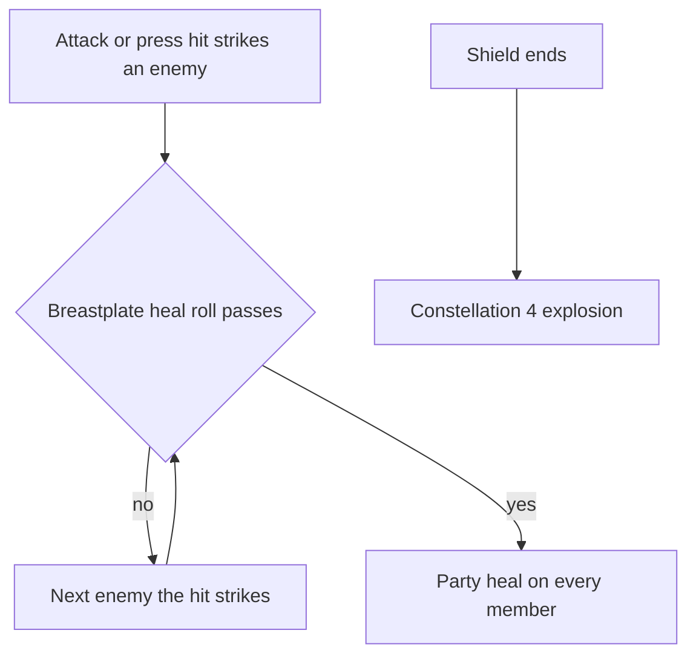

# Noelle

Noelle's kit is its record and one behaviour module, `createNoelleKitBehaviour`, on avatar 10000034: four strikes, a charged attack, a collision and two plunges, Breastplate's press and Sweeping Time's two slashes. Her multipliers are read from proud skill groups 3431, 3432 and 3439, and match the wiki's Favonius Bladework - Maid, Breastplate and Sweeping Time values to two decimal places (`~/Esposter/genshin-parity/text/ExcelBinOutput/ProudSkillExcelConfigData.json` against `~/Esposter/cache/genshin-wiki/Category_Noelle_Talents.json`). Breastplate's shield, its heal, and its constellations I Got Your Back and To Be Cleaned, and Sweeping Time's converted Geo attacks and ATK bonus are built, as the [shared effects](../README.md).

## Decisions

- **Breastplate's shield is set from Noelle's DEF.** It holds 160% of her DEF plus 769 for 12 seconds (group 3432's indices 0, 6 and 3 in `~/Esposter/genshin-parity/text/ExcelBinOutput/ProudSkillExcelConfigData.json`, which read 1.6, 769.79 and 12 at talent level 1; `~/Esposter/cache/gcsim-v2.47.2/internal/characters/noelle/shield.go:13-20`), and is recast over the one she holds. From four constellations, To Be Cleaned explodes it for 400% of her ATK of Geo as it ends, 2U under the Elemental Skill internal cooldown with 100 poise (`~/Esposter/cache/gcsim-v2.47.2/internal/characters/noelle/shield.go:29-44`; `~/Esposter/cache/gcsim-v2.47.2/internal/characters/noelle/skill.go:126-140`, with `Mult: 4` and `PoiseDMG: 100`; the wiki's Breastplate row in `~/Esposter/cache/genshin-wiki/Category_Noelle_Talents.json` gives 2U and 100 poise). The explosion is priced by Noelle as she stood when she cast the shield, and lands on the ground where the character on the field stands, since the shield protects whoever is on the field. The recast ends the shield it replaces, so that one's explosion goes off too. The wiki gives the explosion no area, and gcsim gives it a 4-metre circle round the character on the field (`~/Esposter/cache/gcsim-v2.47.2/internal/characters/noelle/skill.go:145`), which the kit's reach is not yet set against.
- **Breastplate's heal rolls on her attacks while the shield stands.** Her normal and charged attacks' hits and her press carry the roll at 50% (the wiki's level-1 chance in `~/Esposter/cache/genshin-wiki/Category_Noelle_Talents.json`; gcsim's `healChance` at `~/Esposter/cache/gcsim-v2.47.2/internal/characters/noelle/skill.go:100-107`), which I Got Your Back makes certain while Sweeping Time's Geo infusion is up, from one constellation, and a hit rolls on each enemy it strikes until one passes. A pass heals every party member by 21.28% of Noelle's DEF plus 102.7 (group 3432's indices 1 and 7, `~/Esposter/cache/gcsim-v2.47.2/internal/characters/noelle/skill.go:108-110`), each as a share of its own Max HP. The roll reads the world's one seeded random source, which the world screen holds and every combat roll draws on, the strikes' CRIT rolls included, so a session's rolls repeat. Plunges do not roll, as gcsim's do not.
- **Sweeping Time converts her normal attacks to their own poise.** An infusion that converts its attacks (`isConverted`) gives each normal attack hit its converted poise, 132.25, 122.82, 143.865 and 189.75 from the wiki (`~/Esposter/cache/genshin-wiki/Category_Noelle_Talents.json`). Her charged attack, collision and plunges have the same poise converted as normal, so they are unchanged. The Geo infusion and the ATK bonus of 40% of her DEF are built, for 15 seconds past an 80-frame start (`~/Esposter/cache/gcsim-v2.47.2/internal/characters/noelle/burst.go:19`, `:47-49`: `burstStart` 80 and 900 frames; group 3439's index 2 is the 0.4).
- **Ascension 1 and 4 are passives on her module.** Devotion shields the active character with 400% of her DEF for 20 seconds when a drain takes it under 30% HP, from Ascension 1, once every 60 seconds (`~/Esposter/cache/gcsim-v2.47.2/internal/characters/noelle/asc.go:28`, `:35`: 3600 frames; the 400%, 20 seconds and 30% in `~/Esposter/cache/gcsim-v2.47.2/internal/characters/noelle/asc.go` lines 15 to 17 and 32); the drain must name its source, as an enemy's strike does not. From Ascension 4, each fourth normal or charged attack that strikes an enemy cuts the skill's cooldown by a second, counting each attack once on its first enemy, and a skill restarts the count, as gcsim's makeA4CB does (`~/Esposter/cache/gcsim-v2.47.2/internal/characters/noelle/asc.go:59-77`: the fourth hit and the one-second `ReduceActionCooldown`).
- **Noelle's charged attack is one cycle of its spin and its final slash.** A held spin's cycles are not built, so the charged attack hits once and then once more (`~/Esposter/cache/gcsim-v2.47.2/internal/characters/noelle/charge.go:19`, two hits, and the 5-second limit at `:139`).
- **Combat Maid's stamina cut and DMG bonus read the Charged Attack tag.** From Constellation 2, the charged attack's stamina multiplier is 0.8 (`~/Esposter/cache/gcsim-v2.47.2/internal/characters/noelle/cons.go:29-31`, `AddStamPercentMod` at -0.20 for `action.ActionCharge`) and any strike tagged Charged Attack gains 15% DMG (`~/Esposter/cache/gcsim-v2.47.2/internal/characters/noelle/cons.go:18`), so every hit of the spin and final slash counts. Constellation 6's extra seconds are built: each enemy Noelle defeats during Sweeping Time reads the enemy-defeated event and adds a second, up to 10 seconds in all, as the wiki's Sweeping Time text says (`~/Esposter/cache/genshin-wiki/Category_Noelle_Talents.json`) (gcsim takes that extension as a parameter, `~/Esposter/cache/gcsim-v2.47.2/internal/characters/noelle/burst.go:54-68`).

## Not yet built

- **The explosion's reach is unsourced.** The wiki gives no area for To Be Cleaned's explosion, and gcsim's 4-metre circle round the character on the field (`~/Esposter/cache/gcsim-v2.47.2/internal/characters/noelle/skill.go:145`) is not yet set against the kit's reach.

## Key files

| File                                                              | Role                                                                                                                                       |
| :---------------------------------------------------------------- | :----------------------------------------------------------------------------------------------------------------------------------------- |
| `packages/genshin-world/src/services/kit/characters/noelleKit.ts` | `createNoelleKitBehaviour`, Noelle's kit with Breastplate's shield, heal and constellations, and Sweeping Time's buffs and converted poise |

## Sources

- [Favonius Bladework - Maid](https://genshin-impact.fandom.com/wiki/Favonius_Bladework_-_Maid), [Breastplate](https://genshin-impact.fandom.com/wiki/Breastplate) and [Sweeping Time](https://genshin-impact.fandom.com/wiki/Sweeping_Time), Genshin Impact Wiki: Noelle's strikes', charged attack's and plunges' poise, Breastplate's gauge, poise and shield, and Sweeping Time's damage, poise and infusion.
- [gcsim v2.47.2](https://github.com/genshinsim/gcsim/tree/v2.47.2/internal/characters/noelle), MIT: the kit's hitmarks, cancel frames and areas, the shield's size and duration, and Sweeping Time's buff length.
- The proud skill groups 3431, 3432 and 3439 in the hosted game data: the multipliers' indices, the shield's flat and heal values, Sweeping Time's 0.4 DEF share, and the burst's 15 seconds.
- The cached Genshin wiki, `~/Esposter/cache/genshin-wiki/Category_Noelle_Talents.json`: the Sweeping Time constellation 6 text (one second per defeat, up to 10).
- No YouTube or Bilibili reference snapshot for Noelle is in the repo, so no claim here rests on video.

## Open
