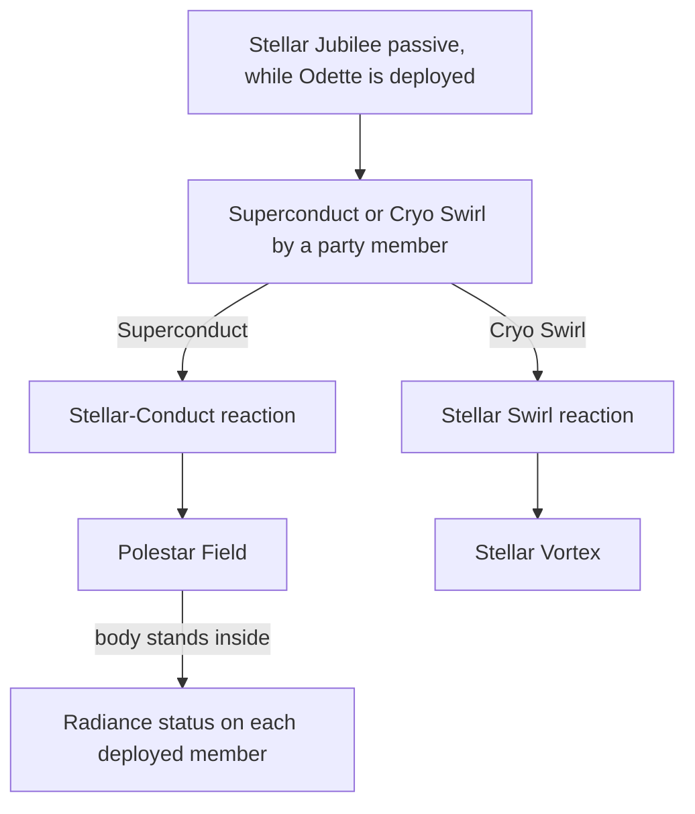

# Odette

Odette's kit is its record and one behaviour module, `createOdetteKitBehaviour`, avatar 10000150 (`{data-root}/genshin-parity/text/ExcelBinOutput/AvatarExcelConfigData.json`). Her record follows gcsim v2.47.2's talent indices and hitmarks, with her multipliers and cooldowns read from the dump's proud skill groups, as [the kits index](../README.md) describes.

## How it works

## Decisions

- **Odette's five strikes and charged attack take gcsim's hitmarks, and her plunges have no gcsim source (open below).** Her strikes are Physical, as gcsim's `{data-root}/cache/gcsim-v2.47.2/internal/characters/odette/attack.go:58` gives the strikes and `{data-root}/cache/gcsim-v2.47.2/internal/characters/odette/charge.go:35` the charged attack, so they carry no element. Their multipliers are the strike group 15031 of the dump (`{data-root}/genshin-parity/text/ExcelBinOutput/ProudSkillExcelConfigData.json`).
- **Her skill is one press hit.** Adagio: Phantom Night Dancers' press hits at gcsim's hitmark of 23 frames (`{data-root}/cache/gcsim-v2.47.2/internal/characters/odette/skill.go:18`), on the player's own radius of 4 (`{data-root}/cache/gcsim-v2.47.2/internal/characters/odette/skill.go:83`) and as Ice (`{data-root}/cache/gcsim-v2.47.2/internal/characters/odette/skill.go:78`, Cryo), from gcsim's `{data-root}/cache/gcsim-v2.47.2/internal/characters/odette/skill.go`. Its multiplier is group 15032 (`{data-root}/genshin-parity/text/ExcelBinOutput/ProudSkillExcelConfigData.json`).
- **Her burst is four hits, the first blunt.** Presto: Bluebird Finale's hitmarks are 112, 128 and 140 frames for its three slashes, and 144 frames for its final, all of radius 7 on the player and the final as Ice, from gcsim's `{data-root}/cache/gcsim-v2.47.2/internal/characters/odette/burst.go` (`:16-17`, `:61`, `:83`). The first slash's poise of 30 is gcsim's `aiCopy.PoiseDMG = 30` in the `if i == 0` of the slash loop (`{data-root}/cache/gcsim-v2.47.2/internal/characters/odette/burst.go:69`), read as that iteration's variant of the copy, so the first slash alone takes it. Multipliers are group 15039 (`{data-root}/genshin-parity/text/ExcelBinOutput/ProudSkillExcelConfigData.json`).
- **Odette's Stellar Jubilee enables the Stellar reactions, and she places the gadgets they stand on.** The cached wikitext names the passive `Dance of Aurore`, Odette's Stellar Jubilee Passive (`{data-root}/cache/genshin-wiki/Category_Odette_Talents.json`), whose text gives the conversion that follows. While she is deployed, her passive enables Stellar-Conduct and Stellar Swirl for her party (`getPartyStellarReactionTypes`), so a Superconduct becomes a Stellar-Conduct and a Cryo Swirl a Stellar Swirl. A Stellar-Conduct any party member triggers leaves a Polestar Field (placed on the reaction path by `addPolestarField`, not by her kit). While the body stands inside it, every deployed member carries the `RADIANCE_STELLAR_CONDUCT_STATUS_ID` status for a think interval of 4 seconds, refreshed on each step and carrying the field's count of the last think as its stacks, the Radiance: Stellar-Conduct state a kit reads its character's Radiance from and a direct Stellar-Conduct hit its coefficient, as gcsim gives every character its `PolestarFieldKey` status while the player stands in the field's area and tags it with the count. The field lowers the Physical RES of the enemies it is over by 40% (`shredPolestarEnemies`), held one step and refreshed by the field's step hook of radius 15 and 7 seconds at the body (the wiki's Starlight Prism lasts 7 seconds; gcsim's field lasts 6, provisional), and a Stellar-Conduct with the body inside a standing field refreshes it rather than doubling it, while one with the body inside none places a new field beside it, as gcsim's `queueStellarConduct` does. A Stellar Swirl leaves a Stellar Vortex of 181 frames, one at a time. gcsim gives the field's radius of 15, its think interval of 4 seconds (240 frames) and the vortex's lifetime, and the [combat](../../combat/design.md) page cites those gadget lines. gcsim's 6-second field lifetime is the figure the wiki disagrees with. These placements are provisional: gcsim creates the gadgets inside the reaction, and the kit places them on the step after it.
- **The vortex deals no hit of its own here.** Its explosion's Cryo damage belongs to the combat's Stellar Swirl, which the kit does not build, so the vortex's summon carries no hits.
- **Her Coda recast is her skill's follow-up, within 394 frames of the press (`{data-root}/cache/gcsim-v2.47.2/internal/characters/odette/skill.go:97`).** Its three damage-over-time hits and its final land at 11, 20, 28 and 62 frames (`{data-root}/cache/gcsim-v2.47.2/internal/characters/odette/skill.go:30` and `{data-root}/cache/gcsim-v2.47.2/internal/characters/odette/skill.go:24`), its action is 76 frames (`{data-root}/cache/gcsim-v2.47.2/internal/characters/odette/skill.go:42`), and it restarts a standing Dance Double on a Plume 114 frames after the recast starts (`{data-root}/cache/gcsim-v2.47.2/internal/characters/odette/skill.go:161-163`), on the status the double already holds rather than a new one. The chain's hits are the skill's follow-up action's hits, held under `skillChain.followUps.0`.
- **Her Dance Double is summoned by her skill and by her burst, and each summon ends any standing one.** The skill's double starts at its summon 23 frames after the press (`{data-root}/cache/gcsim-v2.47.2/internal/characters/odette/skill.go:95`), and its first Plume lands 134 frames after that (`{data-root}/cache/gcsim-v2.47.2/internal/characters/odette/skill.go:22`). The burst's starts 1 frame after the burst (`{data-root}/cache/gcsim-v2.47.2/internal/characters/odette/burst.go:21`), and its first Plume lands 252 frames after that (`{data-root}/cache/gcsim-v2.47.2/internal/characters/odette/burst.go:22`). Each lasts 1262 frames from its summon (`{data-root}/cache/gcsim-v2.47.2/internal/characters/odette/skill.go:177`), and its attacks alternate Plume and Wing on the 109 and 125 frame intervals (`{data-root}/cache/gcsim-v2.47.2/internal/characters/odette/skill.go:29`). A summon ends the standing double, as gcsim's ticker chain cancels the standing one (`{data-root}/cache/gcsim-v2.47.2/internal/characters/odette/skill.go:174-182`), and a burst that finds one standing takes up its next attack, so it starts on Wing once the Plume has landed, rather than on the Plume (`{data-root}/cache/gcsim-v2.47.2/internal/characters/odette/burst.go:94-97`, danceDoubleNextAtk). The kit reads that attack from the standing summon's next hit, which keeps its attack's record area.
- **The Dance Double's schedule enters the record in Prune's shape.** Its first tick is `frames.danceDoubleFirstTick`, 134 frames, cited to `{data-root}/cache/gcsim-v2.47.2/internal/characters/odette/skill.go:22`, the constant the cast passes at `{data-root}/cache/gcsim-v2.47.2/internal/characters/odette/skill.go:94`. That tick is counted from the double's summon, which the cast starts at the skill's 23-frame hit (`{data-root}/cache/gcsim-v2.47.2/internal/characters/odette/skill.go:95`), so its first Plume lands 157 frames after the cast, as Ineffa's summons carry their spawn in each hit. Each named hit keeps its own repeat interval: `frames.plumeTickInterval` is 109 frames, since a Plume is followed by a Wing, and `frames.wingTickInterval` is 125 frames, since a Wing is followed by a Plume (`{data-root}/cache/gcsim-v2.47.2/internal/characters/odette/skill.go:29`, the `skillTickDelay[attackType]` at `{data-root}/cache/gcsim-v2.47.2/internal/characters/odette/skill.go:218`). The Wing's first hit is 243 frames, the first tick plus the Plume's interval, recorded as Unsourced with both citations, since no single gcsim value holds it.
- **Her overlay's values are cited, not Unclassified.** Each value her overlay holds as `Unsourced` is read from the gcsim file and line the [Overlay citations](#overlay-citations) table names, or from the wiki where gcsim is silent, and none is checked against a recording, so each stays provisional until a reader settles it.

## Not built

- **Her plunges have no gcsim source.** gcsim's `{data-root}/cache/gcsim-v2.47.2/internal/characters/odette/` holds no plunge file, so the plunges' hitmarks, reaches and poise stand on the kit's own reading until a source or a recording gives them.
- **Her burst's extra Stellar Glimmer damage is not built.** Presto: Bluebird Finale adds Stellar Glimmer damage for some time, and the combat's reactions carry it.
- **The Stellar reactions are the combat's.** Stellar-Conduct, Stellar Swirl, the Radiance state and the Stellar Glimmer bonus are the combat change's to build, as `openspec/changes/archive/2026-10-22-genshin-combat/` describes. Odette's kit enables two of them through its Stellar Jubilee and places the gadgets they stand on.
- **Ascension 1 and 4 are not built.** Ascension 1, Spring Rite of the Chosen One, gives her Marvelous Splendor stacks while her Dance Double stands, so it waits on those stacks, which no kit holds yet. Ascension 4, Pathetique of Pateticheskaya, raises the Stellar Glimmer hits of her Coda recast and her Dance Double's Plume and Wing by her ATK, so it waits on the Stellar Glimmer state, which the combat holds. Her constellations are the [constellations](../../../../changes/genshin-constellations/design.md) page's, and Constellations 1, 2 and 4 wait on building the Radiance: Stellar-Conduct state first.

## Overlay citations

Each value the overlay holds as `Unsourced`, with the gcsim v2.47.2 file and line it is read from (`{data-root}/cache/gcsim-v2.47.2/internal/characters/odette/burst.go` and `{data-root}/cache/gcsim-v2.47.2/internal/characters/odette/skill.go` in `{data-root}/cache/gcsim-v2.47.2/internal/characters/odette/`, the vortex's gadget line is on the [combat](../../combat/design.md) page), or the source where gcsim is silent.

| Path                                                                                           | Value                                         | Citation                                                                                                                                                                                                                                                                                                                                                                                                                                                                                                                                                                                                                                                                                                                                                                       |
| :--------------------------------------------------------------------------------------------- | :-------------------------------------------- | :----------------------------------------------------------------------------------------------------------------------------------------------------------------------------------------------------------------------------------------------------------------------------------------------------------------------------------------------------------------------------------------------------------------------------------------------------------------------------------------------------------------------------------------------------------------------------------------------------------------------------------------------------------------------------------------------------------------------------------------------------------------------------- |
| `burst.hits.0.area`, `.1.area`, `.2.area`, `.3.area`                                           | radius 7 on the player                        | `{data-root}/cache/gcsim-v2.47.2/internal/characters/odette/burst.go:61`, the `NewCircleHitOnTarget` call's radius at lines 58-62, which the final at line 87 shares                                                                                                                                                                                                                                                                                                                                                                                                                                                                                                                                                                                                           |
| `burst.hits.0.area` through `.3.area` (height, angle)                                          | height 2, full angle                          | `scripts/src/services/genshinAssets/kits/gcsim/createCircleReach.ts`, the builder's circle shape                                                                                                                                                                                                                                                                                                                                                                                                                                                                                                                                                                                                                                                                               |
| `burst.hits.0.multiplier`, `.1.multiplier`, `.2.multiplier`                                    | group 15039, index 0                          | `{data-root}/cache/gcsim-v2.47.2/internal/characters/odette/burst.go:55`, `Mult: burst[c.TalentLvlBurst()]`                                                                                                                                                                                                                                                                                                                                                                                                                                                                                                                                                                                                                                                                    |
| `burst.hits.0.poiseDamage`                                                                     | 30                                            | `{data-root}/cache/gcsim-v2.47.2/internal/characters/odette/burst.go:69`, `aiCopy.PoiseDMG = 30` in the `if i == 0` of the slash loop at lines 64-72                                                                                                                                                                                                                                                                                                                                                                                                                                                                                                                                                                                                                           |
| `burst.hits.3.element`                                                                         | `Ice`                                         | `{data-root}/cache/gcsim-v2.47.2/internal/characters/odette/burst.go:83`, `Element: attributes.Cryo`; the records name Cryo `Ice`                                                                                                                                                                                                                                                                                                                                                                                                                                                                                                                                                                                                                                              |
| `burst.hits.3.hitmarkFrames`                                                                   | 144                                           | `{data-root}/cache/gcsim-v2.47.2/internal/characters/odette/burst.go:17`, `finalHitmark = 112 + 16 + 12 + 4`                                                                                                                                                                                                                                                                                                                                                                                                                                                                                                                                                                                                                                                                   |
| `burst.hits.3.multiplier`                                                                      | group 15039, index 1                          | `{data-root}/cache/gcsim-v2.47.2/internal/characters/odette/burst.go:85`, `Mult: burstFinal[c.TalentLvlBurst()]`                                                                                                                                                                                                                                                                                                                                                                                                                                                                                                                                                                                                                                                               |
| `burst.hits.length`                                                                            | 4                                             | `{data-root}/cache/gcsim-v2.47.2/internal/characters/odette/burst.go:16-17`, the three slashes' hitmarks and the final's                                                                                                                                                                                                                                                                                                                                                                                                                                                                                                                                                                                                                                                       |
| `frames.stellarVortex`                                                                         | 181                                           | `sswDuration = 181`, see the [combat](../../combat/design.md) page                                                                                                                                                                                                                                                                                                                                                                                                                                                                                                                                                                                                                                                                                                             |
| `skill.hits.0.area`                                                                            | radius 4 on the player                        | `{data-root}/cache/gcsim-v2.47.2/internal/characters/odette/skill.go:83`, `NewCircleHitOnTarget(c.Core.Combat.Player(), nil, 4)`; height 2 and angle from `scripts/src/services/genshinAssets/kits/gcsim/createCircleReach.ts`                                                                                                                                                                                                                                                                                                                                                                                                                                                                                                                                                 |
| `skill.hits.0.multiplier`                                                                      | group 15032, index 0                          | `{data-root}/cache/gcsim-v2.47.2/internal/characters/odette/skill.go:80`, `Mult: skill[c.TalentLvlSkill()]`                                                                                                                                                                                                                                                                                                                                                                                                                                                                                                                                                                                                                                                                    |
| `stellarJubilee.stellarReactionTypes`                                                          | `StellarConduct`, `StellarSwirl`, length 2    | none in gcsim, which names the Stellar tags at `{data-root}/cache/gcsim-v2.47.2/internal/characters/odette/asc.go:34-36` but holds no Jubilee list; the [Odette](https://genshin-impact.fandom.com/wiki/Odette) wiki's passive text                                                                                                                                                                                                                                                                                                                                                                                                                                                                                                                                            |
| `hits.plume.area`, `hits.wing.area`                                                            | `TargetCentred`, radius 19 and 20             | `{data-root}/cache/gcsim-v2.47.2/internal/characters/odette/skill.go:213`, `NewCircleHitOnTarget(PrimaryTarget, offset, 4)`: a circle of radius 4 on the primary target. The builder stores a target-centred circle as the skill's targeting radius plus the circle's forward offset plus its radius (`scripts/src/services/genshinAssets/kits/gcsim/toGcsimArea.ts` and `scripts/src/services/genshinAssets/kits/gcsim/createTargetedHitArea.ts`), with the skill's targeting radius of 15 (`SKILL_TARGETING_AREA`, `packages/genshin-world/src/services/kit/constants.ts`). Plume has no offset, so 15 + 0 + 4 = 19; Wing's forward offset is 1 (`{data-root}/cache/gcsim-v2.47.2/internal/characters/odette/skill.go:210`, `offset = info.Point{Y: 1}`), so 15 + 1 + 4 = 20 |
| `hits.plume.element`, `hits.wing.element`                                                      | `Ice`                                         | `{data-root}/cache/gcsim-v2.47.2/internal/characters/odette/skill.go:199`, `Element: attributes.Cryo` in the ticker's literal, shared by both attacks                                                                                                                                                                                                                                                                                                                                                                                                                                                                                                                                                                                                                          |
| `hits.plume.poiseDamage`, `hits.wing.poiseDamage`                                              | the wiki's 15 for each                        | the ticker's literal at `{data-root}/cache/gcsim-v2.47.2/internal/characters/odette/skill.go:193-201` has no `PoiseDMG`, so gcsim is silent; the wiki gives the poise                                                                                                                                                                                                                                                                                                                                                                                                                                                                                                                                                                                                          |
| `hits.wing.hitmarkFrames`                                                                      | 243                                           | `{data-root}/cache/gcsim-v2.47.2/internal/characters/odette/skill.go:22` (134) plus `{data-root}/cache/gcsim-v2.47.2/internal/characters/odette/skill.go:29` (109), the Plume's interval before the first Wing                                                                                                                                                                                                                                                                                                                                                                                                                                                                                                                                                                 |
| `skillChain.followUps.0.hits.length`                                                           | 4                                             | `{data-root}/cache/gcsim-v2.47.2/internal/characters/odette/skill.go:126-127`, the three damage-over-time hits in the loop, and the final at `{data-root}/cache/gcsim-v2.47.2/internal/characters/odette/skill.go:131-155`                                                                                                                                                                                                                                                                                                                                                                                                                                                                                                                                                     |
| `skillChain.followUps.0.hits.0-2.area`, `skillChain.followUps.0.hits.3.area`                   | radius 4.2 with a 0.5 forward offset, and 4.6 | `{data-root}/cache/gcsim-v2.47.2/internal/characters/odette/skill.go:125` on Odette, and `{data-root}/cache/gcsim-v2.47.2/internal/characters/odette/skill.go:150` for the final                                                                                                                                                                                                                                                                                                                                                                                                                                                                                                                                                                                               |
| `skillChain.followUps.0.hits.*.element`                                                        | `Ice`                                         | `{data-root}/cache/gcsim-v2.47.2/internal/characters/odette/skill.go:121` and `{data-root}/cache/gcsim-v2.47.2/internal/characters/odette/skill.go:138`, `Element: attributes.Cryo`                                                                                                                                                                                                                                                                                                                                                                                                                                                                                                                                                                                            |
| `skillChain.followUps.0.hits.0-2.hitmarkFrames`, `skillChain.followUps.0.hits.3.hitmarkFrames` | 11, 20, 28 and 62                             | `{data-root}/cache/gcsim-v2.47.2/internal/characters/odette/skill.go:30` for the three damage-over-time hits, and `{data-root}/cache/gcsim-v2.47.2/internal/characters/odette/skill.go:24` for the final's 62 frames                                                                                                                                                                                                                                                                                                                                                                                                                                                                                                                                                           |
| `skillChain.followUps.0.hits.0-2.multiplier`, `skillChain.followUps.0.hits.3.multiplier`       | group 15032, index 1, and index 2             | `{data-root}/cache/gcsim-v2.47.2/internal/characters/odette/skill.go:123` (codaDoT) and `{data-root}/cache/gcsim-v2.47.2/internal/characters/odette/skill.go:139` (codaSSC), the final without its Stellar Glimmer factor, which is not built                                                                                                                                                                                                                                                                                                                                                                                                                                                                                                                                  |
| `skillChain.followUps.length`                                                                  | 1                                             | `{data-root}/cache/gcsim-v2.47.2/internal/characters/odette/skill.go:113`, the skillRecast function the recast is                                                                                                                                                                                                                                                                                                                                                                                                                                                                                                                                                                                                                                                              |
| `skillChain.followUps.0.animationFrames`                                                       | 76                                            | `{data-root}/cache/gcsim-v2.47.2/internal/characters/odette/skill.go:42`, `skillRecastFrames = frames.InitAbilSlice(76)`, its frames until any action                                                                                                                                                                                                                                                                                                                                                                                                                                                                                                                                                                                                                          |
| `skillChain.windowSeconds`                                                                     | 394 / 60                                      | `{data-root}/cache/gcsim-v2.47.2/internal/characters/odette/skill.go:97`, c.AddStatus(skillRecastKey, 394, true)                                                                                                                                                                                                                                                                                                                                                                                                                                                                                                                                                                                                                                                               |
| `frames.danceDoubleRecastFirstTick`                                                            | 114                                           | `{data-root}/cache/gcsim-v2.47.2/internal/characters/odette/skill.go:24-25` (62 and 52 frames), the restart at `{data-root}/cache/gcsim-v2.47.2/internal/characters/odette/skill.go:161-163`                                                                                                                                                                                                                                                                                                                                                                                                                                                                                                                                                                                   |

## Key files

| File                                                                        | Role                                                                                                                |
| :-------------------------------------------------------------------------- | :------------------------------------------------------------------------------------------------------------------ |
| `packages/genshin-world/src/services/kit/characters/odetteKit.ts`           | `createOdetteKitBehaviour`, which summons the Dance Double on her skill and her burst and places the Stellar Vortex |
| `packages/genshin-world/src/services/party/getPartyStellarReactionTypes.ts` | The Stellar reactions the deployed team's Stellar Jubilee passives enable, each once                                |
| `packages/genshin-world/src/data/kits/odette.json`                          | Odette's overlay                                                                                                    |

## Sources

- [Odette](https://genshin-impact.fandom.com/wiki/Odette), Genshin Impact Wiki: her talent names (Adagio: Phantom Night Dancers and Presto: Bluebird Finale), the Stellar Glimmer text, and the rule that a Superconduct or Cryo Swirl triggered by a party member becomes a Stellar-Conduct or Stellar Swirl while she is in the party. Quote: "When Odette is in the party, Superconduct reactions triggered by party members will be converted to Stellar-Conduct reactions."
- [Stellar-Conduct](https://genshin-impact.fandom.com/wiki/Stellar-Conduct), Genshin Impact Wiki: the Starlight Prism's duration. Quote: "the resulting Starlight Prism lasts for 7s". Not on disk: no cached file holds Starlight Prism text, and the Odette Category file (`{data-root}/cache/genshin-wiki/Category_Odette_Talents.json`) gives none, so the quote is unchecked (see Open).
- [gcsim](https://github.com/genshinsim/gcsim/tree/v2.47.2/internal/characters/odette), MIT at v2.47.2: `{data-root}/cache/gcsim-v2.47.2/internal/characters/odette/config.yml` for the talent indices, `{data-root}/cache/gcsim-v2.47.2/internal/characters/odette/attack.go`, `{data-root}/cache/gcsim-v2.47.2/internal/characters/odette/charge.go`, `{data-root}/cache/gcsim-v2.47.2/internal/characters/odette/skill.go`, `{data-root}/cache/gcsim-v2.47.2/internal/characters/odette/burst.go` for the hitmarks and areas. The Stellar Glimmer state is cited on the [combat](../../combat/design.md) page.
- [gcsim's reactable package](https://github.com/genshinsim/gcsim/tree/v2.47.2/pkg/reactable), MIT at v2.47.2: the Polestar Field's radius, lifetime and think interval, and the vortex's lifetime, cited on the [combat](../../combat/design.md) page.
- The dump's `AvatarSkillExcelConfigData` and `ProudSkillExcelConfigData`: the proud skill groups 15031, 15032 and 15039, the skill's cooldown of 15 seconds (group 15032's index 11, which `{data-root}/cache/gcsim-v2.47.2/internal/characters/odette/skill.go:99`'s `SetCDWithDelay` sets as 15 seconds), and the burst's energy cost of 60 (group 15039's index 6) and cooldown of 15 seconds (index 5).
- The cached Genshin wiki, `{data-root}/cache/genshin-wiki/Category_Odette_Talents.json`: the poise rows of the strikes, the Plume and Wing (rows 4 and 6, 15 each), and the first slash's 30.
- No YouTube or Bilibili reference snapshot for Odette is in the repo, so no claim here rests on video.

## Open

- [ ] **The Starlight Prism lasts 7 seconds** — no source yet: the Stellar-Conduct wiki page the quote comes from is not on disk, and the cached Category file holds no Starlight Prism text; gcsim's Polestar Field lasts 6 s (`sscFieldDur`, on the [combat](../../combat/design.md) page) and the page cannot tie the two.
