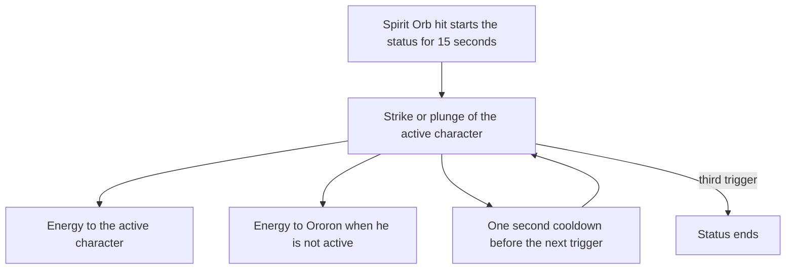

# Ororon

Ororon's kit is its record and one behaviour module, `createOroronKitBehaviour`, avatar 10000105 (`packages/genshin-world/src/services/kit/characters/ororonKit.ts`): three strikes, a fully charged Aimed Shot, the Spirit Orb's first hit, Dark Voices' Echo with its ritual and soundwave field, and a collision and two plunges. His multipliers are read from proud skill groups 10531, 10532 and 10539 (`{data-root}/genshin-dump-backup-6.6/ExcelBinOutput/ProudSkillExcelConfigData.json`), the Spirit Orb's cooldown and the burst's seconds, cooldown and energy cost from the same groups. Ascension 4's energy on the active character's strikes and plunges comes after the Spirit Orb's hit, and Constellation 2's Electro DMG Bonus builds on each enemy the burst's hits strike. Constellation 4 shortens the soundwave's tick.

## How it works

## Not yet built

- **Hypersense, and so Ascension 1, Constellation 1 and Constellation 6, wait on the Nightsoul hook.** gcsim's Nightsoul state gives Ororon points from the party's Nightsoul bursts (`{data-root}/cache/gcsim-v2.47.2/internal/characters/ororon/asc.go:38-39`) and from his own hits (`{data-root}/cache/gcsim-v2.47.2/internal/characters/ororon/asc.go:65`), and spends them on Hypersense, which strikes the enemies near a Nightsoul-tagged hit. The framework has no Nightsoul state, so none of it is built, and Constellation 1's extra bounce and its 50% DMG Bonus (`{data-root}/cache/gcsim-v2.47.2/internal/characters/ororon/cons.go:25`) go with it, since that bonus reads only Hypersense (`{data-root}/cache/gcsim-v2.47.2/internal/characters/ororon/cons.go:34-37`, the `a1Abil` check).
- **The Spirit Orb's bounce waits on a chained hit.** gcsim's orb reaches up to three enemies in all, five with Constellation 1, taken in the combat's enemy order rather than nearest the last (`{data-root}/cache/gcsim-v2.47.2/internal/characters/ororon/skill.go:47-56`, with `{data-root}/cache/gcsim-v2.47.2/internal/characters/ororon/cons.go:45-50`'s two extra bounces). A hit's reach is an area round the body, so the orb's first hit reaches every enemy in its targeted area, which can overcount in a crowd, and the bounce's cap is not built.
- **Constellation 4's 8 energy on the burst's hit waits on a timed energy gain.** gcsim restores it 36 frames into the burst (`{data-root}/cache/gcsim-v2.47.2/internal/characters/ororon/burst.go:18`, `:52`, and the 8 at `{data-root}/cache/gcsim-v2.47.2/internal/characters/ororon/cons.go:116`) whether or not the ritual strikes anything, and a kit's effects land only on a strike or a step's start.
- **The unheld Aimed Shot is not a kit action.** The bow kits built so far model only the fully charged shot, and this kit follows them.

## Decisions

- **The strikes and the Spirit Orb's hit land 10 frames after gcsim's hitmarks.** gcsim queues each arrow and orb to travel 10 frames to its target, so each lands at its hitmark plus the travel, as Aloy's, Collei's and Ganyu's bow kits do (`{data-root}/cache/gcsim-v2.47.2/internal/characters/ororon/attack.go:39`, `{data-root}/cache/gcsim-v2.47.2/internal/characters/ororon/skill.go:28-30`, `{data-root}/cache/gcsim-v2.47.2/internal/characters/ororon/aimed.go:45`). Sigewinne's shot does not, a question on the roadmap. (`packages/genshin-world/src/services/kit/characters/ororonKit.ts`)
- **The Spirit Orb's first hit is one 15.6-metre area from the body, not gcsim's 0.6-metre circle about each enemy.** gcsim queues each enemy the orb reaches as a 0.6-metre circle about that enemy (`{data-root}/cache/gcsim-v2.47.2/internal/characters/ororon/skill.go` line 59), so the kit's single area reaches every enemy in the orb's targeted area instead. That area is 15.6 metres: the 15-metre targeting radius (`SKILL_TARGETING_AREA`, `packages/genshin-world/src/services/kit/constants.ts:11`) plus gcsim's 0.6, as the record's `skill.hits.0.area` gives. (`packages/genshin-world/src/services/kit/characters/ororonKit.ts`)
- **The soundwave field ticks from the cast, not after it.** gcsim's first tick falls 60 frames after the burst begins (`{data-root}/cache/gcsim-v2.47.2/internal/characters/ororon/burst.go:19`, `:73`), and each tick's hit lands on it. Constellation 4 makes the tick 45 frames apart (`{data-root}/cache/gcsim-v2.47.2/internal/characters/ororon/cons.go:105-109`, 0.75 of 60). (`packages/genshin-world/src/services/kit/characters/ororonKit.ts`)
- **Constellation 2's stacks are one buff refreshed by each hit.** Its 8% starts with the burst and gains 8% for each enemy the ritual or a soundwave strikes, to 32%, and keeps the burst's nine seconds rather than restarting them on each hit (`{data-root}/cache/gcsim-v2.47.2/internal/characters/ororon/cons.go:82-87`, `:101`, and the 9-second window at `:84`). (`packages/genshin-world/src/services/kit/characters/ororonKit.ts`)
- **Ascension 4 counts its three triggers on the Spirit Orb's status.** The status starts at the orb's hit and runs 15 seconds (`{data-root}/cache/gcsim-v2.47.2/internal/characters/ororon/asc.go:210`). Each trigger gives 3 energy to the active character, and 3 more to Ororon when he is not the active one (`{data-root}/cache/gcsim-v2.47.2/internal/characters/ororon/asc.go:190-192`), then a second's cooldown before the next (`{data-root}/cache/gcsim-v2.47.2/internal/characters/ororon/asc.go:188`). The third trigger ends the status (`{data-root}/cache/gcsim-v2.47.2/internal/characters/ororon/asc.go:195-197`). (`packages/genshin-world/src/services/kit/characters/ororonKit.ts`)
- **The plunges are the table's standard ones.** gcsim has no plunge file for him (its folder holds `{data-root}/cache/gcsim-v2.47.2/internal/characters/ororon/aimed.go`, `{data-root}/cache/gcsim-v2.47.2/internal/characters/ororon/asc.go`, `{data-root}/cache/gcsim-v2.47.2/internal/characters/ororon/attack.go`, `{data-root}/cache/gcsim-v2.47.2/internal/characters/ororon/burst.go`, `{data-root}/cache/gcsim-v2.47.2/internal/characters/ororon/cons.go`, `{data-root}/cache/gcsim-v2.47.2/internal/characters/ororon/ororon.go` and `{data-root}/cache/gcsim-v2.47.2/internal/characters/ororon/skill.go` only), so the collision, low and high plunge read the proud group 10531's indices 5, 6 and 7 (0.568, 1.136 and 1.419 at talent level 1) and land the moment their action starts, with a zero animation, a departure from the Bennett timings that [the kits index](../README.md) borrows for a plunge with no gcsim file. A recording of his plunges landing together would settle the shared reach; a later landing would need frames. (`packages/genshin-world/src/services/kit/characters/ororonKit.ts`)
- **Ororon's hits deal no poise, and the wiki's figures wait on a recording.** gcsim gives Ororon's strikes, Aimed Shot, Spirit Orb, burst and plunges no poise, and the record carries none for them, so the kit deals none. The cached Ororon talents file (`{data-root}/cache/genshin-wiki/Category_Ororon_Talents.json`) locates 17.6, 15.48 and 24.35 for his three strikes, and 20 for the fully charged Aimed Shot, 30 for the Spirit Orb's hit, 10 for the collision, 100 high and 50 low for the plunges, 100 for the burst's hit and 10 for the soundwave, as its Fully-Charged Aimed Shot, Spirit Orb DMG, Plunging Attack Collision, Low Plunge, High Plunge, Ritual DMG and Soundwave Collision DMG rows give them. Those values stay open until a recording of the game's poise on them settles them. (`packages/genshin-world/src/services/kit/characters/ororonKit.ts`)

## Key files

| File                                                              | Role                                                                                                                                                        |
| :---------------------------------------------------------------- | :---------------------------------------------------------------------------------------------------------------------------------------------------------- |
| `packages/genshin-world/src/services/kit/characters/ororonKit.ts` | `createOroronKitBehaviour`, Ororon's kit with his strikes, Aimed Shot, Spirit Orb, burst and soundwave field, and his Ascension 4 and Constellation 2 and 4 |

## Sources

- [gcsim](https://github.com/genshinsim/gcsim/tree/v2.47.2/internal/characters/ororon), MIT, at v2.47.2: Ororon's strikes' hitmarks and cancels, the Aimed Shot's and the Spirit Orb's frames, Dark Voices' Echo's ritual, soundwave and field, and Ascension 4's and Constellations 2 and 4's values.
- [Spiritvessel Snapshot](https://genshin-impact.fandom.com/wiki/Spiritvessel_Snapshot), [Night's Sling](https://genshin-impact.fandom.com/wiki/Night%27s_Sling) and [Dark Voices Echo](https://genshin-impact.fandom.com/wiki/Dark_Voices_Echo), Genshin Impact Wiki: the poise of his strikes, Aimed Shot, collision, plunges, Spirit Orb's hit, burst and soundwave.
- The cached Genshin wiki, `{data-root}/cache/genshin-wiki/Category_Ororon_Talents.json`: the three strike rows' poise (17.6, 15.48 and 24.35) and the constellation notes.
- The proud skill groups 10531, 10532 and 10539 in the hosted game data: the multipliers' indices, the Spirit Orb's 15-second cooldown (group 10532's index 1, `{data-root}/cache/gcsim-v2.47.2/internal/characters/ororon/skill.go:68`), and the burst's 9 seconds, 15-second cooldown and 60 energy (group 10539's indices 2, 3 and 4).
- No YouTube or Bilibili reference snapshot for Ororon is in the repo, so no claim here rests on video.
