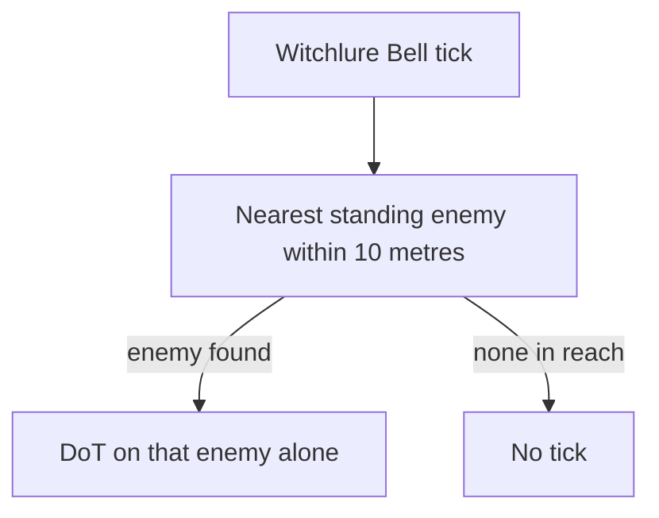

# Prune

Prune's kit is its record and one behaviour module, `createPruneKitBehaviour` (`packages/genshin-world/src/services/kit/characters/pruneKit.ts`), avatar 10000132 (`{data-root}/genshin-dump-backup-6.6/ExcelBinOutput/AvatarExcelConfigData.json`): her normal attacks, charged attack, collision and plunges, her skill's Ring-A-Ding-Ding press, the burst's initial hit and the Witchlure Bell's DoT. Her skill and burst are Anemo (`{data-root}/cache/gcsim-v2.47.2/internal/characters/prune/skill.go:60`, `{data-root}/cache/gcsim-v2.47.2/internal/characters/prune/burst.go:36`).

Her skill and burst are read from proud skill groups 13232 and 13239 (`{data-root}/genshin-dump-backup-6.6/ExcelBinOutput/ProudSkillExcelConfigData.json`) as their talent multipliers. Her cooldowns and energy cost are read from the table: 15 seconds for the skill, 18 seconds for the burst and 70 energy (group 13232's index 2, and group 13239's indices 3 and 4, matching `{data-root}/cache/gcsim-v2.47.2/internal/characters/prune/skill.go:115` and `{data-root}/cache/gcsim-v2.47.2/internal/characters/prune/burst.go:58`; gcsim's `ConsumeEnergy(18)` at `{data-root}/cache/gcsim-v2.47.2/internal/characters/prune/burst.go:59` is a frame delay, not the cost).

gcsim sources: Prune's attack, charge, skill and burst files, with the table data in gcsim's Prune data file.

## How it works

## Decisions

- **The skill and burst's hitboxes are circles by hand.** The skill's press is a circle of 2.5 metres offset 1.4 metres ahead (`{data-root}/cache/gcsim-v2.47.2/internal/characters/prune/skill.go:69`), priced at 3.9 metres (2.5 plus 1.4), and the burst's initial hit is a circle of 6.5 metres (`{data-root}/cache/gcsim-v2.47.2/internal/characters/prune/burst.go:43`). gcsim names neither in a form the builder matches, so each is recorded by hand, and Prune's overlay names no cause for either hitbox's geometry.
- **The Witchlure Bell's DoT ticks on the nearest enemy within 10 metres.** Each tick takes the standing enemy nearest Prune, found by `selectNearestEnemy` (the selector Hyperbloom's homing reads), within the 10-metre detection area (`{data-root}/cache/gcsim-v2.47.2/internal/characters/prune/burst.go:90-91`), and lands the DoT's 1.6-metre circle on that enemy alone (`{data-root}/cache/gcsim-v2.47.2/internal/characters/prune/burst.go:97-103`). The first tick falls 137 frames after the cast and the ticks repeat every 117 frames (`{data-root}/cache/gcsim-v2.47.2/internal/characters/prune/burst.go:56` and `{data-root}/cache/gcsim-v2.47.2/internal/characters/prune/burst.go:104`), recorded as cited Gcsim frames. The bell lasts the burst's 813 frames (`{data-root}/cache/gcsim-v2.47.2/internal/characters/prune/burst.go:27`), which the constellation 6 bonus would add to. The DoT's multiplier is index 1 of proud skill group 13239 (`{data-root}/genshin-dump-backup-6.6/ExcelBinOutput/ProudSkillExcelConfigData.json`), 0.7044 at level 1 (`{data-root}/cache/gcsim-v2.47.2/internal/characters/prune/zz_prune.dm.go:217`), recorded as Unsourced since the builder does not read it from the literal, as is its Anemo element, which `{data-root}/cache/gcsim-v2.47.2/internal/characters/prune/burst.go:85` gives.

## Not built

- **The overlay's bell duration is Unsourced.** `frames.burstDuration` in the overlay names no cause, though `{data-root}/cache/gcsim-v2.47.2/internal/characters/prune/burst.go:27` gives 813 frames before the constellation 6 bonus. The overlay lies outside this folder, so its cause waits on its owner.
- **The Clang Clang convert waits on the convert hook.** A second press of her skill converts it (`{data-root}/cache/gcsim-v2.47.2/internal/characters/prune/skill.go:120`, `:131`) into Clang Clang! Witch-tribution Comes!, a hit that needs the state the press left behind. The kit holds the press alone.
- **Her passives wait on their hooks.** Each reads her convert state, her burst's bell or the party's Elemental Resonance, and none is built yet (the passives are at `{data-root}/cache/gcsim-v2.47.2/internal/characters/prune/asc.go:22`, `:90` and `:137`).

## Key files

| File                                                             | Role                                                                                                                                                                                                                                                                                                                                                                                                                                                                           |
| :--------------------------------------------------------------- | :----------------------------------------------------------------------------------------------------------------------------------------------------------------------------------------------------------------------------------------------------------------------------------------------------------------------------------------------------------------------------------------------------------------------------------------------------------------------------- |
| `packages/genshin-world/src/services/kit/characters/pruneKit.ts` | `createPruneKitBehaviour`, Prune's module, which casts the Witchlure Bell's DoT on the shared nearest-enemy selector                                                                                                                                                                                                                                                                                                                                                           |
| `packages/genshin-world/src/services/kit/selectNearestEnemy.ts`  | `selectNearestEnemy`, the standing enemy nearest a point within a radius, which the Witchlure Bell and Hyperbloom's homing both read                                                                                                                                                                                                                                                                                                                                           |
| `packages/genshin-world/src/data/kits/prune.json`                | Prune's overlay: the poise of her skill's and burst's first hits (Wiki), the Witchlure Bell's hit, first tick and interval, cited to `{data-root}/cache/gcsim-v2.47.2/internal/characters/prune/burst.go`, and its duration, which the overlay leaves Unsourced though `{data-root}/cache/gcsim-v2.47.2/internal/characters/prune/burst.go:27` gives it (open below), with its area, element and multiplier as gcsim gives them; her other hits and areas come from the record |

## Sources

- [gcsim](https://github.com/genshinsim/gcsim/tree/v2.47.2/internal/characters/prune), MIT: her attacks' hitmarks and cancels, the skill's press and convert, the burst's initial hit and DoT, and her table data file.
- The cached Genshin wiki, `{data-root}/cache/genshin-wiki/Category_Prune_Talents.json`: the poise rows, 50 for the skill's press ('Ring-A-Ding-Ding! Hexhunter Chime DMG'), 30 for the burst's initial hit (the burst's 'Skill DMG' row), 10 for the Bell's DoT and 75 for the convert's hit.
- The proud skill groups 13232 and 13239 in the hosted game data: the multipliers' indices, the 15-second skill cooldown, the 18-second burst cooldown and the 70 energy.
- No YouTube or Bilibili reference snapshot for Prune is in the repo, so no claim here rests on video.
