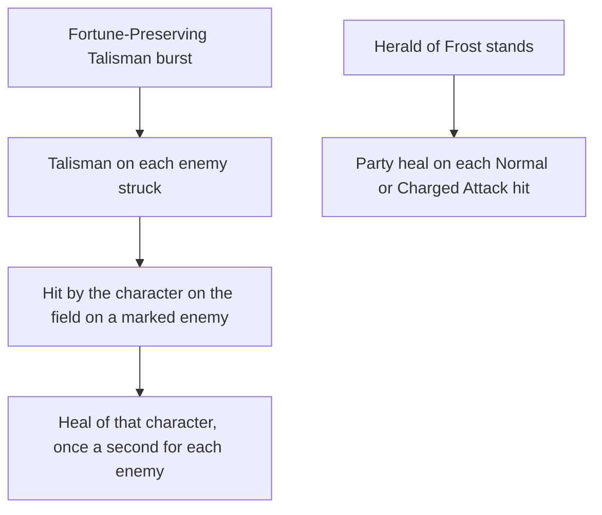

# Qiqi

Qiqi's kit is its record and one behaviour module, `createQiqiKitBehaviour`, on avatar 10000035 (`{data-root}/genshin-dump-backup-6.6/ExcelBinOutput/AvatarExcelConfigData.json`): five strikes (`{data-root}/cache/gcsim-v2.47.2/internal/characters/qiqi/attack.go:16`), a charged attack of two slashes (`{data-root}/cache/gcsim-v2.47.2/internal/characters/qiqi/charge.go:16`), a collision and two plunges (`{data-root}/cache/gcsim-v2.47.2/internal/characters/qiqi/plunge.go`), Herald of Frost with its initial damage and swipes that follow her, and Fortune-Preserving Talisman's damage and the Talisman it marks enemies with. Her multipliers are read from proud skill groups 3531, 3532 and 3539 (`{data-root}/genshin-dump-backup-6.6/ExcelBinOutput/ProudSkillExcelConfigData.json`), and match the wiki's Ancient Sword Art, Herald of Frost and Adeptus Art: Preserver of Fortune values to two decimal places; the charged attack's stamina, the skill's duration and cooldown, and the burst's heal, seconds, cooldown and cost are read from the same groups (group 3531's index 6, 20, which the wiki's `stamina=20` in `{data-root}/cache/genshin-wiki/Category_Qiqi_Talents.json` matches; group 3532's indices 5 and 6, 15 and 30 seconds, `{data-root}/cache/gcsim-v2.47.2/internal/characters/qiqi/skill.go:30` and `{data-root}/cache/gcsim-v2.47.2/internal/characters/qiqi/skill.go:101`; group 3539's indices 3 to 5, 15 seconds, 20 seconds, `{data-root}/cache/gcsim-v2.47.2/internal/characters/qiqi/burst.go:62`, and 80 energy, which the wiki's `energycost=80` in `{data-root}/cache/genshin-wiki/Category_Qiqi_Talents.json` matches). The Herald is a summon that follows the body on the field, its regeneration on hit is the shared party heal on each Normal and Charged Attack hit while it stands (the wiki's Herald of Frost text in `{data-root}/cache/genshin-wiki/Category_Qiqi_Talents.json`), and its continuous regeneration is a field with no edge that heals the active character each 4.5 seconds (`{data-root}/cache/gcsim-v2.47.2/internal/characters/qiqi/skill.go:70`, `{data-root}/cache/gcsim-v2.47.2/internal/characters/qiqi/skill.go:165`), as the [shared effects](../README.md). The Talisman is a status on each enemy the burst strikes, given before its damage, and damage the character on the field deals an enemy holding it heals that character, at most once a second for each enemy. A Glimpse into Arcanum from Ascension 4 (`{data-root}/cache/gcsim-v2.47.2/internal/characters/qiqi/burst.go:127`), and Ascetics of Frost's energy (`{data-root}/cache/gcsim-v2.47.2/internal/characters/qiqi/cons.go:23`), Frozen to the Bone's DMG Bonus (`{data-root}/cache/gcsim-v2.47.2/internal/characters/qiqi/cons.go:31`), Divine Suppression's ATK cut and Rite of Resurrection's revive from one, two, four and six constellations are built (constellations 4 and 6 in `{data-root}/genshin-dump-backup-6.6/ExcelBinOutput/AvatarTalentExcelConfigData.json`, whose texts give a 20% ATK cut on Talisman targets and a revive regenerating 50% of HP once every 15 minutes), and so is Life-Prolonging Methods from Ascension 1 (`{data-root}/cache/gcsim-v2.47.2/internal/characters/qiqi/asc.go:31`).

## How it works

## Decisions

- **Fortune-Preserving Talisman's damage is group 3539's third parameter**, 284.8%, its heal's ATK share and flat HP its first two (0.9 and 577.34 at talent level 1, `{data-root}/genshin-dump-backup-6.6/ExcelBinOutput/ProudSkillExcelConfigData.json`) and its seconds its fourth (`{data-root}/cache/gcsim-v2.47.2/internal/characters/qiqi/burst.go:58`), as gcsim's burst damage, burst heal share and burst flat heal and the wiki give them.
- **The Talisman goes on with the burst's damage.** gcsim applies it 40 frames in by a hit of no damage (`{data-root}/cache/gcsim-v2.47.2/internal/characters/qiqi/burst.go:44-60`, the application queued with 40 frames at `{data-root}/cache/gcsim-v2.47.2/internal/characters/qiqi/burst.go:60`); here the burst's own hit gives it before its damage, so that hit heals, as the wiki notes. The heal answers the character on the field's own hits alone, at most once a second for each enemy, as the wiki's notes give it (`{data-root}/cache/gcsim-v2.47.2/internal/characters/qiqi/burst.go:86`, `{data-root}/cache/gcsim-v2.47.2/internal/characters/qiqi/burst.go:98`, 60 frames), and reads Qiqi's ATK as she stands (`{data-root}/cache/gcsim-v2.47.2/internal/characters/qiqi/burst.go:90`). gcsim reads her live total, buffs included (`{data-root}/cache/gcsim-v2.47.2/internal/characters/qiqi/qiqi.go:51-55`), and the kit's own read is not traced yet (open below).
- **A Glimpse into Arcanum keeps a longer Talisman.** A Talisman with 6 seconds or more left is not replaced and spends no cooldown, as gcsim's check does (`{data-root}/cache/gcsim-v2.47.2/internal/characters/qiqi/burst.go:127-133`: a 50% roll, and the 360-frame extension and 30-second cooldown only when less than 6 seconds are left).
- **Frozen to the Bone reads Cryo or a Freeze on the enemy**, as gcsim's aura check does (`{data-root}/cache/gcsim-v2.47.2/internal/characters/qiqi/cons.go:28-43`, the 15% on normal and charged attacks against Cryo or Frozen).
- **Life-Prolonging Methods is Ascension 1's passive.** A reaction the character on the field triggers gives her 20% Healing Bonus for 8 seconds, unless Herald of Frost stands, as gcsim's `{data-root}/cache/gcsim-v2.47.2/internal/characters/qiqi/asc.go` gives it (`{data-root}/cache/gcsim-v2.47.2/internal/characters/qiqi/asc.go:21-22` for the Herald check, `{data-root}/cache/gcsim-v2.47.2/internal/characters/qiqi/asc.go:31-33` for the 20% for 8 seconds); the bonus goes on the character on the field, as the heal it answers reads its own.
- **Herald of Frost's initial damage shares the swipes' internal cooldown.** The wiki tags it Elemental Skill New (`{data-root}/cache/genshin-wiki/Category_Qiqi_Talents.json`, `icdtag2` and `icdtag3`), which has no `InternalCooldownTag` member here; gcsim gives the initial damage the `ICDTagElementalArt` group (`{data-root}/cache/gcsim-v2.47.2/internal/characters/qiqi/skill.go:36-44`).
- **Rite of Resurrection revives on the step after the burst starts**, through a task, and its 15-minute interval is a status a drown or a jump clears with the rest of the team's effects.

## Not built

- **The kit's ATK read for the Talisman heal is not traced.** gcsim reads her live total ATK, buffs included (`{data-root}/cache/gcsim-v2.47.2/internal/characters/qiqi/qiqi.go:51-55`, `{data-root}/cache/gcsim-v2.47.2/internal/characters/qiqi/burst.go:90`), and the kit's own read has not been checked against it.
- **Rite of Resurrection's clearing by a drown or a jump has no source yet.** gcsim has no revive, and the cached Talents page (`{data-root}/cache/genshin-wiki/Category_Qiqi_Talents.json`, `Talent Note`, constellation 6) names it without its text, so the clearing waits on a recording. Talent 356's text gives the revive and its 15-minute interval (`{data-root}/genshin-dump-backup-6.6/ExcelBinOutput/AvatarTalentExcelConfigData.json`, openConfig `Qiqi_Constellation_6`).

## Key files

| File                                                            | Role                                                                                                                                |
| :-------------------------------------------------------------- | :---------------------------------------------------------------------------------------------------------------------------------- |
| `packages/genshin-world/src/services/kit/characters/qiqiKit.ts` | `createQiqiKitBehaviour`, Qiqi's kit with Herald of Frost, the Talisman and its heal, A Glimpse into Arcanum and her constellations |

## Sources

- [Adeptus Art: Preserver of Fortune](https://genshin-impact.fandom.com/wiki/Adeptus_Art:_Preserver_of_Fortune), [Ascetics of Frost](https://genshin-impact.fandom.com/wiki/Ascetics_of_Frost), [Frozen to the Bone](https://genshin-impact.fandom.com/wiki/Frozen_to_the_Bone), [Divine Suppression](https://genshin-impact.fandom.com/wiki/Divine_Suppression) and [Rite of Resurrection](https://genshin-impact.fandom.com/wiki/Rite_of_Resurrection), Genshin Impact Wiki: the Talisman's heal and its notes, and Qiqi's constellations.
- [gcsim v2.47.2](https://github.com/genshinsim/gcsim/tree/v2.47.2/internal/characters/qiqi), MIT: the Talisman's seconds and heal interval, A Glimpse into Arcanum's roll, interval and longer-Talisman check, and Frozen to the Bone's aura check.
- The proud skill groups 3531, 3532 and 3539 in the hosted game data: the multipliers' indices, the stamina, the skill's and burst's seconds and cooldowns, and the burst's 80 energy.
- The cached Genshin wiki, `{data-root}/cache/genshin-wiki/Category_Qiqi_Talents.json`: the Talisman heal's once-a-second note, the stamina and energy cost, the Herald's ICD tags, and the constellations' names.
- `{data-root}/genshin-dump-backup-6.6/ExcelBinOutput/AvatarTalentExcelConfigData.json`, talents 354 and 356: the talent table's 20% ATK cut and revive once every 15 minutes, grounding the requirement "Qiqi's constellations".
- No YouTube or Bilibili reference snapshot for Qiqi is in the repo, so no claim here rests on video.

## Open
