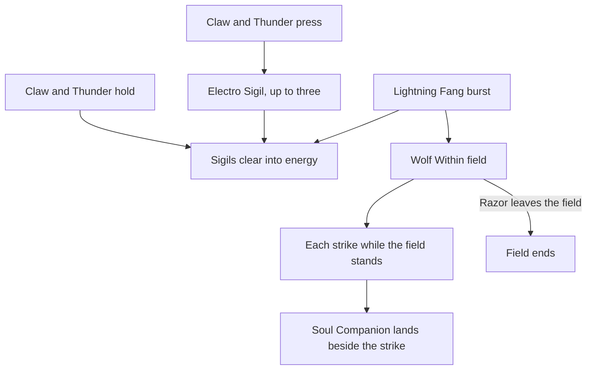

# Razor

Razor's kit is its record and one behaviour module, `createRazorKitBehaviour`, on avatar 10000020 (`~/Esposter.noindex/genshin-dump-backup-6.6/ExcelBinOutput/AvatarExcelConfigData.json`, named Razor in `~/Esposter.noindex/genshin-dump-backup-6.6/TextMap/TextMap_MediumEN.json`): four strikes, a charged attack, a collision and two plunges, Claw and Thunder's press and its hold, and Lightning Fang's blast (`~/Esposter.noindex/cache/genshin-wiki/Category_Razor_Talents.json`). His multipliers are read from proud skill groups 2031, 2032 and 2039 (`~/Esposter.noindex/genshin-dump-backup-6.6/ExcelBinOutput/ProudSkillExcelConfigData.json`), and match the wiki's Steel Fang, Claw and Thunder and Lightning Fang values to two decimal places (level 1 of group 2031 is 0.9592 for the first strike, the wiki's 95.92% in `~/Esposter.noindex/cache/genshin-wiki/Category_Razor_Talents.json`). An Electro Sigil's Energy Recharge, energy and seconds, the press's and the hold's cooldowns, and the Soul Companion's share, the Electro RES bonus, the Wolf Within's seconds and the burst's cooldown and cost are read from the same groups (2032 at indices 2 to 6, 2039 at indices 1 and 3 to 6). The press's Electro Sigils and their clearing into energy by the hold and the burst, and Lightning Fang's Wolf Within with its Soul Companion beside each strike and its Electro RES, are built over the shared effects, with Awakening's cooldown cut and reset from Ascension 1 and Lupus Fulguris's lightning from six constellations, with Wolf's Instinct's all-DMG bonus from Constellation 1 and Bite's DEF cut from Constellation 4. The Wolf Within's ATK SPD, its disabled charged attack and its energy back as Razor leaves the field, Hunger, and his other constellations and Hexerei kit are not built.

## How it works

## Decisions

- **Razor's Electro Sigils are one Energy Recharge buff.** Each press gives a sigil as it starts, up to three, as a buff of the skill group's 20% Energy Recharge a sigil, restarted at its 18 seconds, and the count is read back off the buff. The hold at its hit, 55 frames, and the burst at 7 frames clear them, each sigil giving Razor the group's 5 energy, capped at his burst's cost, through a one-tick field. The 20%, 5 energy and 18 seconds are the wiki's Claw and Thunder page (`~/Esposter/cache/genshin-wiki/Category_Razor_Talents.json`) and group 2032's indices 2 to 4 (`~/Esposter.noindex/genshin-dump-backup-6.6/ExcelBinOutput/ProudSkillExcelConfigData.json`). The hold's clear is `~/Esposter/cache/gcsim-v2.47.2/internal/characters/razor/skill.go`, line 172 and the burst's `~/Esposter/cache/gcsim-v2.47.2/internal/characters/razor/burst.go`, line 73, each giving energy at `~/Esposter/cache/gcsim-v2.47.2/internal/characters/razor/skill.go`, line 240, and the cap is the burst's cost, as the kit's `Math.min` reads it and as the [kits README](../README.md#framework-decisions) gives a flat gain up to a burst's cost (`gainPartyMemberEnergy`). The wiki and gcsim give a sigil on striking an opponent (the wiki's "Upon striking an opponent", `~/Esposter.noindex/cache/genshin-wiki/Category_Razor_Talents.json`, and `~/Esposter/cache/gcsim-v2.47.2/internal/characters/razor/skill.go`, line 121, `addSigil`), but no hit writes the team's effects as it strikes, so the press gives it struck or not. A drop's energy reads the combatant's own Energy Recharge, `packages/genshin-world/src/services/party/gainPartyEnergy.ts`, line 30, not its buffs, so the sigils raise no drop's energy yet.
- **The Wolf Within is a field that ends as Razor leaves the field.** It stands from Lightning Fang's hit at 32 frames (`~/Esposter/cache/gcsim-v2.47.2/internal/characters/razor/burst.go`, line 24, `burstHitmark`) for the burst group's 15 seconds (2039 index 4, `~/Esposter.noindex/genshin-dump-backup-6.6/ExcelBinOutput/ProudSkillExcelConfigData.json`, and the wiki's Lightning Fang duration of 15s, `~/Esposter.noindex/cache/genshin-wiki/Category_Razor_Talents.json`). Its first tick, at the hit, gives Razor the group's 80% Electro RES as a buff (2039 index 3, the same dump, and the wiki's Electro RES Bonus of 80%, `~/Esposter.noindex/cache/genshin-wiki/Category_Razor_Talents.json`), which marks the Wolf Within standing, and resets his skill's cooldown from Ascension 1, as Awakening (`~/Esposter/cache/gcsim-v2.47.2/internal/characters/razor/asc.go`, line 24, `a1CDReset`) and gcsim's burst give it (`~/Esposter/cache/gcsim-v2.47.2/internal/characters/razor/burst.go`, line 38). Leaving the field ends the field and the buff on the swap's kit event, as the wiki's "These effects end when Razor leaves the battlefield" (`~/Esposter.noindex/cache/genshin-wiki/Category_Razor_Talents.json`) and gcsim's swap give it (`~/Esposter/cache/gcsim-v2.47.2/internal/characters/razor/burst.go`, line 125, `onSwapClearBurst`).
- **The Soul Companion is cast by each strike while the Wolf Within stands.** A strike's start casts a summon that lands 1U of Electro at the burst group's 24% of the strike's multiplier (2039 index 1, `~/Esposter.noindex/genshin-dump-backup-6.6/ExcelBinOutput/ProudSkillExcelConfigData.json`) a frame past the strike's hit, reaching gcsim's circle or box beside each strike with the wiki's poise (`~/Esposter.noindex/cache/genshin-wiki/Category_Razor_Talents.json`, Lightning Fang's Soul Companion rows). gcsim queues it from the strike's hit, as the strike's callback (`~/Esposter/cache/gcsim-v2.47.2/internal/characters/razor/attack.go`, line 67, `wolfBurst` at `~/Esposter/cache/gcsim-v2.47.2/internal/characters/razor/burst.go`, line 83, its `QueueAttack` one frame on at `~/Esposter/cache/gcsim-v2.47.2/internal/characters/razor/burst.go`, line 119), so here it lands on whichever enemies its own reach holds, even when the strike misses or is cut short. It is priced under the Elemental Burst internal cooldown: the wiki tags it "Elemental Burst Extra" in Lightning Fang's advanced properties (`~/Esposter.noindex/cache/genshin-wiki/Category_Razor_Talents.json`), and gcsim tags only Lightning Fang (`~/Esposter/cache/gcsim-v2.47.2/internal/characters/razor/burst.go`, line 54) and the Wolf Within (`~/Esposter/cache/gcsim-v2.47.2/internal/characters/razor/burst.go`, line 93) with an elemental burst tag, so no other hit of his carries one.
- **Lupus Fulguris's recharge is its lightning's summon.** From six constellations (the wiki's Steel Fang page, constellation 6, `~/Esposter.noindex/cache/genshin-wiki/Category_Razor_Talents.json`), a strike while none of his lightning stands casts one, 100% of his ATK as 1U of Electro with the wiki's 69 poise a frame past the strike, which stands until 10 seconds past the strike's hit, so the first strike after it releases the next. The 10 seconds are gcsim's 600-frame status set at the hit (`~/Esposter/cache/gcsim-v2.47.2/internal/characters/razor/cons.go`, line 83, `c6cb` at `~/Esposter/cache/gcsim-v2.47.2/internal/characters/razor/cons.go`, line 74), and the 100% is gcsim's `Mult: 1` (`~/Esposter/cache/gcsim-v2.47.2/internal/characters/razor/cons.go`, line 94). Outside the Wolf Within it gives Razor a sigil as it is cast, struck or not, as the press's is; gcsim's `sigilcb` gives it on the lightning's hit, outside the burst (`~/Esposter/cache/gcsim-v2.47.2/internal/characters/razor/cons.go`, line 97 to `~/Esposter/cache/gcsim-v2.47.2/internal/characters/razor/cons.go`, line 102). The lightning's reach is the strike's own, as the record gives it, which is open against gcsim's 1.5-metre circle on the enemy struck (`~/Esposter/cache/gcsim-v2.47.2/internal/characters/razor/cons.go`, line 107), as [Provisional constants](#provisional-constants) records. The lightning carries no kind of attack, as gcsim tags it `AttackTagNone` beside a `TODO: it has another tag?` (`~/Esposter/cache/gcsim-v2.47.2/internal/characters/razor/cons.go`, line 88), and as [the kits README](../README.md#framework-decisions) reads a hit whose wiki entry names no damage kind. A drown or a jump clearing it is open, as no cached source gives it and the kit has no such clear.
- **Razor's areas are priced with their offsets.** gcsim centres his strikes a metre, half a metre, a metre and 1.8 metres ahead of the body (`~/Esposter/cache/gcsim-v2.47.2/internal/characters/razor/attack.go`, line 21), his Soul Companion's hits on the same offsets (`~/Esposter/cache/gcsim-v2.47.2/internal/characters/razor/burst.go`, line 20), the press's 240-degree fan a metre ahead (`~/Esposter/cache/gcsim-v2.47.2/internal/characters/razor/skill.go`, line 113) and his plunges a metre ahead (`~/Esposter/cache/gcsim-v2.47.2/internal/characters/razor/plunge.go`, line 92, `~/Esposter/cache/gcsim-v2.47.2/internal/characters/razor/plunge.go`, line 142), and the second strike's and its companion's boxes reach their far corners.
- **Wolf's Instinct reads whether Razor is on the field.** Its bonus from Constellation 1 is raised only when Razor is the active character, as gcsim's `~/Esposter/cache/gcsim-v2.47.2/internal/characters/razor/cons.go` checks `Player.Active()` against him before the bonus (`~/Esposter/cache/gcsim-v2.47.2/internal/characters/razor/cons.go`, line 23), so the pickup reads the kit's active combatant and not the team's. The 10% and the 8 seconds are `~/Esposter/cache/gcsim-v2.47.2/internal/characters/razor/cons.go`, line 19 and `~/Esposter/cache/gcsim-v2.47.2/internal/characters/razor/cons.go`, line 27.
- **Bite's DEF cut is the press's enemy status.** From Constellation 4 (the wiki's Claw and Thunder page, constellation 4, `~/Esposter.noindex/cache/genshin-wiki/Category_Razor_Talents.json`), the press's hit gives each enemy it strikes a status that takes 15% of its DEF for 7 seconds, which the defence a hit reads takes in the game's formula. gcsim gives it through `c4cb` (`~/Esposter/cache/gcsim-v2.47.2/internal/characters/razor/cons.go`, line 59, the 15% and 7 seconds at `~/Esposter/cache/gcsim-v2.47.2/internal/characters/razor/cons.go`, line 65 and `~/Esposter/cache/gcsim-v2.47.2/internal/characters/razor/cons.go`, line 66), set on the press alone (`~/Esposter/cache/gcsim-v2.47.2/internal/characters/razor/skill.go`, line 100), so the hold's hit gives none.
- **Constellation 2's CRIT Rate is read off the enemy's health.** The hook reads the enemy it lands on, as the [kits README](../README.md#shared-effects) gives, so the below-30% check reads its health as Yanfei's Constellation 2 does, and each of his strikes takes it, as the text gives it. gcsim's `c2` gives the same 10% below 30% HP (`~/Esposter/cache/gcsim-v2.47.2/internal/characters/razor/cons.go`, line 37, `~/Esposter/cache/gcsim-v2.47.2/internal/characters/razor/cons.go`, line 49).

## Provisional constants

- **Claw and Thunder's hold is reached at half a second, provisionally.** The seconds a press must be held are in no table or wiki page, so it is the index's half second until the roadmap's References sought list's `razor-claw-and-thunder.mkv` measures it. The hold plays on its release, its hit and animation gcsim's 55 and 103 frames counted from there (`~/Esposter/cache/gcsim-v2.47.2/internal/characters/razor/skill.go`, line 19, `~/Esposter/cache/gcsim-v2.47.2/internal/characters/razor/skill.go`, line 52). The press's wider fan and later frames during Lightning Fang are not built, so the press and the hold play their frames outside it throughout.
- **Razor's charged attack is provisional.** gcsim does not model it, and the wiki gives no frames, so its slashes are priced at half a second and a second, the charge ends at a second and a fifth, and the table's 40 stamina a second drains as it plays (the wiki's 40/s, group 2031's index 6). Its damage is the wiki's cyclic 62.5% and final 113%, and its poise the wiki's 60 and 120. The wiki's Steel Fang page gives a 5-second maximum duration for the charge, not its end, so the 1.2-second end is not settled by it.
- **Lupus Fulguris's poise and gauge are open.** The 69 poise and 1U gauge are the wiki's, from its Lupus Fulguris page, which is not in the cache, and gcsim's `c6cb` gives the lightning no poise (`~/Esposter/cache/gcsim-v2.47.2/internal/characters/razor/cons.go`, line 74), so the record's `Unsourced` values stand until the page is cached.
- **Lupus Fulguris's reach is open.** The lightning covers the strike's own area, as the record gives it. gcsim centres a 1.5-metre circle on the enemy struck (`~/Esposter/cache/gcsim-v2.47.2/internal/characters/razor/cons.go`, line 107), and no cached source settles which the game uses here.
- **An enemy's strike being physical is open.** No cached source gives an enemy's strike its element, so the Wolf Within's Electro RES changes no damage yet, as the kit assumes, without a source to settle it.

## Not built

- **Awakening, from Ascension 1, is built. Razor's other passives, the kit effects of his third and fifth constellations, and his Hexerei kit are not built.** The Wolf Within's ATK SPD has no attribute here, its disabled charged attack no hook, as a charged attack starts without reading the team's effects, and its Electro on Razor no place to sit; its interruption resistance and Electro-Charged immunity have nothing to act on either. Its energy back as Razor leaves the field, up to 10 (the wiki's Lightning Fang page), is not built, as no source gives how the seconds left turn into energy. Hunger's Energy Recharge below half energy (the wiki's Hunger page, `~/Esposter/cache/gcsim-v2.47.2/internal/characters/razor/asc.go`, line 32) has no hook, as a passive bonus reads the combatant alone, which holds no energy, and a drop's energy reads no bonus. Wolvensprint's sprint stamina is not combat, which is open: its wiki page is not in the cache. Soul Companion and Sharpened Claws raise talent levels, which the [talents](../../talents/design.md) page holds; the wiki's Claw and Thunder page names Sharpened Claws as constellation 5 but gives no talent level, so that is open too. His Hexerei kit, its Surge of Lightning (the wiki's page, which gives the Wolf Within's DMG 70% of his ATK), its Soul Companion's added 70% of his ATK and its Lupus Fulguris's three sigils and CRIT, is not built: gcsim turns it on by default (`~/Esposter/cache/gcsim-v2.47.2/internal/characters/razor/razor.go`, line 28 to `~/Esposter/cache/gcsim-v2.47.2/internal/characters/razor/razor.go`, line 33), and its sigils (`~/Esposter/cache/gcsim-v2.47.2/internal/characters/razor/skill.go`, line 198) and CRIT (`~/Esposter/cache/gcsim-v2.47.2/internal/characters/razor/cons.go`, line 114) are the Hexerei gates it reads; the kit follows the standard kit.

## Key files

| File                                                             | Role                                                                                                                                                                        |
| :--------------------------------------------------------------- | :-------------------------------------------------------------------------------------------------------------------------------------------------------------------------- |
| `packages/genshin-world/src/services/kit/characters/razorKit.ts` | `createRazorKitBehaviour`, Razor's kit with the Electro Sigils, the Wolf Within and its Soul Companion, and Lupus Fulguris's lightning, Wolf's Instinct, and Bite's DEF cut |

## Sources

- [Steel Fang](https://genshin-impact.fandom.com/wiki/Steel_Fang), [Claw and Thunder](https://genshin-impact.fandom.com/wiki/Claw_and_Thunder) and [Lightning Fang](https://genshin-impact.fandom.com/wiki/Lightning_Fang), Genshin Impact Wiki: Razor's strikes', charged attack's and plunges' gauges, internal cooldown tags and poise, the press's and the hold's gauges and poise and the Electro Sigils, and the burst's and the Soul Companion's gauges, tags and poise, the Wolf Within's effects, their end as Razor leaves the field and the energy back. Cached at `~/Esposter/cache/genshin-wiki/Category_Razor_Talents.json`, the pages named in its titles, read by their infobox, advanced properties and scaling table.
- [Awakening](https://genshin-impact.fandom.com/wiki/Awakening), [Hunger](https://genshin-impact.fandom.com/wiki/Hunger), [Wolvensprint](https://genshin-impact.fandom.com/wiki/Wolvensprint), [Wolf's Instinct](https://genshin-impact.fandom.com/wiki/Wolf%27s_Instinct), [Suppression](https://genshin-impact.fandom.com/wiki/Suppression), [Bite](https://genshin-impact.fandom.com/wiki/Bite), [Lupus Fulguris](https://genshin-impact.fandom.com/wiki/Lupus_Fulguris) and [Team Bonus](https://genshin-impact.fandom.com/wiki/Team_Bonus), Genshin Impact Wiki: Razor's passives and constellations, the lightning's gauge and poise, and the Hexerei team bonus his Hexerei kit needs. Awakening and Hunger are cached in the same file; Wolvensprint, Suppression, Bite, Wolf's Instinct, Lupus Fulguris and Team Bonus are not.
- [gcsim v2.47.2](https://github.com/genshinsim/gcsim/tree/v2.47.2/internal/characters/razor), MIT: the kit's hitmarks, cancel frames and areas, the charged attack's areas, the sigils' clearing frames, the Soul Companion's frame and reach, the burst's end on a swap, Awakening's cut and reset, Lupus Fulguris's recharge and reach, Wolf's Instinct's gate and bonus from Constellation 1 and Bite's DEF cut from Constellation 4 in `~/Esposter/cache/gcsim-v2.47.2/internal/characters/razor/cons.go`, and the Hexerei kit it turns on by default. The snapshot is on disk at `~/Esposter/cache/gcsim-v2.47.2/internal/characters/razor/`, and the line numbers above read it.
- The proud skill groups' indices, read from `~/Esposter/genshin-parity/text/ExcelBinOutput/ProudSkillExcelConfigData.json`, rows of groups 2031, 2032 and 2039 at levels 1 to 15.
