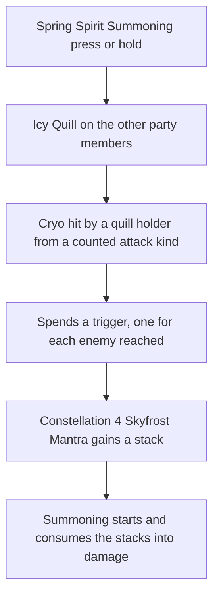

# Shenhe

Shenhe's kit is its record and one behaviour module, `createShenheKitBehaviour`, on avatar 10000063: five strikes, a charged attack, a collision and two plunges (`{data-root}/cache/genshin-wiki/Category_Shenhe_Talents.json`), Spring Spirit Summoning's press and its hold, and Divine Maiden's Deliverance with its initial hit, the field's DoT ticks, the Ascension 1 Cryo DMG Bonus for an active character inside it, and the RES Decrease its DoT gives. Her multipliers are read from proud skill groups 6331, 6332 and 6339 (`{data-root}/genshin-dump-backup-6.6/ExcelBinOutput/ProudSkillExcelConfigData.json`); the charged attack's stamina, the press's and hold's cooldowns, and the burst's energy cost and cooldown are read from the same groups. The field stands 2 metres ahead of the body (gcsim's `{data-root}/cache/gcsim-v2.47.2/internal/characters/shenhe/burst.go` line 48 for "burstArea", its centre at line 49), and each DoT tick's two hits are summoned there (`{data-root}/cache/gcsim-v2.47.2/internal/characters/shenhe/burst.go` lines 77 and 82 to 86). Spring Spirit Summoning's press and hold give the other party members her Icy Quill, whose ATK-based Cryo DMG her kit's party strike hook prices and whose triggers each Cryo hit spends. Constellations 4 and 6 are built on the quill, and her other passives sit outside the kit. The hold's threshold is provisional.

## How it works

## Decisions

- **Shenhe's strikes, charged attack, plunges, skill and DoT ticks take the wiki's poise.** The strikes take the wiki's 46.08, 43.44, 56.31, 27.88 and 73.6 per strike, with 27.88 on each of the fourth strike's two hits, and the charged attack the wiki's 120 (`{data-root}/cache/genshin-wiki/Category_Shenhe_Talents.json`). The plunge collision's 25 is the wiki's too, and the plunges take the wiki's 150 high and 100 low. Spring Spirit Summoning's press takes the wiki's 100 and its hold 200, and Divine Maiden's Deliverance's DoT ticks 50 each. Her plunges' reaches and 0.4 seconds are the other kits' stand-ins.
- **Spring Spirit Summoning's hold begins at 0.5 seconds.** Provisional: gcsim reads the hold from the input alone, as it does for Eula and Diona.
- **Divine Maiden's Deliverance's RES Decrease holds between its DoT ticks.** `packages/genshin-world/src/services/kit/characters/shenheKit.ts` holds the decrease for one tick interval from each tick, the 117 frames the record reads, where gcsim adds a 36-frame shred every 18 frames (`{data-root}/cache/gcsim-v2.47.2/internal/characters/shenhe/burst.go` lines 90 to 91, and 113 to 119).
- **Constellation 1's extra use is a skill charge.** Constellation 1 adds one charge to Spring Spirit Summoning, as the [kits README](../README.md#framework-decisions) gives, and the game's talent 631 says Spring Spirit Summoning "can be used 1 more time" (`{data-root}/genshin-dump-backup-6.6/ExcelBinOutput/AvatarTalentExcelConfigData.json`, with its text in `{data-root}/genshin-parity/text/TextMap/TextMap_MediumEN.json`).
- **The Icy Quill is held by the other party members, not by Shenhe.** Her kit's party strike hook never prices her own strikes, and the quill's "nearby party members" is read as the rest of the deployed team. The hook's ATK is Shenhe's buffed ATK, read through the team's combatant map the strike loop hands the hook.
- **Each Cryo hit a quill holder strikes from an attack kind spends a trigger, one per enemy it reaches.** Strikes are priced and their events sent per enemy, so a strike reaching several enemies spends one trigger for each. The enemy hit events carry the strike's attack tag, and only the five kinds the quill names count, so a reaction or a field's tick neither adds the bonus nor spends a trigger. Constellation 6 exempts a Normal or Charged Attack trigger from the quota while still giving its bonus (`{data-root}/cache/gcsim-v2.47.2/internal/characters/shenhe/skill.go` lines 189 to 191). Constellation 4's Skyfrost Mantra gains a stack per trigger, and Spring Spirit Summoning consumes the stacks as it starts into 5% DMG per stack on its hits (`{data-root}/cache/genshin-wiki/Category_Shenhe_Talents.json`, Insight; `{data-root}/cache/gcsim-v2.47.2/internal/characters/shenhe/cons.go` lines 25 to 29). The empowerment's window is the press action's length, flagged: the wiki gives none, and a hold's own length is not read.
- **The quill's seconds and triggers do not change with the skill's level.** Its ratio is read at the start level, 45.656% of ATK (group 6332's index 2 at level 1, which reaches 108.433% at level 15, `{data-root}/genshin-dump-backup-6.6/ExcelBinOutput/ProudSkillExcelConfigData.json`).
- **Constellation 2 extends the field by six seconds, and gives the active character Cryo CRIT DMG in it.** gcsim's burst lasts six seconds longer at two constellations (`{data-root}/cache/gcsim-v2.47.2/internal/characters/shenhe/burst.go` lines 57 to 62, and `{data-root}/cache/genshin-wiki/Category_Shenhe_Talents.json`, Centered Spirit), so the kit adds six to the field's seconds where it is cast, and its ticks stay as they are. gcsim's `c2` gives the active character 15% CRIT DMG (`{data-root}/cache/gcsim-v2.47.2/internal/characters/shenhe/shenhe.go` line 50) on her Cryo attacks while she stands in the field (`{data-root}/cache/gcsim-v2.47.2/internal/characters/shenhe/cons.go` lines 13 to 23), so each tick adds an element CRIT DMG effect for the tick's interval, which the strikes of that element by that character price in as CRIT DMG. The effect belongs to the active character, not to Shenhe, and the next tick restarts it rather than stacking it.

## Key files

| File                                                                  | Role                                                                                                                                                                                                                                                                                         |
| :-------------------------------------------------------------------- | :------------------------------------------------------------------------------------------------------------------------------------------------------------------------------------------------------------------------------------------------------------------------------------------- |
| `packages/genshin-world/src/services/kit/characters/shenheKit.ts`     | `createShenheKitBehaviour`, Shenhe's kit with Spring Spirit Summoning's press and hold, Divine Maiden's Deliverance's field, its DoT and its Constellation 2 Cryo CRIT DMG, the Icy Quill's Constellation 4 Skyfrost Mantra and Constellation 6 quota exemption, and her strikes and plunges |
| `packages/genshin-world/src/services/kit/getDeployedStrikeBonuses.ts` | Hands each deployed member's party strike hook the team's combatant map, so the Icy Quill reads Shenhe's buffed ATK                                                                                                                                                                          |

## Sources

- [gcsim](https://github.com/genshinsim/gcsim/tree/v2.47.2/internal/characters/shenhe), MIT: the kit's hitmarks, cancel frames and areas, Spring Spirit Summoning's press and hold frames and circles, Divine Maiden's Deliverance's initial hit, its 250 poise, field, DoT ticks and offsets, the Ascension 1 Cryo DMG Bonus and the RES Decrease.
- [Spring Spirit Summoning](https://genshin-impact.fandom.com/wiki/Spring_Spirit_Summoning) and [Divine Maiden's Deliverance](https://genshin-impact.fandom.com/wiki/Divine_Maiden%27s_Deliverance), Genshin Impact Wiki: the skill's press and hold poise and the DoT ticks' poise, gauge and internal cooldown tag.
- The Genshin Impact Wiki's Shenhe talents, cached at `{data-root}/cache/genshin-wiki/Category_Shenhe_Talents.json`, checked against the dump's proud skill group 6332 for the Icy Quill's ratio (45.7% of ATK at level 1, 108.4% at level 15), its 10 and 15 seconds (group 6332's indices 7 and 8, the quill's own durations at `{data-root}/cache/gcsim-v2.47.2/internal/characters/shenhe/skill.go` line 91 and line 148), its 5 and 7 triggers (indices 5 and 6), and the texts of Constellations 4 and 6 from the dump's talent table, which the cached wiki's Constellation 4 note (Insight) and gcsim's `{data-root}/cache/gcsim-v2.47.2/internal/characters/shenhe/cons.go` lines 25 to 29 give the same way.
- `{data-root}/cache/genshin-wiki/Category_Shenhe_Talents.json`: grounds "Shenhe's strikes, charged attack and plunges".
- `{data-root}/cache/gcsim-v2.47.2/internal/characters/shenhe/skill.go` lines 50 to 53: grounds "Spring Spirit Summoning's hold past half a second".
- `{data-root}/cache/gcsim-v2.47.2/internal/characters/shenhe/burst.go` lines 50 to 55: grounds "Divine Maiden's Deliverance initial hit and field".
- `{data-root}/cache/gcsim-v2.47.2/internal/characters/shenhe/burst.go` line 48: grounds "Divine Maiden's Deliverance initial hit and field".
- `{data-root}/cache/gcsim-v2.47.2/internal/characters/shenhe/burst.go` lines 82 to 86: grounds "Divine Maiden's Deliverance initial hit and field".
- `{data-root}/cache/gcsim-v2.47.2/internal/characters/shenhe/burst.go` lines 97 to 104: grounds "Ascension 1 Cryo DMG Bonus in the field".
- `{data-root}/cache/gcsim-v2.47.2/internal/characters/shenhe/shenhe.go` lines 31 to 32: grounds "Constellation 1 charge".
- `{data-root}/cache/gcsim-v2.47.2/internal/characters/shenhe/burst.go` lines 59 to 62: grounds "Constellation 2 extends the field".
- `{data-root}/cache/gcsim-v2.47.2/internal/characters/shenhe/cons.go` lines 13 to 22: grounds "Constellation 2 gives the active character Cryo CRIT DMG in the field".
- `{data-root}/cache/gcsim-v2.47.2/internal/characters/shenhe/shenhe.go` lines 48 to 50: grounds "Constellation 2 gives the active character Cryo CRIT DMG in the field".
- `{data-root}/cache/gcsim-v2.47.2/internal/characters/shenhe/burst.go` lines 107 to 108: grounds "Constellation 2 gives the active character Cryo CRIT DMG in the field".
- `{data-root}/cache/gcsim-v2.47.2/internal/characters/shenhe/skill.go` lines 91 to 92: grounds "Icy Quill from Spring Spirit Summoning's press".
- `{data-root}/cache/gcsim-v2.47.2/internal/characters/shenhe/skill.go` lines 148 to 149: grounds "Icy Quill from Spring Spirit Summoning's hold".
- `{data-root}/cache/gcsim-v2.47.2/internal/characters/shenhe/skill.go` lines 176 to 217: grounds "Icy Quill's bonus and trigger on a Cryo hit".
- `{data-root}/cache/gcsim-v2.47.2/internal/characters/shenhe/zz_shenhe.dm.go` line 197: grounds "Icy Quill's bonus and trigger on a Cryo hit".
- `{data-root}/cache/gcsim-v2.47.2/internal/characters/shenhe/skill.go` lines 203 to 206: grounds "Icy Quill's bonus and trigger on a Cryo hit".
- `{data-root}/cache/gcsim-v2.47.2/internal/characters/shenhe/cons.go` lines 54 to 59: grounds "Constellation 4 Skyfrost Mantra stacks".
- `{data-root}/cache/gcsim-v2.47.2/internal/characters/shenhe/cons.go` lines 37 to 38 and 42: grounds "Constellation 4 Skyfrost Mantra consumed by Spring Spirit Summoning".
- `{data-root}/cache/gcsim-v2.47.2/internal/characters/shenhe/skill.go` lines 74 and 136: grounds "Constellation 4 Skyfrost Mantra consumed by Spring Spirit Summoning".
- `{data-root}/cache/genshin-wiki/Category_Shenhe_Talents.json`, the Insight text: grounds "Constellation 4 Skyfrost Mantra consumed by Spring Spirit Summoning".
- `{data-root}/cache/gcsim-v2.47.2/internal/characters/shenhe/skill.go` lines 189 and 191: grounds "Constellation 6 exempts normal and charged attack triggers".
- `{data-root}/cache/gcsim-v2.47.2/internal/characters/shenhe/attack.go` line 24: grounds scenario "Five strikes in sequence".
- `{data-root}/cache/genshin-wiki/Category_Shenhe_Talents.json`, the Plunging Attack text: grounds scenario "Plunge lands on the enemies in reach".
- `{data-root}/cache/gcsim-v2.47.2/internal/characters/shenhe/skill.go` line 87: grounds scenario "Tap plays the press".
- `{data-root}/cache/gcsim-v2.47.2/internal/characters/shenhe/skill.go` lines 137 to 144: grounds scenario "Hold past half a second plays the hold".
- `{data-root}/cache/gcsim-v2.47.2/internal/characters/shenhe/shenhe.go` line 32: grounds scenario "Constellation 1 adds a charge".
- `{data-root}/cache/gcsim-v2.47.2/internal/characters/shenhe/shenhe.go` line 31: grounds scenario "Constellation 0 adds nothing".
- `{data-root}/cache/gcsim-v2.47.2/internal/characters/shenhe/burst.go` line 62: grounds scenario "Constellation 2 extends the field".
- `{data-root}/cache/gcsim-v2.47.2/internal/characters/shenhe/burst.go` line 60: grounds scenario "Constellation 1 leaves the field as its base".
- `{data-root}/cache/gcsim-v2.47.2/internal/characters/shenhe/cons.go` lines 17 to 20: grounds scenario "The active character in the field gains Cryo CRIT DMG".
- `{data-root}/cache/gcsim-v2.47.2/internal/characters/shenhe/burst.go` line 94: grounds scenario "A character outside the field gains nothing".
- `{data-root}/cache/gcsim-v2.47.2/internal/characters/shenhe/shenhe.go` line 48: grounds scenario "Constellation 1 gives no CRIT DMG".
- `{data-root}/cache/gcsim-v2.47.2/internal/characters/shenhe/skill.go` lines 204 and 217: grounds scenario "A Cryo hit adds Shenhe's ATK and spends a trigger".
- `{data-root}/cache/gcsim-v2.47.2/internal/characters/shenhe/skill.go` line 206: grounds scenario "A Cryo hit adds Shenhe's ATK and spends a trigger".
- `{data-root}/cache/gcsim-v2.47.2/internal/characters/shenhe/skill.go` lines 180 to 181 and 199 to 200: grounds scenario "Other hits add nothing".
- `{data-root}/cache/gcsim-v2.47.2/internal/characters/shenhe/skill.go` lines 193 to 194: grounds scenario "A hit from no attack kind adds nothing".
- `{data-root}/cache/gcsim-v2.47.2/internal/characters/shenhe/burst.go` line 69: grounds scenario "A hit from no attack kind adds nothing".
- `{data-root}/cache/gcsim-v2.47.2/internal/characters/shenhe/cons.go` lines 54 to 55: grounds scenario "A trigger gives a stack from Constellation 4".
- `{data-root}/cache/gcsim-v2.47.2/internal/characters/shenhe/skill.go` lines 218 to 220: grounds scenario "A trigger gives a stack from Constellation 4".
- `{data-root}/cache/gcsim-v2.47.2/internal/characters/shenhe/cons.go` line 31: grounds scenario "No stack below Constellation 4".
- `{data-root}/cache/gcsim-v2.47.2/internal/characters/shenhe/skill.go` lines 186 and 205 to 206: grounds scenario "A skill still spends the quota".
- `{data-root}/cache/gcsim-v2.47.2/internal/characters/shenhe/cons.go` lines 38 and 42: grounds scenario "Spring Spirit Summoning consumes the stacks".
