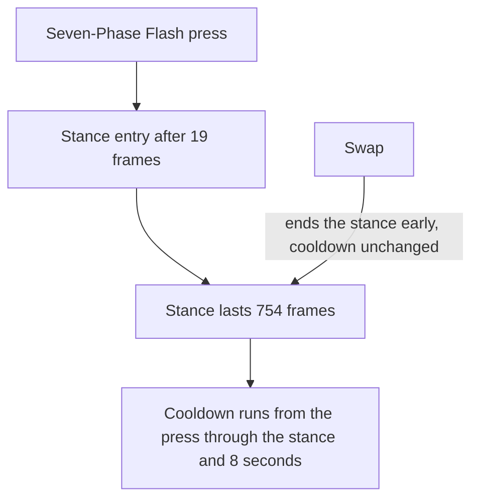

# Skirk

Skirk's kit is its record and one behaviour module, `createSkirkKitBehaviour`, on avatar 10000114 (`~/Esposter/genshin-parity/text/ExcelBinOutput/AvatarExcelConfigData.json`): five strikes, a charged attack of two hits, a collision and two plunges (`~/Esposter/cache/genshin-wiki/Category_Skirk_Talents.json`, Havoc: Sunder), and Seven-Phase Flash, whose press enters a stance of its own strikes and charged attack. Her multipliers are read from proud skill groups 11431, 11432 and 11439 (`~/Esposter/genshin-parity/text/ExcelBinOutput/ProudSkillExcelConfigData.json`), her normal strikes and charged attack from the first, her Seven-Phase Flash's from the second and Havoc: Ruin's from the third. Her skill's cooldown is 8 seconds, counted from the end of the Seven-Phase Flash as gcsim counts it (`~/Esposter/cache/gcsim-v2.47.2/internal/characters/skirk/skill.go:87`; the wiki's Havoc: Warp CD of 8s), her burst's 15 seconds (group 11439's index 7; the wiki's Havoc: Ruin CD of 15s), and the charged attack costs 20 stamina (group 11431's index 7). Her burst costs no energy (the wiki's Havoc: Ruin text, `Category_Skirk_Talents.json`), so its gate is her Serpent's Subtlety, which is not built.

## How it works

## Decisions

- **Seven-Phase Flash is a stance that starts 19 frames on from its press.** Its press lands no hit, so its action has no hits and animates for 43 frames, and a task runs after 19 frames to add the stance, as gcsim's skill enters its state after its delay (`~/Esposter/cache/gcsim-v2.47.2/internal/characters/skirk/skill.go:24`, `skill.go:25`, `skill.go:33`). The stance lasts 754 frames from then (`skill.go:25`). Its strikes are the Seven-Phase Flash's five normal attacks in Cryo (`~/Esposter/cache/gcsim-v2.47.2/internal/characters/skirk/attack.go:170`), and its charged attack is three Cryo slashes (`~/Esposter/cache/gcsim-v2.47.2/internal/characters/skirk/charge.go:19`, `:92`), both from gcsim's stance attack and charge handlers.
- **The stance's attack tags are gcsim's.** Its normal attacks are `AttackTagNormal` in gcsim's `attack.go` (`~/Esposter/cache/gcsim-v2.47.2/internal/characters/skirk/attack.go:166`), read as `NormalAttack`, its charged attack `AttackTagExtra` in `charge.go` (`~/Esposter/cache/gcsim-v2.47.2/internal/characters/skirk/charge.go:88`), read as `ChargedAttack`, and its burst reads as `ElementalBurst`, the kind of the group it plays in, and its skill's tag is open below (the burst's `ElementalBurst` at `~/Esposter/cache/gcsim-v2.47.2/internal/characters/skirk/burst.go:59`).
- **Her skill's cooldown runs from the press, through the state's 19 frames and its 754, then gcsim's 8 seconds.** gcsim sets the cooldown when the state exits (`~/Esposter/cache/gcsim-v2.47.2/internal/characters/skirk/skill.go:87`), but a kit's cooldown starts at the press, so the kit sets it to the time the state would run out on its cap and the 8 seconds after. This keeps the skill from being pressed during the state, as gcsim does. An early end, by a swap or by Serpent's Subtlety running out, does not move the cooldown, so the skill comes back late after one. The swap ends the state at once, as gcsim's exit does.
- **Havoc: Ruin is priced by its base hits, and its Extinction is the burst in the stance.** Ruin's five slashes at 109, 111, 114, 125 and 135 frames and its final slash at 158, each Cryo (`~/Esposter/cache/gcsim-v2.47.2/internal/characters/skirk/burst.go:63`) and read at the burst group's index 0 and 1, land on the body's box (`~/Esposter/cache/gcsim-v2.47.2/internal/characters/skirk/burst.go:17`, `burst.go:70`), the final at 158 frames (`burst.go:21`). gcsim queues the final slash apart from the five, so its burst list counts five hits, where the record holds six. Havoc: Extinction, the burst the stance plays in place of Ruin, lands no hit, so its action has no hits and animates for 41 frames (`~/Esposter/cache/gcsim-v2.47.2/internal/characters/skirk/burst.go:37`).
- **Provisional: the plunges are borrowed.** Skirk's gcsim folder has no plunge file (`~/Esposter/cache/gcsim-v2.47.2/internal/characters/skirk/`); her three plunges are priced and landed as Nilou's are, which the index gives. Whether a recording of her plunges agrees is the roadmap's question.
- **Normal attacks take the windup gcsim queues, on the first strike only.** gcsim's first hitmark is 11 frames plus a 2-frame windup (`~/Esposter/cache/gcsim-v2.47.2/internal/characters/skirk/attack.go:14`, `attack.go:19` to `attack.go:20`), so the first strike lands at 13 frames, and the later strikes' hitmarks carry none. Its animation is its default length from a standing start. gcsim shortens the first strike's animation by the windup after a burst or a normal attack, which is not built.

## Not built

- **Serpent's Subtlety is not built.** It is a point count from 0 to 100 that a press, a hold and each absorbed void rift raise, drained by 7 a second, and it gates Havoc: Ruin at 50 points, adds 0.193 ATK to Ruin's final hit per point above 50 up to 12 points, and ends the Seven-Phase Flash when it runs out. The kit has no point count on its state, so Ruin is castable on its 15-second cooldown alone, where gcsim also requires 50 points, and its SS bonus is missing. This waits on a point count in the kit's state, which the framework does not give a character yet.
- **Void Rifts are not built.** Party reactions that freeze, superconduct, swirl Cryo or crystallise Cryo create a rift each, for 17.6 seconds, up to three, and absorbing one on a Seven-Phase Flash charged attack, a hold or Ruin's animation adds points and a hit. `ReactionTriggered` carries the reactions, and each rift can sit as a status under its own id, so holding them is not the gap. An absorbed rift only adds Serpent's Subtlety points, so the rifts wait on that point count.
- **Skill hold is not built.** The Seven-Phase Flash's hold absorbs void rifts for the seconds held and adds 18 points, which waits on the points and rifts above.
- **Havoc: Extinction's bonus is not built.** Its next ten normal attacks gain DMG Bonus from the void rifts absorbed when it was cast, for 12.5 seconds, and it waits on the rifts.
- **The Seven-Phase Flash's plunges are not built.** gcsim gives the stance its own plunge multipliers, at the skill group's indices 9 to 11, and `KitStance` holds no plunge to play in place of the kit's.
- **Constellations 1, 2, 4 and 6 stay unbuilt.** Constellation 1 hits 5 times when a void rift is absorbed, Constellation 2 adds 10 points and 70% ATK to the Seven-Phase Flash, Constellation 4 raises ATK by Ascension 4's stacks, and Constellation 6 strikes on each normal attack in the stance while it holds rifts. They wait on the rifts and points above.
- **Ascension 1 and 4 are not built.** Ascension 1 makes the void rifts above, which wait on Serpent's Subtlety points. Ascension 4 multiplies her Normal Attack and Havoc: Ruin DMG by each Death's Crossing stack's factor, for up to three stacks, one per Hydro or Cryo party member, 20 seconds each. The stacks are observable from KitElementalHitEvent, but the kit sets no hook that raises the talent multiplier they scale: `getStrikeDamageBonus` adds to the DMG Bonus, outside the `(1 + bonus)` factor, and Skirk's module sets no `getStrikeAdditiveBaseDamageBonus`, the flat-base hook a character's module can set.
- **The talent passive is not built.** A team of only Hydro and Cryo members with both present sets gcsim's passive tag on each of them, a tag no kit reads yet, so the passive waits on a party-wide tag the members' hits read.

## Key files

| File                                                             | Role                                                                                                                |
| :--------------------------------------------------------------- | :------------------------------------------------------------------------------------------------------------------ |
| `packages/genshin-world/src/services/kit/characters/skirkKit.ts` | `createSkirkKitBehaviour`, Skirk's kit with her strikes, charged attack and plunges, and Seven-Phase Flash's stance |

## Sources

- [gcsim v2.47.2](https://github.com/genshinsim/gcsim/tree/v2.47.2/internal/characters/skirk), MIT: the strikes' hitmarks, animations and reaches, the Seven-Phase Flash's state, its entry at 19 frames and its 754 frames, the charged attack's slashes and reach, Havoc: Ruin's slashes, final slash, reach and animation, Havoc: Extinction's animation, the cooldowns and energy maximum.
- The proud skill groups 11431, 11432 and 11439 in the hosted game data: each multiplier's index and the cooldowns, read at talent level 1.

## Open

- [ ] **Her skill's attack tag reads as `ElementalSkill`** — no source yet: gcsim's `skill.go` names no elemental skill tag, so no gcsim line gives it.
